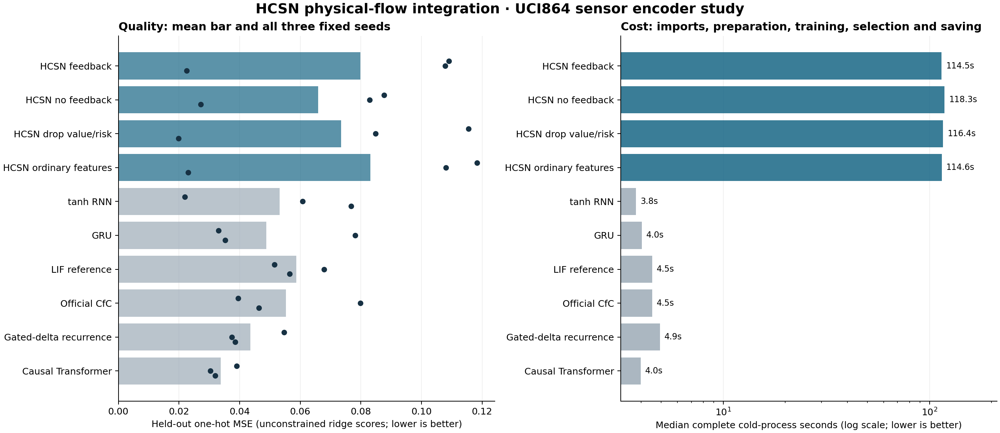

# HCSN 连续流集成：实现与真实流式实验记录

日期：2026-11-22。源代码见 [Draft PR #6958](https://github.com/TrillionniumFoundation/hepta-private-ci/pull/6958)。本记录覆盖审计后的五项接通工作，以及固定计划的 45 个正式运行。

## 实测结论与当前决策

五项优先工作已完成实现并进入可复核实验，但本次结果没有确认完整 HCSN 的质量与耗时综合优势。完整 HCSN 的测试 MSE 为 **0.079779**，小 Transformer 为 **0.033770**；单次完整冷进程耗时中位数分别为 **114.48 秒**和 **3.98 秒**。本设置下 HCSN 的 MSE 约为后者的 2.36 倍，耗时约为 28.79 倍。HCSN 的平均 accuracy 为 91.2%，略高于 Transformer 的 90.1%；因此不能概括为所有指标均落后，但预声明的 MSE 与完整成本均不支持扩大规模。

四个 HCSN 配对消融中，完整模型相对普通特征替代的三个 seed MSE 均略低，平均差为 −0.003359；然而关闭反馈与移除 value/risk 的平均 MSE 都更低。局部特征信号与整套机制有效是不同结论；当前证据不支持 value/risk/flow 已带来稳定任务优势。

条件读出直接解的平均开发 MSE 相对未训练 KEEP 降低约 **70.08%**，完整成本中位数为 **8.69 秒**。有界编辑相对直接解仅改善约 **0.49%**，完整成本却约为其 **4.30 倍**。在五种方法全部执行后的选择中，三个 seed 最终均选择含 BP 的方法：两次 Profile BP、一次 Joint BP。这支持继续扩大有明确适用域的条件直接求解，也支持保留外层 BP，不能据此宣称编辑已替代全网训练。

当前工程决策：保留物理时间语义、解析再生参考、条件读出、候选保持门与 KEEP；将研究分支维持为 Draft，不采用本轮选中的模型，不扩大到全模态联合训练。下一阶段的进入条件应是独立真实任务上完整前向/反向成本与质量的可重复优势，以及更严格的资源对齐。

## 交付与来源

- 运行源码 commit：`abb3e5012c5f48e3cb42759785429cb1d496acb3`；基准为 `b0b4b9a1dc424233621fff394d866b654963f8da`。
- 119 个运行源码文件的 manifest：`1953148571aa943cc20ad531c2268626acd523cf57cb6adb87e700399b7e3be1`。独立 GitHub Git-tree 回读全部匹配。
- 修改按 13 个逻辑提交组织，每个少于 500 变更行；默认 legacy 行为和历史实验保持可复现。
- 精确源码 [CI run 45007458768](https://github.com/TrillionniumFoundation/hepta-private-ci/actions/runs/45007458768)：124 tests，0 failure/error/skip；canonical formatter、显式 Ruff 和 clean-tree 检查全部成功。这是指定源码检查的结果，不代表全部仓库工作流均通过。
- 原始预测、候选状态、未入选结果、所有成本与运行日志在 [evidence.zip](evidence.zip)，SHA256 为 `e27ae1925f3524f978d278fec64ac5961a131c513c3bcc7cea64021ab5bba992`，共 3,055,428 bytes、512 项。机器汇总为 [summary.json](summary.json)，核验摘要为 [verification.json](verification.json)，保存模型的独立重放摘要为 [selected_replay.json](selected_replay.json)；逐项检查记录完整保留在压缩包内。复核步骤见 [REPRODUCE.md](REPRODUCE.md)。
- 全仓 CI 的独立状态快照见 [repository_ci_context.json](repository_ci_context.json)。指定 HCSN 源码检查通过，不等于全仓 CI 通过；格式检查与既有 Windows/learning 失败按基准逐项比较，额外首次 attempt timeout 保留为未归因。

## 五项实现

1. **统一时间与事件量。** `step_physical` 分开 event-mask 与每秒连续写入率，明确首次事件概率、贴现首次事件、重复事件数、occupation 积分与 continuation value。初始不应期群体参与总体风险。重复事件数可跨区间相加；区间首次事件概率不能直接相加为全窗口风险。
2. **内容进入动力学。** 上一状态的 active/refractory 标记内容经有界投影进入漂移、边界、奖励。四个 HCSN 消融采用同参数配置、同初始权重、同状态容量与输入/批次计划，各自独立训练；关闭 route 后相应参数不活跃。反馈在声明区间起点更新，区间内保持。
3. **接通解析再生参考。** 固定漂移/扩散、reset、确定不应期的独立 Brownian 参考包含重复首达、计数矩、贴现事件及再生价值。测试直接比较实际有限生成元，并显式检查有限 Erlang 不应期的提前释放误差。
4. **直接解、编辑与 BP 共存。** 多目标读出共用一次中心化 SVD；profile/joint 路径保留真实 BP。候选受开发集改进和传入保持集约束；不满足时返回 KEEP。固定程序的编辑 delta 与独立读出求解成本分别记录。
5. **真实传感器 encoder。** 用真实时间差与因果窗口运行四个 HCSN arm、六个参考模型，并保存从开发集选择的模型及一次最终测试预测。外层记录冷进程全部时间。

细分一致性的适用域是同一物理控制路径：输入、反馈导出的生成元/边界/奖励以及写入事件保持相同。此时状态传播以及可加的计数、occupation 积分满足 semigroup 一致性。在新增区间端点重算反馈会改变过程；risk 暴露汇总和按端点求值的池化一般也不具有这种细分不变性。本轮没有证明整个闭环 encoder 对任意重采样等价。

## 流式 encoder 协议

使用 [UCI Room Occupancy Estimation](https://archive.ics.uci.edu/dataset/864/room+occupancy+estimation)，DOI `10.24432/C5P605`，CC BY 4.0。源 CSV SHA256 为 `c090ee5c94b61762bfec9d22767864490b51030f98cca030f02822468db25d9c`。

输入为 15 个温度、光照、声音幅度、CO₂、PIR 传感器通道；这不是原始音频、视频或全模态语料。使用 16 次观测的因果窗口，窗口之间 reset；实际相邻时间差保留，不对不同 clocks 取平均。训练/开发/测试按时间分离并净空，使用 128/64/118 个窗口。该数据集在项目此前研究中已使用，不称作前瞻性未见数据。

三个固定 seed，每个 arm 完成 64 次 batch=8 的 next-sensor 更新。占用人数标签只用于训练评估 probe 与开发选择；在 step 0/32/64 中按开发 MSE 选模型，最后对测试集评分。基础参数目标为 600 ±15%，持久状态上限为 8192 bytes；实际容量并不相同。表中同时报告基础参数/含 probe 总参数。CPU FP64、单线程；900 秒是下一更新开始前检查的软预算。运行在共享的 Intel Xeon E5-2673 v3 2.40GHz 主机，48 个逻辑 CPU 中对本进程树限制 100% CPU quota，没有专属核心隔离。

测试 MSE 是四个 one-hot 目标坐标上的均方误差；共同 ridge probe 输出未经概率单纯形投影，不能当作已校准概率。sample SD 反映三个完整训练随机种子（初始化与批次顺序），固定时间切分未变化，不构成人群优势置信区间。

| 方法 | 测试 MSE：均值 ± sample SD | 平均 accuracy | 完整冷进程秒：中位数 | 基础/含 probe 参数 | 持久状态 bytes | NoUpdate |
|---|---:|---:|---:|---:|---:|---:|
| HCSN：完整反馈 | 0.079779 ± 0.0495 | 91.2% | 114.48 | 598 / 754 | 848 | 1/3 |
| HCSN：关闭反馈 | 0.065905 ± 0.0337 | 91.5% | 118.34 | 598 / 754 | 848 | 1/3 |
| HCSN：移除 value/risk | 0.073444 ± 0.0488 | 91.5% | 116.42 | 598 / 754 | 848 | 1/3 |
| HCSN：普通特征替代 | 0.083138 ± 0.0523 | 91.2% | 114.57 | 598 / 754 | 848 | 1/3 |
| tanh RNN | 0.053201 ± 0.0282 | 90.1% | 3.78 | 600 / 708 | 104 | 2/3 |
| GRU | 0.048778 ± 0.0254 | 89.5% | 4.03 | 645 / 705 | 56 | 2/3 |
| LIF surrogate 参考 | 0.05866 ± 0.00839 | 89.5% | 4.53 | 626 / 734 | 312 | 0/3 |
| 官方 CfC | 0.055259 ± 0.0216 | 88.4% | 4.53 | 623 / 691 | 64 | 0/3 |
| Gated-delta recurrence 参考 | 0.043552 ± 0.00964 | 88.4% | 4.93 | 577 / 645 | 512 | 0/3 |
| 小型 causal Transformer | 0.03377 ± 0.00458 | 90.1% | 3.98 | 561 / 613 | 2048 | 1/3 |

四个 HCSN arm 的基础参数均为 598，持久状态均为 848 bytes，含相同 probe 后总参数为 754。普通特征 arm 仅用普通 tanh 特征替换 risk/value 两列，仍保留其他流动力学、内容和完整流计算成本。以下配对差值使用同一个 seed；负值表示完整反馈的测试 MSE 更低。它检验指定读出与预算下这些通道的增量可用性；通道是内部状态的确定函数，不增加外部信息，也不证明所有 flow 特征或所有任务均有增益。NoUpdate 仅表示选中的 encoder checkpoint 是 step 0；其 ridge probe 仍使用训练标签拟合，全部已发生训练成本照计。

| 配对 MSE 差 | seed 181391 | seed 284729 | seed 395201 | 三 seed 均值 |
|---|---:|---:|---:|---:|
| 完整反馈 − HCSN：关闭反馈 | 0.021343 | 0.024814 | -0.0045332 | 0.013875 |
| 完整反馈 − HCSN：移除 value/risk | -0.0065614 | 0.02287 | 0.0026963 | 0.006335 |
| 完整反馈 − HCSN：普通特征替代 | -0.0093502 | -0.00029118 | -0.00043571 | -0.003359 |

## 条件解与编辑协议及结果

同 seed 共用未训练 incumbent 和随机预测头。最早 16 个训练窗口作为保持集，额外 purge 一个窗口；其后最多 64 个拟合窗口，开发最多 32 个。归一化和 clock scale 仅由所选拟合输入决定。没有 test 模型评分，也不使用 occupancy 标签。

可编辑 encoder 块限定为 `feedback.projection.weight`。Profile/joint 各运行 8 次 BP；direct 固定 encoder；bounded edit 从同一 incumbent 独立尝试八个预声明 drift/reward 方向，每个 L2=0.02。每个候选需要开发 MSE 改善，并满足保持 MSE ≤ 原始 KEEP +0.01。表中 SVD 指条件读出的分解，不包含流内部线性求解；全部真实耗时仍计入完整费用。P4 MSE 以标准化并截断至 [-8,8] 的 15 个传感器为目标，与上表四维 one-hot MSE 不可直接比较。其开发集参与候选及五方法选择，选中开发分数用于检验本次受约束搜索过程，不是独立测试集泛化结果。

| 方法 | 选中开发 MSE：均值 | 保持 MSE 变化：均值 | 完整冷进程秒：中位数 | 条件 SVD/seed | backward/seed | KEEP | 保持门拒绝：总数 |
|---|---:|---:|---:|---:|---:|---:|---:|
| KEEP | 0.31706 | 0 | 4.48 | 0 | 0 | 3/3 | 0 |
| 条件直接解 | 0.094856 | -2.3615 | 8.69 | 1 | 0 | 0/3 | 0 |
| Profile BP | 0.090443 | -2.3795 | 79.08 | 17 | 8 | 0/3 | 0 |
| Joint BP | 0.092903 | -2.3659 | 65.19 | 1 | 8 | 0/3 | 0 |
| 有界编辑 | 0.094393 | -2.3629 | 37.39 | 8 | 0 | 0/3 | 0 |

每个 seed 在五个已经执行完的方法中按共同开发 MSE 选择。并列按固定方法顺序处理；全搜索费用包括五种方法，不能把选中 direct 或 KEEP 解释成这次搜索只花了该方法的时间。

| seed | 选中方法 | 候选种类 | 开发 MSE | 保持 MSE | 五方法完整总秒 | 状态摘要 |
|---|---|---|---:|---:|---:|---|
| 181391 | Profile BP | profile_bp | 0.11274 | 2.217 | 198.20 | `a5401a937629c088` |
| 284729 | Joint BP | joint_bp | 0.070076 | 1.8122 | 192.84 | `f3329aef98106d6b` |
| 395201 | Profile BP | profile_bp | 0.087916 | 1.9434 | 194.33 | `c5497ef314f2b00c` |

真实数据实验中 81 个已评估的非 KEEP 候选均通过保持门，保持门拒绝次数为 **0**。拒绝与 KEEP 路径已有定向测试，但相对未训练 KEEP，本轮真实数据没有让保持约束成为活跃限制，因此不能据此证明编辑对困难旧任务的保持能力。保持目标是指定窗口的真实下一传感器值，评估的是任务 MSE；不是强制新旧输出逐点一致。

## 完整核验与成本范围

45 个正式运行全部完成，0 失败、0 重试。45 个冷子进程合计 **2041.60 秒**；连同 launcher setup/执行，内部计费共 **2043.68 秒**；最外层冷进程实测为 **2044.00 秒**，约 34.07 分钟。所有运行记录、开发期失败和未入选候选都保留；NoUpdate/KEEP 也承担已发生的搜索成本。核验阶段完成 **3954 项检查**，从保存预测独立重算流式测试指标，并核对所有声明 trial、源码、计划、batch IDs、候选状态与选择门。

另对保存的 KEEP/selected 状态执行独立无梯度重放，核查 15 个 adaptation trial 的开发和保持分数。该重放计算花费 **32.66 秒**，含启动的冷进程花费 **34.62 秒**，执行 **30** 次前向、**30** 次验证缓存命中；没有 backward、条件读出重拟合或 test 评估。静态核验冷进程另耗时 **2.87 秒**，两阶段及其外层开销合计 **37.49 秒**。核验成本单列，未减少原训练/搜索账本。

## 可支持的结论范围

解析参考和真实 AD/选择机制已接通，程序能够记录并选择直接解、编辑、BP 或 KEEP。是否更快需要比较完整成本；本实现的动态传播仍使用 dense matrix exponential，多 RHS SVD 的复用不能代表整个神经网络已有速度优势。

暴露池化传给 probe 的 risk 汇总为各区间首次事件概率之和除以总时长；它是每秒暴露统计，不是概率、瞬时 hazard 或全窗口首次风险。occupation feature 是区间内 active population 概率的时间平均，与房间 occupancy 标签是不同对象。

当前 value 是冻结当前有限生成元和奖励后的贴现 policy continuation，按区间末状态加权且允许负值；risk 是首次事件概率。这些通道不是原论文 equity/debt/首达解析式的直接复用；违约概率本身也不等同于 put 价值。Brownian 闭式参考覆盖固定系数、固定边界及明确 reset/delay；网络采用有限空间、Erlang 不应期及区间边界投影。matrix exponential 对声明的有限过程精确。本轮网络边界是参数化的反馈控制，未通过任务 QVI/contact conditions 或原文 smooth-pasting 方程求出内生自由边界。

保持门仅约束指定窗口上的标准化下一传感器预测 MSE，相对未训练 KEEP 不恶化超过 0.01；它不要求逐点输出不变，也不能证明预训练知识保持。手写语义编辑方向的生成成本未测量，也不能将它称为自动权重程序已经替代全网 BP。跨架构使用资源预算区间与上限，实际状态/读出容量不同；相同参数/状态的严格配对结论只适用于四个 HCSN 消融。

LIF 使用每源区间最多一次事件的 endpoint surrogate；gated-delta 使用明确递推参考；CfC 使用官方 `ncps==1.0.1`。这里没有神经形态能耗测量、优化 GPU kernel、长期跨窗口在线适应或全模态联合训练结果。

## 所有 seed 原始摘要

stream 列为测试 MSE；adaptation 列为选中开发 next-sensor MSE。

| study | arm | seed | 对应 MSE | 完整冷进程秒 | 决策 |
|---|---|---:|---:|---:|---|
| adaptation | bounded_edit | 181391 | 0.113852454 | 36.0602 | Candidate |
| adaptation | bounded_edit | 284729 | 0.0706195636 | 38.0214 | Candidate |
| adaptation | bounded_edit | 395201 | 0.098707401 | 37.3879 | Candidate |
| adaptation | direct | 181391 | 0.114102344 | 8.6893 | Candidate |
| adaptation | direct | 284729 | 0.07095488 | 8.5388 | Candidate |
| adaptation | direct | 395201 | 0.0995114883 | 8.8408 | Candidate |
| adaptation | joint_bp | 181391 | 0.11295809 | 66.2867 | Candidate |
| adaptation | joint_bp | 284729 | 0.0700755167 | 62.4794 | Candidate |
| adaptation | joint_bp | 395201 | 0.0956759526 | 65.1883 | Candidate |
| adaptation | keep | 181391 | 0.291830348 | 4.4773 | KEEP |
| adaptation | keep | 284729 | 0.350653427 | 4.7277 | KEEP |
| adaptation | keep | 395201 | 0.308705485 | 4.3770 | KEEP |
| adaptation | profile_bp | 181391 | 0.112737359 | 82.6864 | Candidate |
| adaptation | profile_bp | 284729 | 0.0706751668 | 79.0767 | Candidate |
| adaptation | profile_bp | 395201 | 0.0879160328 | 78.5352 | Candidate |
| stream | causal_transformer | 181391 | 0.0389810705 | 3.7758 | NoUpdate |
| stream | causal_transformer | 284729 | 0.0303729851 | 4.0767 | Candidate |
| stream | causal_transformer | 395201 | 0.0319570154 | 3.9762 | Candidate |
| stream | gated_delta_reference | 181391 | 0.0546641793 | 4.7775 | Candidate |
| stream | gated_delta_reference | 284729 | 0.0374126486 | 4.9270 | Candidate |
| stream | gated_delta_reference | 395201 | 0.0385777134 | 5.3294 | Candidate |
| stream | gru | 181391 | 0.0329920667 | 4.0260 | Candidate |
| stream | gru | 284729 | 0.078097856 | 3.9256 | NoUpdate |
| stream | gru | 395201 | 0.0352446585 | 4.1261 | NoUpdate |
| stream | hcsn_drop_value_risk | 181391 | 0.115551882 | 110.6620 | Candidate |
| stream | hcsn_drop_value_risk | 284729 | 0.0848912547 | 116.4228 | Candidate |
| stream | hcsn_drop_value_risk | 395201 | 0.0198901868 | 119.9351 | NoUpdate |
| stream | hcsn_feedback | 181391 | 0.10899045 | 114.4795 | Candidate |
| stream | hcsn_feedback | 284729 | 0.107761396 | 106.4769 | Candidate |
| stream | hcsn_feedback | 395201 | 0.0225865035 | 115.1782 | NoUpdate |
| stream | hcsn_no_feedback | 181391 | 0.0876469832 | 118.3381 | Candidate |
| stream | hcsn_no_feedback | 284729 | 0.0829476399 | 109.2150 | Candidate |
| stream | hcsn_no_feedback | 395201 | 0.0271196892 | 120.9387 | NoUpdate |
| stream | hcsn_ordinary_tanh | 181391 | 0.118340601 | 114.5728 | Candidate |
| stream | hcsn_ordinary_tanh | 284729 | 0.108052572 | 113.1777 | Candidate |
| stream | hcsn_ordinary_tanh | 395201 | 0.0230222115 | 119.2418 | NoUpdate |
| stream | lif_surrogate | 181391 | 0.0515219065 | 4.4245 | Candidate |
| stream | lif_surrogate | 284729 | 0.0678983427 | 4.5277 | Candidate |
| stream | lif_surrogate | 395201 | 0.0565584674 | 4.7784 | Candidate |
| stream | official_cfc | 181391 | 0.0395108087 | 4.5290 | Candidate |
| stream | official_cfc | 284729 | 0.0798750453 | 4.5785 | Candidate |
| stream | official_cfc | 395201 | 0.046392536 | 4.4297 | Candidate |
| stream | tanh | 181391 | 0.0219504577 | 3.8757 | Candidate |
| stream | tanh | 284729 | 0.0608336237 | 3.7259 | NoUpdate |
| stream | tanh | 395201 | 0.0768192586 | 3.7765 | NoUpdate |
