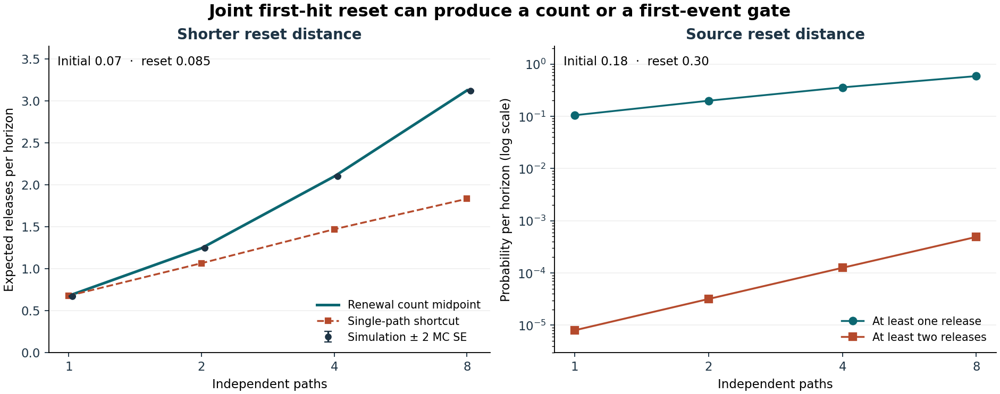

# Repeated firing after a joint reset of multiple independent microdomains

The one-interval operator reports the chance of at least one release and resets all subunits together. To count every release in a longer horizon, fix a wall, an initial log distance $x$, a strictly positive reset distance $r$, an absolute refractory duration $h>0$, volatility $\sigma>0$ and drift $\mu$. The first of $n$ independent Brownian paths to reach zero emits one event. All paths then wait for $h$ and restart at $r$ with fresh independent Brownian increments. A neuron-specific absolute refractory time caps the number of releases over a finite horizon. The construction assumes each hit resets the entire group. Motion of the threshold during a waiting interval, correlated paths and partial resets lead to different laws.

## Counting every event

Write $W_{n,d}$ for the first hitting time among $n$ paths starting at distance $d$, including infinite waiting times when all paths escape. With the one-path hitting CDF $F_d$, $Q_d(t)=P(W_{n,d}\le t)=1-[1-F_d(t)]^n$. Starting at or below the wall produces a release at time zero. If $S_k$ is the time of event $k$, the strong Markov property gives
$$
S_k=W_{n,x}+(k-1)h+\sum_{i=1}^{k-1}W^{(i)}_{n,r},\qquad
E[N(T)]=\sum_{k\ge1}P(S_k\le T).
$$
The sum contains at most $1+\lfloor T/h\rfloor$ potentially nonzero terms. For $s>0$, set $L_d(s)=E[e^{-s W_{n,d}}\mathbf{1}_{W_{n,d}<\infty}]$. Taking the Laplace transform in the horizon yields the exact expected count transform
$$
\int_0^\infty e^{-sT}E[N(T)]\,dT
=\frac{L_x(s)}{s[1-e^{-sh}L_r(s)]}.
$$
This is a delayed renewal process. Numerical inversion of a transform is unnecessary for the finite-grid interval method below. The finite-time spike train is a random count measure. Both its integrated expected count and the order-wise event probabilities are continuous outputs for a neural operator. Conditional independence is required within each group, and fresh increments after reset are required between events. The mean-state recurrence in the caption experiment is a distinct model.

For one path the waiting-time transforms factor by distance, so $P(S_k\le T)=F_{x+(k-1)r}(T-(k-1)h)$ for $x>0$. The existing repository already implements a more general discounted single-path series with a fixed refractory interval in [the distance-series derivation](https://github.com/TrillionniumFoundation/hepta-private-ci/blob/be42c8242a5986f0acf979cb9773e19633c9a396/experiments/hcsn_hx_unified_v3/RENEWAL_DISTANCE_SERIES_20261031.md). Its derivation's content identity is Git blob `012c40716743c2fd0133968dd38ed1267d2812c8`. For multiple paths the earliest path after a reset can differ from the previous winner. Replacing every $F$ by $Q$ in the single-path distance series generally gives an incorrect count.

## Finite-time bounds and differentiation

Choose $\Delta=T/M$ so $h/\Delta$ is an integer. Couple every positive waiting time to its floor and ceiling grid times using the same underlying sample. A sum of rounded-down waits is no later than the actual event. Rounded-up waits give the converse. For each wait the discrete mass at floor-grid index $j$ is $Q_d((j+1)\Delta)-Q_d(j\Delta)$. Convolving those masses gives a bound on each $P(S_k\le T)$, including the initial atom at zero when applicable. The implementation evaluates the first event probability directly, sums the remaining order-wise bounds and restricts convolution to the time prefix still needed. Halving the grid step yields nested intervals under the coupling. These are real-arithmetic bounds. The numerical implementation uses double precision and zero-padded linear FFT convolution, so ordinary floating-point error applies. The midpoint has derivatives with respect to live input distance and reset distance. The coupling proof bounds the expected value. Continuum gradient bounds would require a separate approximation theorem.

## Numerical verification

The study uses $T=0.25$, $h=0.025$, $\sigma=0.23$, $r=0.085$, $x\in\{0,0.07\}$, $n\in\{1,2,4,8\}$ and $\mu\in\{-0.2,0,0.03355\}$. At the positive source drift and $x=0.07$, the values below are expected counts per quarter horizon. The Monte Carlo column uses 100,000 independent trajectories per cell and reports one Monte Carlo standard error.

| Paths | Coupled interval with 1,280 time bins | Exact for one path or direct substitution for multiple paths | Independent event simulation |
|---:|---:|---:|---:|
| 1 | 0.676565–0.677059 | 0.676703 | 0.669420 ± 0.002381 |
| 2 | 1.242420–1.243993 | 1.064354 | 1.244380 ± 0.002922 |
| 4 | 2.095954–2.100126 | 1.468940 | 2.101540 ± 0.003106 |
| 8 | 3.118567–3.127248 | 1.831402 | 3.118360 ± 0.002748 |

Across 24 parameter settings, the intervals were nested on 80, 160, 320, 640 and 1,280 bins. All six single-path cases contained the exact single-path series on every grid. The independent simulation drew 2.4 million complete trajectories using inverse-Gaussian waiting times for nonzero drift, an independent escape draw for outward drift, and Lévy waiting times for zero drift. The largest difference from the closest finite-grid interval was 3.001 Monte Carlo standard errors. Across 12 live starting configurations, derivatives of the grid midpoint on a 320-bin mesh agreed with central differences in both inputs to a maximum scaled error of $1.46\times10^{-10}$. These tests establish the inner event-count computation for the fixed-wall model. Its effect on learned representations, throughput or caption quality remains to be measured.

## How multiple firings change the information delivered to the next layer

Suppose every release writes a fraction $g\in[0,1]$ of the same content vector $v$ into memory $h_0$. After $N$ releases the memory equals $(1-g)^N h_0+[1-(1-g)^N]v$. The effective expected gate is therefore
$$
G(g)=E[1-(1-g)^N]=g\sum_{k\ge1}(1-g)^{k-1}P(N\ge k).
$$
All weights are nonnegative, so each order-wise bound transfers directly to $G$. At $g=1$ the first hit completely overwrites the old content, and later hits carrying that same content have no additional effect. The ordinary fully replacing port consequently has $G(1)=P(N\ge1)$. At the other endpoint $G'(0)=E[N]$. An architecture can expose count, send separate event times, or use a partial update if repeated events should influence the receiver.

The shorter reset distance above was chosen to illustrate a readily measurable repeat regime. At the **source reset distance** 0.30 and reference distance 0.18 with all other illustrated constants fixed, repeating an event within the quarter horizon is rare. The refractory time 0.025 is an illustrative new parameter. These are evaluations of the model equation at named inputs.

| Paths | Probability of at least one event | Probability of at least two events | Effective half-write gate, $g=0.5$ |
|---:|---:|---:|---:|
| 1 | 0.104665 | 0.000007943–0.000008084 | 0.05233451–0.05233454 |
| 2 | 0.198375 | 0.000031569–0.000032128 | 0.09919555–0.09919569 |
| 4 | 0.357398 | 0.000124686–0.000126881 | 0.17873010–0.17873065 |
| 8 | 0.587062 | 0.000486465–0.000494951 | 0.29365286–0.29365498 |

The additional endpoint and gradient checks cover both reset distances, three starting distances, four channel counts and five write fractions. The endpoint identities agreed within $2.23\times10^{-16}$. Interior derivatives agreed with central differences within $6.20\times10^{-11}$. [regenerative_release.json](regenerative_release.json)

The original 7,394-blob code and narrative catalog contained 801 documents matching a renewal/repeated-reset expression. No blob matched the specified lexical patterns for both earliest-of-independent searchers and repeated resetting. Equivalent code with different notation may escape this screen. The underlying mathematics uses established order statistics and delayed renewal theory. [Lawley, Physical Review E (2020)](https://doi.org/10.1103/PhysRevE.101.012413) · [Gallager, Discrete Stochastic Processes, chapter 4](https://ocw.mit.edu/courses/6-262-discrete-stochastic-processes-spring-2011/931ffa0940899c27f34b71ad64fd2bb0_MIT6_262S11_chap04.pdf) · [Gerstner et al., Neuronal Dynamics, renewal statistics](https://neuronaldynamics.epfl.ch/online/Ch7.S5.html)

Reproduce the numerical checks with `python verify_regenerative_microdomains.py results.json` in a PyTorch, NumPy and SciPy environment. The raw per-cell bounds and simulation estimates are in [regenerative_verification.json](regenerative_verification.json).
