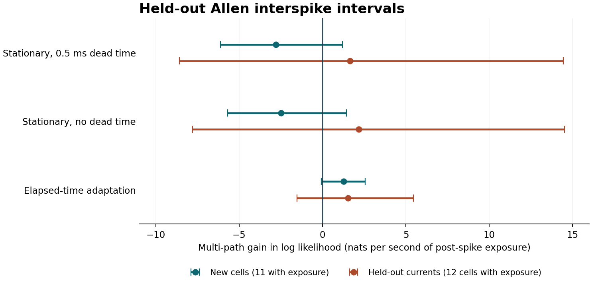

# Single- and multi-path waiting times on held-out Allen cells and currents

The development-selected four-path model scored worse on unseen neurons and slightly better on unseen currents in previously represented neurons than the strongest conventional comparator, a single-path inverse Gaussian. Both paired 95% intervals crossed zero. The original plan required positive lower limits at both endpoints. The estimates leave a cross-neuron advantage for the multi-path construction unresolved.

## What was measured

The public Allen Cell Types Database measured actual spikes during approximately one-second constant-current Long Square sweeps. The archived study stored the relative times from the institute's NWB spike-time dataset. The new analysis conditions on the first observed spike of each sweep, scores every following interval and scores survival to the end of the pulse after the final spike. A single-spike sweep contributes a right-censoring observation. A zero-spike sweep contributes to the coverage count. This endpoint leaves onset latency and firing probability in zero-spike sweeps unmeasured. The inherited 36-cell sample had previously been studied for firing-rate curves and latency. Its spike times were split specifically for this retrospective timing comparison. [Allen Cell Types API](https://brain-map.org/support/documentation/cell-types-database-api) · [Allen SDK guide to sweep spike-time data](https://alleninstitute.github.io/AllenSDK/cell_types.html)

The development partition selected the best of $n=2,4,8$ conditionally independent inverse-Gaussian hitting times. Conventional choices were a single inverse Gaussian, gamma, lognormal and exponential with the same dead time. Each parametric family shared its global current response and time scale across cells. For \(n\) paths and a normalized single-path wait with density \(f\) and survival \(S\), the composite density is \(n f S^{n-1}\) and survival is \(S^n\). The inverse Gaussian used here is the proper first-passage law of an inward drift. The fitted quantities are event waiting time, shape and the group-shared current response. The timing model uses its own physical inward drift. Positive evidence on this endpoint would support the timing distribution alone.

The 18 fitting cells contributed 95 sweeps with 1,166 observed post-first spikes and 47.372 seconds at risk. The six development cells contributed 37 sweeps, 343 post-first spikes and 15.938 seconds. All seven models per specification were fit again on the 24 combined training and development cells with their held-out current levels omitted. The final weights, choices and both anticipated test data digests were committed before either scorer accessed a held-out shard. The fit and development procedure took 112.69 seconds wall time on one low-priority CPU thread. This is a small parametric maximum-likelihood calculation.

## Registered outcomes

Gain is the multi-path log likelihood less the chosen conventional log likelihood, divided by each cell's total post-first exposure and averaged equally across cells. Intervals resample whole cells 10,000 times, preserving current groups and repeated sweeps. Bits/spike pools the paired log likelihood differences and divides by the total number of subsequent observed spikes. The two weighting conventions need not agree in magnitude.

| Specification | Development choice, multi / conventional | Unseen-cell gain, nats/s (95% interval) | Unseen-current gain, nats/s (95% interval) |
|---|---|---:|---:|
| Stationary, common 0.5 ms dead time (primary) | IG4 / IG1 | −2.808 [−6.127, +1.205] | +1.655 [−8.585, +14.440] |
| Stationary without dead time | IG4 / IG1 | −2.480 [−5.687, +1.430] | +2.166 [−7.798, +14.517] |
| Common elapsed-time adaptation and 0.5 ms dead time | IG2 / IG1 | +1.258 [−0.063, +2.547] | +1.532 [−1.542, +5.451] |

- **Unseen cells.** There were 101 sweeps from 12 cells, including 52 zero-spike and 11 single-spike sweeps. Eleven cells provided measurable post-first exposure, totaling 46.507 seconds and 307 subsequent spikes. The primary paired result was −0.7299 bits per subsequent spike, with two specimen wins and nine losses.
- **Unseen currents.** There were 45 held-out-amplitude sweeps from 24 otherwise represented cells, including 32 zero-spike sweeps. Twelve cells provided measurable post-first exposure, totaling 12.613 seconds and 385 subsequent spikes. The primary paired result was +0.0789 bits per subsequent spike, with four specimen wins and eight losses.
- **Parameter limits.** All selected primary fits terminated successfully. The shared current slope reached its preregistered lower bound −2 in both selected families, and the four-path log time-scale intercept reached its upper bound 0. The published comparison applies to the named bounded fits. These limitations and the different firing rates of the exposed sweeps matter when interpreting transfer. No individual neuron had its own calibrated scale or intercept.
- **Architecture selection.** Using the external observations to choose a different path count would spend the held-out evaluation. The recorded four-path primary and two-path adaptation choices come entirely from the six development cells.

Full numerical scores for all seven families and every specimen are in [results.json](results.json), with 3,066 per-sweep family-by-condition scores in [cold_sweep_scores.json](cold_sweep_scores.json). A second scorer independently recomputed all 3,066 contributions from the stored raw spike times with SciPy distribution objects. The largest absolute disagreement was \(2.85\times10^{-13}\) log units, with zero support violations. Before training, 3,640 synthetic-grid evaluations and numerical density integrals checked the model implementation. [Independent raw-time replication](independent.json) · [Qualification](numerical_qualification.json)

## Replay

Start from the archival cohort zip with SHA-256 5418ceb3cff7dc563490807f5051243c454d8055bef5c5a5e0ab44d719578d07. The old archive is available in [the original project snapshot](https://github.com/TrillionniumFoundation/hepta-private-ci/blob/be42c8242a5986f0acf979cb9773e19633c9a396/qualification/hcsn_research_20261127/feedback/ephys/nwb_curve_records.zip). Preparation and fitting are separate from the cold scorer. Run prepare_isi.py on the archived zip to reproduce the same four data shards. Run replay_isi.py on the already-sealed parameters and portable cold scores to reconstruct the paired comparisons without estimating any parameter. Run independent_validate_isi.py with the zip, selection seal and cold scores to check all per-sweep values from the original timestamp arrays. The published [selection seal](selection_seal.json) SHA-256 is af3d54429606472bc2e593b2699f6b71d2c73166bb913bf2299a495b1ac892c7. The [prespecified protocol](PROTOCOL.md) and [cohort assignments](cohort_seal.json) document each exposed and reserved group.
