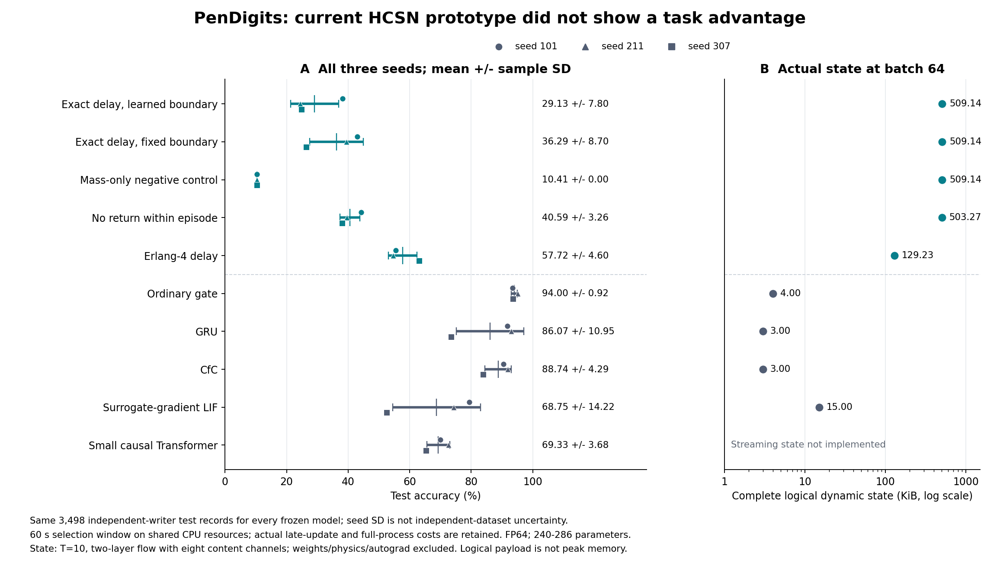
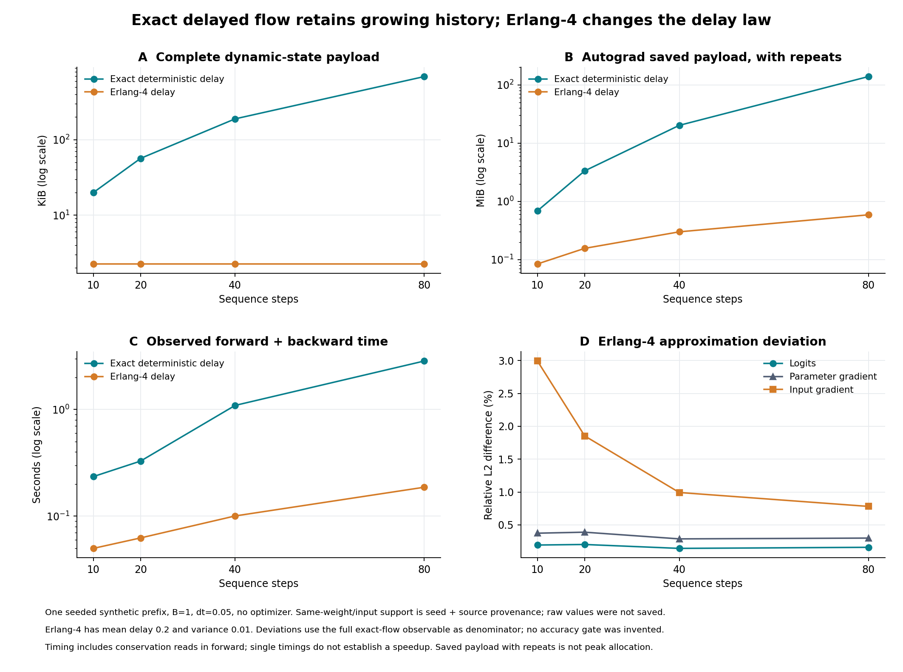

# HCSN 联合网络：完整训练、独立测试与成本结果

日期：2026-11-19。执行身份：`hcsn-coupled-pendigits-equal-budget-20261119-d741-attempt001`。

**联合网络已经完成真实训练、完整状态检查、统一选模封存和独立测试，但本轮没有得到优于基线的证据。** 确定性再生流的测试准确率为 **29.13% ± 7.80%**，Erlang-4 为 **57.72% ± 4.60%**，普通门控为 **94.00% ± 0.92%**。这里的 ± 是三个 seed 的样本标准差，包含训练随机性与运行环境波动；三者不是三个独立数据集。

本轮关闭了“完整算子如何组成可训练网络”“如何把标量任务边界接入实际动力学”“完整状态与长度成本是否可见”“真实任务是否实际训练和独立评估”等具体执行缺口。原 N256 bitwise、原 C2 full replay、历史 UNKNOWN、HPCA 外部托管和全模态收益门没有被本实验替代。`all_closed` 仍为 `false`。

## 1. 冻结身份与实际执行

- 模型/训练/评估源在 [Draft #6754](https://github.com/TrillionniumFoundation/hepta-private-ci/pull/6754) 的 `8fe7bc209803659cc3f4780be0940c5183ca6e9b` 先发布，再执行。26 个 pinned source 文件保持原字节。
- [PROTOCOL.json](PROTOCOL.json) SHA256：`9601216e77b3dc5b3b41f77d7df8f124b7ab176692b0a0b66f24773b95eec9e0`。
- 唯一训练 campaign：**30/30 training children + 30/30 evaluation children** 全部退出 0；没有模型重试、因结果删 seed、事后改 LR 或看到 test 后继续训练。
- 所有 30 个成功终止和 selected checkpoint 先组成共同 seal，才允许各模型读 test。全部 30 个 selected 模型的验证 logits 与原保存值的最大绝对差都是 **0**。
- 唯一 guarded arithmetic reader：30 个模型、175 次验证、157,464 个已记录 Adam updates；从原保存 logits 重算选模和测试分数，全部通过。这个 reader 没有重新生成训练梯度、优化器轨迹或模型输出。
- 后继 gate/reader 共检查 205 份保存数组、2,361,900 个 logit 坐标均有限；这些是完整性分母，不是独立试验数量。完整 B64 flow state 的最大概率/内容余额残差为 **8.43769498715119e-15**。

原 `benchmark_review.py` 单独调用时缺少完整先验 seal 检查，并有 NaN 比较可能放行的问题。已新增独立调用约束 [run_review.py](evidence/benchmark-review/run_review.py)，在读者被允许前核验全部 roster/terminal/原件 hash/best-eligible，并检查数组及标量有限性。该 wrapper 在本地 `9beb10ed686cff6f44729b586c022e9978b61868` 冻结，SHA256 `1d5ab1ce8ec9a351d7ad23c1d86644464826de0d2033e34b98b1f4a3e2fdd78e`。原训练与测试程序未改写，正常 campaign/evaluator 路径原已先封存选模并检查输出 finite。

## 2. 实验回答的具体问题

数据来自 Alpaydin 与 Alimoglu 的 [UCI Pen-Based Recognition of Handwritten Digits，DOI 10.24432/C5MG6K](https://archive.ics.uci.edu/dataset/81/pen%2Bbased%2Brecognition%2Bof%2Bhandwritten%2Bdigits)，CC BY 4.0。原训练集有 7,494 条、30 位 writers；原测试集有 3,498 条、另外 14 位 writers。仅在训练集内按固定 seed 271828 抽取每类 75 条，共 750 条 validation；其余 6,744 条用于训练。

每条样本是 8 个有序二维坐标，按弧长重采样；不是实测等间隔时间序列。各模型都收到相同坐标变换和 2 个末尾零输入，模型 dt 被指定为 1/20。公共测试集的独立 writer 划分有意义，但不提供未来外部策展或 Owner 托管来源。

10 个 arm × seeds 101/211/307；FP64、batch 64、Adam .003、gradient-norm cap 1。实测参数量 240–286，接近但非严格相等；没有宣称同 FLOPs、同 CPU 秒或训练充分收敛。固定 60 秒选择窗口比较的是这套实际实现和运行环境下的结果。

## 3. 全部真实测试结果

| 模型 | 参数数 | Test accuracy，mean ± seed SD | Test CE mean | 完成 updates mean | B64 完整动态状态 | 首次观察到 validation ≥80% |
| --- | ---: | ---: | ---: | ---: | ---: | --- |
| 确定性延迟＋可学习边界 | 259 | 29.13 ± 7.80% | 2.0088 | 250.0 | 521,360 B | 0/3；右删失 |
| 确定性延迟＋固定边界 | 258 | 36.29 ± 8.70% | 1.8921 | 478.7 | 521,360 B | 0/3；右删失 |
| 只传质量的负控制 | 259 | 10.41 ± 0.00% | 2.3022 | 528.0 | 521,360 B | 0/3；右删失 |
| 观测窗内不返回 | 259 | 40.59 ± 3.26% | 1.8554 | 489.3 | 515,344 B | 0/3；右删失 |
| Erlang-4 延迟 | 259 | 57.72 ± 4.60% | 1.4071 | 1607.3 | 132,336 B | 0/3；右删失 |
| 普通门控 | 266 | 94.00 ± 0.92% | 0.2275 | 10867.3 | 4,096 B | 3/3；10.007–20.164 s |
| GRU | 250 | 86.07 ± 10.95% | 0.4663 | 9501.3 | 3,072 B | 2/3；10.013–10.040 s |
| CfC | 286 | 88.74 ± 4.29% | 0.4244 | 8393.3 | 3,072 B | 3/3；10.019–20.052 s |
| Surrogate-gradient LIF | 240 | 68.75 ± 14.22% | 1.0073 | 7951.3 | 15,360 B | 1/3；20.032–20.032 s |
| 小型 causal Transformer | 274 | 69.33 ± 3.68% | 0.8745 | 12421.3 | streaming 未实现 | 0/3；右删失 |



更新数包含已经执行并计费、但不能进入模型选择的最终越界更新。80% 目标来自冻结协议，报告的是首次合格 validation 观察时间，不是精确越过时刻；未观察到时保持右删失，不把空值改成 60 秒。达到相同 validation 目标的成本问题，当前只有普通门控与 CfC 在三个 seed 都有观察；HCSN 两个主要版本均为 0/3，无法据此给出相同效果下更便宜的结论。

当前确定性流在三个 seed 上都明显落后于普通门控。Erlang-4 的状态更小、完成更新更多、测试分数更高，但仍落后于所有五个实测普通基线的平均分。这支持一个具体决策：**保留可微再生算子与独立参考的研发价值，暂不把当前实现升级为全模态主干。** 不能从一次短 FP64 CPU 任务外推所有 SNN、Transformer、连续时间模型或充分训练后的排名。

“固定边界”和“观测窗内不返回”的分数高于当前 learned-boundary arm，并不单独证明任务边界或 reset 没有用。它们的计算图、更新数量和等待机制同时发生变化；当前实测能够拒绝这套预算下的收益主张，不能隔离出一个普遍因果效应。质量结果不是纯初始化随机性：运行环境也影响了可完成更新与验证次数。

## 4. 当前网络的准确语义

实现使用两层完整有限状态再生群体，保留 active probability、8 通道 signed content、永久 upper escape、hit/discounted hit、occupation/value、确定性延迟 packets、消息缓存和写入账本。输入写入只作用于 active mass；到期释放先进入 active，再接收写入。层间消息是前一时间区间积累的触界质量与内容质量，因此有一个声明的 sample interval 延迟。每层保留自身概率，并不把一层的 probability 当成另一层的概率复制。

学习的标量任务成本 `K=.15+.02*tanh(raw_cost)` 经过 free-boundary 隐式梯度，改变实际 reset law/flow/readout。有限模型保留真正的重置与等待；其 perpetual value 与完整 pending-state continuation value 已有数值和梯度检查。源冻结前 19 个 focused controls 包括独立 delayed ODE、输入/权重/7 个 task-physics 参数导数、真实边界路径、完整冷续算、release-before-write、shared-law batching、Erlang ODE/value，以及真实子进程故障收集。

这些结论有清楚边界：

- 四个空间 interior nodes 是有限 CTMC；不存在“本次已经证明连续扩散所有参数域”的结论。
- 该边界来自标量 Brownian reward/cost 控制问题，再投影到有限动力学；没有解出分类任务依赖内容的 Bellman/干预价值面。
- 同一 batch 中 probability law 相同，输入经 signed content 传递，发放时刻分布本身不依赖样本。mass-only 因而是人为切断内容的负控制；不能把它的 10.41% 解读为一般 SNN 或所有 margin-only 模型不能传信息。
- 输入是 sample-triggered 写入。重复输入并减小 dt 会改变写入过程，不能宣称任意输入重采样不变。
- 冷保存能恢复未来 forward dynamics，不包含过去 autograd graph；模型/physics/optimizer/RNG 仍需各自保留。
- 与原金融 equity/default 结构的研究路线不同，这里实际检验的是带标量任务策略的再生流网络。先前 [HX Cell 公平预算结果 #6744](https://github.com/TrillionniumFoundation/hepta-private-ci/pull/6744) 也未证明完整双通道金融特征优于普通门控；本实验没有将其负结果改写。

## 5. 60 秒窗口与实际成本

60 秒从模型构造前开始，包含 optimizer 初始化、训练、周期验证、验证 NPZ 写出和候选内存 deepcopy。最终 `selected.pt` 在循环结束后写盘；没有 60 秒内已经 durable/fsync 的证明。

循环不在截止后启动新工作，但已开始的原子更新可以晚完成。**30 个 fit 各有 1 次晚完成更新，全部收费、保留且没有入选。** 最大越界在 `flow_no_return-s211`：update 428 完成于 66.936765 秒，实际 training wall 为 66.937155 秒；其 selected 是 update 358、40.330395 秒。不能把实际总成本写成严格 `30×60`。

运行使用一个固定随机顺序、最多两个 fresh children、logical CPU 0/1、每个一个数值线程、4 GiB AS、150 秒 whole-child deadline；观察可用内存下限为 2 GiB。Affinity 不提供独占 physical core。未取得本地 cgroup 约束保证，也没有 per-update CPU/主机频率/外部竞争轨迹。

SNN 三 seed 完成 601、6,298、16,955 updates，对应 training CPU 43.408、58.797、59.554 秒。28.21 倍更新差无法由 1.37 倍 CPU 时间差单独解释；早期 GRU seed307 初次验证到 33.813 秒才结束。原件不足以确定剩余原因；没有以 CPU 比率虚构一条纠正后的训练曲线。

| 阶段 | Full child CPU 秒 | Child wall 之和 秒 | 最大 full child RSS KiB |
| --- | ---: | ---: | ---: |
| 30 training children | 1,874.611680 | 1,995.212336445 | 290,968 |
| 30 evaluation children | 170.053462 | 245.773285785 | 234,568 |
| 合计 | 2,044.665142 | 2,240.985622230 | 290,968 |

实际 campaign elapsed **1,143.690149883 秒**，包含并行；child wall 之和不能当 elapsed。Test inference timers仅覆盖已加载并经过 validation replay 的模型在全 test 上推理，full child 另含 imports/data/checkpoint/replay/state probe/backward probe。单次 forward/backward 或 inference 计时保留所有离群值，不能据此宣称稳定内核 speedup。没有 GPU、能耗或峰值 allocator 测量；未全面记录的指数动作计数保持未知，不当作 0。

独立算术 reader 完整 child：wall **1.988416697 s**，CPU **1.826867 s**，RSS **50,252 KiB**；其 parent 自身另有 0.235724672 CPU 秒。原 frozen reader 没有 body timer，未虚构该字段。完整静态审计和 30-fit 逐项计时表见 [campaign-static-review/README.md](evidence/campaign-static-review/README.md)。

## 6. 长序列状态与 Erlang 近似

另外预先冻结并实际完成 8 个无 optimizer 的 synthetic profiles：B1、相同初始化 seed101、输入 seed123、长度10/20/40/80、固定 dt=.05。比较的 observation horizon 是 .5/1/2/4；并非 dt refinement，也不是长序列任务泛化测试。

| Steps | Exact 动态 bytes | Erlang-4 动态 bytes | Exact serialized bytes | Erlang serialized bytes | Exact saved-AD payload | Erlang saved-AD payload |
| ---: | ---: | ---: | ---: | ---: | ---: | ---: |
| 10 | 20,384 | 2,304 | 34,311 | 8,493 | 721,897 | 88,537 |
| 20 | 57,984 | 2,304 | 72,455 | 8,493 | 3,503,177 | 163,977 |
| 40 | 193,984 | 2,304 | 208,135 | 8,493 | 21,145,097 | 314,857 |
| 80 | 705,984 | 2,304 | 720,071 | 8,493 | 145,236,937 | 616,617 |

Exact 两层总 pending packet 数一直为8，但保存 generator 的最大 order 从15增至100；history 内部维度增长，所以 packet 数固定没有保证恒定内存。saved-AD payload 是 hooks 累加，含重复保存；它不是峰值 live memory。T80 对应 full-process RSS 分别为277,448/230,884 KiB，两种口径已分开。

Erlang-4 的平均 delay=.2、variance=.01，改变了等待时间分布。相对于 exact flow，logits 的 relative L2 deviation 为0.143–0.203%，参数梯度0.288–0.390%，输入梯度0.782–2.993%。分母是完整对应的 flow observable，没有 denominator floor；这是一次初始化、一条输入前缀族的模型近似偏差，未设事后“近似通过”门。



独立 reader 在原67个文件上核验280个tensor/123,444个坐标，state.pt 与 RAW.npz 全部逐字节一致；完整两层概率与8内容通道的余额最大残差 **1.3766765505351941e-14**，在原2e-9门内。为恢复等待质量实际执行32次独立 SciPy 矩阵积分，0 model/AD/optimizer；全 child wall2.461332071s、CPU2.435018s、RSS223,652KiB。

初始化/input provenance 由同 seed 与共同 source 路径支持。原 profile 未保存实际 weights/input values 或 hashes，无法从现存原件直接验证二者逐位相同；没有补跑模型冒充当时原件。完整结果与上述限定见 [length-review/README.md](evidence/length-review/README.md)。

## 7. 完整原件与复核方式

全部831个原件、48,542,680原字节已按manifest打包，archive含manifest共832 members；包括30份selected和last checkpoints、全部训练journals、175份validation NPZ、30份test NPZ、完整probe state、60个process请求/终止/日志、8个length profiles、两个独立reader、静态审计、26个冻结source、原protocol和UCI数据分发原件。

- Lossless tar.xz：**28,626,312 bytes**，SHA256 `b6f4969ccc5f75b526223b9f83ff0c6348a324ad3bc93342558a13f72b5fe35c`。
- 7个有序parts，每个≤4MiB，在 [archive-attempt001](evidence/real-task-originals/archive-attempt001)。
- [MANIFEST.json](evidence/real-task-originals/archive-attempt001/MANIFEST.json) SHA256 `358e83ffe6f36637c9fff80c3752305c4f4cc963a2bf2e6b6887efe31b2fdf98`。
- 每个tar member已逐个读取并核对原字节hash；parts重组SHA一致。封存后所有输入仍与原SHA一致。
- 导出不是模型重跑。导出完整 child wall36.092270715s、CPU35.844602s、RSS58,156KiB；body计时另外保存。绘图完整 child wall4.017660117s、CPU3.978737s，0模型/optimizer/矩阵动作；两个PNG已目视检查。

从仓库根目录可重组 archive，不需要重新训练：

```bash
cat qualification/hcsn_network/evidence/real-task-originals/archive-attempt001/part-*.tar.xz.part > hcsn-network-originals.tar.xz
sha256sum hcsn-network-originals.tar.xz
```

只在全选模seal、全部original hashes和零失败已核验之后，使用 `evidence/benchmark-review/run_review.py` 运行原frozen arithmetic reader；不要把原reader单独调用误认为完整test-access gate。新运行须有独立输出路径和成本，不覆盖本次 `attempt001`。

## 8. 项目准入判断

当前证据支持：有限完整再生神经元可以被组成能训练、能冷续算、能传递实际内容且有可核对梯度的网络；完整状态成本确实可以测量，且长历史会快速增长。当前真实任务比较未支持质量、同效果成本或主干替换优势。

原历史门各有独立身份：[#6751 C2 partial→plateau](https://github.com/TrillionniumFoundation/hepta-private-ci/pull/6751)、[#6752 N256多步修复](https://github.com/TrillionniumFoundation/hepta-private-ci/pull/6752)、[#6755 strict metadata](https://github.com/TrillionniumFoundation/hepta-private-ci/pull/6755)、[#6757 D-only21模型选择](https://github.com/TrillionniumFoundation/hepta-private-ci/pull/6757) 提供各自有界的新证据。原#6742 1,291/69,728 bitwise mismatch仍为负结果；原six-fit独立full replay仍0/6；旧controller terminal仍UNKNOWN；HPCA外部来源/Owner托管与既有retention负结果不能由本实验赋予资格。

下一次架构研究应在新的训练/开发协议中检验更小状态、真正由输入驱动的时间动力学或内容相关任务边界，保留本次独立test结果；当前test不继续用于调优。正式晋级须同时有动力学/梯度、状态/运行成本及真实独立任务收益的证据。这里没有将“已经完成实验”写成“所有科学主张都通过”。
