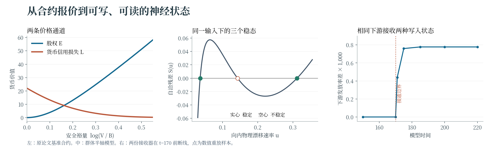
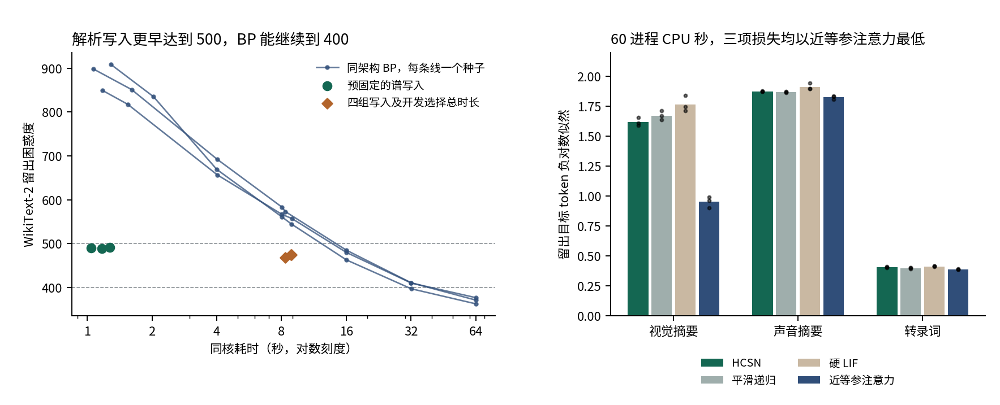

# Hepta Continuous Spiking Network 研究与复现入口

He–Xiong 的内生破产边界、权益定价和信用损失可以组成可训练的神经元。带吸收、复位和不应期的连续模型还有可验证的双稳态，可以用一条由放电史调制的真实自由边界写入和读取状态。局部权重编辑以及有限任务上的从头直接写入出现了等质量加速。公开的固定协议尚未建立跨数据、跨模态和大尺度的普遍优势。不同层数、噪声律、时间基准和输入带宽的实现应依据各自的协议解释。

## 由论文到具体动力方程

原论文是 Zhiguo He 与 Wei Xiong 的 *Rollover Risk and Credit Risk*，发表于 2012 年 *Journal of Finance* 67(2), 391–430。原股权 E 具有有限责任与内生停止条件 E(B)=E′(B+)=0。债券在停区按回收规则兑付，债价损失 L 取同流动性无违约参考债与风险债之差。有限期首达概率 F 是单独的无量纲读数。采用固定或随机的流动性定价环境与实际神经膜的随机漂移，需在模型里分别写出。将股权转化为恢复力、把信用损失作为靠近边界的再生反馈，是这里的建模选择。[原论文](https://www.princeton.edu/~wxiong/papers/rollover.pdf) · [单态解析母式](../hcsn_sustained_20261128/resolvent)

对相对坐标 x=log(V/B)>0，固定内部状态时按漂移扩散演化，触及 x=0 的质量发放，进入不应期，再在 a>0 复位。以 D 为扩散系数，p(0)=0 时，向外的正发放通量 J=D ∂ₓp(0+)。移动坐标会在真实相对漂移中产生 −d log B/dt。复位后仍然可以多次发放，这一机制超出了单次破产合约。按当时的分布聚合 E 与 L，分别形成复位附近的恢复项和向壁的驱动项。分布的物理方程、单次首达核和价格的贴现方程各自有不同含义。

|研究问题|已验证的结论|重做证据|
|---|---|---|
|同一输入能否有两种稳定神经状态|半轴上有三个正再生稳态；两个外侧在固定质量空间局部指数稳定，中间有正增长模|[半轴定理与谱界](../hcsn_sustained_20261128/halfline/FULL_STABILITY.zh.md)|
|能否只发出真实 B|固定合约时两态同壁。用近期发放量调节本金，在 ε=.025 证两个发送与四个接收工作点的稳定性，实算时域脉冲、断线和移动壁效应|[物理单线](../hcsn_sustained_20261128/boundary_port/README.zh.md) · [频率/脉冲](../hcsn_sustained_20261128/boundary_port/TRANSFER.zh.md)|
|能否从同一个初态写入再读取|严格的有限时开环可达构造；五档有限网格重放矩形写入，相同接收器在 t=170 前差为零，t=220 发放率差 0.00077768。吸引域内，延迟无限长后对早期短脉冲幅值的梯度趋于零|[写入、保持、延迟读取](../hcsn_sustained_20261128/boundary_port/REACHABILITY.zh.md)|
|单线能否替代整个隐藏分布|不同真实可达历史可以发出相同当前 B，下一拍首达率分别为 0.33216 和 0.11317。多时限或价格观测收紧最坏歧义|[可达反例与 120 个对偶证书](https://github.com/TrillionniumFoundation/hepta-private-ci/blob/ae23f3682afc0a39e99a23c70c92eb4fdda6cc54/qualification/hcsn_sustained_20261128/boundary_observability/reachable/README.md)|
|可恢复流动性下是否还能直接用两个价格|建立双向连续时间切换模型的分区解析变换、期限数值反演与两壁联立求根。PyTorch 对内生壁、股权与货币损失端到端反传，通过独立重求整个均衡的扰动核验|[无空间网格算子](switching_transform) · [独立 PDE 与 180 万路径](stationary_switching) · [有限切换时窗](returning_regimes)|
|哪些物理参数可直接改|四个设计观测可显式识别四个合约参数；只有边界时用两本金尺度 × 两实际合约期限。期限接近会显著放大噪声|[四参反演](../hcsn_sustained_20261128/contract_inverse) · [纯边界反演](../hcsn_sustained_20261128/boundary_only_contract) · [实验设计](../hcsn_sustained_20261128/contract_design)|
|硬件如何影响单线|绝对 BF16 边界在 ε=.001、.005 会将两个源态量化为同值。高精度内先算中心 log 比率再发 BF16，两个源态保持可分|[逐值重放与定长检索上界](precision_and_recall)|

## 真实数据上的不同问题

|数据和任务|可核验的观察|实验入口|
|---|---|---|
|CREMA-D，冻结 2 层，仅安全裕量跨层，72 类|直接头 HCSN 比 LIF 的留出 NLL 低 0.14036，配对区间不跨零；与普通平滑递归区间跨零。断线后得训练先验|[冻结编码器、42 套权重](returning_encoder)|
|CREMA-D，2 层，隐藏与读出均从头直接解|纯直接写输入/隐藏/输出为 3.84845，BP 完整端点 3.15073。同过 4.10 的 24 冷进程设计中直接法 2.196 秒、BP 2.859 秒；前者 0/3 通过 3.75。给直接隐藏层增加五次头更新后 NLL 3.65952，三种子均过 3.75|[直接隐藏写入、全部原始分数](direct_hidden)|
|CREMA-D，冻结头的精确 Newton 写入|一次只精确求最初的局部二次问题；四次追加修正才令返回特征三种子过探索性 3.75。几何相同的预调节 L-BFGS 需同时比较质量与首次达标时刻|[112 套头的独立重放](newton_readout)|
|CREMA-D，六层全参，有方向的双价格漂移|同一遍留出 NLL 比非金融对照差 0.06223。补充的同核分步轮转、每格 60 进程 CPU 秒下，反而低 0.07920，演员配对区间 [−0.14368,−0.01900]。等墙钟 60 秒的区间跨零|[四臂全权重复核](https://github.com/TrillionniumFoundation/hepta-private-ci/tree/1f6b5f731acfdba4c02a9ce5774c27f02d11f246/qualification/hcsn_signed_encoder_20261128)|
|外部 RAVDESS，24 位演员、1,056 片零样本迁移|同一遍 HCSN 相对 SDPA 的 NLL 差 −0.10134，60 秒源训练差 −0.19891。60 秒的演员内宏 AUROC 反而较低；Top-1 区间跨零|[源权重、外部 72 候选重评分](https://github.com/TrillionniumFoundation/hepta-private-ci/pull/7274)|
|RSICD，真实图片自由生成图注|964 张测试图、4,820 条人工参考句。开发集选端点后，HCSN CIDEr-D 0.17512，相对注意力为 −0.02825，相对普通光滑为 −0.01906，两个图像重抽区间均低于零|[生成原件复核](https://github.com/TrillionniumFoundation/hepta-private-ci/pull/7274)|
|WikiText-2，33,278 词、完整双遍、4 臂 × 3 种子|1,144,579 参数，128 语境；HCSN 三个测试困惑度 392.40/401.28/398.33，SDPA 400.85/403.45/395.89，光滑递归 375.29/380.68/382.85，硬 LIF 387.90/395.54/396.17|[完整单语实证](https://github.com/TrillionniumFoundation/hepta-private-ci/pull/7280)|
|已训练表示的顺序编辑|同一位置的 BetaEdit 适配版在前三次编辑通过同门，冷进程 5.99 秒对 BP 8.37 秒；第六次仅 2/3 达标，同位 BP 为 3/3。包括输入、更新、评估，父本训练与先前的调参另计|[实际原件与进程时钟](https://github.com/TrillionniumFoundation/hepta-private-ci/tree/653fe72c24a405c3d7812f07f2a25011788a4ded/qualification/hcsn_sustained_20261128/beta_sequential)|

[三目标视听文本联合生成](trimodal_decoder)共享一套权重，三种条件任务分别覆盖视频摘要、声音摘要和转录词；自然输入仅来自已公布的十二个话句和原录音的低带宽观测。[长时六层实验](trainable_encoder)按每格完整一遍及 120/900/2,600 秒分别留原始权重和逐项分数，五臂、三种子在同一训练程序中执行，等待全部开发端点封存后再评留出演员。开发中间端点、累计优化时间、并发计算量、同一会话的真实经过时间分别计量。

## 审计范围

[审计表与复算程序](audit)记录 Git 引用、目录、对象和逐对象核验。主分支固定于 732e934b，8,589 个不同 blob、97,287,164 字节经实际散列，选定的中英文研究关键词无匹配。研究分布在大量未合入分支与 PR；仅审 main 会漏掉实验。以早期 07:18:57 纽约时间快照计，heads、tags 与虚拟 PR refs 的并集已有 230,766 个不同 blob。09:13 的快照有 8,412 个分支、2,231 个标签、13,163 个 PR refs、231,450 个不同 blob；新增与退出分别为 696 与 12。Git 对象和存档字节完整、可提取原始分数、实验可重放、研究结论可推广是不同层次的证据。在使用结果时请将仓库路径与具体 Git 提交、训练端点和数据协议绑定。

## 可接入的网络与后续独立验证

[直接针对 main 的 PyTorch 实现](https://github.com/TrillionniumFoundation/hepta-private-ci/pull/7284)提供可堆叠神经层、跨分块的状态传递与端到端 BP。独立回归发现并修复了极小首达概率的浮点相消和复位初价的偏差。FP64 原子在最远端的参考首达概率约 1.25×10⁻²⁹，修改后前向、反向和有限差分相符。[双稳态在独立单粒子观测噪声下的判别精度](precision_and_recall/branch_readout/READOUT_NOISE.zh.md)给出读出设备的影响。

[同核三模态比较](trimodal_decoder/paired/README.zh.md)的五种模型、三个种子和四种预算均已独立重放。固定 60 进程 CPU 秒时 HCSN 的视觉/听觉/文本 NLL 为 1.61895/1.87470/.40525，近等参数注意力为 .95241/1.82408/.38966。真实 Radeon 8060S 三模态流式解码的单样本递推状态为 256 字节，相同任务的近等参数注意力 KV 为 14,400 字节；批量大小改变实测吞吐排序。[设备实测](https://github.com/TrillionniumFoundation/hepta-private-ci/blob/0b612b9aafca6c7bdc0efea0e3dc3db8f379c9f5/qualification/hcsn_sustained_20261128/trimodal_device/meter/README.md)

[正式 WikiText-2 训练、完整概率头和全参数写入](https://github.com/TrillionniumFoundation/hepta-private-ci/pull/7280)涵盖 33,278 个词和 245,568 个留出预测。32 维、114 万参数的边界模型三个种子两遍 BP 测试 PPL 为 392.40–401.28，直接写入全部 34 张量为 716.25–733.64。连续裕量上的非双线性价格在同词数下对最佳双线性替代有微小平均收益，等墙钟比较中较慢。12 遍独立种子 HCSN 为 327.28，注意力 317.31，平滑对照 312.02。

[语料条件统计的直接谱写入](spectral_write/README.zh.md)在同一个语言模型的受限子族里取得了相反的早期速度结果。1.04–1.27 秒的预固定写入三次都达到测试 PPL 500，同架构 BP 的 8 秒端点三次均未过线，16 秒端点全部达到。PPL 400 时直接写入 0/3，BP 最迟 64 秒 3/3。关闭金融反馈后两种子略好；把这项速度收益归于快速的条件统计拟合有数据支持，归于金融层本身则缺少支持。

18 个独立新进程含载入、训练和完整测试评分，500 PPL 门槛的谱写入与开发选定 BP 中位用时分别为 3.962 和 19.952 秒。九对启动顺序交替，配对时长比中位 5.33；BP 达到更好的最终 PPL。本项与只改预训练读出的编辑分别计量。[冷端点和每个原始分数](spectral_write)
