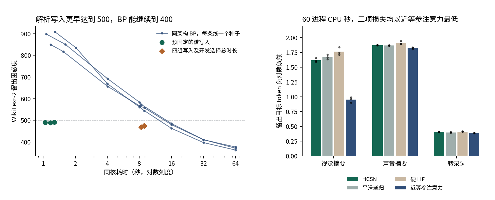

# 训练语料谱写入能更早过 500 PPL，精度与金融反馈需另行检验

对完整 WikiText-2 的 2,088,627 个训练目标，用一次条件计数构成“前词 × 后词类别”及“前词 × 类内词位”两个稀疏表。按真实词头的层次概率表达计算平滑对数比，以 30 个奇异方向写入每个词的隐藏表示。对两个金融块在零历史下的边界映射作数值反演，再写入词嵌入。正常推理启用真实非零股权/信用损失、因果递推和两层边界。所有推理均使用 [原语言模型](https://github.com/TrillionniumFoundation/hepta-private-ci/pull/7280)。写入运行没有反向传播和优化器更新。

这条写法有明确的自由度。34 个参数张量中有 6 个随训练语料估计，涵盖 1,115,043 个系数，主要是词嵌入和概率头；其余 29,536 个系数按公式固定，前馈支路置零。此前另一个 [全张量拟合协议](https://github.com/TrillionniumFoundation/hepta-private-ci/pull/7280) 对全部 34 张量逐层赋予语料估计，其留出 PPL 为 716–734。这里检验词预测所需的条件统计能否在更小的模型子族内直接写入。

|官方留出，245,568 个目标词|种子 137|种子 311|种子 557|
|---|---:|---:|---:|
|预固定谱写入，PPL|491.14|488.30|490.06|
|预固定写入耗时，秒|1.272|1.170|1.045|
|四候选由开发集选定，PPL|474.97|474.31|468.39|
|四次拟合加完整开发评分总秒数|8.885|8.827|8.316|
|同架构 BP 约 8 秒，PPL|561.24|567.06|583.39|
|同架构 BP 约 16 秒，PPL|463.02|479.97|485.08|
|同架构 BP 约 64 秒，PPL|362.79|376.89|371.25|

在同一颗 CPU 核上，预先固定的谱写入三次都过测试 500，普通 BP 在 8 秒端点均未过，16 秒端点均已过。BP 真正首次过线的时刻只知道在相邻采样点之间。提高到 400 后，预设和开发选定写入均为 0/3，而 BP 最迟在 64 秒端点全部达到。基础非神经绝对折扣 bigram 在这个数据定义上仅花约 .324 秒拟合，测试 PPL 266.38；谱写入在此没有胜过强计数基准。训练时间不包括语料下载。图中把四次开发搜索的成本计入棕色点。[训练计时与原始开发端点](development.json) · [全部 BP 观测、干预和评测](terminal.json)

断开第一层传往第二层的唯一边界，选定模型的 PPL 分别退到 1273.34、1445.25、1445.25。只关闭金融反馈，保持同一组已拟合词参数时则分别为 462.46、466.95、468.84。完整模型在前两个种子反而较差，第三个种子只略好。可以将语料统计有效写入该结构；本实验的速度收益不能进一步归因于特定合约的非线性。分析性步骤是一种直接拟合规则，与在已训练父模型上做少量 BetaEdit 编辑是不同实验。

按训练前固定的“一个指定设置＋开发集选定设置”，共 6 份实际部署权重的原生逐词结果用另一套 NumPy FP64 递推完全重算，覆盖 1,473,408 个词分数。逐词 NLL 最大绝对差小于 8×10⁻⁶。[独立公式与运行记录](verified.json) · [独立验证程序](verify.py) · [协议](PROTOCOL.md)

复现需要 #7280 的原始 `src/`、`train.npy`、`valid.npy`、`test.npy` 和 `data.json` 在同一目录。先运行 `write.py DATA OUT` 冻结选择，再运行 `score.py DATA OUT`，随后运行 `verify.py DATA OUT`。固定单核并设置 BLAS 线程为一，比较进程时使用同一 Python 与 PyTorch 环境。

18 个新解释器进程另行核对冷启动。每种子重复三对，随机排列种子和配对顺序，交替先执行哪种算法。BP 的更新步数只从完整开发端点中选择，取第一个不差于预固定谱写入开发 NLL 的端点，分别为 445、439、419 步。进程从启动到输出完整留出评分的中位数，谱写入 3.962 秒，BP 19.952 秒；九对实际墙钟比值的中位数为 5.328，范围 4.053–6.082。两种方法均通过测试 500 PPL，BP 三个模型的终点精度还要高些；该比值只回答这个宽门槛及已冻结的开发选择。前置语料文件已在本机，BP 的采样观测间隔亦应计入解读。[进程原计时](cold.json) · [49 份原始权重、概率和统计](archive/manifest.json)
