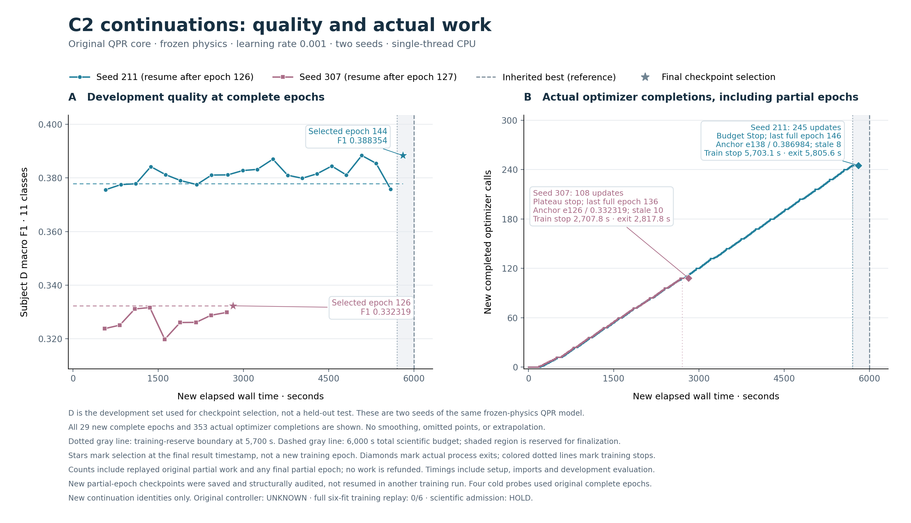

# HCSN：四阶段执行结果与架构判断

本报告汇集本轮实际执行的神经算子、任务自由边界、HX Cell、N256 和 C2 结果。每项结论绑定自己的模型、源码、数据和资源口径；各分支均以 Draft PR 保留。这里的研究判断不会替换原来的资格合同或历史失败记录。

**当前最有力的正面结果，是可微再生算子与任务自由边界可以分别做对。当前最有力的负面结果，是完整 HX 价值特征在本轮相同 CPU 时间预算下明显落后于普通门控和 GRU。** 两者都应成为下一步架构选择的依据。

## 1. 完成范围与判断

| 工作线 | 实际证据 | 可以支持的结论 | 尚不能支持的结论 |
| --- | --- | --- | --- |
| 完整 current-state 算子 | 完整待释放状态、确定性不应期、带符号内容、六项原始检查、60 次辨识更新 | 有界有限 CTMC 上可以继续运行并反向传播 | 一般扩散、任意移动边界、恒定长序列成本、真实 encoder 优势 |
| 神经任务自由边界 | 三个控制任务、三个 Bellman 网格、九个优化起点、八参数隐式梯度 | 指定收益/成本下可以得到内生阈值及其梯度 | 已与完整 encoder/C2 联合训练 |
| HX feature Cell | 30 个固定更新次数实验、36 个相同时间预算实验 | 已直接检验完整 equity/risk 特征的任务质量与成本 | 金融结构普遍优于普通门控，或优于 SNN/Transformer |
| N256 warm-1 | 稠密原件、独立稀疏执行、69,728 坐标比较、连续首次触界参考 | 一个固定时间步已实际执行并量化两类误差 | 原逐位一致门槛通过、完整大规模训练或全局连续极限 |
| C2 | 原检查点冷恢复及两条独立续训 | 见终态章节中的实际范围 | 原六条完整独立训练重放、原控制器终态已恢复 |

“可求导”“数值模型正确”“训练确实进行了”“同预算任务收益”是四个不同问题。当前没有同一个实现同时证明完整再生语义、任务内生边界、可控长序列状态成本和真实任务收益。

## 2. 仓库盘点与科学实现的对应

全仓路径/blob 盘点基于整合候选 `38351c487b286c86ce5d54e7d20bac364a1819da`，根树 `ae6756959590c2281d5460d8f2bab1fb428d8e4b`：32,151 个文件，全部路径和 blob 标识完整，根目录 63 项与 GitHub API 一致。`qualification` 有 12,408 个文件、278 个直接子目录，其中 HCSN 有 95 个目录、5,122 个文件。19,375 个 blob 的字节数没有取得，因此不报告虚构的全仓字节总量。

本报告随附[完整路径清单的无损归档](integration-inventory.json.gz)和[独立重建结果](INVENTORY_REVIEW.json)。`verify_inventory.py` 从全部路径、mode 和 blob SHA 自底向上重新计算 Git tree，实际得到上述完全相同的根哈希；并核对 32,151 叶节点、63 个根条目。该检查不读取 blob 内容，不能证明大小字段或源码逻辑正确。归档解压后精确恢复原 7,031,693 字节清单，原件 SHA256 `8ef132e8d53bd4a13f3b3b9cb2fa12d1ccd7565a2b25d0d353e2bc8247c82b74`；压缩件 1,155,721 字节。

收尾时重新读取真实 branch ref，整合分支已到 `e3443eb41426a1dc496793e1fa5fc19c98f1eb74`，根树 `9f5f29637febfbe736602de54e932fbe349e5afa`。Git 比较确认相对基础快照为 ahead 6 / behind 0，merge-base 正是 `38351c4...`；全部 35 个变化均为 `qa/stem-bakeoff/` 的新增文件。[完整增量](INTEGRATION_DELTA.json)绑定每个新增路径、mode、blob SHA 和大小。`verify_integration_delta.py` 将这 35 项加入完整原清单，实际重建出完全相同的新根树，得到 **32,186 个文件、63 个根条目**；[实际核验结果](INTEGRATION_DELTA_REVIEW.json)记录 0.648555 wall / 0.636185 CPU 秒、零 blob 内容读取及零模型调用。原来 19,375 个未知大小仍保持未知。

这次上游合并保留的是历史 Cell 输入覆盖控制与 growth-gate 证据；不能按合并日期把历史结果重新计作本轮训练。该增量未改变原 HCSN 源码或本报告各实验的冻结身份。完整路径证明、这 35 项的增量内容审阅与本轮数值实验是分别记录的工作。

35 个新增 blob 已全部取回并按 Git blob 哈希及长度核对，共 1,046,151 字节，[逐文件内容身份记录](INTEGRATION_CONTENT_REVIEW.json)随报告保存；没有执行其中的历史脚本。输入覆盖试验使用冻结的 LFM2.5-Encoder-230M 与 48 个小型 Linear Head，比较固定 192-token 上限内的 prefix/head-tail 选择。它的已发布主对比在每 Head 拟合 128 个来源时为 `+0.94479466` 个百分点，95% 配对来源组区间 `[-1.53464796,+3.57934517]` 个百分点，跨零；这一 128 也不是完整标注成本，因为还有训练池选择与共享校准标签。该记录既不是本轮 HX Cell，也不是完整再生 HCSN 的训练结果。growth-gate 目录则是已有结果重分析，新增训练为零。[历史输入覆盖说明](https://github.com/TrillionniumFoundation/hepta-private-ci/blob/e3443eb41426a1dc496793e1fa5fc19c98f1eb74/qa/stem-bakeoff/evidence/20261024-input-coverage/README.md)

深度源码和实验审阅基于 `bdfbae5c66a47ba71032d354a8576dc4aa25db92` 的 13,504 文件快照，以及各专项不可变源码/实际运行原件。全路径覆盖不等于对所有 Rust、前端、CI 和存档文件逐行证明正确；深入审阅集中在本次研究所依赖的数学核、状态、训练、恢复和证据链。

需要持续区分三种已存在的实现：

| 实现 | 实际状态和计算 | 边界及参数语义 |
| --- | --- | --- |
| `qualification/hcsn` 的 HX Cell | 有界 memory/recovery；特征为完整 HX equity/V 与首次触界概率 | 输入条件下的金融静态边界；本轮训练金融参数；没有实际触界/reset/不应期密度 |
| `qualification/hcsn_currentstate/differentiable.py` | 活跃概率和内容、上侧逃逸、累计读出、完整延迟通量/原子 | 有限空间 CTMC；逐段改变输入；#6748 修复后，原位更新 reset 也保留事件时快照；边界几何由调用者给出 |
| C2 冻结 v8 | 256 空间系数、1 个返回尾系数、16 个剩余时间相位，加内容与适配器 | 原 QPR/phase projection；物理参数和共同前后端冻结；训练内容、似然、门控、读出和适配器 |

因此，HX 的“双特征”、完整算子的“概率/内容通道”和 C2 的连续读出不应都称为同一个 Call/Put 神经元。原 C2 源码的实际 `cores.py` 哈希为 `95fcf93747520414a062183affd546f599bc415b2a9daa47e59db20f67412302`；只引用其历史基础 Git 提交不足以完整标识当时运行的源码。

## 3. 完整神经元：已完成的算子语义

当前有限状态算子的状态包含活跃概率/内容、永久非返回的上侧逃逸质量、累计触界数、折现触界数、占据时间、累计奖励、累计折现因子，以及所有未释放的指数通量包或原子。首通道是概率，其余通道允许带符号的内容质量；它们使用同一传输算子。

每段冻结输入通过矩阵指数推进；下边界流出在固定不应期之后按事件发生时的 reset 分布返回。参数变化作用于当前活跃动力学和新事件；原位更新同一个 reset Tensor 的事件快照保证由下述 #6748 修复提供，不能倒挂到旧源码。外部边界扫过通过明确的空间单元比例同时移除概率和内容，产生精确延迟原子；从连续移动边界计算这些比例仍是调用者的建模责任。

`state.value` 的终端条件是 **零**：只累计活跃/上侧逃逸的运行奖励和触界时支付的事件奖励；等待期奖励为零，返回时不重复支付事件奖励。任务若需要完整状态上的终端函数，必须明确声明并仅添加一次 `discount_factor * Phi(state)`。

固定的 Fraction 逻辑时间与不应期不参与求导。初始状态、速率、reset、内容、奖励和折现参数通过保存的图求导。冷保存恢复的是完整前向状态；序列化不保存早于检查点的 autograd 图。代码限制空间阶数 1..64，并在矩阵/包数/指数调用预算耗尽时明确拒绝；不会静默删去小概率包。

### 实际数值与训练

六项检查覆盖独立 Gamma 再生参考、DOP853 延迟方程、分段复合与冷恢复、扫过质量、参数/内容梯度、两层流量与内容的反传以及资源/非有限值控制。三个完整轨迹与独立 DDE 参考的最大差异约 `2.63124e-11`，概率和带符号质量守恒误差小于 `8.9e-16`。代表性两通道状态包含三个待释放包，共 3,336 个逻辑 tensor 字节，最大指数矩阵阶数 14，每轨迹 19 次指数调用。

六个速率的 60 次 Adam 辨识更新把 MSE 从 `7.0083583698e-4` 降至 `1.7483806557e-7`。这是对三个过程辨识轨迹的拟合，不是独立测试集 encoder 精度。最终本地 study 主体计时 4.007 wall / 4.006 CPU 秒，从数值依赖导入后开始；进程峰值 RSS 313,192 KiB 包括运行时。已发布源码在 hosted 验证中也完成六项检查及 60 次更新。

两层检查是上游通量/内容参与下游初始化和参数的可微组合，不是完整时间分辨的多层实时耦合网络。

证据：[完整算子 Draft #6741](https://github.com/TrillionniumFoundation/hepta-private-ci/pull/6741)，实际 hosted 源码 `369b4dd6e8352b33170e0b2169ab133a7215d7a8`，run `44465157713`。

### 事件时 reset 的额外缺陷修复

独立复查发现原实现直接保存 `physics.reset` 的 Tensor 引用。调用者之后原地更新同一个参数，会把已发放事件的 reset 从 `[0.25, 0.75]` 改成 `[0.8, 0.2]`。最小复现中，Atom/Flux 的未来活跃状态误差分别为 `0.55` 和 `0.08598435087199`。

修复只在两处事件记录中使用 `reset.clone()`。回归中两个前向误差都变成零；VJP 仍为 `[1,2]`，未来读出梯度与独立解析值之差为零及 `1.11e-16`。原六项检查加新增两项全部通过，两阶段复现/验证总计 5.814332 CPU / 5.875239 wall 秒。原始失败、日志和费用保留。

这保证事件记录的前向快照和普通图内梯度；它不承诺在保留活跃计算图时任意原地更新 optimizer 参数仍安全。旧长时程/训练数据仍绑定旧 kernel `fccee9781c86af243c5f691f876d0dec34296edfedc327d6f4a100bcd2def949`，未重新标记为新 kernel 的实验。

证据：[独立 reset 修复 Draft #6748](https://github.com/TrillionniumFoundation/hepta-private-ci/pull/6748)，修复源码 head `9b20d29391a23fe7f1d4fbb5b1377b10130a1c69`，加入 CI 回归及证据后的 head `972a5b72c158761bc4dd7729b5d06bc50e1a8c53`；该分支叠加于 #6741，kernel 改动仍只有两处语句。

发布后既有 workflow 自动在新源码 `9b20d293...` 运行了一次六项检查及 60 次辨识更新（run `44479509254`）。原件 ZIP 2,717 字节，SHA256 `0fed7cee45fcb4aabbe378d762061a0872254f1cbdde11ed5d315cc9300f3096`，下载后独立核对了实际 source head、修复后 kernel 哈希和结果：最终 MSE `1.748380655708663e-7`，DDE 最大误差 `2.631272977282606e-11`，质量最大误差 `1.1102230246251565e-15`。此 run 的 study 主体为 2.291059 wall / 2.284130 CPU 秒，排除导入启动；RSS 407,068 KiB 为进程峰值。它是新源码的新执行，不覆盖旧长时程结果，也尚不包含后来加入 workflow 的两项 reset 专门回归。

后续 run `44481454177` 在 `972a5b72...` 上明确执行并通过新增两项 reset 回归、原六项检查和 60 次辨识更新，最终误差/损失同上。其[原始 ZIP](reset-qualification-44481454177.zip)、[API 元数据](RESET_CI_METADATA.json)和[独立原件审阅](RESET_CI_REVIEW.json)在本目录永久保留。ZIP 为 3,326 字节，SHA256 `ed431ff60f5f14bcc1725f2570aca20d4a9e648a8d73a280a58b17e3cdaf3458`。study 主体 2.912382 wall / 2.911522 CPU 秒，同样排除导入；RSS 为 407,820 KiB。没有把其中某次较短耗时挑作硬件加速证据。

## 4. 长时程成本与延迟近似

对单活跃状态、触界率 1.7、确定性不应期 0.2、两个通道 `[1,-0.3]`，独立 80 位 Gamma 有限再生和验证了 1、4、16、32、64 个不应期间隔。五个实际新进程全部完成，总计 13.503 wall / 13.402 CPU 秒。最大值误差 `6.04e-14`，最大速率梯度误差 `9.06e-14`。

| T/d | 动态 tensor 字节 | 加上 Physics 的持久 tensor 字节 | 包内生成元阶数 |
| ---: | ---: | ---: | ---: |
| 1 | 192 | 256 | 2 |
| 4 | 816 | 880 | 8 |
| 16 | 9,072 | 9,136 | 32 |
| 32 | 34,416 | 34,480 | 64 |
| 64 | 134,256 | 134,320 | 128 |

虽然每例只剩一个包，包内部的生成元仍在增长。最长例前向推进加不应期查询约 0.1344 秒，六个独立标量反向调用合计 2.3328 秒；这不等于一个网络总损失的单次 backward。上述 payload 不含 Python、allocator 和 autograd 存储，进程 RSS 则包括运行时整体成本。

另一个单独冻结的 20 例实验把固定延迟换成等均值 Erlang 阶段，K=2/8/32/128，覆盖同五个时点。全部完成，37.708 wall / 37.547 CPU 秒。原完整算子调用次数为零。

| K | 动态字节 | Physics 字节 | 合计字节 | T=d 的最大值绝对误差 | T=d 的最大速率梯度误差 |
| ---: | ---: | ---: | ---: | ---: | ---: |
| 2 | 136 | 144 | 280 | 0.07605797 | 0.03634770 |
| 8 | 232 | 816 | 1,048 | 0.04199150 | 0.02171389 |
| 32 | 616 | 9,264 | 9,880 | 0.02234545 | 0.01225878 |
| 128 | 2,152 | 135,216 | 137,368 | 0.01156038 | 0.00655817 |

误差取触界计数、活跃质量、不应期质量及两通道的最大值。K=128 的阶段状态虽然小，其实际稠密 Physics 矩阵仍有 135,216 字节；在 T/d=64，它的合计持久 tensor 大于确定性版本。这是一个两通道案例的计数，未推算 batch 共享 Physics 后的成本或实际 GPU 显存。两批实验的时间不能直接当作配对加速比。

等均值意味着相同的长期平均发放率，并不意味着相同的暂态或累计计数。固定有限维线性时不变阶段系统的传递函数为有理函数，无法对任意历史精确实现 `exp(-s*d)` 的纯延迟；这一论证只限制该系统类，不能推出所有非线性或特定输入族的压缩都不可能。

证据：[长时程报告](https://github.com/TrillionniumFoundation/hepta-private-ci/blob/a7b5beac60648c7c115e1cef1bc059fe0c036886/qualification/hcsn_currentstate/evidence/longtime-20261119/README.md)、[Erlang 全部原件与 25 点图](https://github.com/TrillionniumFoundation/hepta-private-ci/blob/a7b5beac60648c7c115e1cef1bc059fe0c036886/qualification/hcsn_currentstate/evidence/erlang-compression-20261119/README.md)。

## 5. 由任务收益决定的内生自由边界

已实现一个可以独立验证的再生控制问题。活跃状态满足 `dY=mu dt+sigma dW`，运行收益 `alpha*Y-ell`；发放支付成本 K，等待 d 后返回固定绝对状态 a，以 rho 折现。目标为活跃期收益减所有折现发放成本。该实现要求 alpha、K、rho、sigma 为正，ell 非负，`0<d<=2`，并满足继承的物理参数域与下述 reset 距离约束。

令 `eta=exp(-rho*d)`，`kappa=(mu+sqrt(mu^2+2*rho*sigma^2))/sigma^2`，`p(y)=alpha*y/rho+alpha*mu/rho^2-ell/rho`。阈值 b 上方：

```text
U_b(y) = p(y) + A_b exp(-kappa*(y-b))
A_b = [-K + eta*p(a) - p(b)] / [1 - eta*exp(-kappa*(a-b))]
U_b(b) = -K + eta*U_b(a)
smooth pasting: A_b = alpha/(rho*kappa)
```

边界残差对 b 的导数为 `(alpha/rho)*(1-eta*exp(-kappa*(a-b)))>0`，提供单调求根及 `db/dtheta=-R_theta/R_b` 的一阶隐式梯度。给定条件下的 QVI 验证同时检查延续区和干预区；最优 reset 距离超出实现域 `(1e-4,8)` 会明确拒绝，不截断伪装成解。

这里对消元后的匹配/光滑粘贴系统求导；不能直接把光滑粘贴为零的状态导数拿来作隐式梯度分母。根唯一也不保证所有域内点的梯度条件数都好，`R_b` 很小时仍需单独监控。本实现是八参数 FP64、一阶梯度的小控制模块，不提供高阶导数或大规模 GPU 内核的资格。

三个任务、三个网格的独立 Bellman 策略迭代、三个初始阈值分别比较：九个优化起点全部完成；八参数隐式/有限差分最大差异 `2.53e-10`，学习边界最大误差 `5.32e-9`；最细 Bellman 网格的触发位置误差不超过 0.336 个网格单元，reset 价值相对误差不超过 `1.24e-5`。扩大计算域后的价值变化小于 `8.2e-14`。

这些结果确实把 free-boundary 方法变成了神经控制目标的一部分，但本例参数在 episode 内固定，尚未接入完整 encoder 或 C2。金融破产终止使用的 equity matching 条件不能直接替换再生 reset 条件；本模型中的 `-K+exp(-rho*d)*U(a)` 是重新建立的神经任务价值。

本例的运行收益只依赖标量 Y，没有把高维内容的预测质量、等待队列或跨模态收益纳入价值状态。把这些变量加入实际任务以后，最优边界一般会成为依赖内容与历史状态的曲面；本例一维闭式结构不会自动保留。输入条件化的局部参数或近似价值函数可以作为候选实现，但其误差和任务收益需另行验证。

小控制模型中对 d 的解析梯度，不等于完整 current-state 算子已经能对 Fraction 事件调度求导；后者的不应期和逻辑时点仍固定。

证据：[Draft #6739](https://github.com/TrillionniumFoundation/hepta-private-ci/pull/6739)，已发布 head `0ca096781651508250c950829c347a38edcfede4`。

## 6. HX Cell：固定更新与相同时间预算给出不同判断

数据为 delayed recall 与 adding 两个小任务，长度 16、宽度 8、batch 32、FP32、单 CPU 数值线程。独立训练/验证/测试样本数为 512/128/256；三个种子改变初始化和 minibatch，共用一个独立测试集。标准差反映三种子的变动，不是多个独立数据集的置信区间。

HX dual 与匹配普通 gate 均有 257 个可训练参数，共用初始映射和 memory/recovery 结构；GRU 为宽度匹配的 297 参数。HX 金融参数实际训练。HX/gate 的状态 payload 为每例 64 字节，GRU 32 字节；HX feature Cell 没有空间密度或延迟队列。

### 固定 160 次更新

五个模型、两个任务、三个种子共 30 个完整结果。原 1,800 秒批次完成 26 个，随后一次受限恢复完成剩余四个；两次原始中断及未知在途更新数、全部费用均保留。

| 模型 | Recall MSE，均值±样本 SD | Adding MSE，均值±样本 SD |
| --- | ---: | ---: |
| HX dual | 0.174965 ± 0.132240 | 0.170420 ± 0.005067 |
| 匹配 gate | 0.200564 ± 0.126215 | 0.170647 ± 0.005690 |
| HX call | 0.174757 ± 0.132297 | 0.170423 ± 0.005065 |
| HX risk | 0.193602 ± 0.141760 | 0.169947 ± 0.004412 |
| GRU | 0.344451 ± 0.002014 | 0.171024 ± 0.002941 |

这个固定更新口径下，HX recall 均值优于该 gate 和 GRU，但变动大、adding 接近常数基线，并且完整双特征与 call-only 非常接近。它不构成双特征机制或相同成本优势的证明。

### 每个模型实际使用 20 秒训练预算

六个模型、两个任务、三个种子共 36/36 完成，总控制器时间 890.854 秒。20 秒包含初始验证、训练、梯度检查、周期验证和内存内候选复制。验证及复制均在截止前完成才允许选中。导入、构造、最终保存、测试与延迟测量单列在完整进程费用内；到期在途操作的实际更新和超时没有删除。

| 模型 | Recall MSE，均值±样本 SD | Adding MSE，均值±样本 SD | Recall 实际更新范围 |
| --- | ---: | ---: | ---: |
| HX dual | 0.362838 ± 0.032309 | 0.177412 ± 0.007918 | 15–30 |
| HX dual prepared | 0.345257 ± 0.004619 | 0.177195 ± 0.007563 | 38–45 |
| 匹配 gate | 0.00157511 ± 0.00087182 | 0.00276613 ± 0.00083097 | 706–1,327 |
| HX call | 0.346256 ± 0.005319 | 0.426393 ± 0.439096 | 30–31 |
| HX risk | 0.00248298 ± 0.00036106 | 0.0298515 ± 0.0322815 | 740–779 |
| GRU | 0.000021893 ± 0.000017344 | 0.000193898 ± 0.000061410 | 5,309–5,315 |

prepared 保留完整 HX 表达式和梯度，通过每次 forward 内的齐次结构复用计算；没有跨 optimizer 缓存或 detach。它在这个预算下仍未追上普通 gate。Adding/call/101 的晚验证不合格，只选中初始检查点，test MSE 约 0.9334；这个不利样本原样纳入均值。

“达到常数预测器一半验证误差”的目标也给出一致方向：两个任务中，HX dual/prepared/call 均为 0/3 在预算内达到；gate/risk/GRU 均为 3/3。记录的是定期验证首次观察时间，不是精确穿越时刻。

CPU 环境为共享主机。首例期间发生一个短时独立标量复核，原记录保留；全矩阵之后仅做了一次同源码首例诊断重复，不替换原样本、不计入 36 个均值。没有据此删除异常值，也没有宣称独占硬件基准。

**这一轮支持“先解决完整 HX 特征的实际成本，再考虑扩大”。它没有否定所有参数域、任务和硬件上的研究可能性，但已否定用当前实现的固定更新均值来宣传 CPU 同预算优势。**

证据：[Draft #6744](https://github.com/TrillionniumFoundation/hepta-private-ci/pull/6744)、[全部 66 点图及原件](https://github.com/TrillionniumFoundation/hepta-private-ci/blob/4939bf7cbefaae9f9f71533b36580c6b81327e45/qualification/hcsn/campaign_audits/hx-wall-20261119/README.md)。

### 单独的 FP32 远尾梯度修复

新增复查发现某些远尾参数下 equity 值有限而梯度为 NaN。独立修复使用受域限制的正矩展开和稳定尾部比值，保留域外原分支；没有通过裁剪结果或随意加 epsilon 掩盖问题。80 位参考的新分支梯度相对误差约 FP64 `9.74e-14`、FP32 `1.62e-7`；域外原分支的既有较大误差仍保留。

hosted 相关测试 121/121 通过。该修复晚于 30+36 个主实验，主实验没有使用此修复；不得用新源码冒认旧实验，也不能把主实验的成本失败归因于未在那里观测到的远尾 NaN。

证据：[独立 Draft #6745](https://github.com/TrillionniumFoundation/hepta-private-ci/pull/6745)，head `7d7df6d0349ed4d3930556f5003a9ba90ae1e5d0`。

## 7. N256：实际执行与两种误差

修复原 workflow 的 YAML 和 runner/Python 可用性问题后，固定的 warm 0→0.001 时间步已真正运行：两个稠密指数、一个序列化输出，69,728 个解码坐标、9 个包、560,358 字节。原件 SHA256 为 `b2a6e204e613fead7c0735b12a335a88d2394c8f4da99cab798133443c55dc18`。

独立 CSR 组装和 `expm_multiply` 执行比较了全部 69,728 个坐标：最大绝对差 `9.0899510141e-16`、最大对称相对差 `5.5018733734e-14`，但有 1,291 个逐位差异，所以原逐位一致门槛仍是 **RED**。生成元和输出算子本身逐位相同。没有更改旧门槛把该结果变成通过。

第二个独立比较直接读取冻结的 FP64 节点质量，使用 45/80 位连续首次触界及源卷积，不执行新的有限网格传播：连续触界量 `0.00527158440549492448`，稠密值 `0.0052714509584328596`，相差 `-1.334470620649e-7`，约 25.3144 ppm；折现量相对差约 25.3023 ppm。该结论只适用于相同节点初始分布和这一时段。

稠密/稀疏一致性与有限网格/连续扩散误差是不同层面。两个算法接近机器精度，并不使连续模型误差也成为机器精度。此处仍没有 N256 全序列训练、任意参数一致精度或全连续极限梯度结论。两种执行的成本包含范围不同，因此不计算不公平的加速比。

证据：[实际稠密执行 #6740](https://github.com/TrillionniumFoundation/hepta-private-ci/pull/6740)、[稀疏比较与连续参考 #6742](https://github.com/TrillionniumFoundation/hepta-private-ci/pull/6742)，后者 head `8a43dec4bf4ad92b3be9af6b42ce272d6d08763b`。

## 8. C2：实际冷恢复与独立续训

两条 continuation 均已取得实际 producer、逐 PID wait4 和原生控制器终态；原生任务 `1a1f286aa59-ffbe-b5c` 为 `succeeded`、exit 0、输出完整、终态发布已确认。两条训练的停止语义不同。全量封存、35 个分片的本地重组及独立逐轨迹审计均已实际完成。

| Fit | 恢复完整 epoch | 最后完整 epoch | 新完整 optimizer 更新 | 选中 best epoch/F1 | 实际停止 | 实际 wall / CPU 秒 |
| --- | ---: | ---: | ---: | --- | --- | ---: |
| s211/lr.001 | 126 | 146 | 245 | 144 / 0.388353751030186 | BUDGET_STOP | 5805.587806 / 5721.835218 |
| s307/lr.001 | 127 | 136 | 108 | 126 / 0.33231907785802234 | COMPLETED_PLATEAU | 2817.803327 / 2783.269963 |

seed 211 在科学预算内预留最终验证时停止，正常 exit 0；245 次 started/completed 对齐，924 次训练 micro-forward、88 次 development forward。第 147 轮只有五个已提交的有效 batch，完整 cursor 保存当前 epoch、356 个 episode 的既定顺序、下一个 offset 160 和五项加权目标；另一个 batch 已进行四次 micro-forward，未提交 optimizer 更新。不能将这一轮计为完整。最后完整 epoch146 的 strict-best 是 epoch144，而平台期 anchor 仍为 epoch138、F1 `0.38698437025179494`，stale 为八；小幅 strict-best 改善没有错误重置耐心。

该例最终最佳模型 D 评价实际完成 31,952 事件，accuracy `0.71457185778668`，macro-F1 从继承的 `0.37790299262340454` 升至 `0.388353751030186`，增加约 1.0451 个百分点。这是用于模型选择的开发集增益；`training_adequacy_established=false`，没有满足平台期停止条件，也没有评估独立确认集。峰值 RSS 为 3,503,780 KiB。RESULT/COST 的 SHA256 分别为 `4d28b70f559134469ed8726747166284e875d5f5e5e30f5c65285cb44591928f` 和 `74ae34f997552bc94ecabdeb725736e5d76f3fb76f9b48ceeab0a0985f5aeeff`。

seed 307 按原平台期规则 `COMPLETED_PLATEAU` 正常 exit 0，108 次 started/completed 对齐、405 次训练 micro-forward；完整最佳模型 D 评价再次完成 31,952 事件，质量没有高于继承的最佳值。峰值 RSS 3,536,760 KiB，约 3.373 GiB；没有预算越界、外部停止、硬杀或残留 optimizer 不确定区间，partial cursor 为 null。其结果 SHA256 为 `4d090fd0feaa9f98a8a255852dc4e7a0e9d554650eadb2c26ff8d58b7fcae57a`，wait4 成本原件 SHA256 为 `4cf3a00a40c497ea9960094eb87c1451720a0a34ecda965877bfe1a8caa29bc0`。

两个进程的完整 CPU 合计 8,505.105181 秒、各自 wall 合计 8,623.391133 秒，并发墙钟跨度 5,805.587806 秒；这些是训练子进程口径，后续封包、传输和独立只读审计另外计费。共 353 次新增完整 optimizer 更新、29 个新增完整 epoch；两者均没有科学截止后的 optimizer 完成、外部停止、硬杀、RSS 超限或未决 optimizer 完成区间。

终态后的完整归档包含 667 个成员，其中运行输出 437 个；原始成员合计 200,305,468 字节，所有更新与 epoch 检查点、日志、冻结源码及 182 个原始证据输入均保留。压缩件 144,225,308 字节，SHA256 `05b10e450be5e234db9d89512c243e8267764d7ff19b777d1e479d0300154050`，分为 35 个不超过 4 MiB 的可逆分片。归档器实际逐成员回读并核对归档前后源文件哈希；该阶段另计 102.296762 wall / 100.603655 CPU 秒，峰值 RSS 118,394,880 字节，模型和 optimizer 调用均为零。数据集 payload 仍由完整原始清单标识并留在原数据位置；归档和只读读者不把“清单一致”冒认为再次读取全部外部数据。传输出现过明确的 GitHub 连接超时，已上传分片复用，各失败尝试与接续费用保留。

预先固定的独立 `audit.py` 首次实际运行即为 `VERIFIED_ARCHIVED_CONTINUATIONS`，exit 0、stderr 为空。它核对全部 667 个成员和两个 fit 的 265/117 个新增检查点，共 382 个；验证恢复 tensor 字节、AdamW 步数、冻结参数、Python episode 顺序、加权目标、epoch 链、partial cursor、strict-best/平台期停止及逐 PID 成本。从保存的最终 logits/labels 用独立 NumPy 算术重算，指标最大绝对差 `2.22e-16`；两份 macro-F1 均精确一致。原检查点后幸存的 10/11 条旧更新记录与本次重算的 loss、梯度 norm、事件数和 micro-forward 数全部一致。

只读审计没有构造模型、重新推理、重新生成梯度或运行 optimizer，也未重哈希外部数据 payload；它不构成独立训练重放。其完整新进程费用为 14.652554 wall / 14.414620 CPU 秒，含 Python/NumPy/Torch 导入，峰值 RSS 552,816 KiB；审计主体的 11.902168 秒另有记录，不能代替完整进程成本。审计源码前后 SHA256 均为 `d3da9e6357473d2440fdc0bca46f6880b056489b71935b1253941dbab0945776`，REVIEW 原件 38,605 字节、SHA256 `617758a0a23e69cf7687c3faa70a51b174514d472a0d0225bce5c9ad126f5a3c`。`1e-12` 只用于同一保存 logits 的独立算术比较，未增设或放宽跨 runtime 训练资格。



[矢量图](c2-continuation-progress.svg)、[逐点数据及来源身份](c2-continuation-progress-data.json)和 `plot_c2_continuation.py` 从同一完整归档与实际审计结果生成；保留 29 个新增完整 epoch 和 353 次实际完成更新，不平滑、不删点、不外推。星号是最终结果时点的检查点选择，不是新增训练 epoch；训练截止与进程退出分别标记。两次导出中后一次只修正版式，未重跑审计或模型；最终 PNG 已人工视觉核对。

seed 307 的完整 epoch 检查点为 450,552 字节，不能代替其 3,621,642,240 字节实际训练峰值 RSS。该例冻结表单独计数的唯一 tensor storage 峰值为 155,990,016 字节，排除 Python key 和 allocator；累计构表 301.393 秒、四次清理，模型检查点重载会实际清空缓存。最终最佳模型完整 D 复评也消耗预算，而不是免费的恢复动作。没有能耗或 GPU 显存观测。

两条恢复点分别为 s211/lr.001 的完整 epoch126、s307/lr.001 的完整 epoch127。恢复模型、AdamW、RNG、完整历史、strict-best 和 plateau anchor；继承的完整开发集评价精确复现 F1 `0.37790299262340454` 和 `0.33231907785802234`。这是恢复检查，不能计作新增学习收益。

前置独立冷恢复实验从两个检查点各运行两份新进程，共四次实际 AdamW 更新、16 个 micro-forward；同检查点的两份结果逐位一致。四份完整进程耗时合计 246.6963 wall / 245.1995 CPU 秒。独立读取检查没有重新执行 forward 或 optimizer。

续训每条 6,000 科学 wall 秒，包含导入、输入核验、构表和继承 best 验证，并在该预算内预留最后 300 秒收尾；30 秒额外宽限只处理在途/终止清理，独立计费。两个进程分配不同物理 CPU、各单线程、各 8 GiB 地址空间和 6 GiB RSS 上限。保留原 strict-best 规则、0.002 平台期改善量、10 轮耐心、最少 30 累计 epoch 和 C2 的 200 累计 epoch 上限。

每完整更新保存不可变模型/optimizer/RNG 及 mid-epoch 游标；每完成全训练 epoch 和全 D 评价再提交 epoch 记录。训练集 89,216 事件，D 开发集 31,952 事件，11 类 macro-F1 用于选择；独立封存确认集 E 没有被评估。开发最佳分数不是独立测试结果。

上述新第 147 轮检查点的保存与只读结构审阅，不等于已经从它另行执行一次恢复训练；前置四次实际 cold probe 恢复的是旧完整 epoch126/127。本轮没有增加新的部分轮次恢复训练身份。

新环境为 Torch 2.8.0+cpu，旧环境为 2.8.0+cu128。冷恢复数值吻合不使两个环境身份相同。旧未知尾部、s211/s307 原检查点后的已知 10/11 次更新、额外冷恢复四次和本次重算都保留自己的工作与费用，不退款或合并冒认。

原控制器仍为 **UNKNOWN**，完整六条独立训练重放仍为 **0/6**，原科学准入仍为 **HOLD**。新终态即使完整，也不填补旧优化时段缺失记录，更不自动修复旧 QPR 数值语义。

原 C2 另外四条已有 producer 结果也已保留并独立从 confusion matrix 重算：

| 原 fit | producer 累计 epoch | D macro-F1 |
| --- | ---: | ---: |
| s101 / lr.001 | 116 | 0.3440169978 |
| s101 / lr.003 | 76 | 0.3878342597 |
| s211 / lr.003 | 50 | 0.3910932361 |
| s307 / lr.003 | 72 | 0.3498305889 |

四份开发指标重算差不超过 `1.11e-16`；这些是旧 producer 结果，并非本轮重新训练。六份旧 journal 中幸存的完整 optimizer 调用共 3,489，是下界。它们与两份新身份续训的轨迹、预算和环境分别保存；本报告没有将它们拼成一个新的同预算模型排名。

证据：[四次冷恢复 #6746](https://github.com/TrillionniumFoundation/hepta-private-ci/pull/6746)、[两条独立续训 #6747](https://github.com/TrillionniumFoundation/hepta-private-ci/pull/6747)。 后者最终 head 为 `36af54220083137147541f57e0f77243ca3a6f04`，tree 为 `e5acf5e0dc181a654d0fcad6b89d209e294541b7`；[完整终态报告](https://github.com/TrillionniumFoundation/hepta-private-ci/blob/36af54220083137147541f57e0f77243ca3a6f04/qualification/hcsn_c2_continuation_20261119/README.md)与[独立审计原件](https://github.com/TrillionniumFoundation/hepta-private-ci/blob/36af54220083137147541f57e0f77243ca3a6f04/qualification/hcsn_c2_continuation_20261119/evidence/independent-audit/attempt001/REVIEW.json)均已按不可变提交发布，仍为 open Draft。

## 9. 对原设想与扩大研发的判断

He–Xiong 原论文提供共同生成元下的价值方程、首次触界结构、内生违约边界和匹配/光滑粘贴方法。这些方法可以用于神经建模；但 equity 的金融价值不自动成为物理恢复力，首次触界概率也不是 put 价格或自激 panic 过程。若要由它们驱动动力学，必须另行定义漂移、反馈、噪声、reset 和任务损失，再分析稳定性与训练效果。

更严谨的算子映射是：先定义状态生成元 L，价值通过向后方程 `(L-rho)U+r=0` 求得，概率/内容密度通过对应的向前算子 `L*` 传播，吸收边界通量给出触界读出，再添加 reset 与不应期再生。固定边界下，存续算子 `P_t^b f(x)=E_x[f(Y_t) 1{tau_b>t}]` 和触界测度 `Pr_x(tau_b in dt)` 是可组合动力学的基础；奖励积分及终端给付形成价值函数。一个特定奖励下的闭式价值，并不自动提供任意输入历史的完整状态转移。要保留 Call/Put 风格的双读出，可以将它们作为价值/风险特征或由任务重新定义的延续/干预价值，但应与真实概率及内容通量分别记录。

本轮实现的可迁移成果，是明确的完整状态、再生 Bellman 条件、可微解析参考和分离误差层次的验证方式。当前只能把金融 feature Cell 与真实再生流算子视为两个互补研究分支，不能合并其各自优点形成未经实测的“单一全新 network 已成立”结论。

### 层间接口与训练机制的具体判断

只给 `V_b` 或 `V-V_b` 不能唯一确定本轮完整可继续运行状态：两个单元可以具有相同边界和 margin，却积累了不同的内容、密度和即将释放的事件。上游可以保留内部等待状态，margin 也可以是有意选择的读出；这一反例不证明所有 margin-only 网络无效。对于希望传输发放内容的网络，更完整的候选接口应显式传输触界质量增量、对应的带符号内容质量增量，再按需要附加 margin/价值特征。下游如何将这些量写入状态、改变漂移或触发边界扫过，是仍需固定并验证的耦合规则；其任务收益应与 margin-only 读出比较。

本轮控制问题的最优 b 在 episode 内固定，因此它是策略参数，单独逐层重复传 b 不会携带该 episode 内新到达的输入内容。随输入变化的状态、margin 和发放通量才提供相应时序信息。若改为输入条件下的 b(t)，就需要处理移动边界：例如在几何 Brownian 状态和可微确定性正边界下，`x=log(V)-log(b(t))` 的漂移包含额外的 `-b'(t)/b(t)`；跳变边界还需要处理被扫过的概率和内容。固定边界首次触界公式不能跳过这些项直接复用成任意动态边界的精确解。

连续密度通量可以作为群体或随机神经元的期望发放读出。它不自动等同于一条确定性单神经元轨迹的离散脉冲序列，也不自动获得事件硬件的稀疏执行收益。若最终需要实际离散事件，采样、低噪声极限和跨事件梯度又会引入额外的定义与验证问题。

经过非线性层和损失后，通常 `loss(E[spikes]) != E[loss(spikes)]`。因此，直接训练连续密度读出的确定性网络，并不自动等于对某个离散随机 SNN 的期望损失做精确优化；多单元相关性也不能从单元守恒自动推出。两种网络语义都可以研究，但应预先声明实际训练对象，而不是借单元解析参考宣称整个随机网络严格等价。

解析价值函数提供了可验证的特征、参考值和边界条件；它没有代替输入驱动的状态转移、reset 后的继续演化或延迟状态。光滑粘贴使匹配处的一阶状态导数连续，但不保证任意参数方向梯度良态，更不消除沿时间的反传和保存/重算成本。本轮对任务自由边界使用消元残差的隐式导数，正是为了避免把边界处为零的价值斜率误当作可逆分母。

相对 SNN，连续通量提供直接可微的密度/期望读出，但普通 SNN 也有 surrogate gradient 和 EventProp 等训练路径；BP 并非独有优势。相对 Transformer，递归状态有潜在流式益处，但密度、内容、延迟结构与反传图的成本必须实算；连续流本身不等于稀疏硬件事件。Closed-form 连续时间特征也不是新的唯一性依据，CfC、SSM 等应进入公平控制。

创新性也需要更窄地表述。Brunel–Hakim 的原始神经网络研究已经使用膜电位密度、吸收阈值上的发放通量与 reset 注入条件。因此，“概率流代替单条离散脉冲”本身不能构成首创证明；本项目需要检验的是任务内生释放边界、价值特征、带内容的再生流及其可训练实现能否形成有用的新组合。[原始研究](https://arxiv.org/pdf/cond-mat/9904278)

近期的原始研究 Mészáros、Knight、Nowotny（2025）还将 EventProp 扩展到多次发放、递归连接和可学习突触传输延迟，提供权重及该延迟的精确梯度。突触传输延迟与本项目的内在不应期 d 是不同参数，不能直接混称；但这项工作进一步说明“能反传”或“时间参数可学习”不是 HCSN 的独占优势。本报告不把其论文中的速度倍率转用于本项目。[论文及公开全文](https://pmc.ncbi.nlm.nih.gov/articles/PMC12644660/)

本轮没有新增同条件 Transformer/SNN/GPU/全模态实测，所以不报告精度、能耗或吞吐领先。研究的下一次扩大应由同一个候选实现通过以下可复查条件决定：

1. 在明确输入/参数域内保持继续运行、质量/内容守恒、正确 reset/延迟、可验证梯度；分开报告有限模型、连续近似和边界控制误差。
2. 对长序列完整状态设定预先声明的成本和近似误差目标；包括 Physics、密度、内容、等待结构和训练图，而不是只数一个隐向量。
3. 将任务边界接入该实际算子，保持相同预算和充分训练，对单/双特征、固定/学习边界、reset、只传 margin/传内容通量、完整/近似状态进行逐因素消融。
4. 在真实独立测试集上同时比较相同预算效果及达到相同效果的费用；选择观察时间、截止与异常处理均预先固定。

上述条件是下一轮尚待实现的研究门槛，不是本轮已经通过的资格。

## 10. 原始方法来源

- He, Z. and Xiong, W. (2012). [Rollover Risk and Credit Risk, Journal of Finance 67(2), 391–430](https://zhiguohe.net/wp-content/uploads/2023/12/The-Journal-of-Finance-2012-HE-Rollover-Risk-and-Credit-Risk.pdf). 金融违约终止模型与本文的神经再生控制目标分别建模。
- Wunderlich, T. and Pehle, C. (2021). [Event-based backpropagation can compute exact gradients for spiking neural networks](https://www.nature.com/articles/s41598-021-91786-z). 特定连续时间脉冲模型可用事件伴随条件求精确梯度。
- Mészáros, B., Knight, J. C., and Nowotny, T. (2025). [Efficient event-based delay learning in spiking neural networks](https://www.nature.com/articles/s41467-025-65394-8). Nature Communications 16, 10422；多次发放及递归网络的突触延迟梯度，区别于本项目的内在不应期。
- Brunel, N. and Hakim, V. (1999). [Fast global oscillations in networks of integrate-and-fire neurons with low firing rates](https://arxiv.org/pdf/cond-mat/9904278). Neural Computation 11(7), 1621–1671；膜电位密度、阈值通量和 reset 注入的已有原始研究。
- Neftci, E. O., Mostafa, H., and Zenke, F. (2019). [Surrogate Gradient Learning in Spiking Neural Networks](https://arxiv.org/abs/1901.09948). 脉冲网络的另一训练路线。
- Hasani et al. (2022). [Closed-form continuous-time neural networks](https://www.nature.com/articles/s42256-022-00556-7). 连续时间解析形式的已有神经架构背景。
- Gu, A. and Dao, T. (2023). [Mamba: Linear-Time Sequence Modeling with Selective State Spaces](https://arxiv.org/abs/2312.00752). 内容条件递归状态和硬件实现的比较背景。
- Dao et al. (2022). [FlashAttention: Fast and Memory-Efficient Exact Attention with IO-Awareness](https://arxiv.org/abs/2205.14135). 实际注意力成本应包含 IO/内核实现，不能只用抽象复杂度排序。

## 11. 交付状态

全部研究分支保持 Draft，不合并主线。原源码、失败、超时、在途更新、预算和未通过门槛保留。发布前以各 PR 的不可变 head、实际原件哈希、终态和成本完成最后的索引核对。

GitHub 仓库 API 的本轮实际读回为 `private:false`、`visibility:public`；仓库名称中的 `private` 不是访问控制。这里的发布记录按真实可见性描述，Draft 状态本身不改变仓库的公开性。

本轮 C2 两条新身份续训、完整归档及唯一一次独立轨迹审计均已完成；各结果仍保留上文的停止、数据、模型、环境及科学准入范围。没有把独立证据核验通过改写成全模型资格通过。
