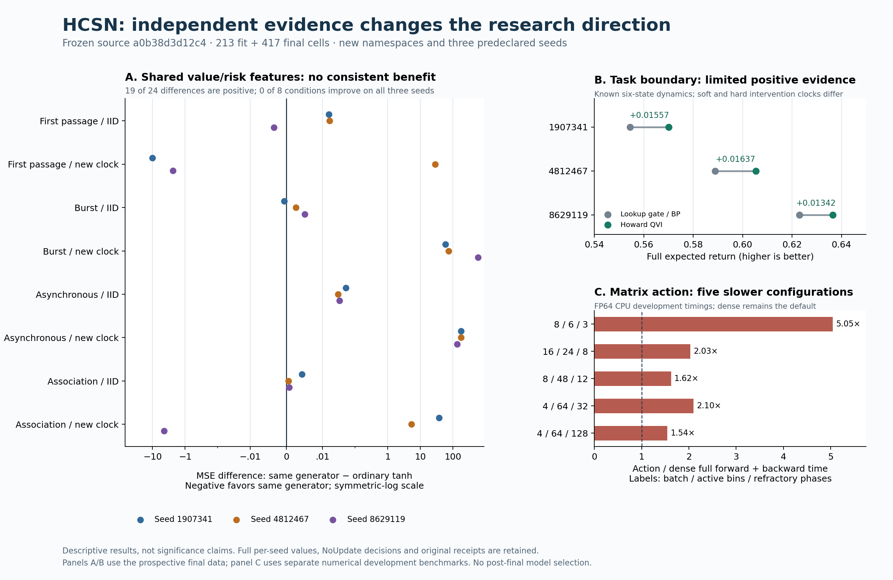

# HCSN 六项推进：实现、独立确认与运行链审计

日期：2026-11-21。研究源码冻结于 [`a0b38d3d12c45a4fd254ca27fe1d4266b4c75c53`](https://github.com/TrillionniumFoundation/hepta-private-ci/commit/a0b38d3d12c45a4fd254ca27fe1d4266b4c75c53)，源码 PR 为 [#6911](https://github.com/TrillionniumFoundation/hepta-private-ci/pull/6911)。本目录是运行完成后的只读证据归档；其后续 Git 提交不是实验所用源码版本。

## 结论与处置

本轮完成了统一有限过程、完整延续的任务控制参照、可选作用核、五组独立机制实验和当前运行链核查。新的结果支持继续研究**任务价值驱动的重置控制**；尚未支持共享解析通道的普遍预测增益、作用核净加速，或权重编程替代整个网络的 BP 训练。当前总体状态为 **HOLD：研究实现可继续，生产采用与全链准入尚未闭合**。

| 原工作项 | 本轮实际推进 | 新证据的含义 | 尚未闭合的部分 |
|---|---|---|---|
| 统一动力学 | 同生成元的价值、首事件风险、事件计数；锁定重置相位；固定延迟年龄参照 | 有限状态过程的定义与可执行参照已建立 | 连续扩散极限、任意时变固定延迟，以及网络风险群体口径的统一 |
| 任务价值边界 | 完整状态的继续／重置优势、Howard QVI、精确干预执行；独立 H2 | 六状态已知动力学问题上，三个种子均优于当前 soft gate | 学习动力学、部分可观测状态、相同决策时钟，以及全序列网络内的任务边界 |
| 动态核 | 带状 uniformization 作用、合法区间内复用、完整前后向计时与 profiler | 数值吻合，但五个配置全部更慢 | 融合实现及同误差、同质量的净加速；保留 dense 默认 |
| 学习方式 | 固定读出和共同可编辑范围两组实验；直接解、BP、语义程序、混合 | 无普遍替代 BP 证据；大量 NoUpdate 必须单列 | 完整程序设计费用、更充分的训练与稳定外推 |
| 目标任务 | 首达、突发、异步传感、关联记忆；新时钟；真实六架构对照 | 获得可重复读取的负面小规模证据，暴露明显外推退化 | 成熟容量基准、真实多模态任务、GPU／能耗和扩展规律 |
| 当前运行链 | 当前源码测试、后端算子身份、固定延迟冷恢复、CI 和历史门槛核查 | 当前候选可运行，研究数据完整 | 全仓平台 CI、N256、原始 C2 训练链、HPCA 仍有独立阻塞 |

图 A/B 来自本轮预先声明的独立最终数据；图 C 来自此前保留的数值开发基准。图中的种子差异只作描述，未进行显著性推断。全部原始指标见 [冻结报告](FROZEN_REPORT.md) 和 [原始证据包](formal-evidence.zip)。

## 1. 实际运行的版本、数据与完整性

本轮从基线 `602e2db1ed9cbf6d10b120973b021c2733995b10` 分为 21 个可审阅源码阶段，最终源码树为 `e1952190914918e84449df90b110dba305cb05f8`。阶段提交及分支见 [SOURCE_PUBLICATION.json](SOURCE_PUBLICATION.json)，62 个源码路径的总变更见 [完整比较](https://github.com/TrillionniumFoundation/hepta-private-ci/compare/602e2db1ed9cbf6d10b120973b021c2733995b10...a0b38d3d12c45a4fd254ca27fe1d4266b4c75c53)。#6911 是分阶段堆栈的最终入口，其单个 PR diff 不包含所有前置阶段。全部研究结果绑定同一最终源码 `a0b38d3d12c4`；不会用后续文档或修复提交冒充已经测过的版本。

正式数据生成前写定三个种子 `1907341 / 4812467 / 8629119`、五个新 namespace、方法网格、质量容忍规则及共享进程预算。没有读取历史 HCSN、N256、C2、HPCA、UCI 或此前最终集来选择本轮方法。每组拟合后，根审查者先核对原始 `selection.json` 的 SHA-256，再显式绑定最终执行；最终阶段各执行一次，消费标记保存原始哈希的严格 64 字节。

| 实验 | 拟合单元 | 独立最终单元 | 拟合选择状态 |
|---|---:|---:|---|
| A：固定编码器、读出适配 | 48 / 48 | 96 / 96 | 46 selected、2 NoUpdate |
| B：共同可编辑范围 | 48 / 48 | 96 / 96 | 2 selected、34 NoUpdate、12 reference |
| C：六架构小容量试验 | 72 / 72 | 144 / 144 | 14 selected、58 NoUpdate |
| H1：同生成元特征消融 | 36 / 36 | 72 / 72 | 36 selected |
| H2：有限控制问题 | 9 / 9 | 9 / 9 | 6 selected、3 reference |
| **合计** | **213 / 213** | **417 / 417** | 无缺失、无 UNAVAILABLE、无未结算失败操作 |

**630/630 表示执行与证据完整，绝不表示 630 次性能胜出。** NoUpdate 是候选未胜过开发集参照后，保留原参数的合法结果；同一拟合选择在两种最终时钟下评分，不能算两次成功更新。

原始归档含 236 份文件。根审查另行逐字检查原件大小与哈希，核对 44 个已登记源码文件，并在旧 fit 快照和 final 快照上分别重验 213／417 单元；独立重算全部 67 个预声明对比，均与冻结报告一致。见 [ROOT_REVIEW.json](ROOT_REVIEW.json)。本地审计登记表用于可追溯性，不是外部不可篡改登记机关。

运行使用 CPU、Python 3.12.3、PyTorch 2.8.0+cpu、NumPy 2.5.4；官方 `ncps==1.0.1` 实际可用，33 个依赖源码文件哈希已冻结。数值子进程使用单 intra/inter-op／BLAS 线程，实际 CPU 配额 100%、内存上限 6 GiB。源码 CI 的 NumPy 为 2.3.5，与正式研究环境分开报告。

数据量也限定了结论范围：A/H1 每种子 48 train、24 dev、每种最终时钟 48 个样本，序列长 12；B/C 为 24/12/24、序列长 8。H2 为 32 train、32 dev、128 个新收益观测。C 只有 12 步 BP。不能把这些实验当作多模态大模型训练。

## 2. 统一动力学：已实现什么

以行生成元 \(G\)、初始分布 \(p_0\)、运行收益列 \(r\)、贴现率 \(\rho>0\)、带标记事件率列 \(k\) 定义公共有限状态过程：

\[
p_t=p_0e^{tG},\qquad
v=(\rho I-G)^{-1}r,\qquad
\mathbb E[N_T]=p_0\int_0^T e^{sG}k\,ds.
\]

若 \(M\) 为带标记事件的转移矩阵，\(K=G-M\) 为保留原流出损失的 killed generator，则首次带标记事件概率为

\[
\Pr(\tau\le T)=p_0\int_0^T e^{sK}k\,ds.
\]

事件期望允许大于一，首事件概率不允许；二者不能互换。`finite_control.py` 显式检查生成元、标记边和同一过程的价值／风险／计数，`impulse_execution.py` 消去零驻留干预状态，同时保留即时付款、重置后的继续价值、自然事件与主动重置计数，避免把重置之后的未来收益错误置零。[源码：有限控制](https://github.com/TrillionniumFoundation/hepta-private-ci/blob/a0b38d3d12c45a4fd254ca27fe1d4266b4c75c53/qualification/hcsn_adaptive/finite_control.py)，[源码：干预执行](https://github.com/TrillionniumFoundation/hepta-private-ci/blob/a0b38d3d12c45a4fd254ca27fe1d4266b4c75c53/qualification/hcsn_adaptive/impulse_execution.py)。

有三个必须保留的数学边界。

第一，新参照可计算**整个初始群体**的首事件概率，包含观察起点仍在不应期、随后释放并触发的质量；当前 BatchedFlow/Prepared 输出的 `risk` 仍是**观察区间起点活跃群体**的首次触发质量加边界瞬跳，未条件归一化，也不是整个序列的一生首次触发。二者可以共享区间内冻结的 G，但初始群体不同。本轮保留已经声明的网络口径，没有把新参照实现误写成全网已经切换。静态调用链复核在开发证据包中保留。

第二，网络 `call` 取区间结束分布与价值函数的乘积，risk/count 为区间累计量。共享生成元不会自动建立金融 put-call parity、value matching 或 smooth pasting；当前数值算子也不能等同于直接照搬 He–Xiong 原模型的全部解析解。

第三，矩阵指数和线性求解在相应正则条件下可微，边界重映射、硬策略集合切换和数值求和规划仍可能产生分段性。有限差分与 autograd 验证支持已检查区域中的 BP 使用，未证明全参数空间无梯度问题。完整状态 QVI 允许一般干预集合，未假定总能化为单一标量阈值；正式 B/C 序列网络仍使用 `boundary_scale * tanh(linear(input))` 形式的边界，尚未在每一步接入任务 QVI 最优动作。sigma、不应期等 FlowConfig 参数仍固定，B 的共同可编辑范围也不等于所有内部动力学参数均可编辑。

### 固定延迟与 Erlang 相位

固定等待 \(d\) 的贴现因子是 \(e^{-\rho d}\)，等均值 k 相 Erlang 等待为 \((1+\rho d/k)^{-k}\)。有限 k 的后者不是确定性等待。本轮独立实现固定延迟 renewal／年龄状态参照，冷恢复保留年龄分布和时钟。[源码](https://github.com/TrillionniumFoundation/hepta-private-ci/blob/a0b38d3d12c45a4fd254ca27fe1d4266b4c75c53/qualification/hcsn_adaptive/fixed_delay_reference.py)。

常事件率 2、等待 0.5、时域 1.5 的算例，精确期望计数为 1.62450847899。年龄网格 16/32/64/128 的误差为 0.02006217 / 0.01000535 / 0.00499581 / 0.00249614，呈约二倍细化改善。此参照只覆盖单活跃态、常事件率过程；没有宣布任意时变扩散和固定延迟已经求解。

## 3. H1：共享价值／风险结构，当前没有显示优势

H1 保留相同底层动力学、其他特征和读出形式，比较四列同生成元 value/risk、四列普通固定 tanh 及四列置零。三组均承担完整共同特征库的计算成本，因此检验的是增量特征信息。它不是把整个 HCSN 与一个任意不同成本的模型混比。

下表为预声明的 `same_generator MSE − ordinary_tanh MSE`；负数才表示同生成元特征更好。三个数依次对应固定的三个种子。

| 任务 | 时钟 | 三个种子的 MSE 差 |
|---|---|---|
| 首达 | IID | +0.015430 / +0.016495 / −0.003481 |
| 首达 | 新时钟 | −10.13959 / +28.51927 / −2.34051 |
| 突发 | IID | −0.000659 / +0.002591 / +0.005070 |
| 突发 | 新时钟 | +59.31254 / +74.64121 / +588.13459 |
| 异步 | IID | +0.051286 / +0.029653 / +0.032605 |
| 异步 | 新时钟 | +176.42091 / +176.52639 / +136.39859 |
| 关联记忆 | IID | +0.004267 / +0.000599 / +0.000732 |
| 关联记忆 | 新时钟 | +37.35722 / +5.33759 / −4.46519 |

8 个条件的平均差全部为正；24 个配对种子差中 19 个为正、5 个为负；没有一个条件三个种子一致改善，四个条件三个种子一致变差。没有跨任务混合原始 MSE，也不把这 24 个描述性差值当作显著性检验。

结论限定为：**当前这组同生成元特征、读出和预算不支持 H1 优势假设。** 数值算子算对与任务表征更好是两件不同的事。特征缩放、病态性或外推机制可能值得研究，但本轮没有确定其中哪个是原因，不能用未经验证的解释抹去负结果。[完整对比](FROZEN_REPORT.md)。

## 4. H2：任务价值边界取得有限正证据

实验在已知六状态 G 上，以独立带噪收益观测估计运行收益；五个活跃状态可控制，一个重置相位被锁定。Howard 方法和五个 logit 的 full-state lookup gate 优化相同的完整延续收益，并与 never-reset 比较。所有 32 个硬策略的执行公式在开发测试中与精确干预系统对照。

| 种子 | Howard QVI | lookup gate + BP | 差值 | never-reset |
|---:|---:|---:|---:|---:|
| 1907341 | 0.5700666 | 0.5544963 | +0.0155703 | 0.3207167 |
| 4812467 | 0.6053084 | 0.5889390 | +0.0163694 | 0.3664132 |
| 8629119 | 0.6364086 | 0.6229849 | +0.0134237 | 0.3699558 |

Howard 每个种子用了 3 次策略评价线性求解，记录的 Bellman residual 为约 2.22e−16；lookup gate 用了 128 次反传及 128 次线性求解。两种方法各有三个候选被开发集接受。三个 Howard 策略均为 `[1, 0, 0, 0, 0]`；BP 的概率也已接近这个硬集合。

这支持**在已知小型控制问题中，用任务价值构造重置动作可能比当前有限步 soft gate 更有效**。但 soft gate 在 uniformization 决策时钟上随机干预，Howard 执行硬瞬时干预；只有硬端点共享精确干预方程。不能把当前 +0.015 左右的差值完全归因于“自由边界理论优于 BP”，更不能外推到未知动力学、隐状态或多模态全网训练。[源码与限制](https://github.com/TrillionniumFoundation/hepta-private-ci/blob/a0b38d3d12c45a4fd254ca27fe1d4266b4c75c53/qualification/hcsn_confirmatory_v1/BOUNDARY_CONTROL_PROTOCOL.md)。

## 5. H3：可以解局部子问题，尚不能宣称替代 BP

语义权重程序是本轮助手编写、在最终数据生成前封存的实际程序，具有固定可访问对象、可编辑参数和任务语义。它不是将任意矩阵赋值改名为语义编辑，也没有声称完整复现某个外部大模型权重编程系统。程序设计时间、助手 token、API 费用没有完整记录，均保留为未知。

预先声明的每种子容忍度为 `tau=max(1e-6, 0.01*incumbent_dev_MSE)`；同一任务／时钟三个种子全部满足 `candidate_final_MSE <= BP_final_MSE + tau` 才记为通过质量筛选。该筛选不是总体等价性检验，也没有证明候选真的完成有效参数更新。

### A：冻结编码器，只适配读出

| 方法，相对 local BP | 通过的任务／时钟条件 | IID | 新时钟 | 解释 |
|---|---:|---:|---:|---|
| ridge 直接解 | 0 / 8 | 0 / 4 | 0 / 4 | 条件目标有解析解不保证独立数据泛化优于早停 BP |
| 语义权重程序 | 4 / 8 | 0 / 4 | 4 / 4 | 有明显分布取舍，不能选择性只报告新时钟 |
| 程序初始化后 BP | 5 / 8 | 4 / 4 | 1 / 4 | 值得保留为初始化方案，仍使用 BP |

关联记忆 IID 中，语义程序平均 MSE 0.206792，local BP 为 0.008536；新时钟下则为 0.150776 对 1.927705。两个结果都保留。该取舍排除了“普遍同质量替代”的说法。A 的两次语义程序 NoUpdate 均在首达任务，种子为 4812467 和 8629119；该任务新时钟下三种子中的两次优势实际上来自保留零读出参照，不是程序编辑成功。其他三个任务的语义程序均为 selected。程序初始化后 BP 在全部四个 IID 条件通过筛选，但新时钟仅首达通过。[A 逐种子结果](FROZEN_REPORT.md)。

### B：共同可编辑范围的外层适配

共同范围包含 drive、boundary、writer 与 readout；条件直接解只解给定外层参数下的读出，没有求得所有非线性外层权重的全局闭式解。

| 方法，相对 joint BP | 质量筛选通过 | 实际拟合决策 |
|---|---:|---|
| conditional direct | 8 / 8 | 12 个共同 ridge reference |
| semantic program | 7 / 8 | 1 selected、11 NoUpdate |
| program then BP | 8 / 8 | 1 selected、11 NoUpdate |
| joint BP 自身 | 比较基准 | **12 NoUpdate** |

36 次候选更新中 34 次被开发集拒绝，所有方法共用的 ridge incumbent 被保留下来。24 组候选／BP 对比中，20 组在三个种子上全部精确持平；这主要是相同 checkpoint 的结果，**不是多种训练算法都成功学到了相同优秀解**。仅有的两个被接受更新来自首达的种子 1907341，其中纯语义程序还出现 IID 退化。[ROOT_REVIEW.json](ROOT_REVIEW.json) 提供按方法拆分的决策计数。

因此，现有结果支持保留条件直接解和语义初始化作为受限子模块；不支持撤掉整个网络的 BP。即使某段程序执行更便宜，缺失程序设计成本和匹配质量证据时，也不能报告完整适配加速倍数。

## 6. 六架构对照：实际运行，但只是小容量机制试验

实现并运行了 HCSN、GRU、对角线性连续时间 SSM、硬前向／替代梯度 LIF、因果 Transformer，以及官方 ncps CfC。参数量分别为 280、253、281、277、309、295，全部落在 280±15% 的预定范围内。参数带相同不意味着 FLOPs、状态维数、缓存或内存相同。

下表为每格三个独立训练种子的描述性平均 MSE；每种子的全部数值与范围均在冻结报告中。

### IID 最终数据

| 模型 | 首达 | 突发 | 异步 | 关联记忆 |
|---|---:|---:|---:|---:|
| HCSN | 0.049819 | 0.078898 | 0.897229 | 0.034184 |
| GRU | 0.024116 | 0.065247 | 0.072628 | 0.027381 |
| 官方 CfC | 0.020231 | 0.071828 | 0.292415 | 0.040127 |
| 对角线性 CT-SSM | 0.060822 | 0.062665 | 0.055603 | 0.067718 |
| LIF surrogate | 6.919589 | 1.556311 | 0.381479 | 0.960141 |
| 因果 Transformer | 0.061228 | 0.045034 | 0.081134 | 0.125573 |

### 新时钟最终数据

| 模型 | 首达 | 突发 | 异步 | 关联记忆 |
|---|---:|---:|---:|---:|
| HCSN | 83.6866 | 4143.0611 | 315.2314 | 103.6384 |
| GRU | 0.6624 | 69.6948 | 1.4139 | 1.0047 |
| 官方 CfC | 7.9438 | 39.3700 | 9.9409 | 0.8817 |
| 对角线性 CT-SSM | 51.2018 | 943.3348 | 52.3015 | 187.0998 |
| LIF surrogate | 15.3400 | 10.4446 | 1.1686 | 3.6263 |
| 因果 Transformer | 149.2688 | 594.5298 | 5.9481 | 705.2202 |

时钟由 40–120 ms 变到 180–450 ms，属于已声明的时间尺度／分布改变，不能称为同一物理轨迹的纯重采样。数值均为有限值，不能把巨大误差当成缺失后删掉。当前 HCSN 在该外推设置上的严重退化，不支持“连续时间结构天然保证时间尺度泛化”。

72 个拟合案例只有 14 个新候选被接受，其余 58 个回退。HCSN 为 3 selected／9 NoUpdate；GRU 2／10；CT-SSM 2／10；LIF 7／5；Transformer 与 CfC 均为 0／12。各模型的基础读出已经拟合，但编码器适配很少被接受。因此这些数据是有效的受限机制证据，不能排列成成熟架构的最终能力排名，也不能推广为大型 Transformer 或 SNN 的普遍优劣。

C 的 case 内训练及开发评价耗时中位数，HCSN 为 0.666405 秒、GRU 为 0.072125 秒、官方 CfC 为 0.135396 秒。这部分 CPU 实测也没有显示 HCSN 的时间优势；其范围不含各模型单独启动到退出的全部费用，不能冒充完整成本对比。HCSN 突发任务种子 8629119 的候选确实被开发集接受，但新时钟真实目标为约 0.397–0.728、预测约 69.76–151.75，MSE 12079.60。该反例确认预测外推失败，不自动证明底层物理质量流爆炸；本轮没有完成这种归因消融。

## 7. 动态核：正确性通过，净加速没有通过

实现了可选带状 Poisson/uniformization 指数作用路径。缓存只复用同一有效区间内的量，没有跨参数更新复用旧数值张量。作用路径避免完整 dense expm，但价值通道仍调用稠密线性求解。

FP64、同输入／参数／损失、4 个序列步、完整前后向，共五个配置，每配置三次测量；冷调用保留。下表使用后两次时间均值比，全部原始测量仍在开发证据包。

| batch / active bins / phases | action / dense 时间比 |
|---|---:|
| 8 / 6 / 3 | 5.04581 |
| 16 / 24 / 8 | 2.03218 |
| 8 / 48 / 12 | 1.62188 |
| 4 / 64 / 32 | 2.10081 |
| 4 / 64 / 128 | 1.54196 |

五组输出与梯度均吻合：最大输出绝对误差约 2.56e−14，最大梯度误差约 1.08e−15。然而五组作用路径全部更慢，故 **dense 仍为默认实现**。观测到的 RSS 是两个分支在同一进程中的总高水位，不支持某一路的内存优势。

实际 profiler 的两步完整前后向中，dense 有 8 次 `aten::linalg_matrix_exp`，action 为 0；两路仍各有 2 次 `aten::linalg_solve`。乘法操作计数从 114 变为 1763，指出细粒度操作成本值得定位，但尚不能确定唯一瓶颈。profiler 自身带检测开销，其 6.22 秒整体耗时没有混入模型速度比较。Poisson 截断界针对所声明的截断项，未覆盖浮点舍入、梯度或离散规划切换的全部误差。

## 8. 完整费用：77.27 秒的含义

| 数值子进程 | fit + final 完整 wall time |
|---|---:|
| A 固定读出 | 10.596165 s |
| B 共同可编辑范围 | 23.803862 s |
| C 六架构 | 28.866415 s |
| H1 特征 | 7.577453 s |
| H2 控制 | 6.429352 s |
| **合计** | **77.273247 s** |

其中 fit 为 52.112192 秒，final 为 25.161055 秒；测量从数值子进程启动到退出，包含导入、特征构造、拟合、选择、保存和最终评价。810 秒是五组共享预算上限，不能用“上限／实际耗时”当作任何算法的加速倍数。

外层逐 phase 进程合计 82.360296 秒；两个批次 wrapper 合计 83.989047 秒。这些是包含关系，不能再与 77.273247 秒相加。冻结子进程另为 10.417943 秒；登记内部设置 0.196581 秒、登记 wrapper 0.498215 秒；冻结报告生成 0.486783 秒。

每方法还保留包含共同设置成本的独立运行成本下界；这些下界既不与共享总耗时相加，也不被称为完整端到端费用。固定执行顺序和冷启动开销也限制方法间的纯算法速度解读。例如 A 的 local BP 单例最大约 1.029 秒、中位约 0.05273 秒，混合方案中位约 0.05260 秒；不能将两者总适配计时 1.603／0.629 秒解释为 2.55 倍算法加速。程序设计、助手 token/API、安装、开发验证、CI 和部分工具区间另列；设计/API 等未知项没有填零。因此当前没有足够信息声明“以相同质量把完整训练时间缩短多少倍”。

开发中的失败费用同样保留：依赖安装一次网络超时，原生 Rust fixture 的一次冷构建在依赖下载期间取消、实际执行测试数为零；其 supervisor wall time 为约 522.934 秒，未伪装成成功测试。备用 Ruff 上传未安装，已中止。最终正式实验没有失败、超预算、未知子进程阶段或替换 namespace 的重跑。

## 9. 测试、当前 CI 与历史运行链

研究源码候选 `a0b38d3d12c4` 已在托管 CI 运行 47/47 源码 fixture，用时 2.802 秒；远端正式研究环境此前在 `61e9c1e880dd` 上亦通过 47/47，这些 fixture 覆盖的研究文件与 a0 逐字相同，两个整体 commit 身份不混同。强制 `just fmt --base 602e2d…` 成功，检查后没有源码变化。既有 Rust HCSN default 与 arbitrary-precision 各 8/8 通过；这不是整个 crate 的 424 个测试都运行。TaskFlow 源码与 prospective merge 各 18/18 通过。

本轮修复包括测试路径规范化、私有临时目录权限、严格 lint 不接受的 unwrap/expect、限定的 Bazel 测试依赖组合，以及 Copy 类型的冗余 clone。生产目录私密性、所有权及隔离检查保留。相关原生日志验证与版本对应关系在开发／CI 证据包内。

**全仓 CI 尚未全绿。** 截至 2026-11-21 11:37:13 EST（原始回执为 16:37:13 UTC），blocking run `44922509419` 的 45 jobs 为 26 success、8 failure、6 skip、5 pending；8 个失败 job 含依赖汇总，不等于 8 个独立根因。GNU whole job 已成功，源码与 merge 两条 learning.operator、Windows shard 1/2/4 等仍失败。完整原始状态见 [CI_STATUS.md](CI_STATUS.md) 与 [CI_STATUS.json](CI_STATUS.json)。

a0 已定位的失败包括：Windows native-host 两个测试在启动二进制前收到 Os(3)；learning.operator 精确源码 lane 遇到 `-D warnings` 下的三个 dead_code 声明（Bellman 的 `predict_tabular_operator`、`MAX_COMPATIBILITY_SAMPLES`、`fit_transition_model`）；musl 的 `original_next_use_evidence_timing_diagnostic` 收到 OwnerUnavailable／Transport DeadlineElapsed，约 501536 微秒。

Windows 路径问题中，Bazel 提供逻辑 runfile key，而测试直接把它当作物理路径。后续最小修复使用仓库现有运行时 binary resolver，必须在独立工作树生成真实 Cargo/Bazel 锁并接受平台验证。这个后续修复不改变本轮冻结科学源码，不能反向改写已完成实验的来源。musl 后续 host Core/app-server target 最终通过，但存在自动 retry 的 FLAKY 标记，不能写作首次干净通过；也不能用其最终成功覆盖前面的 broad failure。

正式实验后，为 Windows 两文件修复做了受限的独立工作树尝试。首试因编排遗漏显式物化步骤，在原 blob 检查时失败，随后以运行时所有权校验取消；保留首试后，纠正尝试在 `git read-tree --reset -u a0` 阶段达到 225 秒超时。没有完成回执或 stderr 可支持更具体的根因；补丁、Cargo metadata、Bazel 锁生成、formatter 和回归测试均未执行。两次 created-to-terminal 监督时间为 74.548 + 226.175 = **300.723 秒**；配置 cap 合计 299.548 秒，差额为启动／终止监督开销，未隐藏或算作训练成本。正式 a0 HEAD 与 sparse 配置只读核验不变。按仓库 AGENTS 的依赖变更规则，目前缺真实 Cargo/Bazel 锁及回归验证，该 Windows 修复仍为**未应用候选**。

Bellman 的另一个独立候选已生成可审阅 patch：仅在两个文件的三处声明增加 `#[cfg(any(test, feature = "compatibility-api"))]`，与已存在的导出和调用可达性对应；不放宽 lint，不删除业务逻辑。它同样明确标记为未应用、未编译，尚待 default／compatibility 严格 Clippy 和既有测试。可直接审阅 [Bellman 候选 diff](bellman_cfg_candidate.patch) 和 [Windows 候选 diff](native_host_runfiles_candidate.patch)。两种候选及所有执行／未执行边界都保存在开发／CI 证据包中，不列入已完成修复。

其他待处理项目包括平台隔离 fixture、远程协议／退出超时与仓库格式检查。61e9 的 Prettier 警告涉及 131 个文件，均不在本轮从基线到 a0 的 62 个已改路径中；此事实不等于已经证明基线 CI 的历史结论。已有平台失败不能笼统称为偶发，也不能通过放宽生产 guard、忽略断言或替换已消费运行身份使其变绿。

历史门槛保持各自原结论：

| 门槛 | 当前可确认事实 | 结论 |
|---|---|---|
| N256 数值 | 早期 98 ULP／665 个差异仍无经确认的根因；不能猜成 transpose 问题。之后同一身份发生两次执行，单次键合同失败 | RED_DUPLICATE_KEY；不重用该键 |
| N256 提供器 | 当前增广矩阵存在正行和与带符号种子坐标，不能直接接入 substochastic-only 路径 | 需要真正的带符号非次随机区间指数作用与完整新资格运行，仍未合格 |
| C2 | current-best 全 D replay 6/6、恢复见证 6/6、289 epoch 提交可核；原始完整训练 replay 0/6 | 三份原始 terminal 回执仍缺失，完整原始训练／成本审计未闭合；E 不准入 |
| HPCA | 外部保管、留存及 sealed admission 证据未齐 | NoUpdate／HOLD |

C2 的 `torch.equal` 与 max-abs=0 表明数值相等，不能单独证明所有浮点位模式（例如 signed zero）逐字一致。固定延迟的小系统冷恢复已验证，也不能替代原始 C2 训练链缺失的记录。上述状态原件来自 [#6901](https://github.com/TrillionniumFoundation/hepta-private-ci/pull/6901)、[#6908](https://github.com/TrillionniumFoundation/hepta-private-ci/pull/6908)、[#6910](https://github.com/TrillionniumFoundation/hepta-private-ci/pull/6910) 和 [#6764](https://github.com/TrillionniumFoundation/hepta-private-ci/pull/6764)，本轮只读核查没有重新执行其消费键或读取未准入 E 数据。

## 10. 研究判断与下一轮准则

当前最值得继续的主线是**任务价值驱动的重置／资源分配控制**，而不是把“共享解析通道”直接当作通用大模型优势。现有 BP 可作为训练工具保留，条件直接解可用于确有线性结构的读出，语义程序可继续作为显式带成本的初始化或局部编辑候选。新作用核先作为实验后端保留。

新一轮若推进，应预先处理并分别验证以下问题：H1 特征量纲、数值条件与增量信息；H2 相同决策时钟、模型未知和完整状态估计；C 的训练充分性、参数范围及实际计算量；完整程序生成与编辑成本。对时间尺度的下一次检验应另设相同物理轨迹重采样的成对试验，和当前时域／分布改变试验分开。

本轮最终数据已消费，可用于解释现有结果，不能继续用于选择新超参、重置预算或挑选有利模型。任何源代码、模型、预算或分析规则变化都需要新的独立登记与新确认数据；此前负结果与成本继续保留。

## 证据索引与只读复核

- [FROZEN_REPORT.md](FROZEN_REPORT.md)：冻结分析器生成的所有逐种子最终指标、预声明对比和费用。
- [formal-evidence.zip](formal-evidence.zip)：236 份原件，包含原始预测／标签／样本误差、fit/final、选择哈希、消费标记、链式成本、registry、完整 `report.json` 和 630 行 `seed_metrics.csv`。
- [ROOT_REVIEW.json](ROOT_REVIEW.json)：原件、44 个源码、630 单元及 67 个对比的独立核对。
- [ROOT_PLAN.json](ROOT_PLAN.json)、[ROOT_FINAL_BINDINGS.json](ROOT_FINAL_BINDINGS.json)：实际登记分配及外部绑定，不是未填写的模板。
- [development-ci-evidence.zip](development-ci-evidence.zip)：466 份文件，包含数值开发、固定延迟、五组内核测量、实际 profiler、测试和 formatter 回执、失败设置成本、CI 原始日志、历史门槛原件及 66 份源码文件（其中 44 份属于正式登记闭包）。
- [CI_STATUS.json](CI_STATUS.json)：本次归档的 CI 截止时点。还在运行的项目保留 pending，不猜最终结果。
- [CI_REPAIR_ATTEMPT.md](CI_REPAIR_ATTEMPT.md)：Windows 补充尝试的实际终态、总耗时及未执行步骤。
- [EVIDENCE_MANIFEST.json](EVIDENCE_MANIFEST.json)：本目录所有交付件的字节数及 SHA-256；清单本身不自引用。

正式原始包 SHA-256：`3d0c033923c8ccc3d617bfa36531fd544b712b4ac516d133df5c3885e3967455`。原冻结报告 SHA-256：`39b6262031222846574b9d052f6b765af7b92f3886d498045a91b797771f6c51`。实际 allocation SHA-256：`eb41dab6881067191c0617c7b656b347e10bbca5e47aa3bfe7d9f741bf055d65`。

开发／CI 包 SHA-256：`e4a6d2618f948ecc1d5c0e264529ab8a77e44ead6013e787c02fbc6e6de78821`，10,598,607 字节。正式包与开发包分开，避免将开发计时、旧版本 CI 或后续未完成修复混入正式研究结果。

复核时可把归档解到新目录，使用源码 a0 中的只读 `qualification.hcsn_sixwork.reporting.summarize`，显式传入五个 `campaign/<stage>/attempt`、解包后的 registry、原始 ROOT_PLAN 和原源码 CONFIRMATORY_PLAN。输出须为新目录；无需也不应再次执行任何 fit/final。路径重定位会改变报告中的本地路径，不改变原始选择、指标、消费身份与过程回执。

传输完整性备注：早期 15 个本地 freeze JSON 副本和两个本地基线源码镜像曾被文本工具多加一个换行，根审查发现哈希不同后保留旧副本，并用远端／Git 原始字节恢复。远端正式源码、登记、学习与原始结果从未改写。最终归档使用原始字节打包，236/236 逐项哈希通过；该传输事件的对照与修复记录也保留在开发证据包。
