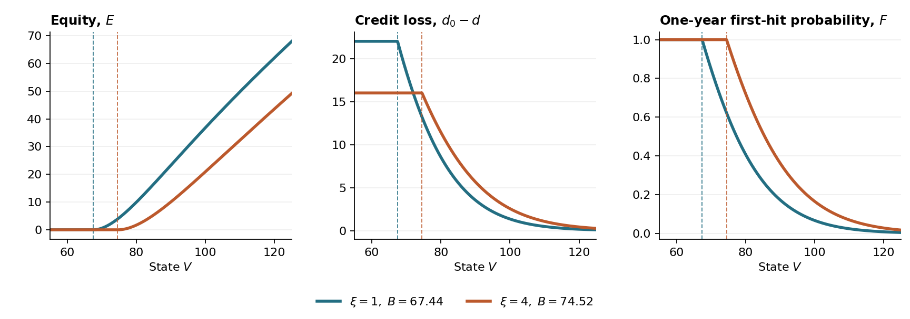

# Hepta Continuous Spiking Network 研究记录

本研究问的是，He–Xiong 的内生停止边界能否充当可学习的跨层信号，股权和信用损失能否改善时间序列表示，以及直接写权重能否以相同质量缩短训练。现有实现支持前两者的构造和普通反向传播。在几个真实任务上，金融结构能产生可利用的特征。架构收益随数据和预算改变。本轮六层模型的大多数同质量门槛仍未通过。

[完整模型推导、可直接编程的股权与损失闭式解、连续放电更新及局部权重写入公式](resolvent/MODEL.zh.md)

## 论文中的算子与神经元里的状态

He 与 Xiong 在《Journal of Finance》2012 年论文中从有限期限债券定价式 (8)、股权延续方程 (11) 和光滑贴合推出内生违约边界 (12)，附录 (A7) 给出股权。固定合约下股权在边界取零，内侧一阶导数为零。首达概率 F、贴现首达权重 G 和包含回收的债券价值具有不同的边界条件。用股权作为恢复信号，还需指定它反馈到漂移还是阈值、反馈符号与时间尺度。用债券信用损失、给定时距的首达概率或单位时长的首次触界通量作为第二通道，对应三个可以分别检验的模型。[He 与 Xiong 正刊作者版](https://www.princeton.edu/~wxiong/papers/rollover.pdf)

对数裕量 x=log(V/B) 具有漂移 μ 和波动 σ 时，在冻结参数区间内，可以直接用反射原理计算首达概率。以有限体积或离散质量传播未触界状态，把当期抵达吸收边界的质量送入不应期，之后注回复位分布，就产生可重复放电的神经元。持续计算中的状态包括存活质量和不应期质量。直接使用正金融漂移和无限上界时，一部分质量会永久逃离阈值；实际的持续放电规律依赖物理漂移、复位及外部输入。串接多个冻结参数区间也需保留群体状态。每个区间重新取一次平稳合约价，不能由此推出整个动态控制问题已经满足一个全局最优停时方程。[仓内长期放电推导](https://github.com/TrillionniumFoundation/hepta-private-ci/blob/fff9a90720deaf848ad30991158f2b6180e61f4f/qualification/hcsn_frontier_20261127/continuum/TONIC.md)

如果合约参数固定，B 对输入不变。让输入驱动本金或成本，或者传 log(V/B)，才能把样本差异送给下一层。能传信息与能充分概括状态是两个命题。仓内在同一复位可达集合上给出了两个八原子历史，三个当期观测相等，下一步触界质量仍相差 0.006675。允许接收端提出有限一组未来冲击查询，可传相应的生存函数投影，测量时要把请求及返回的数据带宽都计入。若网络保留普通隐藏残差，需固定权重、专门关掉边界线才能测它的边际贡献。[历史反例、查询和真实视网膜数据](https://github.com/TrillionniumFoundation/hepta-private-ci/blob/fff9a90720deaf848ad30991158f2b6180e61f4f/qualification/hcsn_frontier_20261127/README.md)

采用连续概率或期望流后，普通自动微分可以沿有限步网络传播，有效区间和接触约定仍然重要。风险概率接入吸收区后在边界有折点。本轮表 I 条件下，吸收区斜率为零，存活区首达概率的右斜率约为 −4.14012。对逐条光滑轨道的离散过阈时刻，需要横截与复位导数；对布朗轨道则应对分布核、积分或适当的随机梯度求导。硬脉冲也已有基于事件伴随的精确梯度算法。[原文独立复算](paper/README.md) · [EventProp](https://www.nature.com/articles/s41598-021-91786-z)

## 两个已进入代码的数值改进

- 修复近重合贴现根。实际主研究入口过去在零流动性溢价时发生除零。现用导数平均稳定求值，重合极限直接退化为解析导数。32 份合约各六个裕量上的最大绝对差为边界 1.86e−11、股权 3.42e−10、裕量梯度 2.34e−9。默认正溢价下，旧/新模型载入相同权重后输出、输入梯度和全部参数梯度逐项相等。[回归原件](zero_premium/README.md)
- 对固定等距网格，吸收布朗转移的直接项取决于格点差，反射项取决于格点和。把两者做线性卷积，并分别处理首尾箱，即可将单行工作从 O(K²) 改成 O(K log K)，中间空间为 O(K)。两层、三个端口、真实 Torch 正反传和多步复位均有对照。单线程 CPU 的 FP32 前向加反向，K=12/128/512 的 dense/FFT 时间比分别约 0.43/1.29/20.90。K=12 默认稠密路径更快。两种子手写数字的小模型中，K=128 的八进程对照给出冷训练总时间约 9.65→4.32 和 9.80→4.66 秒，对应配对最终准确率相同；两种子没有共同达到预设开发质量门槛。[公式、硬件与原始计时](transport/RESEARCH.md)

## 多模态编码器与传统基线

| 检验 | 实际观测 | 解释 |
|---|---|---|
| Flickr8k 同钟的真实图像–描述 | HCSN、稠密注意力、平滑门、LIF 的 NLL 为 2.9080、2.9096、2.9112、2.9206。HCSN 减稠密为 −0.001576，图像配对区间 [−0.008021,0.004932]；相对 LIF 为 −0.012583，[−0.017702,−0.007391]。 | 公共解码器保留两层注意力；比较的是图像前缀模块。 |
| SHD 真语音，单核 30 秒/模型 | 原式、平滑、LIF、Transformer、CNN 的说话人等权准确率为 9.73%、8.26%、46.20%、86.48%、89.68%。 | 时间预算短，计算开销直接改变可完成的更新数。 |
| 产品图文检索 | 4,320 个冷测商品，前向构造 5.46%，强卷积/Transformer 7.39%，差 −1.925 个百分点，区间 [−2.528,−1.355]。 | 预定 −2 个百分点非劣界未通过。 |
| 生理预测 | 三个实测细胞中，金融首达特征优于匹配切线，但同信息、同带宽的灵活风险率模型在三者上有更低 NLL。 | 特定首达先验可以测试，与神经机制的唯一性、普遍性分别判定。 |

[Flickr8k](https://github.com/TrillionniumFoundation/hepta-private-ci/tree/aeeab662ac9dae57c4b48e4fe6a0be6189edd998/qualification/hcsn_research_20261127/flickr_gpu/final_2520) · [SHD](https://github.com/TrillionniumFoundation/hepta-private-ci/blob/49f839b0382fc806545ecab53bffc3002ba6fac7/qualification/hcsn_clock_8559/STATUS.zh.md) · [商品留出](https://github.com/TrillionniumFoundation/hepta-private-ci/blob/b3fdc981568ab9ce122d2fb569372651e0b4b314/qualification/hcsn_continuous_20261127/paired_catalog/HELD_OUT.md) · [生理首达对照](https://github.com/TrillionniumFoundation/hepta-private-ci/blob/4333c8cd0116a37078bfadeaab858a883c614ffc/qualification/hcsn_query_intervention_20261127/README.md)

## 同一六层网络的直接写入与 BP

CREMA-D 使用 7,442 个音视频片段、91 位演员、72 条候选文本。训练/开发/冷测为 4,984/1,147/1,311 个片段，三者演员无交集。每条输入包括 12 帧 28×28 灰度画面和对应 12 组 64 维声学特征。所有方法使用同一组样本、初始化、图库、预处理，以及每种子相同的优化样本顺序。这是一项封闭图库检索任务。

从随机初始化出发，在六个真实的 96×80 群体读矩阵上按观察到的隐状态做局部岭回归，并拟合共享 256×96 投影。写入范围合计 70,656 个标量。金融系数、其他隐藏矩阵和输入前端在此次有限写入实验中保持原初始化。同位置 BP 开放完全相同的参数。真实隐藏标签、打乱隐藏标签和只拟合投影供相互区分。候选先在开发集选定和记录摘要，随后对留出演员计算所有 72 个分数。

| 方法 | 留出 NLL ↓ | 留出 Top-1 ↑ | 计入两档候选选择及冷测的时间，中位秒 |
|---|---:|---:|---:|
| 直接写六层与投影 | 4.95315 | 6.53% | 6.50 |
| 打乱隐藏目标标签 | 5.07846 | 5.36% | 6.54 |
| 仅直接拟合投影 | 5.07856 | 4.30% | 5.17 |
| 同位置 AdamW BP | 4.12971 | 3.48% | 10.18 |
| 随机父本 | 4.27107 | 2.82% | 2.73 |

直接写入比打乱标签及只拟合投影更好，说明训练标签通过隐藏矩阵影响了外部任务。直接法与同位置 BP 的主要损失差为 +0.82344，演员配对 95% 区间 [0.69696,0.95040]。三种子未共同达标。事后按所有模型相同规则在开发集拟合一个温度，差缩小至 −0.02195，[−0.05570,0.01312]。再共同加入训练类别频率，差为 +0.04866，[0.02114,0.07696]。这些校准沿用同一批演员，解释了置信度与类别频率的作用。原先的主要结果和用时各自保留。[原协议](crema/EDIT_PROTOCOL.md) · [原始比较](crema/direct-summary.json) · [校准复算](calibration/README.md)

同仓此前在语音网络的两个隐藏矩阵上，用前向传播灵敏度加阻尼最小二乘改写了 336 个标量。对两个独立说话人组，同时保留旧域时，达同门槛的完整时间为 18.9 秒，同位置 BP 为 18.0 秒；普通声学岭回归为 12.0 秒。前向灵敏度显式使用下游输出关于待写矩阵的导数。它和本轮完全通过局部目标构造的六层直接写入，代表不同的信息成本。[两层原始证据](https://github.com/TrillionniumFoundation/hepta-private-ci/blob/81d9753a4d9f28e24df1321da95f17fa746dbdb0/qualification/hcsn_finite_multilayer_edit_20261128/PRIMARY_RESULTS.md)

## 可复核的执行范围

完整分支同一性、树和内容的统计分开报告。[全仓快照](audit/README.md)。本轮新启动的宽 96 长时训练包含四个架构、三个种子和每组 3,150 秒的实际优化，共 37,800 秒，另外计开发、封存与冷测。训练、原始结果和云设备收据分别绑定各自任务。Kaggle 接受本轮 T4 请求并产生终态，但容器实际为 CPU 版 Torch，原生 GPU 项数为零。[持续训练协议](crema/PROTOCOL.md) · [Kaggle 原任务](transport/cloud_receipt.json)

## 十亿参数的训练与廉价基线

已在原计算节点找到四组完整 CPU 训练及冷测。每个架构用同一种子完成 16 次 AdamW，累计看过 256 条样本呈现、249 个不同片段。所有架构在完整 1,311 个留出演员片段上作 72 选一。原始检查点共八份、32.49 GB，已在原机逐项校验。四组各四种输入干预共 1,510,272 个冷测 logit 重新计分，结果和原报告一致。

| 架构 | 实际参数数 | 冷测 NLL ↓ | 冷测 Top-1 | 原拟合活动墙钟，秒 |
|---|---:|---:|---:|---:|
| Hepta 金融原式 | 1,016,475,200 | 4.275644 | 16/1,311 | 634.19 |
| 平滑配对对照 | 1,016,475,200 | 4.275750 | 18/1,311 | 586.57 |
| LIF | 1,016,475,200 | 4.275910 | 16/1,311 | 565.72 |
| 因果注意力 | 1,011,757,056 | 4.276667 | 16/1,311 | 488.72 |

用相同 256 次标签呈现计数、每类加一，得到 4.268407 NLL、48/1,311 命中。四个模型在这档有限预算里都落后于这个廉价基线。十亿规模能前传、能训练、能取回完整冷测记录；以它训练出强的通用编码器需要不同层级的证据。[复算、权重散列及原始分数](billion_recovery/README.md)

另一项独立实验已在真实 1,016,475,200 参数模型上启动。六个 4,096×160 读矩阵与一个 256×4,096 投影共 4,980,736 个可写标量，占整网约 0.49%。直接写、打乱隐藏目标、仅写共享投影、同位置 BP 和随机父本共享输入、种子、图库与冻结规则。比较覆盖三个种子、三组随机父本和其他四法各两档预算，共 27 个候选，所有候选开发封存后才打开完整外测。[十亿编辑预案](billion_edit/PROTOCOL.md)

图中两条竖线是流动性冲击强度不同时求出的内生边界。对应同一企业价值，股权、债权损失、首达概率有不同单位和形状，给网络的反馈增益应分别计量。[作图代码](paper/plot_channels.py)

较长的手写数字工程测试沿用原 80% 开发门，最高步数从 16 扩至 96，八组候选先冻结首过与终点权重再打开同一批 73 个留出样本。另一台 Mac 单核 CPU 上，K=128 两个种子分别在第 32/24 步达到同一开发门，稠密和 FFT 的首过权重在留出集的平衡准确率分别同为 87.84%/98.65%。冷启动至开发首过的时间从 20.04→4.89 秒和 16.48→4.13 秒。K=12 两组时间比分别是 2.24 与 0.89。这个固定质量速度收益是特定算子在同一 HCSN 上的实现收益。[扩展协议](transport/EXTENSION_PROTOCOL.md) · [首过及冷测原件](transport/extended_cold.json) · [复现入口](crema/REPRODUCE.md)

在默认 K=12 的报价上，还可以利用同一裕量下股权和信用损失对本金的仿射性。每次网络前向在当下网格计算两个端点价格，同一段序列用精确的线性插值复用，端点仍在自动微分图中。两层 FP64 开发样例的前向状态与原式最大差 2.22e−15，输入和参数梯度最大差 1.78e−14。单核 8 帧的前向加交叉熵反传，K=12 的中位数 19.93→14.48 毫秒，K=64 为 60.73→52.78 毫秒。四对短训练的冷进程收益约 1.09–1.14 倍。两项变换均可通过正式构造器单独启用。[公式与适用条件](price_cache/README.md) · [逐步硬件计时](price_cache/ai395_step.json)

在同一批已选中的 15 个六层模型上，重载权重逐位重现了 1,415,880 个原始分数。关掉五个层间接收器的边界线，同位置 BP 的冷测 NLL 上升 0.00428，演员配对区间 [+0.00117,+0.00717]；约 22.4% 的片段改变了首选项。直接写入模型关掉同一条线，NLL 反而下降 0.07998，区间 [−0.12547,−0.03068]，首选正确率从 6.53% 降到 6.05%。直接写入模型关掉股权通道后，正确率降到 1.22%，NLL 从 4.953 降到接近等概率的 4.278。某个通道确实传递了信息，它对排序和对置信概率的帮助可以不同。[完整干预、逐片段原件与复算](interventions/README.md)

**连续流的实际资源收益。** 新的六层分段入口在保留跨段梯度时，通过四臂、两精度、四种切分的 32 组对照。宽 96、单条流、256 个已嵌入帧，原式 HCSN 跨段状态是 5,376 字节，LIF 是 3,072 字节，因果注意力 KV 是 589,824 字节。每段 16 帧的单核推理分别是 106.68、54.60 和 10.03 毫秒。持续状态体积与实际吞吐在这里给出了相反的架构排序。原音视频任务只有 12 个位置槽位，256 帧工程测试使用合成嵌入。[流式 API、梯度与逐次计时](streaming/README.md)

**另一种直接构造。** 在同一组七个矩阵上还试了监督类中心的局部岭更新加共享 Fisher 判别投影，24 个候选先封存再冷测。三种子直接法原始 NLL 为 4.27610，BP 为 4.12971，配对差 +0.14639 [+0.10775,+0.18254]。联合开发/冷测 4.1 门直接法仍为 0/3。单一子问题的代数可解性不足以使六层全局学习目标达到同一质量。[完整协议、结果及核验](discriminant/README.md)

**实体云 GPU。** 保留同一个 Colab 请求，完成分配、绑定、实际计算、结果回收和释放。实际 Tensor 运算与运行时显示 Tesla T4、CUDA 13、Torch 2.14.1+cu130。K=12 的原/缓存 16 步训练冷墙钟 11.581→8.518 秒，K=64 为 10.445→8.014 秒；单种子物理模型的留出平衡准确率均为 50.00%，130 参数线性对照为 95.95%。价格计算的 GPU 加速和模型的学习质量需要分别报告。[云原始数值](price_cache/colab_t4.json) · [服务端回收](price_cache/colab_final_receipt.json)

**直接检验神经放电动力学。** 对 Allen 两个互不重叠的实测细胞组，把含复位和不应期的有限时窗精确期望脉冲数拟合到训练电流，在保留电流上检验。拟合噪声的有限时窗模型相对同约束稳态近似，在 72 个细胞的每次刺激计数绝对误差改善 0.175 个，配对区间 [0.032,0.330]；在另一组 36 个细胞恶化 0.058 个，[0.005,0.127]。同一细胞的相邻电流插值在两个队列都更准。这里检验的是首达/复位机制，股权和债权价格不进入这条计数公式。[全部 108 个细胞、393 个留出电流水平及原始预测](current_clamp/README.md)

**真正的十亿参数 CUDA 读写。** 在私有 Colab 的 Tesla T4 上，完整 1,016,475,200 参数编码器用 16 条原始音视频训练片段直接写入七个矩阵，所有 72 条文本候选均参与评价。实际拟合为直接 0.464 秒、同位置 BP 7.168 秒，对应峰值显存约 4.28/6.29 GB。配对的两条外测上，原始/直接/打乱/同位置 BP 的 NLL 分别为 4.335/9.685/8.420/4.329，均命中 0/2。直接写更省时也更差；两条留出只足以证实真设备及算子路径。三种子完整样本的独立任务另行评估。[原始完整分数、装置与工作量](gpu_billion/RESULTS.md)

**持续输入的相变条件。** 在实际两层网络增加可学习的物理漂移，保持论文定价漂移独立。原模型用相对边界复位时，恒定输入只改变过渡通量，四种持续驱动的 12 格稳态都落在 0.00864335/步。新物理增益为 0.15 时，驱动从 −2 变到 +2，稳态从 0.0000646 变到 0.081885/步；无界连续极限存在由漂移变号决定的持续放电起始点。有限网格上边缘截断导致阈下仍有非零稳态流。[推导、实际网络接口和跨层梯度核验](tonic_network/README.md)

**同质量速度的硬件反转。** 真 T4 的独立测试中，稠密与 FFT 都在相同更新数达到 80% 开发正确率，留出 logits 最大差约 $5.94\times10^{-15}$。K=128 两枚种子，稠密/FFT 冷启动到门槛为 13.50/18.85 秒、11.08/14.40 秒；对应板卡能耗为 506.04/539.06 焦耳、417.96/430.70 焦耳，与 Mac CPU 的配对结果排序相反。K=12 的两组 FFT 用时也更长，板卡能耗四对只在一对略低。[原始设备计时和能耗](gpu_quality/RESULTS.md)

**较长多模态训练的开发趋势。** 四种架构、三个种子各完成 240 秒真实优化后，在同一 1,147 个开发片段上，原式 HCSN 为 2.21516 nats，平滑对照 2.37395，LIF 2.53234，因果注意力 2.71909。20 秒处则是注意力最好。全部 12 组已过 240 秒时，总计入账 2,880.24 秒、85,886 个参数更新。这项持续实验的留出演员按预注册在最终封存后才计分。[开发读数](crema/rung240.json)

此前十亿参数训练只看到 249 个不同训练片段。为把这个差距变成实际实验，另开一个固定终点的十亿全参数面板：原式 HCSN 和因果注意力、相同三个种子、每格完整看过 4,984 个不同训练片段、312 次 AdamW，六个终点统一封存后再用 1,311 个冷测片段和 72 条文本评估。[整轮训练协议](billion_epoch/PROTOCOL.md)

**整套训练数据上的直接写权重。** 三种子各给每种方法四遍相同的 4,984 条、每遍不重复的训练片段。按开发集选择后，原式直接写、同七个矩阵反传、全参数反传在 1,311 个留出片段上的原始 NLL 分别是 4.90713、3.81273、3.01426；Top-1 是 5.64%、9.99%、22.20%。直接写比打乱隐藏目标好 0.15485 nats，表明中间层监督确实起效。开发和留出同时达到原始 NLL 4.1 的种子却分别只有 0/3、3/3、3/3；同位置 BP 实测 16.11–17.25 秒即到该门。封存 45 个候选，并重算 7,963,920 个分数。[整轮与同质量比较](full_edit/README.md)

**训练后精确保护部分向量。** 在三枚已有 HCSN 上，把一条台词对应的六种情绪标签循环置换。以 AlphaEdit 的零空间约束保护 72 个文本向量，其原始投影改变量小于 7×10⁻⁸。96 个需改写的留出片段命中率从 0.69% 提高到 20.49%，但其余 1,215 个片段的 NLL 增加 0.30551，演员配对区间 [0.27593,0.33796]。再保护 32 个训练音视频向量，可用零空间只余一维，此时留出预测无一改变。这直接测得了局部编辑的可塑性和旁损。[编辑效果、保留效果与对照](null_edit/README.md)

**高分辨率时的真实 T4 交叉点。** K=2,048、双精度时，首达和双报价算子含反传的稠密/FFT 时间为 88.26/12.06 毫秒，增量分配显存约 1,281/5.75 MiB，板卡能耗为 6.18/0.41 焦耳。换成两层、三帧完整网络，在 K=1,024 时仍为稠密 75.41、FFT 78.32 毫秒；增量分配显存则为 514/6.71 MiB。把初始密度与连续求积对照，K 从 256 增至 2,048，最大首达误差从 0.001572 降至 0.000198。[所有精度、规模和整网对照](gpu_resolution/RESULTS.md)

**边界可在帧间真正连续移动。** 新选项让 log 边界在每一帧内部线性移动。在共动坐标中把漂移改成 μ−Δlog B/Δt，即可沿用首达与吸收解析核。一个可复算的例子中，初始 log 裕量为 0.131818，边界上升 0.19：瞬间跳变时触界概率为 1，历时 0.25 连续上升时为 0.787404。20 组独立布朗桥抽样核对了首达和终点分箱。两层网络的方向导数有限差分误差小于 1.1×10⁻¹¹；在重复使用的小型数字留出上，三种子平均 NLL 从 0.07116 降至 0.06249。此变化区分了连续消息的数值类型和边界在真实时间内的运动方式。[推导、采样与训练结果](ramp_boundary/README.md)

**全合约反传与参数识别。** 完整的 PyTorch 闭式算子支持同时对裕量和九个合约系数求导，独立求积/ODE 复核 1,800 个偏导。另找到票息、面值、回收率、税率的一族精确联动改变，能保留固定合约的边界、股权、信用损失和两种首达观测。48 次有限改写的五观测最大差 1.99×10⁻¹³。由此可知，解析可导、存在保行为编辑和从下游任务唯一求出全部参数，是三个不同的问题。[公式、证明、FP32/FP64 与实测误差](differentiable_law/README.zh.md)

**独立的真实连续情感回归。** 在 CMU-MOSI 的 31 个留出视频、686 个片段上，三种子三流前向 HCSN、同构 BP、Transformer 的视频等权 MAE 分别为 1.02560、1.02908、1.00490。前向减同构 BP 为 −0.00347，区间 [−0.05290,+0.04876]，通过预注册 +0.05 非劣界；前向减 Transformer 为 +0.02071，[−0.04496,+0.08148]，未通过。三种子均达到宽松 1.20 门时分别需 19.56、31.56、29.47 秒；两个廉价岭对照只需 15.46/15.38 秒。收紧到 1.05，Transformer 仍在 29.47 秒达标，前向和同构 BP 均有种子未达标。打乱文本损害显著，打乱声音、画面的两个家族校正区间跨零。[36 个真实拟合的封存与留出](mosi/fresh_interpretation.json)

**原生 T4 的全片段低带宽比较。** 全 7,442 条片段和 72 条文本在私有 T4 训练/评测。保留的特征是每片四时段、四块亮度和四段音频量化，视频像素与音频原频带方差分别仅保留 34.1%、20.5%。共同训练 12 秒的原式、平滑、LIF、因果注意力的冷测 NLL 分别为 3.76122、3.79149、3.77221、3.56775。原式减注意力 +0.19347，[0.08925,0.29297]；按演员打乱音、视频令原式 NLL 分别上升 1.44256、0.06291。去掉第二层的边界输入令 NLL 增加 0.01279，[0.00459,0.02190]。在另一固定 78 步预算下原式优于 LIF、落后于注意力。原权重另在 CPU 重载了 24 组。[云端原始结果](gpu_crema/RESULTS.md) · [独立硬件重载](gpu_crema/cpu_replay.json)
