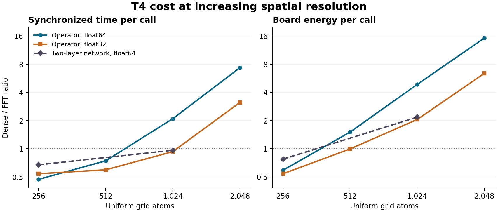

# Resolution, wall time, allocator memory and energy on a T4

The private run executed all 20 arms on a Tesla T4 using Torch 2.14.1+cu130. The CUDA dot product returned 140. All ten comparisons met their predeclared value and derivative tolerances. All programs stayed below the 75% device-allocator cap.

| Workload | Precision | Atoms | Dense / FFT wall, ms | Time ratio | Peak workspace, dense / FFT MiB | Board energy per call, dense / FFT J | Energy ratio |
|---|---:|---:|---:|---:|---:|---:|---:|
| operator | float64 | 256 | 6.38 / 13.58 | 0.470 | 20.09 / 0.72 | 0.2323 / 0.3941 | 0.589 |
| operator | float64 | 512 | 8.23 / 11.09 | 0.742 | 80.06 / 1.44 | 0.5009 / 0.3325 | 1.507 |
| operator | float64 | 1024 | 23.05 / 11.03 | 2.090 | 320.28 / 2.88 | 1.6155 / 0.3325 | 4.858 |
| operator | float64 | 2048 | 88.26 / 12.06 | 7.320 | 1280.56 / 5.75 | 6.1821 / 0.4068 | 15.198 |
| operator | float32 | 256 | 6.44 / 11.93 | 0.540 | 10.01 / 0.36 | 0.2065 / 0.3823 | 0.540 |
| operator | float32 | 512 | 6.56 / 11.03 | 0.595 | 40.09 / 0.73 | 0.3272 / 0.3287 | 0.996 |
| operator | float32 | 1024 | 10.51 / 11.29 | 0.931 | 160.14 / 1.46 | 0.7171 / 0.3497 | 2.050 |
| operator | float32 | 2048 | 36.78 / 11.81 | 3.114 | 640.28 / 2.91 | 2.5037 / 0.3925 | 6.379 |
| network | float64 | 256 | 50.61 / 75.15 | 0.673 | 32.39 / 1.70 | 1.7144 / 2.2149 | 0.774 |
| network | float64 | 1024 | 75.41 / 78.32 | 0.963 | 513.77 / 6.71 | 5.3746 / 2.4706 | 2.175 |

Ratio columns divide the dense value by the FFT value. Each operator call includes four initial distributions, first-passage flow, both He–Xiong monetary prices, a smooth probe and reverse derivatives for the initial distribution, shift and nominal principal. The network uses three frames, two layers, width two and the priced inter-layer port. Each call includes differentiation. Peak workspace adds PyTorch-allocated live storage over the pre-call baseline. Board energy uses the cumulative NVML counter across the full repeated block divided by its number of calls.

On the tested grid sequence, FP64 operator wall time first favored FFT at 1,024 atoms and FP32 first favored FFT at 2,048. The separate three-frame network still took 78.32 ms under FFT versus 75.41 ms dense at 1,024 atoms, while using about 6.71 versus 513.77 MiB of incremental allocator memory. The study measures one T4 and one dynamic input construction per arm; the true crossover depends on batch size, dtype, hardware and whether the measured task includes the rest of the network.

The compressed raw archive contains 168 arrays with 133,976 numerical elements. The independent NumPy program verified the reported comparisons and timings. An independent SciPy calculation also integrated the analytic first-hit probability against the specified smooth initial marginal on [0.015, 1.30]. The largest absolute flow error of the finite initial population against continuum quadrature fell from .001572 (256 atoms) to .000787 (512), .000395 (1,024) and .000198 (2,048). That initial-density discretization error is shared by both algorithms. Higher resolution therefore buys a measurable reduction for this synthetic marginal at the stated cost.

Output files and source identities are in receipt.json, inputs.json, scaling.json and checks.npz. The cold, end-to-end training comparison at 12 and 128 atoms is a different measurement with a separately sealed set of fits.
