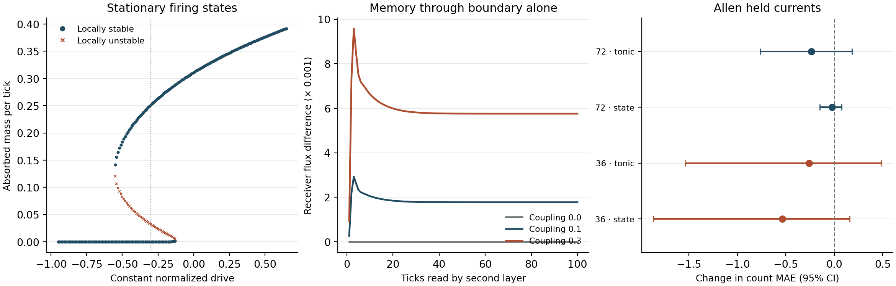

# 由股权产生恢复力，由信用损失促进触界

计算上一拍未触界质量的条件平均对数裕量 $\bar x_t$，用复位分布的平均裕量 $x_*$ 作为恢复点。令 $e_t=\langle m_t,E\rangle/20$，$l_t=\langle m_t,L\rangle/20$。二者按总群体质量聚合；在存活条件下重新标准化的量只有 $\bar x_t$。定义实际首达过程的漂移

$$
\mu_t=\mu_{0}-g\tanh u_t+
k_E\tanh([e_t]_+)\,(x_*-\bar x_t)-k_L\tanh([l_t]_+).
$$

$k_E,k_L$ 是显式正值、可反传的每单元增益。股权通道将群体平均状态推回复位点的方向。信用损失增大时，流向违约壁的漂移加强。报价继续使用论文的定价漂移。实际发放的吸收核使用上式的物理漂移。一个时间片中先读上一拍的状态并冻结本拍漂移，再传播质量，因此没有当拍代数环。网络构造器接受 `signed_force_gains=(k_E,k_L)`，`initial_physical_gain=g` 和 `boundary_path="linear_log"`。有需要时可用 `initial_flow_coupling` 将上拍通量乘以一个可训练标量加入本拍决定本金的输入。

三个固定起点上，增大损失通道均提高下一拍触界概率。股权通道在低于复位点时减少触界，在高于复位点时增加触界，将漂移拉向复位点。两层普通 BP 的四个增益中心差分误差最多 1.11×10⁻¹⁰。稠密与 FFT 前向、反向的最大差低于 5×10⁻¹⁵，切分轨迹输出逐位相同。复核包含全质量处于不应期时的下一拍复位和旧构造参数/检查点兼容性。 [实现检查](verified.json)

## 真实的两稳态和只读边界的接收端

恒定外部驱动下，给定漂移先解存活质量的线性稳态，再解漂移的一维自洽方程。局部稳定性用消去冗余不应期坐标后的完整一步映射雅可比谱半径判断。12 原子下，196 个预定参数点中 12 个出现三个稳态；更大增益也出现谱半径大于一的解。稳定驱动、低态和高态取决于增益和上网格边界的设置。

在 24 原子、$k_E=.02,k_L=3$、最终归一化驱动 $-0.3$ 下，两个样本从同一复位出发，分别接受 700 拍相反刺激，再接受 900 拍完全相同的刺激。最终吸收通量分别为 0.00000571 和 0.25155013；独立稳态计算给出两个吸引域，二者之间的不稳定稳态谱半径为 1.133。驱动历史在双通道模型内留下可定量的长期记忆。相同外部输入和零边界回读下，发送端可以有不同内部通量而相同 $B$。

给上一拍通量到本金输入增加 0.1 的反馈，发送端最终对数边界差为 0.007564。第二层在最后 100 拍才从同一状态启动，只接收发送端对数边界，最终自身通量相差 0.001776。把该反馈关为零，发送端内部通量相差 0.251544，接收端的全部 100 拍输出相同。增益 0.3 时两个差值为 0.023882 和 0.005758。有限时间网络的边界差对新增益的导数为 0.01762783，直接数值差分复现。这个受控实验只传一个可区分的历史条件，任意群体分布仍有更多自由度。[逐拍边界与接收输出](boundary_memory.json) · [全稳态扫描](phase.json) · [不同上边界与分辨率的结果](refined.json)

固定上界 1.3 时，12 至 96 个原子都能复现上述相位。将上界扩大至 5.2，该组增益仍存在三条有限网格解；安静态接近零通量、具有向外漂移，在无限半轴下没有相应的常质量正再生稳态保证。对另一组 $k_E=.65,k_L=6,v=-.9$，固定上界 1.3 时有三个解，扩至 2.6、3.9、5.2 时均仅见一个。中等增益各 0.65 且零驱动时，受测网格都只有一个稳定解。有限区间的双稳态可用普通可微操作构造，区域、分辨率与物理时间单位会改变生理解释。神经群体首达、稳定性及放电率动力学已有长期的研究历史。[Mattia 与 Del Giudice，2002](https://doi.org/10.1103/PhysRevE.66.051917)

## 在实测神经元上的独立检验

沿用两个不重叠的 Allen 队列及各自原始留出电流。每个细胞、每种模型只用训练电流学习三个参数，将电流映射成无量纲驱动并确定每秒的模拟拍数。各臂共享编码、预算、复位与噪声。此处两价格增益预先固定各 0.65。五种模型共 540 次细胞级拟合全部封存后，对 393 个留出电流评分。下表是给定封存参数，使用独立 PyTorch 高斯输运直接逐拍重放后的逐细胞平均绝对计数误差。

| 队列 | 仅持续驱动 | 两价格 | 仅股权 | 仅损失 | 两个非金融状态信号 | 原同细胞插值 |
|---|---:|---:|---:|---:|---:|---:|
| 72 个细胞、174 个电流 | 4.3363 | 4.0994 | 4.1981 | 4.7285 | 4.1229 | 3.7175 |
| 36 个细胞、219 个电流 | 2.1377 | 1.8798 | 2.4173 | 1.8660 | 2.4170 | 1.3313 |

双价格减非金融反馈的误差变化分别约为 −0.024 [−0.148,+0.078]、−0.537 [−1.868,+0.159]。双价格减仅持续驱动的两个区间也均跨零。这个方案未达到预定的两个队列同时超过两项对照的生物预测门；同细胞相邻电流插值的点估计在两个队列都更优。393 个留出输入各自直接计算的两价格响应，与拟合时高速表的预测最多相差 0.00185 个脉冲；仅信用损失的数值差更大，已保留逐输入直接值。只凭刺激强度与整窗脉冲数不能辨识分子层面的“股权”或“信用风险”。[训练与判定方案](PROTOCOL.md) · [封存](allen_seal.json) · [独立逐拍复算](allen_direct_verified.json)

在仓库根目录运行，令 PYTHONPATH 包含 qualification/hcsn_continuous_20261127/core 与本目录。Allen 的两份授权输入 ZIP 及哈希见相邻 current_clamp 目录。`allen.py DATA_DIR OUTPUT_DIR` 执行配对拟合，`replay_counts.py OUTPUT_DIR` 在独立张量路径重算留出预测。`phase.py phase.json`、`refine.py`、`boundary_memory.py` 分别检查稳态、稳健性及层间传输。运行 `check.py PREVIOUS_POPULATION_SOURCE` 时，从本分支 git 历史取添加有符号力之前的核心实现作逐位兼容对照。
