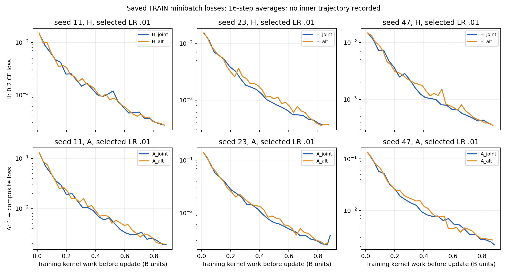
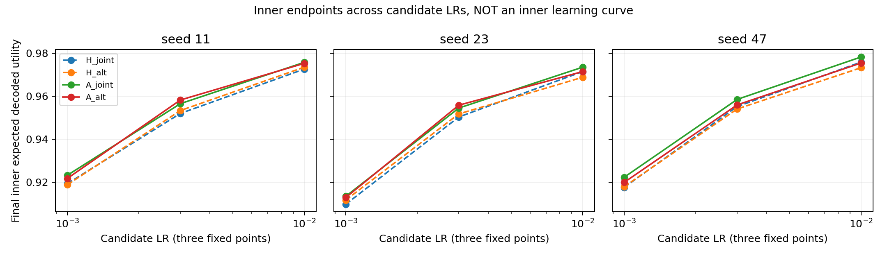

# Saved-state diagnosis: encoder learning bottleneck remains a hypothesis

Subsequent status: the parent paused the lambda.001 head-anchor proposal. It is
still unimplemented/unrun. The current requested work is only the
[code-pair reconciliation availability check and protocol draft](../content_reconcile/PROTOCOL_DRAFT.md),
with no new model computation or formal evaluation.

This analysis reads the existing36 candidate logs, saved gradients/moments,
base/final parameters and original TRAIN endpoints. It runs no forward pass,
new gradient, optimizer step, training, old-model evaluation or formal-data read.
The fixed1:1 recipe remains rejected. Positive A-H inner intervals remain
selection-used TRAIN diagnostics, not confirmed benefits.

**The evidence establishes a different optimization/adaptation path and a failed
allocation recipe. It does not establish an encoder representation-learning or
capacity bottleneck as the cause.** The alternate recipe changes encoder
derivative opportunities, per-parameter Adam clocks/moments, encoder-visible
minibatch sequence, total head updates, and which gradients enter clipping.
Those changes were not causally isolated. No schedule ratio is searched here.

## Correction and observed quantities

The previous report incorrectly said H_alt-H_joint was negative in all seeds.
The unchanged raw arrays give **+.000893954733** in H seed11,
-.002661160182 in seed23, -.002591397032 in seed47; mean-.001452867494.
Only A_alt-A_joint is negative for all three seeds. The reporting sentence is
corrected in [RESULTS.md](RESULTS.md); original data, intervals, costs and failed
readiness are unchanged. This H counterexample matters for causal interpretation.

There is one scalar minibatch loss before every update, first/last parameter
gradients by block type, actual first deltas, final parameter movements and
moments/clocks. Each of the36 candidates has ONE final inner endpoint. There
are no inner checkpoints during training. The three LR endpoints are an LR
response, not an inner learning curve. No missing trajectory was reconstructed.

The [complete36-candidate CSV](../runs/content-block-train-v1-20261023/posthoc/all36-training-inner-budget.csv),
[detailed JSON](../runs/content-block-train-v1-20261023/posthoc/mechanism-analysis.json) and
[reproducible saved-state script](../runs/content-block-train-v1-20261023/posthoc/posthoc_mechanism.py)
include all three LRs and every seed. The following selected-LR.01 table
compares each seed directly. Tail losses are averages of the last32 *sampled
training minibatches*, not a full-fit evaluation. H loss is0.2 CE; A loss is
0.2 CE minus decoded expected utility. The H/A numerical loss scales cannot be
compared as if they were a common utility metric.

| Seed | Group | First32 TRAIN loss | Last32 TRAIN loss | Final inner utility | Final inner joint success | Encoder delta L2 | Heads delta L2 |
|---|---|---:|---:|---:|---:|---:|---:|
| 11 | H_joint | .01145584 | .000280590 | .97260936 | .97105425 | 8.53924 | 9.67294 |
| 11 | H_alt | .01246871 | .000275176 | .97350332 | .97200231 | 6.49542 | 11.77226 |
| 11 | A_joint | -.90139989 | -.99793010 | .97575597 | .97434318 | 8.75533 | 10.58559 |
| 11 | A_alt | -.89066304 | -.99801849 | .97528841 | .97383013 | 6.81142 | 13.03527 |
| 23 | H_joint | .01324849 | .000373594 | .97146106 | .96990371 | 8.15913 | 9.51891 |
| 23 | H_alt | .01402314 | .000372065 | .96879990 | .96706219 | 6.70196 | 12.01216 |
| 23 | A_joint | -.88379682 | -.99742176 | .97349515 | .97197260 | 8.80229 | 10.57423 |
| 23 | A_alt | -.87375638 | -.99735676 | .97144617 | .96977775 | 6.92407 | 13.23899 |
| 47 | H_joint | .01285465 | .000382757 | .97584468 | .97452928 | 8.30411 | 9.41515 |
| 47 | H_alt | .01396796 | .000368782 | .97325328 | .97182079 | 6.66953 | 11.59194 |
| 47 | A_joint | -.88910392 | -.99751359 | .97823815 | .97702206 | 9.05271 | 10.78978 |
| 47 | A_alt | -.87979072 | -.99726623 | .97543450 | .97398148 | 6.91291 | 12.96527 |

At equal *step indices* alternate initially fits more slowly, but it receives
more steps per training-work quota. At the actual endpoints, H_alt's tail CE
is slightly lower in all seeds while inner utility improves only in seed11.
A_alt has lower tail composite loss in seed11 but worse inner utility there;
seeds23/47 have worse tail loss and worse inner utility. This mixed pattern
does not support a simple universal training-fit/representation failure.
Minibatch sampling, unequal endpoint exposure and nonmatching train/inner
metrics also prevent a quantitative generalization-gap claim from these losses.
An inner CE curve, or separated A CE/utility trajectory, was not recorded.



Curves use16-step means and cumulative *executed training-kernel* units, not
entire group cost. H shows0.2 CE; A shows1+composite loss solely to use a log
axis. They do not plot A's utility alone. Complete common/search/tail cost is
separately retained in the original ledger.



All36 endpoints are shown. The final inner response improves across the three
registered LRs, and.01 was selected in every group. This supplies no unobserved
intermediate validation score or justification for an expanded LR search.

## Parameter movement and optimizer evidence

For selected candidates, alternate/joint encoder displacement-norm ratios are
.761/.821/.803 for H and.778/.787/.764 for A. Head ratios are1.217/1.262/1.231
for H and1.231/1.252/1.202 for A. Encoder displacement cosines are.930-.945;
head cosines.988-.993. Thus this is not merely a uniformly shorter version of
the same path: there is less encoder movement, more head movement and changed
directions. Parameter L2 distances/cosines are not activation quality, semantic
information, effective rank, probe accuracy or proof of a representation bottleneck.
No such representation measurements were saved.

The five implementation tests,36-candidate clock/moment audit and18 inactive
hash checks found no Adam implementation defect. Standard-joint element updates
match the old native kernel; inactive encoder state actually stays unchanged.
This rules out those checked numerical/clock corruption mechanisms, not every
possible optimizer issue. The deliberate optimizer histories differ: selected
A encoder clocks256 versus386 and head clocks512 versus386; H264 versus394 and
528 versus394. Encoder sees only odd minibatches in alt, versus every minibatch
in joint. Gradient-norm clipping also sees only active heads on skipped steps.

All saved first/last joint global gradient norms across36 candidates are below
.266; saved heads-only norms are below.106, versus clipping threshold5.
Clipping was therefore inactive at these observed points. Full intermediate
clipping history was not logged, so it cannot be asserted inactive everywhere
or blamed as the cause. Last gradients are from different minibatches and
different parameter states/steps, and cannot be compared as matched gradients.

The final active Adam direction can be algebraically derived from saved m,v,t
without taking a new step. For selected encoder blocks its norm is.0177-.0288
in alt and.0180-.0323 in joint, with mixed per-seed ordering. There is no
consistent saved terminal near-zero encoder-update signal. This reconstruction
does not recover pre-step parameters, rounded subtraction, a full trajectory or
the encoder gradients deliberately omitted on heads-only steps.

## Objective conflict: an initial measurement, not a late diagnosis

The first joint gradients are byte-identical between the two recipes for
each objective, seed and LR. Initial H/A also share the same base and batch,
so `g_A-g_H` is an identifiable initial utility contribution. Selected.01 values:

| Seed | Block | Utility/CE gradient norm | CE/utility cosine |
|---|---|---:|---:|
| 11 | encoder | 7.04396 | .99314 |
| 11 | heads | 7.19868 | .99386 |
| 23 | encoder | 7.93001 | .99129 |
| 23 | heads | 8.04315 | .98942 |
| 47 | encoder | 7.41547 | .98769 |
| 47 | heads | 7.71770 | .98562 |

Across the nine seed/LR starting states and both parameter blocks, the aggregate
cosine stays positive (.948-.994); both recipes share these starts. At selected
starts2.6%-5.3% of coordinates oppose, despite positive total alignment. The
actual first A/H parameter-delta cosines are only.912-.958: Adam largely
normalizes gradient magnitude, so a7-8x utility norm is not a7-8x parameter
step. For all selected starts, dot products of the actual A step with both CE
and minus-utility gradients are negative, consistent with initial first-order
descent of both losses. This is local aggregate evidence, not per-row or global
optimization proof and not evidence that conflicts never occur.

Late H/A gradients cannot be subtracted as utility components: the parameter
states, batch indices and update counts have diverged. No late same-state
component gradients, separated A loss terms or per-row conflict history were
saved. Earlier wrong-consensus observations motivate a hypothesis but cannot
explain this experiment's failure causally. There is no observed initial net
objective opposition that would justify declaring target conflict the cause.

## Budget use and strong dense reference

The groups consumed96.879%-97.084% of their12B ceilings and57.969%-67.483% of
their10-second ceilings. Individual candidate training used99.514%-99.821% of
its unit allowance but only51.072%-77.039% of its CPU allowance. Same-group
updates are identical for every LR/seed. This is operator/pair-admission limited,
not an alt group stopped early by CPU. The common reserve rule and actual tail
explain the remaining total headroom; unexecuted estimates are never charged.
There is no evidence that hidden lower budget or failure to spend the training
quota explains the alt result. Additional head updates were genuine.

| Seed | A_alt−A_joint | A_alt−old strong A | H_alt−H_joint | H_alt−old strong H |
|---|---:|---:|---:|---:|
| 11 | -.00046756 | -.00056419 | +.00089395 | +.00067803 |
| 23 | -.00204897 | -.00231852 | -.00266116 | -.00263292 |
| 47 | -.00280365 | -.00294327 | -.00259140 | -.00255969 |

Old quality arrays are reused, not re-evaluated. A_joint is only.00016860 below
old strong A on average, with386 versus old387 updates, whereas A_alt is.00194200
below old A. H_joint is.00005199 below old H on average. This is consistent with
the strong dense baseline remaining competitive, not evidence that the new
optimizer/kernel invalidated it. Old/current CPU waves are not compared for
a latency benefit. Same-wave A_alt-A_joint complete CPU-net remains negative.

## What can and cannot be concluded

| Question | Evidence | Limit |
|---|---|---|
| Is encoder representation capacity insufficient? | Same architecture does better under joint training; alt has less encoder and more head movement. | No capacity intervention, saved activations/probes or matched functional states. Capacity bottleneck is unproved. |
| Is Adam implemented incorrectly? | Checked paths match NumPy/original C; clocks, moments, inactive bytes and charged kernels pass. | Intentional per-parameter histories/batches differ; an optimization/coadaptation issue remains plausible. |
| Is utility conflicting with CE? | Initial aggregate directions align; A-H inner contribution stays positive in both recipes. | Initial coordinate opposition exists; late same-state components were not logged. No late-conflict diagnosis is available. |
| Does more head training replace encoder training? | It did not under this single fixed1:1 allocation and caps; A loses all seeds, H is mixed. | This rejects the registered recipe, not a theorem that every reduced-encoder allocation fails. No ratio sweep is proposed. |

## One minimal next candidate: standard joint with weak head anchoring (UNRUN)

Keep **standard all-joint updates**, the existing model/capacity,0.2 CE anchor,
decoded reward, native Adam clocks and batch sequence rule. Add the same weak
proximal penalty to BOTH H and A, anchored to each immutable supervised base's
four head arrays:

```
P = 792  # text/image matrices and biases
penalty = 0.001 / (2*P) * sum_heads ||theta - theta_base||^2
head_gradient += 0.001 / P * (theta - theta_base)
```

This is ONE fixed weight, not an estimated optimum or a weight/ratio sweep.
No decoder or encoder penalty, new parameters, frozen encoder, route or refiner.
The hypothesis is weak head-drift/coadaptation control, motivated by alt's20%-26%
larger head movement and training-tail improvements that do not reliably carry
to inner utility. Those observations do not prove overfitting: no matched train/
inner CE was recorded. This candidate explicitly avoids assuming a capacity
bottleneck and avoids the rejected encoder-skipping optimizer changes. It also
leaves the external content objective unchanged rather than asserting a target-
conflict fix. A common training regularizer changes neither the CE coefficient
nor the external observer, and does not establish utility benefit by itself.

A later registration would give H_prox/A_prox the same fixed candidate/seed/LR
opportunity and whole-group10s/12B caps, including all setup/search/observations/
exports/service. With a reused delta, direct penalty/value/gradient work is
5P=3960 scalar operations/step plus billed setup/copy/check work; its actual
implementation inventory must be verified before execution. No extra encoder
pass is needed and none is credited as a saving. Strong original dense A/H
remain separate visible references; harming H_prox cannot manufacture success
because A_prox must also beat strong unregularized A.

The candidate is falsified if it reduces head drift but cannot improve utility
AND joint success over strong dense A within the complete caps, if matched
A_prox-H_prox contribution disappears, or if required per-seed greedy retention
drops more than.02. All seed failures stay visible. A positive selected-inner
interval would still be exploratory. If future causal claims are intended,
intermediate fixed-source endpoints and same-state CE/utility diagnostics must
be explicitly priced/recorded prospectively, rather than assumed available.

This candidate has NOT been implemented, trained or evaluated. The original
fixed1:1 rejection and formal confirmation hold remain. This post hoc pass took
3.121636083 measured CPU seconds before its receipt; scientific plots/CSV were
produced from the saved arrays only. Font-cache warnings did not prevent plots;
temporary cache paths are explicit for reproduction. No runtime blocker remains.
