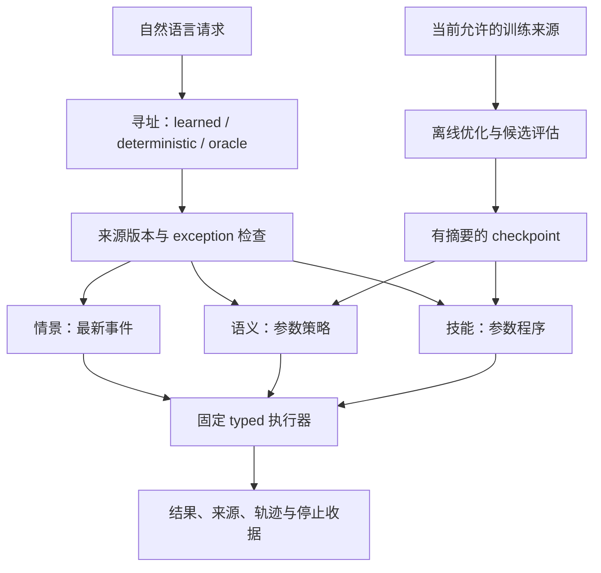

# Typed parameter memory: implementation and measured limits

本分支完成了一套可训练、可保存、可在新进程读取的多类型参数记忆实验。
第一轮证据支持“知识进入了参数，固定类型图能够组合使用这些参数”，
但没有证明比显式记录读取更准确、更节省存储，或通过自主分裂获得收益。
学习路由、分裂准入和合并准入均保留了失败结果。

## Source and authority

- 唯一 integration baseline：`main` commit
  `f8c9419df6ddeb36ff8b522a50219981fb8d9345`，tree
  `15c9d6ea07bf3832de82825a6cc1e8c958dd3d45`。
- 本研究延续其后代 V9 candidate `b013604e3ea60eabcd2738c56624d6c1b8372c8f`。
- 新 adapter 实验源码：commit `c39552216b46f1187526aef4bda073c0a9380c72`，
  tree `bd73f159708be820584d1d321eeb877e16d4bcf5`。
- [SOURCE_BINDING.json](evidence/formal-01/SOURCE_BINDING.json) 逐文件验证了
  冻结运行的 18 个 Python/JSON 文件与上述提交的内容完全相同。
- 这里是 qualification 与研究代码。新 tensor profile 尚未成为 native
  Hepta owner 的生产模型类型；原有 native byte/catalog 路径单独验证。

## 实际实现

| 层 | 实现 | 边界 |
|---|---|---|
| 情景 cell | SQLite 事件、版本、来源和 exception | 精确事实与授权由 owner 保持 |
| 语义 cell | 384 维冻结 MiniLM 特征上的低秩模块与 12-bit head | 输出 reserve / pack / limit |
| 技能 cell | 同类参数模块，四个受限分类 head | 输出四步、七 opcode 的有限程序 |
| 寻址 | 小型受限分类模型、确定性规则、oracle 干预 | 内容读取与语言访问分别计分 |
| 组合 | event → semantic policy → skill program → interpreter | 图、类型和原语固定；程序有 stop/步数上限 |
| 分化 | 梯度分区、真实子 adapter、静态专家、rank-8 对照 | 共享 head 冻结；相同参数与逐行期望曝光 |
| 合并与休眠 | teacher 行为蒸馏；owner cache 移除与 checkpoint 唤醒 | 合并需质量准入；不保证 allocator 立即释放 RSS |
| 维护 | 来源更正、重放、撤销、保留数据 clean rebuild | 来源版本先于模型访问检查 |



MiniLM 是冻结的预训练表示，实际更新的是 `A`、`B` 和训练阶段允许的 head：

\[
\operatorname{logits}(x)=W_{head}(I+BA)x+b.
\]

父阶段这个表达式对 embedding 是仿射函数，可以折叠为 dense linear head。
它证明真实参数写入，不证明新的函数表达能力或优于单独训练线性 head。
后续子 cell 冻结共享 head，才具有明确的低秩更新约束。

参数 reader 不导入训练数据或 evaluator，SQLite authorizer 禁止其读取
`sources.payload`。显式检索臂单独获准读取该列。参数中保留来源 ID 和
训练摘要，没有每个实体对应的目标值表。原始来源仍用于更正、重建与授权，
其存储成本没有被排除。

内容 cell 读取的是地址对应的 canonical embedding，自然语言变体先由 router
转成地址。因此 oracle 条件验证已知地址上的参数内容，未见表达的端到端表现
主要受寻址影响；这不等于内容模型自行理解所有改写，也没有检验新实体或新概念的泛化。

## Formal-01：冻结后的结果

协议见 [PROTOCOL.json](PROTOCOL.json)。三个 optimizer seed 为 731、732、733；
39 次候选 fit，共 1,171,200 次训练样本呈现。训练进程退出后才解析独立编写的
held 文件，随后启动新的结构 reader、owner lifecycle 和任务 reader 进程。

任务包含 8 个实体、8 个有限技能程序；训练与 held 各有 16 种实体/技能配对，
两组不重叠。Held 有 320 个 query ID、292 段不同文本、32 个模板组，并在三个
seed 与三种事件状态下重复。它们属于相关观测，不是 24,192 个独立统计样本。
原 RESULT 的 `independent_wording_groups` 字段应理解为由独立评审编写的
32 个不同模板组，不代表统计独立性，也不代表 32 位作者。

下表从 [原始结果](evidence/formal-01/RESULT.json) 和
[独立审计](evaluation/AUDIT-formal-01.json) 汇总。组合列排除了由外部
exception 直接停止的案例，因此不会把权限/例外路径算作学习成功。

| 实验臂 | 语义完全正确 | 技能完全正确 | 非 exception 组合正确 | Unknown 错误接受 |
|---|---:|---:|---:|---:|
| Oracle + 参数 | 100% | 100% | 100% | oracle 给定类型 |
| Oracle + 显式记录 | 100% | 100% | 100% | oracle 给定类型 |
| 确定性寻址 + 参数 | 87.50% | 90.63% | 87.50% | 3.125% |
| 确定性寻址 + 显式记录 | 87.50% | 90.63% | 87.50% | 3.125% |
| 学习寻址 + 参数 | 0% | 0% | 0% | 0%，但全部拒答 |
| 学习寻址 + 显式记录 | 0% | 0% | 0% | 0%，但全部拒答 |
| 未训练 checkpoint + oracle | 0% | 0% | 0% | oracle 给定类型 |
| 训练后移除 residual + oracle | 45.83% | 100% | 80.95% | oracle 给定类型 |
| Joint 参数 cell + oracle | 不适用 | 不适用 | 14.48% | 不适用 |

每种 router 下，参数与检索的 2,880 对输出逐项相同，包括来源、状态和轨迹。
因此本轮没有质量上的参数记忆增益。这里的强基线是 exact typed SQLite
读取加固定 planner / 共同解释器，不能声称全面比较了自由文本 RAG 或通用 LLM planner。

三个事件状态是独立 SQLite counterfactual 副本。它们保留相同的 logical event
ID / sequence，但 value 不同；metadata snapshot 没有跨副本绑定 payload。
因此这里的同信息比较成立，却不能据此声称事件内容寻址、连续版本推进或 native
来源权威。逐条核对见 [provenance note](evaluation/FORMAL-counterfactual-provenance-note.json)。

学习路由的 calibration 在最高候选阈值 0.9 下仍有 6/16 unknown 错误接受。
三个 seed 都触发预声明的 threshold 1.1 全拒 fallback；没有根据 held 放宽门槛。
这把访问失败与内容失败分开了：oracle 地址下的参数内容读取正确。

`zero` 是初始未训练模型，不是所有权重数值清零。`headonly` 是训练后把 B 清零，
保留共同训练过的 head；它也不是独立优化的线性 head 基线。当前 skill 解主要由
head 承载。审计还检查了完整中间数值轨迹：headonly 为 800/1008，joint 为
58/1008；原先只要求最终值和完整 opcode 序列的指标分别为 816/1008、146/1008。
该额外诊断保留为事后审计，没有替换预注册 endpoint。

分开语义/技能与 joint 都有 21,544 参数，每任务有 38,400 次监督呈现；
分开模型合计处理 76,800 次输入，joint 为 38,400 次。分开模型还获得更容易的
分解输入合同。因此可报告本配置的组合差异，不能推广为严格等计算下的普遍模块化优势。

## 参数分化：实现成功，准入失败

| Seed | 梯度分区子 cells | 固定专家 | 单 rank-8 | 蒸馏合并 | 分裂 / 合并准入 |
|---|---:|---:|---:|---:|---|
| 731 | 15/16 | 14/16 | 15/16 | 14/16 | false / false |
| 732 | 15/16 | 15/16 | 15/16 | 14/16 | false / false |
| 733 | 15/16 | 15/16 | 15/16 | 13/16 | false / false |

前三种候选均为 10,764 个总参数，其中 6,144 个可训练；总训练呈现 38,400 次。
分区不均时按数据量分配步数，seed 732 使用 750/450 步，保持逐行期望曝光相同。
六个 checkpoint 在新进程恢复了同一个冻结 head，四种候选 canonical 读取均为 8/8。

这里等额的是运行时唯一参数和训练曝光：共享 head 有 4,620 参数，两个私有
adapter 各有 3,072 参数，加载后确实引用同一个 head 对象。持久化时每个
checkpoint 仍重复保存 head，所以两个动态子 cell 占 64,502–64,584 B，
单 rank-8 占 43,771–43,798 B，文件字节并不等额。加载临时对象与各候选独立
RSS 尚未测量，不能从唯一参数数目推断部署内存相等。见
[shared-head cost audit](evaluation/STRUCTURE-shared-head-cost-note.json)。

梯度分区没有严格超过单 rank-8，合并的自然表述 calibration 退化，因而没有激活
这些结构候选。当前网络仍是固定 typed graph，自发图形成尚未被证明。

## 维护、删除和停止

短期维护的三个 seed 均满足：更正后 8/8 当前值正确；未改的七项 7/7 保留；
删除后七项 7/7 保留；删除来源不在重建 lineage 中；从相同初始化和训练日程独立
重复的 clean rebuild 参数完全相同。这是一个有限反事实检查，不是一般机器遗忘保证。

实际 owner 验证了旧版本拒绝、依赖撤销后停止参数/事件读取、sleep 移除缓存引用、
wake 核对参数/encoder/typed config、步数上限，以及 owner stop 后的请求不再读取。

额外的 64 周期 × 3 seeds 持续维护实验见 [longrun](longrun/)。首链已完成
192 次更新、24 次 clean rebuild 和 219 次新进程读取，独立审计 7,198 项通过。
按每周期最终状态计，参数与 exact-SQL 两臂均为 active 1,512/1,512、changed
207/207、retention 1,305/1,305、revoked 24/24。完整核对见
[longrun audit](evaluation/AUDIT-longrun-complete.json)。它按固定协议
串行执行实际更新与每八周期删除重建，使用新进程参数读取和同信息 exact-SQL
对照，并由外层资源监控记录可观测区间。一次基础设施中断留下了未知的尾部成本和
**398.263 秒监控间隙**；恢复后的完整质量结果与成本覆盖分别报告，不能把未知成本补零。

相同冻结协议的 clean 成本复现已在
[GitHub Actions run 40681620656](https://github.com/TrillionniumFoundation/hepta-private-ci/actions/runs/40681620656)
成功完成，job 为 `122793476485`，源码为
`773e8c5540521861ab18b1c61268069d6610279a`。它在另一台硬件上完整执行了
192 个周期、216 次 fit、219 个 fresh reader，四类质量计数与首链相同；
[CI 独立审计](evaluation/AUDIT-longrun-ci.json) 的 **8,563 项**检查和
[参数字节与成本补充审计](evaluation/AUDIT-longrun-ci-costs.json) 的 **11,609 项**检查均通过。
这些数字是证据核对项目数，不是独立样本数。两遍使用相同的三个 seeds、固定地址、
数据和日程，属于复现及成本补测；不能合并质量分母来增加统计把握，也没有重新调 held 门槛。

[完整 clean 证据](longrun/evidence/longrun64x3-clean/README.md) 为 37 文件、
8,086,169 B 的归档交付，最大文件 400,000 B。18 个 parts 原样保留 CI 的
7,089,136 B tar，恢复后有 4,153 个普通文件、633 个目录、21,766,558 B 原始文件内容。
其中包含真实参数、全部请求和响应、SQLite、采样记录，以及外层准备、硬件、依赖、
GitHub 来源和打包收据；独立 `RAW_FREEZE-run-03-clean.json` 可直接核对源码身份。
首次链路与原 ZIP/tar/raw 均保留。该 workflow 实际运行的是 Python 研究路径，
不能据此宣称新 tensor profile 已接入 native Agentd。

长跑仍只有八个固定地址，每次完整重放当前有效 canonical 记录。它检验反复维护，
没有检验容量随数据增长、单次曝光学习或来源可丢弃。删除检查覆盖服务撤销和当前
模型的 clean rebuild；为复核而保存的历史权重与来源没有被物理擦除。

## 真实成本及目前可下的结论

| 项目 | 实测字节 |
|---|---:|
| 共享冻结 encoder 资产 | 127,536,988 |
| 每 seed 有效语义＋技能 checkpoint | 86,753–86,870 |
| 加上 router 后 | 148,950–149,027 |
| Canonical 地址向量 cache | 23,189 |
| 16 条完整 source JSON | 2,542 |
| 单个 SQLite database | 28,672 |
| 全部 51 个候选 checkpoint | 2,068,831 |

Study wall 为 107.766 秒，全部子进程 CPU 合计 103.562 秒，训练 body wall
58.522 秒。每个 reader 中各臂顺序运行并共享加载，输入 embedding 已预计算；
各臂的局部计时不能作为独立部署的端到端延迟。缺失的 per-arm RSS 积分保持未知。

长期 clean 复现另有完整账目，见
[COST_SUMMARY.json](longrun/evidence/longrun64x3-clean/COST_SUMMARY.json)。运行环境为
Intel Xeon Platinum 8370C、四个逻辑 CPU、Python 3.12.15、CPU Torch 2.8.0+cpu、
NumPy 2.3.5；与首链硬件不同，耗时差异不能归为算法加速。

| Clean 成本范围 | 实测值 |
|---|---:|
| 安装、恢复与准备 wall | 24.251046586 s |
| 连续维护监控窗口 wall | 858.478325932 s |
| 完成的训练＋reader 子进程 CPU | 852.535687 s |
| 外层 wrapper 含已等待子树 CPU | 977.339552314 s |
| 独立打包 CPU | 4.456184323 s |

子进程、driver 和 monitor 成本已包含在 wrapper 中，不能再次相加。打包是之后的
独立阶段，wrapper＋打包共 **981.795736637 CPU 秒**。checkout/Python setup 与
upload CPU、准备阶段内存/存储积分仍未知。3,802 次资源采样有 29 次错误，
RSS/PSS 的 **11.850252394 秒**和存储的 **1.344647791 秒**没有可用积分；
`full_cost_exact=false`。采样根只覆盖维护输出及历史证据，安装依赖、恢复的原始 study、
仓库和共享 encoder 资产另计。127,536,988 B encoder 是共享引用，本次没有重新编码。

Clean reader 的八地址参数/SQL loop 中位数分别为 **1.320548 ms / 0.116704 ms**；
两个臂固定顺序运行在同一 fresh process 内。包含启动、imports、加载、两臂和退出的
整个 reader 中位数为 **1.344905092 s**。loop 不含共享加载等成本，新进程也不代表
文件系统未缓存，因此这些结果不能作为两个独立部署的端到端延迟比较。SQL 正确率
相同、观测读取片段更快，且不需要参数训练。

两遍长期执行实际完成 **432 次 fit、259,200 步、8,294,400 次样本呈现**，另有首链
中断尝试的未知工作量。两遍已完成 fit/reader 的 CPU 合计 **2,553.042976 s**；
按互不重叠的首链已完成子进程，加 clean wrapper 和打包计算，观测成本下界为
**2,682.303025637 CPU 秒**。该下界仍未包括首链 driver/monitor、中断尾部、之前的
formal study、其他准备与验证、checkout/setup 和上传，不能当作整个研究的精确总成本。
Clean 复现没有填补首链 398.263 秒间隙的真实使用历史，两遍均保留 `full_cost_exact=false`。

该小型任务没有存储压缩优势，也没有全生命周期成本优势的证据。127 MB 是共享资产，
不能计作每 cell 各一份；同样不能忽略它、地址向量、来源、重放、搜索和重建成本。
长期成功也没有改变学习路由全拒、分裂/合并准入失败和固定图没有自主形成的结论。

## 复现与证据

代码采用 Python 3.12、CPU PyTorch 2.8.0、NumPy 2.3.5；encoder 环境为
ONNX Runtime 1.23.2 和 tokenizers 0.22.1。编码器全部模型及 tokenizer 文件由
[encoder.py](encoder.py) 的 digest inventory 绑定；原 revision 为
`e8f8c211226b894fcb81acc59f3b34ba3efd5f42`。

先恢复完整原始证据，不需要重新训练：

```bash
python qualification/memory-cell-adapters/evidence/formal-01/restore.py /absolute/new/evidence
```

372 个原始文件共 42,634,595 B，压缩后 3,991,976 B，按每份不超过 400,000 B
分块。保留全部实际权重、训练请求/收据、fresh-reader 请求/响应、SQLite、失败的
开发调用日志和 source freeze；不是只有摘要或示例偏置。

在准备好的两个 Python 环境和 pinned encoder 目录下重跑一个新目录：

```bash
"$ADAPTER_TRAINING_PYTHON" -I -B qualification/memory-cell-adapters/study.py \
  --encoder-python "$ADAPTER_ENCODER_PYTHON" \
  --training-python "$ADAPTER_TRAINING_PYTHON" \
  --encoder-dir "$ADAPTER_ENCODER_DIR" \
  --output /absolute/new/study-output
```

独立审计只重算保存的结果，不执行训练或新推理：

```bash
python qualification/memory-cell-adapters/evaluation/audit.py \
  --run-root /absolute/new/evidence \
  --source-root qualification/memory-cell-adapters \
  --encoder-root "$ADAPTER_ENCODER_DIR" \
  --output /absolute/new/audit.json
```

本地 24 个不同测试已执行通过；整体 discovery 的 23 pass / 1 环境 skip 之后，
使用显式 encoder 环境补跑该一项并通过。另有 V9 真实参数 fresh-reader 的五项
测试、SIGTERM/资源监督的 17 项测试；原生 Rust 的最终验证与格式收据单独记录。

## Native 接入与下一项研究门槛

[NATIVE_INTEGRATION.md](NATIVE_INTEGRATION.md) 列出新 residual numeric profile、
typed inventory/program value、双地址依赖、encoder/feature 绑定、发布与最终来源
重验的具体接点。旧 native `{factor,label}` / 单步 procedure 无法保真表示这里的
三个策略值与四步技能，不能通过改名宣称已经接入。

下一版的研究门槛应先解决可接受错误率下的寻址覆盖率，并使用有可学习结构、
需要泛化到新实例的内容任务。随后才比较等信息、等参数、等训练暴露和完整成本下
的结构收益。固定 schema 的成功、参数持久化成功、单次重建成功，均不能替代
“自组织通用 memory system”的验收。
