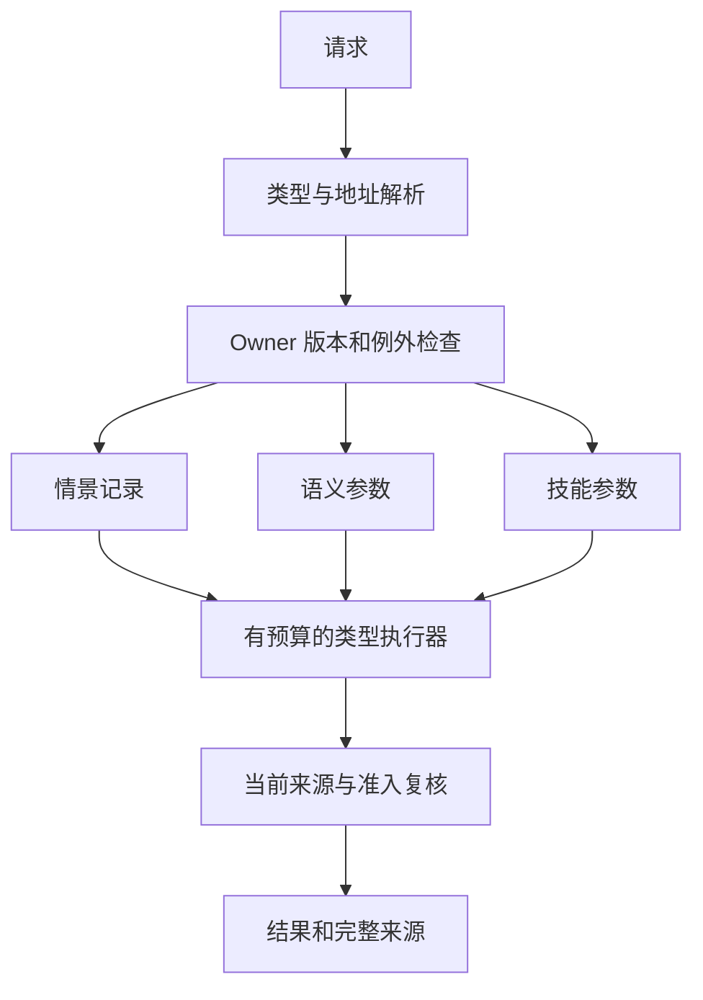

# 多类型参数记忆：五个工作包的实现、结果与边界

这是可执行研究与原始证据的汇总，不是通用记忆系统已经成立的声明。
代码、权重、训练请求、来源、fresh-reader 输出、失败尝试和成本缺口都保留。
主要结果是：已知地址上的新知识确实能写入小模型参数，并在训练进程退出后读取；
固定类型组合能够工作；本轮没有发现相对于同信息显式读取的质量、压缩或完整成本优势，
也没有通过分裂或合并产生有收益的自主结构。

## 两条独立执行路线

1. **原生 Hepta V9**：现有 Agentd、canonical cognitive owner、学习产物发布、
   独立选择、control socket 与 TaskFlow 生命周期，执行 catalog 与无答案目录的
   byte 参数模型。真实训练、来源更正、跨进程读取、停止、休眠唤醒及迁移在此验证。
2. **新的 residual tensor 研究**：冻结 MiniLM 表示、Torch 低秩残差、语义和技能
   head、Python 研究 owner、同信息 SQL 对照、分裂/合并对照及长跑维护。
   这条路线增加了更严格的参数与结构比较，但其新模型尚未成为 Agentd 的原生 profile。

两条路线的模型、数值合同和值类型不同，不能把它们拼成“同一个新 residual 模型已经
完成原生部署”的证据。完整桥接要求见
[NATIVE_INTEGRATION.md](../memory-cell-adapters/NATIVE_INTEGRATION.md)。

## 五包验收表

| 工作包 | 实际交付 | 结果与解释 |
|---|---|---|
| 真实参数记忆 | 语义/技能参数训练、checkpoint、来源与例外、训练退出后的新进程读取；另有原生无目录 byte 模型 | 内容读取在 oracle 已知地址上全部正确；未训练控制失败。支持有限域参数记忆，不支持开放世界知识泛化或系统压缩。 |
| 可靠寻址 | 固定预训练表示、受限学习输出、确定性寻址、oracle 和 unknown 拒绝 | 新 residual 实验的学习路由在 calibration 不能满足约束，按预声明规则全拒；确定性端到端组合 87.5%。内容与访问失败已经分开。 |
| 固定多类型组合 | 情景事实、语义策略、四步技能程序与共同解释器；训练外的已知实体/技能配对 | Oracle 下参数与同信息 SQL/planner 都是 100%。当前没有跨类型网络相对强显式基线的质量收益。 |
| 参数分化 | 梯度分区提出子 cell、真实 child adapter、固定专家、等参数 rank-8、蒸馏合并、sleep/wake | 动态子 cell 不超过 rank-8；合并退化；三 seed 的分裂/合并准入全部 false。候选真实训练，但没有激活无收益拓扑。 |
| 持续维护与真实执行 | 更正、完整重放、旧能力保持、删除后重建、当前版本拒绝、owner 停止；两遍语义和一遍技能维护，各 192 周期，另有独立原生执行链 | 受测有限域质量保持，但没有完整生命周期成本优势。Python 新模型停止与原生 V9 停止各自成立；新 residual 的原生联合闭环尚未实现。 |

## 1. 知识进入了哪些参数

新研究使用固定 384 维 MiniLM 向量，训练的算子为

\[
u=xA^T,\quad z=x+uB^T,\quad \mathrm{logits}=zH^T+b.
\]

语义 cell 输出 reserve、pack、limit 三个四位整数。技能 cell 的四个分类 head
输出受限的七种 opcode，交给带停止和步数上限的解释器。情景事实及精确 exception
保持在可追溯记录中，不能被参数置信度替代。

父阶段训练 A、B 和 head，因此其输入到输出仍是仿射函数。它不等于微调 Transformer
本体，也没有证明比独立训练线性 head 更强的表达能力。子 cell 阶段冻结并共享 head，
此时低秩更新的容量约束才明确。

参数 reader 不导入训练数据或 evaluator，SQL authorizer 禁止它读取 source payload；
显式检索对照单独获准读该列。模型保留来源 ID、版本和训练摘要；参数 checkpoint
不包含每个实体对应的目标答案目录。原始来源仍保存在 owner 数据库，用于显式对照、
维护与撤销，参数读取臂不能读取这些 payload。训练结束、保存并退出后，新的进程
重新加载权重进行推理。

Formal-01 使用 seed 731、732、733，共 39 次候选 fit、1,171,200 次样本呈现。
全部 51 个 checkpoint 与 372 个原始文件均保留。冻结源码绑定到
`c39552216b46f1187526aef4bda073c0a9380c72`，不是只根据后来工作树声称可复现。

证据：[协议](../memory-cell-adapters/PROTOCOL.json)、
[源码绑定](../memory-cell-adapters/evidence/formal-01/SOURCE_BINDING.json)、
[原始结果](../memory-cell-adapters/evidence/formal-01/RESULT.json)、
[1,413 项独立核对](../memory-cell-adapters/evaluation/AUDIT-formal-01.json)。

## 2. 内容、寻址与组合的贡献

任务有 8 个实体和 8 个技能程序，训练与 held 各有 16 个实体/技能配对且互不重叠。
Held 的 320 个 query ID 实际对应 292 段不同文本、32 个模板组，随后在三 seed、
三个事件状态上重复。因此记录行数不能当作独立统计样本数。

| 读取条件 | 语义正确 | 技能正确 | 无 exception 的组合正确 |
|---|---:|---:|---:|
| Oracle＋参数 | 576/576 | 576/576 | 1008/1008 |
| Oracle＋显式记录 | 576/576 | 576/576 | 1008/1008 |
| 确定性寻址＋参数 | 504/576 | 522/576 | 882/1008 |
| 确定性寻址＋显式记录 | 504/576 | 522/576 | 882/1008 |
| 学习寻址＋参数/显式记录 | 0/576 | 0/576 | 0/1008 |
| 未训练 checkpoint＋oracle | 0/576 | 0/576 | 0/1008 |
| 训练后移除 residual＋oracle | 264/576 | 576/576 | 816/1008 |
| Joint 参数 cell＋oracle | 不适用 | 不适用 | 146/1008 |

每种 router 下，参数与显式记录的 2,880 对输出在值、状态、来源和执行轨迹字段上完全相同；
这不表示包含计时字段的整个 JSON 逐字节相同。
强基线是 exact typed SQLite、同信息固定 planner 和共同解释器；这不构成对所有 RAG
或通用 LLM planner 的比较。

学习路由在 calibration 的最高候选阈值 0.9 仍错误接受 6/16 unknown，三个 seed
都触发预先规定的 1.1 全拒 fallback。没有使用 held 放宽阈值。确定性寻址的 unknown
错误接受为 18/576。内容 cell 实际接受 canonical 地址向量，语言改写先由 router
映射为地址，因此 oracle 的成功不能被解释为内容网络自行理解任意改写。

Oracle 条件下，144 个 exception 组合请求被精确规则直接停止；这些没有计入上表
无 exception 的学习成功分母。其他寻址条件还可能在到达该规则前就拒绝请求。
`zero` 指初始未训练模型，不是所有数值清零。移除 residual 是保留共同训练的 head
再将 B 清零，不是独立优化的线性基线。Skill 在该控制下仍全部正确，表明保留下来
的 head 已足以重现本轮技能答案；它不能量化 residual 在训练过程中的因果贡献。

分开模型与 joint 的参数数都是 21,544，每任务监督呈现相同，但分开模型累计处理
76,800 个输入，joint 为 38,400，且分开模型具有更易学习的输入分解。
因此 100% 对 14.48% 只能说明本配置差异，不能宣称严格等计算的模块化优势。

另外，三个事件状态是反事实 SQLite 副本，沿用相同逻辑 ID/sequence 而改变 value。
它们支持各自上下文中的同信息比较，不证明事件内容寻址或连续原生版本权威。
见 [来源复核](../memory-cell-adapters/evaluation/FORMAL-counterfactual-provenance-note.json)。

## 3. 分裂、合并、休眠已经执行；收益门槛没有通过

| Seed | 梯度分区两个 child | 两个固定专家 | 单 rank-8 | 蒸馏合并 |
|---|---:|---:|---:|---:|
| 731 | 15/16 | 14/16 | 15/16 | 14/16 |
| 732 | 15/16 | 15/16 | 15/16 | 14/16 |
| 733 | 15/16 | 15/16 | 15/16 | 13/16 |

前三种候选运行时唯一参数均为 10,764，其中 6,144 可训练，总训练呈现 38,400。
数据分区不均时按数据量分配训练步，保持逐行期望曝光一致。两个 child 的 head 在
加载后确实是同一个对象；各候选 canonical 新进程读取都是 8/8。

动态分区没有严格超过 rank-8，合并在 calibration 退化，三 seed 均未通过结构准入。
当前网络仍是固定类型图，没有根据这些负面结果偷偷激活新拓扑。

等额参数也不意味着持久化字节相等：两个 child 文件各自保存了 head，合计
64,502–64,584 B；单 rank-8 为 43,771–43,798 B。独立加载峰值和每臂 RSS 没有测量，
不能从共享对象推断部署内存相等。见
[共享 head 成本核对](../memory-cell-adapters/evaluation/STRUCTURE-shared-head-cost-note.json)。

## 4. 长期维护的质量与成本

### 语义维护：两遍相同的冻结协议

这项长跑专门检验语义记忆，协议为 64 周期 × 3 seeds、8 个固定地址，每周期完整重放当前有效的 canonical 记录；
每八周期执行一次删除和保留数据 clean rebuild。每遍共 192 次更新、24 次重建、
216 次 fit、219 次新进程 reader。这两遍不包含技能维护；技能使用下文另立并冻结的
协议，原生 V9 的三阶段语义/程序维护则由独立的原生实验提供证据。

| 每遍各周期末的累计指标 | 参数臂 | Exact-SQL 臂 |
|---|---:|---:|
| 当前有效读取 | 1512/1512 | 1512/1512 |
| 被更正值 | 207/207 | 207/207 |
| 未更改能力保留 | 1305/1305 | 1305/1305 |
| 撤销请求拒绝 | 24/24 | 24/24 |

首次链路遭遇中断后从保留状态继续，完成质量检查；398.263 秒监控间隙及一次不完整
重建尝试的成本保持未知。随后在独立 GitHub runner 上按完全相同的冻结协议完整复跑，
没有覆盖第一次尝试，也没有把相同数据当成更多独立样本。

Clean run [40681620656](https://github.com/TrillionniumFoundation/hepta-private-ci/actions/runs/40681620656)
成功。其 216 次 fit 的输入、目标、来源和日程与首链相同，参数摘要也逐个相同。
独立质量/来源审计通过 8,563 项核对，另有 11,609 项参数字节、读取和成本核对；
这些是核对项目数，不是独立实验数。

| Clean 成本切片 | 实测 |
|---|---:|
| 准备 wall | 24.251046586 s |
| 维护采样窗口 wall | 858.478325932 s |
| 完成的 fit＋reader 子进程 CPU | 852.535687 s |
| 外层 wrapper CPU（已包含其等待的子树） | 977.339552314 s |
| 独立打包 CPU | 4.456184323 s |
| Wrapper＋打包，去重后的可观测 CPU | 981.795736637 s |
| 八地址参数读取 loop 中位数 | 1.320548 ms |
| 同进程八地址 SQL loop 中位数 | 0.116704 ms |
| 整个 fresh-reader 进程中位数 | 1.344905092 s |

嵌套 CPU 不能重复相加；loop 不包括共享启动/加载，两个臂固定顺序执行，新进程
也不代表磁盘缓存清空，因此它们不是两项独立服务的端到端延迟。

3,802 次资源采样有 29 次错误，RSS/PSS 积分未知区间 11.850252394 秒，
存储未知区间 1.344647791 秒。观察到的 RSS/PSS 峰值分别为 548,093,952 /
448,604,160 B，都是采样峰值。Checkout/setup/upload CPU 和一些准备成本没有完整
计量，保留 `full_cost_exact=false`。

两遍已完成 432 次 fit、259,200 步、8,294,400 次样本呈现，另有中断尝试的未知工作。
按互不重叠范围合并的可观测 CPU 下界为 2,682.303025637 秒；它不是全研究总成本，
没有包括原生 CI、首次链路 driver/monitor、形式研究、上传及全部验证。

本实验删除语义是：撤销当前服务、从保留数据重建当前模型，并验证删除来源不再
进入该模型的 lineage。历史权重和来源为了复核仍保留，不是物理擦除或一般机器遗忘。

来源：[长跑说明](../memory-cell-adapters/longrun/README.md)、
[原始 clean 归档](../memory-cell-adapters/longrun/evidence/longrun64x3-clean/README.md)、
[质量审计](../memory-cell-adapters/evaluation/AUDIT-longrun-ci.json)、
[成本审计](../memory-cell-adapters/evaluation/AUDIT-longrun-ci-costs.json)。

### 技能维护：独立冻结的 64 × 3 周期

[Skill run 40742088819](https://github.com/TrillionniumFoundation/hepta-private-ci/actions/runs/40742088819)
成功，source `4693e8028fb8563ec730dcb55458a212389154a5`，
tree `df3224a5a13c1fcc0a41d3b0278a864174e12d7e`。运行前已固定来源更正规则、
600 步训练预算、每八周期删除重建、四个公开执行 probe 和独立审计代码。

本次同样完成 192 周期、216 次 fit、219 次新进程读取。每个被更正程序必须改变
至少一个公开 probe 的行为；程序选择只读作者定义的来源，不读模型结果或损失。
每次 clean rebuild 重新构造网络，起始参数摘要必须等于该 runner 保留的未训练
初始化。全 216 份 600 × 32 采样序列以原始 int64 字节保留。

参数和 SQL 两臂的周期末累计精确程序读取均为 **1512/1512**，更正 **207/207**，
未更改能力 **1305/1305**，撤销拒绝 **24/24**。实际执行的状态、结果与完整轨迹
也全部匹配；每个 workflow 的四个公开 probe 全部正确才计为成功。包括初始读取
和全部中间阶段，每臂共 1728 个有效程序、6912 次公开 probe 执行，没有只保留
周期末的较好 checkpoint。

独立审计通过 **28,467** 项核对，直接解码 222 个 checkpoint 的 float32 参数，
用独立 NumPy 算术和独立解释器核对原始读取与执行输出，不导入实验模型或 trainer。
19 个冻结来源／协议文件（含支持代码），以及 workflow/request，均逐字节绑定回原始提交。

| 技能维护成本切片 | 实测 |
|---|---:|
| 完成的 fit 子进程 CPU | 433.334382 s |
| 完成的 reader 子进程 CPU | 228.331255 s |
| 维护采样窗口 wall | 669.297076051 s |
| Wrapper＋后续独立打包，去重后的 CPU | 785.766679218 s |
| 八 workflow 参数读取 loop 中位数 | 1.010242 ms |
| 同进程八 workflow SQL loop 中位数 | 0.123206 ms |
| 整个 fresh-reader 进程中位数 | 1.021130909 s |
| 216 个新 checkpoint | 13,105,634 B |
| 原始采样日程 | 33,177,600 B |

2913 次采样记录了 46 次进程退出相关读取错误，RSS/PSS 未知区间为
20.962605019 秒，存储未知区间为 0.009797947 秒。采样 RSS/PSS 峰值分别为
690,384,896 / 521,078,784 B。该 runner 使用 AMD EPYC 9V45，与语义 clean run 的
Xeon 不同；不能把 wall 或 CPU 差异解释为算法加速。`full_cost_exact=false` 保留。

第一次审计的旧报告 writer 因富含执行信息的 phase 记录超过 400,000 B 分片上限而
退出。原始失败回执、来源和已写出的 57 个检查分片完整归档。修复仅新增按编码
字节拆分的 writer，并替换主审计器的一行 import；全部比较逻辑与训练结果未改。
两项传输回归测试通过，第二次审计完整退出零，57 个检查分片与首轮逐字节相同。
这次修复没有触发重新训练。

三遍维护共完成 648 次 fit、388,800 步、12,441,600 次样本呈现。按互不重叠范围
相加的已知 CPU 下界为 **3468.069704855 秒**；原生 CI、原始 Formal-01、首次中断
尝试、未测准备/上传以及全部审计等仍未计入，不能称为全研究总成本。

来源：[技能协议与说明](../memory-cell-adapters/skill_longrun/README.md)、
[完整原始归档](../memory-cell-adapters/skill_longrun/evidence/longrun64x3-skill/README.md)、
[独立审计](../memory-cell-adapters/evaluation/AUDIT-skill-longrun.json)、
[成本分解](../memory-cell-adapters/skill_longrun/evidence/longrun64x3-skill/COST_SUMMARY.json)。

## 5. 原生验证与最终化状态

Formal-06 的 951 项普通测试及 3/3 actual 原生测试通过，但最后的 structure scorer
因 JSON 对象键的 int/string 表示差异失败；原始 CI receipt 继续保持 `passed=false`。
Formal-05 还揭示了重复获取 owner snapshot 跨秒造成完整 export 不一致的问题。
修复分别规范了真实 wire 比较、改用已经保存的同一份 snapshot；没有改变数值、数据、
训练预算、阈值或科学准入条件。

修复后的 **formal-07 已完成并通过**：source `8510464dd7c4bbed20b5dfa81d3b65eaf6671132`，
tree `71ff3402b3da1ad2d7fa9a39873364fbd9f4f7a5`，
[run 40733474806](https://github.com/TrillionniumFoundation/hepta-private-ci/actions/runs/40733474806)，
job `122975678245`。GitHub run/job 均 success，原始 receipt 为 `passed=true`，
9 项命令全部退出零，**951/951 普通测试和 3/3 actual 原生测试通过**。
原始 ZIP 与 GitHub 的字节数和 SHA-256 相符，完整 TAR 的 487 个 regular members
均已核验；没有把 formal-06 重新评分后改称 formal-07。

原生持续训练有 6 个真实 worker、36 次 fit，两种表示分别覆盖 9 → 17 → 25 个
当前实体。每阶段 trained 与 clean 均达到 future 144/144 reads、24/24 decisions，
retention 48/48 reads、8/8 decisions；未训练和 frozen 控制不同，参数因果门槛通过。
迁移后读取发生在原来源根目录不可用的条件下，保留真实 owner/runtime 身份证据。

原生结构研究执行 27 个训练进程、3 个选择进程和 256 次 fit，但三个 stage 的独占
search/replay/communication wall 成本仍缺失，决策是 `NoChange / MissingMeasurements`，
没有发布新拓扑。独立原生语言候选的 known correct coverage 为 94/144（65.2778%），
unsupported acceptance 为 8/96（8.3333%）；仍为 shadow，质量门槛为 false。
这些原生指标使用另一套任务与模型，不能与 residual 实验混合为同一统计结果。

**Exact-source 最终化已在 CI 完成并通过**：
[run 40748270215](https://github.com/TrillionniumFoundation/hepta-private-ci/actions/runs/40748270215)，
job `123027755943`。输入 source 为 `d4193c842bba8113719ef36f451cbc9061e34a7f`，
输入 tree 为 `8f55bde73e94040e4f0db1572966a2882751a1d9`；最终输出 tree 为
`28b310cc8db30270110605f8509f95b772451fd6`。原始 artifact 认证、来源与成员 preflight、
原始 finalizer、最终 freeze 四项门槛均通过。十包 `just fix` 与 `just fmt` 都退出零，
wall 分别为 415.125325691 秒与 2.070047535 秒。

原始 artifact `12845041139` 的 ZIP 为 565,627 B，SHA-256 为
`d342f64c9d96b38c3bd737eab24adbc0e0f7820c8aebb1ade904bb4116541214`。
最终补丁为 297,234 B，SHA-256 为
`cf1ea514c924aab13cadb850942fa2e04b1075f2f5b553eb777c3cbcb0f87a71`。
从固定远端 source 恢复 33 个旧文件，应用该原始补丁后，所有新文件的 Git blob 与
SHA-256 均符合原始补丁及 `AFTER_FILES.json`。GitHub 用这些准确 blob 和输入 tree
构建出的完整 tree 与 CI 输出相同。
独立静态审查仅发现一处 `&format!` → `format!` 的 Clippy 修复，其余为格式调整。

最终化保持 152 个 native Python 文件、153 个其他冻结来源输入，以及 323 个 adapter
文件的字节不变。最终 fix/fmt 后没有手工重跑测试或模型；这里的源码树及文件核对属于
产物身份验证。原始补丁、阶段日志和四项门槛回执的交付位置为
[finalize-formal-01](evidence/finalize-formal-01/README.md)。
最终源码已发布为 [`d6ef56de0a786e5c291602d4801125ae55f3be15`](https://github.com/TrillionniumFoundation/hepta-private-ci/commit/d6ef56de0a786e5c291602d4801125ae55f3be15)，
分支与提交 tree 均已独立读回确认。详见 [发布身份](evidence/finalize-formal-01/PUBLISHED_SOURCE.json)
与 [恢复后的静态审查](evidence/finalize-formal-01/FINAL_PATCH_STATIC_REVIEW.json)。
这些构建/完整性门槛通过，也不会把科学收益的 false 改成 true。

失败和诊断证据分别保留在 [formal-04](evidence/native-formal-04/)、
[formal-05](evidence/native-formal-05/)、[formal-06](evidence/native-formal-06/)
及 [wire/snapshot 回归](evidence/selection-wire-regression/)；成功的完整原始证据见
[formal-07](evidence/native-formal-07/README.md)。

## 结论对实现的影响

当前适合保留的系统形态是：精确来源与版本记录、可替换的参数候选、独立寻址、
受限类型执行器、质量/成本准入，以及清楚的停止和重建路径。参数训练能成为某些
类型记忆的表示方式，但本实验不支持把来源记录丢弃，或让分裂本身成为优化目标。

### 如何把 cell 接成可维护的 memory network

Cell 的类型应由输入输出合同、来源约束和允许的执行方式确定。不同 cell 可以共享
基础表示和训练工具，不必把所有记忆都变成同一种可生成文本的小模型。

| 类型 | 本轮保存或学习的内容 | 对外合同 |
|---|---|---|
| 情景 cell | 精确事件、顺序、实体与事件来源 | 返回当前有效事件及来源；不把参数预测当作历史事实 |
| 语义 cell | 规范化地址到策略数值的参数映射 | 返回受限类型值、模型身份和所依赖的来源版本 |
| 技能 cell | 规范化 workflow 到有限操作码程序的参数映射 | 返回可验证程序，由有步数预算的解释器执行 |
| 例外与 owner | 精确 hold、撤销、当前版本和服务停止 | 拒绝过期或被撤销的输入，在准入关闭时阻止读取 |

前三类的固定组合已在研究 owner 中执行。下面是新 residual profile 接入原生控制
路径时应统一遵循的目标结构；它不表示该新 profile 已完成原生桥接。

寻址器只负责选取合法的类型和地址；内容 cell 只负责受限预测；owner 决定这些
来源和模型此刻是否有效。这样可以单独替换寻址、参数模型或显式检索，也可以用
相同来源和执行器做公平对照。网络连接携带类型和依赖关系，不应只携带一段自然
语言提示，否则很难归因错误或证明撤销已经生效。

分裂流程应保留为“提出候选—训练—对照—准入”：先根据训练侧的冲突或误差分组
提出两个子 adapter，再与不分裂、增加 rank 和固定专家比较。同等训练与参数预算
只是比较的起点，还要测量物理存储、路由和加载成本。只有质量及完整成本门槛都
满足才更新当前拓扑；测量不足时保留当前结构。本轮真实产生了子模型和合并模型，
但门槛未通过，正是这个流程应当保留的结果。

更正需要新来源版本和候选 checkpoint；撤销先阻止服务，再从有效来源重建。候选
训练不能自行取得发布和选择权。睡眠释放活跃实例，唤醒时核对完整模型身份；原生
停止还必须使用 Agentd 的生命周期和 generation 检查，不能由研究 owner 的布尔
标记替代。新 profile 的逐文件桥接步骤与验收条件见前述 NATIVE_INTEGRATION.md。

下一阶段真正需要新增的证据是：更大且增长的数据容量、独立训练的线性 head 强基线、
同输入和计算的组合对照、显式预算下的非全量重放维护，以及新 residual profile 的
原生 owner 联合闭环。这些应在新协议下开展；不能通过重调当前 held 来把失败变成成功。
