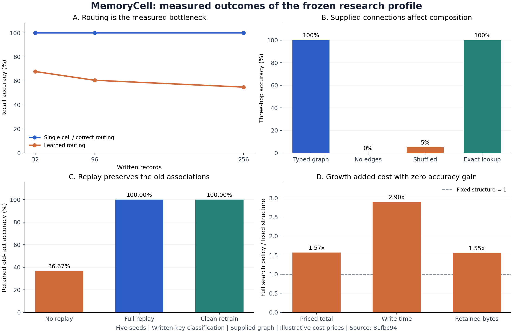

# MemoryCell 六阶段：实现与实测结果

本轮已实现并实际执行六阶段研究流程。结果支持继续研究参数记忆 cell，也明确暴露了两个未通过的核心假设：**固定多 cell 尚未优于同参数预算单 cell，分裂／合并尚未获得覆盖维护成本的收益。通用 memory system 尚未成立。**

这里的模型是 NumPy 实现的小型可训练分类器，不是预训练语言模型。所有结论限定于下述 CPU 数值实验；它没有接通 Hepta 的生产 owner，也没有激活生产神经元。

## 1. 可复核的交付

- 执行源码 commit：`81fbc94963447ecb0e4bf6956d144d77e5a16e13`。
- 被研究仓库的 main 基线：`f8c9419df6ddeb36ff8b522a50219981fb8d9345`。
- 正式协议：[PROTOCOL.json](PROTOCOL.json)。超参数、seeds、候选结构、成本价格和验收聚合均在正式执行前提交。
- 原始结果：[results.json](results/20261025-six-stage/results.json)。机器可读结论：[QUALIFICATION.json](QUALIFICATION.json)。
- 执行环境：[environment.json](results/20261025-six-stage/environment.json)。Python 3.12.14、NumPy 2.3.5、Linux CPU，BLAS/OMP 各限制为一个线程。
- 证据清单：[MANIFEST.json](results/20261025-six-stage/MANIFEST.json)，其 SHA-256 为 `cfa89c5b225b3925fd429fe62f51e9d9ec41c0f6e8f00b53b2f08a57b6aa7136`。
- 操作和复现：[README.md](README.md)。与现有 Hepta owners 的接入边界：[INTEGRATION.md](INTEGRATION.md)。

完成了 61 项机制测试；随后格式化并提交源码，再执行冻结的正式研究。正式流程耗时 21.825 秒，生成 207 个真实训练的 tensor artifacts，执行 19 次 fresh-process 单 cell 读出。校验器确认 945 个证据文件、27 个执行源码文件及其精确 Git commit 字节绑定。独立复核重算了所有 core/transfer 逐条预测及结构成本账单。

这些检查证明代码和证据的一致性，科学门槛仍需逐项判断。GitHub workflow 已提供，但远端 CI 尚未执行；当前代码和结果尚未推送。



图中百分比是五个 seeds 的均值。D 图以固定结构成本为 1；定价总成本采用冻结的研究价格，不代表货币成本。

## 2. 六阶段判定

| 阶段 | 实际交付与观测 | 判定 |
| --- | --- | --- |
| 1. 单 cell 参数记忆 | 真正训练、保存、重载；32/96/256 条已写入关联均 100% 恢复；fresh reader 无源数据通道 | 限定任务通过；未测到最大容量，也无压缩收益 |
| 2. 固定多 cell | 共享 encoder、四个局部 cell、三种路由、可重载 network；primary 学习路由 60.52%，单 cell 100% | 未通过同预算优势标准 |
| 3. 类型化 meta network | 两条三跳链；正确图 100%，去边 0%，兼容类型打乱 5% | 给定图上的组合标准通过；未证明自组织拓扑 |
| 4. 持续学习与维护 | 新增、更正、回放、撤销、旧快照阻止、干净重训；回放保留率 100%，删除接口 20/20 拒绝 | 一次小规模维护诊断通过；非长期学习或权重遗忘证明 |
| 5. 分裂、合并、巩固 | 实际子模型训练、继承、硬标签蒸馏和选择；五次都选择不改变结构 | 未通过；准确率增益为 0，完整定价成本高 56.86% |
| 6. 扩展通用性 | 三个新随机流与一个真实仓库事实诊断均执行 | 覆盖了额外诊断；广泛迁移与通用性未建立 |

Stage 1、3、4 的限定标准要求五个正式 seeds 各自通过。Stage 2 使用配对 seed-cluster 比较；独立统计样本量是 5，而不是重复问法的数量。

## 3. 模型究竟记住了什么

共享底座是冻结、与训练数据无关的 128 维哈希编码器。每个 cell 学习两个矩阵：

```text
logits = tanh(encode(key) @ A) @ B
```

写入使用真实梯度和 Adam；读出从保存的权重计算 64 类中的类别。单 cell 比较臂的 rank 为 35，含 6,720 个 float64 参数。四个局部 cell 各为 rank 8，再加 rank-4 router，合计 6,672 个参数。单 cell 多出的 48 个参数来自整数 rank 向上取整。另训练约等 FLOP 的单 cell 比较臂，并保留实际计算量。

**主任务测试的是已写入 key 的参数恢复。** 问句模板虽然被保留作隐藏读请求，但模型实际接收规范化 key，所以问句措辞变化不构成新的模型输入泛化。不能将这些分数解释为自然语言问答。随机 key 与 value 使用独立随机流，模型不能从未写入的 key 推断随机 value。

fresh reader 通过新的 `python -I` 进程运行，仅接收 keys、编码器身份和 artifact 路径，不接收 targets、历史、回放或训练样本。受控 Python audit 记录只打开 `manifest.json` 和 `tensors.npz`。这是读路径隔离检查，不是 OS 安全隔离，也不是抵御恶意原生代码的证明。

## 4. 容量、失真与路由损失

证据：[core/summary.json](results/20261025-six-stage/core/summary.json)。五个正式 seeds 为 11、23、47、71、101。

| 写入关联数 | 单 cell | 约等 FLOP 单 cell | 正确域／literal 路由多 cell | 学习路由多 cell | Exact / lexical 检索 |
| ---: | ---: | ---: | ---: | ---: | ---: |
| 32 | 100% | 100% | 100% | 67.81% | 100% |
| 96，primary | 100% | 100% | 100% | 60.52% | 100% |
| 256 | 100% | 100% | 100% | 54.84% | 100% |

单 cell 在本次测试到的最大负载 256 条上 top-1 失真为 0；这只给出一个已测工作点，不能说最大容量是 256。各分区 cell 的最大已测负载为 64 条。当前任务没有形成对正确路由模型的容量压力。

Primary 的学习路由相对单 cell 差 **−39.48 个百分点**，探索性 seed-cluster 95% 区间为 **[−43.65，−33.23] 个百分点**。正确域路由与学习路由的差为 +39.48 个百分点。修好路由至多消除这个已观测损失；本实验中的正确路由仍只与单 cell 持平，不能据此宣布多 cell 优势。

960 次 primary 读请求中，错误路由 382 次，最终答案错误 379 次；3 次错误路由恰好输出同一类别。该 960 次读请求包含重复事实的两个问法，独立统计单位仍为五个 seeds。

事后描述性诊断发现，两条隐藏问句模板的学习路由答案准确率分别为 83.33% 和 37.71%，而 router 训练损失很低。这支持“路由对问法变化的泛化不足”，尚不能唯一归因于哈希碰撞、rank 或某个词项。此诊断没有用于重新训练或调整正式结果。

### 没有观测到压缩或读取成本优势

Primary 的平均组件大小：

| 组件 | 平均字节数 |
| --- | ---: |
| 单 cell 权重张量 | 53,760 |
| 四个 cell 与 router 权重张量 | 53,376 |
| 单 cell 保存产物，含训练 receipt | 55,582.8 |
| 多 cell、router、network 保存产物 | 63,841.6 |
| 最小 exact 映射 JSON | 6,201.6 |
| 上述映射的 gzip | 1,245.0 |
| 另需保留的公共源事件 | 30,768 |

单 cell 产物约为未压缩映射 JSON 的 8.96 倍、其 gzip 的 44.64 倍。不能将神经参数化本身叫作有效压缩。完整系统预算没有配平；源、回放、版本和维护状态也不能省略计价。

每批 192 个 primary 请求的本机平均热读时间：单 cell 4.202 ms；学习路由加 cell 21.674 ms；预构建 exact 索引 0.012895 ms。Exact 索引构建另为 0.049336 ms。多 cell 时间已包含路由；这些是单机小批次诊断，不是生产延迟 SLA。

## 5. 类型化组合：连接有效，但拓扑是给定的

证据：[composition/summary.json](results/20261025-six-stage/composition/composition/summary.json)。每个 seed 有两条 `episodic → semantic → procedural` 三跳链，共六个 cell。每个 cell 真实训练、保存并重载；下一跳只能使用上一模型的实际输出和固定公共 slot 解码。

| 读出方式 | 五个 seeds 合计 |
| --- | ---: |
| 正确类型化图 | 240/240，100% |
| 去边 | 0/240，0% |
| 类型兼容打乱 | 12/240，5% |
| 精确映射的三跳组合 | 240/240，100% |

每次 shuffle 实际改变四条边。去边后无法到达最终答案节点，因此这部分 0% 包含结构上不可达的影响；类型兼容打乱是更有信息量的对照。

结果证明已学到的数值关联能够组合，且正确连接会改变结果。它没有证明 cell 自发学会类型、发现拓扑、理解情景语义或执行通用程序。这里的 procedural cell 仍是符号映射，不能当作真实程序技能。精确组合基线也为 100%，所以尚无超越传统存储系统的证据。

## 6. 持续学习：回放有效，删除仍需干净重训

证据：[evolution/summary.json](results/20261025-six-stage/evolution/evolution/summary.json)。每个 seed 从 24 条旧记录开始，新增 12 条、更正 8 条、删除 4 条，最终保留 32 条有效记录。

| 候选 | 未变旧知识保留 | 新知识 | 更正后知识 | 当前全部知识 |
| --- | ---: | ---: | ---: | ---: |
| 只训练新增与更正，无回放 | 36.67% | 100% | 100% | 76.25% |
| 继承参数并回放当前有效源 | 100% | 100% | 100% | 100% |
| 新初始化、当前有效源完整重训 | 100% | 100% | 100% | 100% |

无回放时旧知识从 100% 降到 22/60；回放解决了这个小实验中的明显遗忘问题。另有以下实际检查：

- 撤销源后，带污染继承链的产物不能服务。
- 加载撤销前快照时必须合并当前撤销 frontier，旧快照不能复活旧模型。
- clean retrain 无参数 parent，训练源不包含任何已撤销 revision。
- 删除接口在模型读出前拒绝全部 20/20 删除查询。

回放模型虽然当前知识全部答对，其原始权重仍在 7/20 删除探测上命中旧值，所以不能以“当前有效知识准确”替代撤销检查。clean 模型在该有限探测中为 0/20，仍不构成权重遗忘证明。

本轮采用的是**全量当前有效源、从新初始化重训**，不是局部无损擦除。也只覆盖一次小规模更新周期，长期流式任务、自然领域和分布式删除仍待验证。

## 7. 分裂、合并与巩固：真实执行，但没有收益

每个 seed 写入 48 个 key。selection 和 hidden test 各使用 24 个不相交的有效 key；两组事实均可合法参与记忆写入，但结构选择不读取 hidden test 的结果。

| 候选 | 结构 | 参数量 | Selection / hidden test |
| --- | --- | ---: | ---: |
| Parent | rank 16 | 3,072 | 100% / 100% |
| Split | 从 parent 继承并训练的 2 × rank 8 | 3,072 | 100% / 100% |
| Fixed | 独立训练的 2 × rank 8 | 3,072 | 100% / 100% |
| Merge | 对 split 输出硬标签蒸馏的 rank 16 | 3,072 | 100% / 100% |

所有候选均真实训练，且均使用 24,576 B 张量。五个 seeds 都以 `insufficient_net_gain` 拒绝 split 与 merge，选择 `parent/no_change`；0.1、1、10 倍成本权重下选择也相同。

完整 policy 总账计入 parent、两个 children、merge、蒸馏及全部 selection 读取，包含未被采用的候选。固定双 cell 是单独比较臂，不混入 policy。平均结果：

| 指标 | 完整搜索 policy | 固定双 cell | 比值 |
| --- | ---: | ---: | ---: |
| 隐藏读准确率 | 100% | 100% | 无增益 |
| 实际写入秒数 | 0.373653 | 0.128993 | 2.8967× |
| 实际保留并计价的字节 | 320,321.2 | 206,152.4 | 1.5538× |
| 冻结价格下的总成本 | 0.328512 | 0.209435 | 1.5686× |

成本公式为 `10^-6 × retained bytes + 0.01 × write seconds + read seconds`。所含字节覆盖实际保留的模型、路由、lineage、源、回放和训练 receipt；研究评测日志不计入该口径。每次主机计时会波动，价格也是明确选择的研究策略。

结论是本设置下不应增长：收益为零，成本增加 56.86%。这不证明分裂永远无效，因为所有候选已经处在准确率天花板；后续应在新冻结协议中引入容量压力、领域冲突或分布漂移，再用独立数据测试。

## 8. 扩展诊断没有等同于通用性

证据：[transfer/summary.json](results/20261025-six-stage/transfer/summary.json)。冻结写入／读取程序用于三个新 seeds 和四个新域名，单 cell 与正确路由均为 100%；学习路由分别为 68.75%、62.50%、83.85%，均值 71.70%。

另从固定仓库 `MODULES.json` 读取 40 条 module → owner 事实，包含 20 个 owner 类别。rank-8 cell 的 fresh-process 分类读出为 100%，exact/lexical 也均为 100%。输出 owner 名称另需 413 B 标签目录。

三个随机流仍由相同生成器产生，每个都重新训练模型；真实来源只有一份小 registry。它们证明冻结程序可用于额外的数据，没有证明已学权重跨领域迁移、开放问答、多种真实记忆类型或通用任务流。Stage 6 的宏观完成标准仍未满足。

## 9. 对 Hepta 下一步设计的影响

1. **保留明确的写入、读出、版本与拒答接口。** 当前 artifact、network、lineage 和撤销机制可作为后续 backend 的研究接口参照。
2. **显式类型和确定性路由优先。** 本任务 literal route 已达 100%；学习路由要在模糊寻址任务上以独立证据证明价值，并承担不确定性与拒答处理。
3. **优先让参数记忆学习可复用规律、偏好和程序技能。** 对这类随机精确关联，本次参数化没有压缩优势；精确事实仍需有版本的源存储和检索。
4. **增长必须是可拒绝的候选操作。** 分裂／合并要以隐藏收益、旧能力保留和完整生命周期成本共同决策。应允许长期保持不变。
5. **下一轮引入实际模型和独立真实任务。** 新 backend 需绑定底座、tokenizer、adapter、数据和产物身份；将真实情景、语义规律与程序任务分别测量，再考察跨类型组合。先冻结新协议，不能用本轮隐藏结果反复调参后仍声称同一轮验收成功。
6. **沿现有 Hepta owners 接入。** 推理、学习执行、artifacts、plasticity、evaluation 与源数据 owner 各保留职责。参数预测不能伪装成 `RecallPacketV1` 的原事实召回；具体边界见 INTEGRATION。

当前可交付的是具有实际训练和完整负结果的研究实现。它为进一步投入提供了可测依据；生产接入、语言模型微调、有效参数压缩和通用记忆仍是后续需要独立实现及验证的工作。

## 10. 本地提交与发布状态

分支：`research/memory-cell-six-stage-20261025`。实现已按模型、读出、数据、计量、路由、网络、图、生命周期、实验和校验拆成可审查的本地提交；原始生成证据单独提交。

一次远端 push 被自动审批系统拒绝，理由是本轮尚无明确授权将新内容发布到 GitHub。没有绕过拒绝，也没有推送或创建 PR。请求批准时，应列明该分支、代码、合成研究数据、固定公开仓库事实和全部正／负结果，然后再执行发布。
