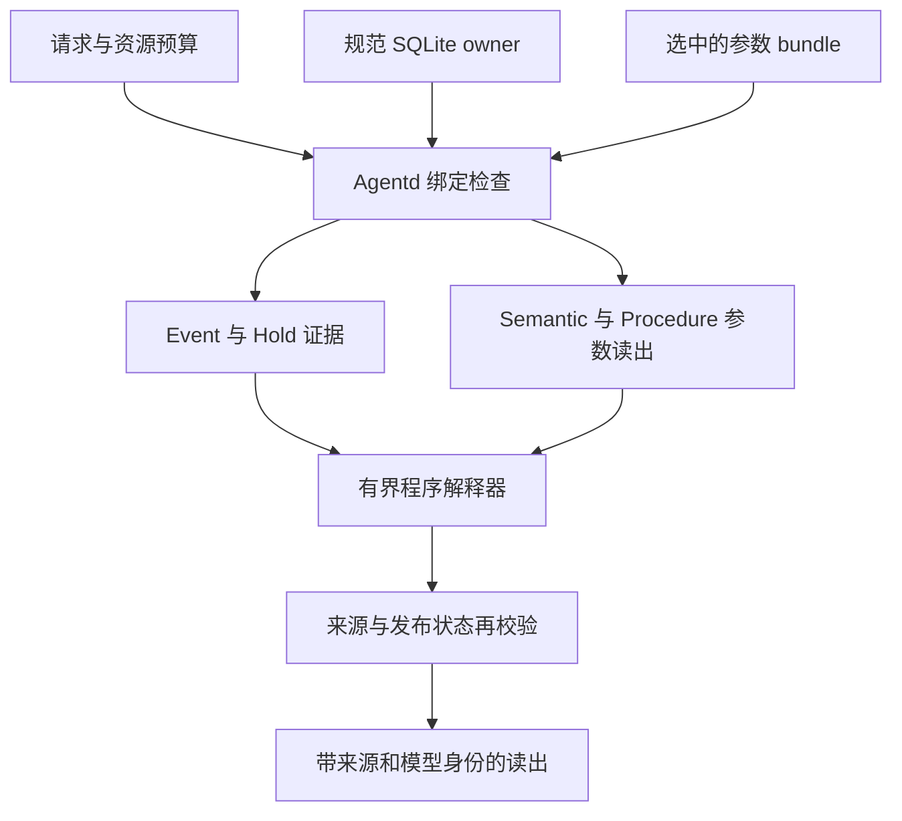

# Hepta memory cells：实现、原生验收设计与下一步

## 结论与证据状态

**Hepta 可以沿现有 neuron、认知 owner 和 Agentd 扩展出有不同职责的 memory cell；当前实现提供了这个方向的有限原型，还没有形成能够自主分工、独立演化的通用元记忆网络。** 已写入的原生代码将参数读出、来源授权、程序执行和发布资格分开。研究侧训练并比较了有限映射；原生侧准备通过真实 SQLite owner、控制 socket、独立进程和签名 artifact owner 验收这些参数能否进入实际读取流程。

**本报告的 actual owner 状态统一为“待本轮 CI 实测”。** 第三轮普通测试已有 969 passed／31 skipped，随后在 JUnit 收集阶段失败，actual 尚未启动；当前进度与原始证据见 [总报告](REPORT.md)。下文的原生加载、读出、停止、迁移、撤销和数值一致性均描述实现或测试设计；测试代码中的断言与预期生成的 `status: passed` 字段不是已经完成的证据。编译、单元／集成测试和 actual 五进程链路应分别记录结果，失败日志也必须保留。

已经完成的冻结 Python 研究及其局限见 [研究结果报告](research_results_zh.md)、[完整计数](analysis/COUNTS.md) 和 [独立审计](audit/AUDIT_REPORT.md)。这里只保留对实现有影响的结论：固定 typed 分解在本次限定 joint 对照上较强，但没有超过同信息 SQL planner；直接未见措辞、学习型寻址与维护质量较弱；分裂和合并候选均未通过质量门槛。不能从这些结果推导一般压缩优势、动态结构优势或通用记忆已经形成。

## 1. Cell 的职责：三类记忆与一个显式例外

在这个原型里，cell 是有输出合同、持久化状态、来源依赖和执行边界的组件。它不要求每种记忆都变成神经网络。

| 角色 | 当前实现 | 查询时的职责 | 仍需保留的证据 |
| --- | --- | --- | --- |
| 情景／事件 Event | 规范 SQLite owner 中带有效时间的版本记录 | 精确读取当前值、历史值和差值 | 原始来源、修订、时间和 tombstone |
| 语义 Semantic | 冻结表示上的小型残差参数模型 | 读出 `reserve`、`pack`、`limit` | 参数身份、完整训练来源、当前支持记录 |
| 技能 Procedure | 相同参数形式、不同输出头 | 读出四个 opcode 组成的程序 | 参数身份、程序来源、解释器版本 |
| 例外 Hold | owner 中独立的布尔记录 | 只有明确 `hold=false` 才允许组合执行 | 当前 hold 来源；缺失不能解释为 false |

因此“三类型组合”是事件证据、策略参数和程序参数协作；Hold 是必须检查的约束来源，没有第四个学习型模型。事件与例外维持精确存储，便于更正、历史查询和撤销。策略与程序的参数记忆作为候选能力存在，不能取代来源日志。

类型与解释器定义见 [`memory_inventory_values.rs`](../../codex-rs/hepta-cognitive-types/src/memory_inventory_values.rs)。原生请求／读出合同单独采用 inventory profile，未把新值塞入旧 V9 catalog profile；`hepta-memory` 仍是来源 owner，`hepta-neuron` 只负责有界参数预测。

## 2. 参数模型实际学到了什么

### 2.1 计算形式与能力边界

输入为固定 MiniLM 编码器产生的 384 维 float32 向量。每个参数 cell 保存四个张量：

\[
A\in\mathbb{R}^{r\times384},\quad B\in\mathbb{R}^{384\times r},
\quad H\in\mathbb{R}^{w\times384},\quad b\in\mathbb{R}^{w}.
\]

读出计算为：

\[
u=Ax,\quad z=x+Bu,\quad \ell=Hz+b=H(I+BA)x+b.
\]

**中间没有非线性激活，这仍是冻结表示上的仿射映射。** 当输出头 H 也可训练时，不能把加入 A、B 解释为超越无约束线性头的函数族：取 B=0 就回到线性头。Residual 与独立 linear 的差异可能来自参数化、初始化、优化路径和固定预算。研究没有对 MiniLM Transformer 求梯度，也没有训练一个可自由生成文本的语言模型。

Semantic 的输出宽度为 12：三个值各用四个 bit，每个字段范围 0–15。Procedure 的输出宽度为 28：四个位置，每个位置在七个 opcode 中选一个。固定 rank-4 时，两类分别有 7,692 与 13,852 个 float32 参数；这包括输出头，不是只报 adapter 的大小。规范地址参数读出与“直接把未见问题措辞送进模型”是不同实验，不能混用成绩。[模型实现](../../codex-rs/hepta-neuron/src/memory_residual_cell.rs)；[研究协议](formal-01/PROTOCOL.json)。

当前 serving 入口对 key 求摘要，在 artifact 的 canonical cache 中取得该地址的已存向量，再计算参数输出。Cache 保存向量及文本／向量摘要，不保存答案目录；但它仍然是按已知地址组织的存储，其大小必须计入成本。未知 key 不会凭空得到向量或新知识。原生 decoder 不重新运行编码器，也不能只凭一个声明的 encoder digest 证明缓存来自真实编码；该来源要结合固定编码器文件、导出过程和训练收据核对。

### 2.2 字节、数值和拒答合同

`MemoryResidualCellV1` 是新类型。封套 schema 为 `hepta.memory.residual-native.v1`，地址 profile 为 `hepta.memory.canonical-minilm-cache.v1`，数值 profile 为 `hepta.memory.f32-f64-residual.v1`。Policy 与 program 分别使用 `bits12` 和 `ops4x7` 输出 profile。

实现将 A、B、head.weight、head.bias 以小端 float32 的十六进制字节运输，不预先把 BA 或整个模型折叠为另一组矩阵。参数摘要按固定张量名、形状、dtype 和原始字节重算，使旧 checkpoint 的参数身份可以保持不变；原生封套本身因来源和字段不同拥有自己的 artifact digest。

原生推理把原 float32 值提升为 f64，按声明顺序逐项累加：A 从零开始；B 从零开始求和后再加 x；head 从 bias 开始。与 fresh scalar reference 比较的预定容差为 `abs_error <= 1e-4 + 1e-5 * abs(reference)`。容差用于浮点实现一致性，不用于容许不同的 typed 答案或不同来源。

加载器检查完整 artifact digest、四个张量的精确形状、参数摘要、有限数值、唯一 map key、排序且无重复的 lineage、features 与 supports 的地址集合一致性等。当前维度固定 384，rank 为 1–64，单模型封套上限 32 MiB，最多 4,096 个支持地址；这些是格式上限，不是已经验证的服务规模。Checkpoint／training receipt 摘要是被封套绑定的引用字段；decoder 不会自行重放外部训练过程，外部证据身份仍需由发布验收核对。[封套校验](../../codex-rs/hepta-neuron/src/memory_residual_wire.rs)。

Semantic 用每个 logit 到零的最小距离，Procedure 用每个位置第一名与第二名差的最小值，决定是否达到声明的 margin。这个 raw-logit margin **不是经过校准的正确概率**。未知地址或低 margin 返回无值、空来源和拒答原因；参数预测不取得 owner、发布或执行权限。

## 3. 原生合同与一次完整读取

### 3.1 值、预算与程序执行

共享类型 `MemoryInventoryPolicyV1`、`MemoryInventoryProgramV1`、`MemoryInventoryValueV1` 位于 cognitive-types；JSON 的学习型值由 `kind` 与 `value` 区分。Event 输入限定在 ±1,000,000，程序固定四个 opcode，单次请求最大执行步数为 1–4。程序数据通过有界解释器执行：

| Opcode | 对当前值 v 的操作 |
| --- | --- |
| keep | 保持 v |
| reserve_gap | `max(0, reserve - v)` |
| pack | `v * pack` |
| cap | `min(v, limit)` |
| add_reserve | `v + reserve` |
| halve | 向负无穷方向取整的 `v / 2` |
| stop | 保持 v，结束并返回成功 |

算术使用有检查的运算，超预算、没有 stop 或溢出都不会输出部分成功值。Readout 合同另检查 trace 的连续性、成功 stop、预算与形状；服务失败读出清空成功值、source IDs 和 cell digests。程序 cell 存储的是短程序，通用解释器负责运算；不能因此声称神经网络独立学会了程序的数值执行。[共享合同](../../codex-rs/hepta-cognitive-types/src/memory_inventory.rs)；[执行入口](../../codex-rs/hepta-agentd/src/memory_inventory_execution.rs)。

### 3.2 固定三类型组合

一次 Apply 请求可以用实体 A 的 Event／Semantic 和流程 B 的 Procedure，不要求两个 key 相同。实现顺序是取得当前 owner 快照、校验选择的 bundle、解析操作与 key、读取明确的 hold=false 和 Event、分别运行两个参数模型、执行程序，最后校验来源与发布状态。

Apply 按当前合同使用四个依赖来源、两个参数 artifact、三个 hop。成功返回值需绑定查询身份、bundle generation／digest、模型 artifact digest 和精确 source 集合。Event 与 Hold 值来自 owner；semantic policy 和 procedure program 来自 `bundle.predict`，实际执行路径没有拿 owner 的 policy/program 源答案替代模型输出。测试 harness 可以读取源答案计算期望结果，但那是评分路径。

这种连接是代码规定的有向组合，角色和调用顺序预先给定。它没有学习任意图上的路由，也没有自行发现新的 cell 类型。来源绑定证明的是身份、依赖和时效，不能证明模型预测在语义上正确。

### 3.3 寻址控制与模型能力分开

主要内容／生命周期 actual 用明确的 oracle 操作选择 seam，目的是隔离“参数能否被真实 owner 读出”。另外设计了独立 Python worker：固定 MiniLM 上的四类线性头学习 semantic、procedure、apply、reject，key 则由 owner registry 的唯一显式名称／alias 匹配绑定。多个匹配等歧义情况拒答，worker 回复还需匹配请求、模型 digest、registry 与 owner cut。

这是一套学习操作、确定性绑定 key 的混合寻址设计。不能把它描述为端到端学习了实体寻址，也不能把一条 actual 请求描述成 held wording 的统计验证。研究中的 learned router、nearest、deterministic 与 oracle 有独立计数，见 [寻址结果](research_results_zh.md)。[Worker wire](../../codex-rs/hepta-agentd/src/memory_inventory_address_wire.rs)；[Python worker](../memory-cell-v10/inventory_worker.py)。

## 4. 来源 owner、参数发布与最终使用校验

### 4.1 来源不是 artifact 自己声明的权限

Inventory 的 `(key, kind, effective_at)` 构成稳定地址，源记录经现有 SQLite owner 的授权、修订和引用机制写入。更正使用 expected revision 的 CAS；遗忘写 tombstone 并保持原地址的不可变 ancestry，读取不会在当前地址撤销后静默回退到旧值。`hold=false` 也必须有实际源记录。[写入 API](../../codex-rs/hepta-memory/src/memory_inventory_write.rs)。

`MemoryInventoryOwnerSnapshotV1` 只能由真实 owner 构造；它可以序列化给训练端，但没有把 JSON 反序列化成 owner 权限的入口。Source ID 由 scope 和 owner head 的 record digest 派生，包含修订及引用身份。训练导出必须完整分页并保持同一 cut，不能截取一个方便子集后声称完整 owner 快照。[Snapshot](../../codex-rs/hepta-memory/src/memory_inventory_snapshot.rs)；[分页接口](../../codex-rs/hepta-agentd/src/memory_inventory_snapshot.rs)。

当前 bundle 依次核对两个模型的 kind／profile／encoder、当前各类型完整 training records、key 摘要到单一当前 source 的 supports，以及完整 lineage。一次查询需要的局部来源和训练过整个模型的全部来源是两种集合；未被本次查询使用的训练来源仍可能影响参数，不能只核对查询来源。

发布继续使用已有 artifact owner 的资格、签名、generation、CURRENT 选择和 withdrawal 机制；模型字节通过 hash 校验不等于得到发布资格。原生实现把 inventory bundle 接入共享 release 机制，没有用新参数类型另建一个可绕过授权的发布通道。[Bundle](../../codex-rs/hepta-agentd/src/memory_inventory_bundle.rs)；[Release](../../codex-rs/hepta-agentd/src/memory_inventory_release.rs)。

### 4.2 最终返回前的边界

读取开始先取得当前 owner 快照并验证 bundle；执行之后检查 release，再 await SQLite 完整来源校验，随后同步重查 release，减少来源等待期间发生撤销却返回旧值的窗口。Agentd 的生命周期与 spawn generation 也负责拒绝停止、Draining 或旧代请求。[Runtime](../../codex-rs/hepta-agentd/src/memory_inventory_runtime.rs)；[来源再校验](../../codex-rs/hepta-memory/src/memory_inventory_revalidate.rs)。

这些检查属于两个 owner 上的顺序校验，**不是跨 SQLite source owner 与 artifact owner 的原子事务，也没有证明两者之间更强的全局线性化语义**。Actual 的并发设计覆盖地址解析暂停时进入 Draining；撤销设计覆盖撤销后的读取和冷启动拒绝。它不应被扩大解释为穷尽所有发布／来源竞态。

## 5. 当前完整 scope 绑定带来的连带失效

这是局部优化和长期成本解释中最重要的实现限制。`memory_inventory_snapshot` 先调用旧 owner 的完整 `lane_c_snapshot`，之后才筛 inventory schema；导出的 `owner_cut_digest` 始终取原始完整 cut，没有改成训练来源投影。

这个非分页 cut 绑定同一 owner、同一精确 scope 的全部 memory revision 数、source ledger 行数、tombstone 数、KG fact set 数、KG projection generation，以及当前有效／verified heads 和 tombstone heads 的 snapshot digest。Revision 计数发生在可见性筛选之前。依据固定基线 [`lane_c_snapshot.rs`](https://github.com/TrillionniumFoundation/hepta-private-ci/blob/0f41c4968eea63727c69e2b979491e94a99a9dbb/codex-rs/hepta-memory/src/lane_c_snapshot.rs)，Git blob 为 `af66a5195f8a65635abe6c2abaf7b8e265bb6e9d`。

| 同 scope 的变化 | 当前实现的后果 |
| --- | --- |
| 本次查询或其他地址的训练来源更正 | 完整 cut 改变，旧 bundle 失效 |
| Event／Hold 新增、更正或撤销 | 即使策略、程序权重不变，两个旧参数 cell 的 bundle 仍失效 |
| 非 inventory memory 新增、修订或撤销 | revision/frontier 或 head digest 改变，连带失效 |
| 新增不被训练引用的 source ledger 行 | source frontier 改变，连带失效 |
| KG fact 或 projection generation 改变 | cut 改变，连带失效 |
| 仅时钟前进，可见 heads 不变 | 不因时间本身失效；非分页 cut 不直接哈希观察时间 |
| 时间跨过某个 head 的生效／过期边界 | 可见集合改变时，cut 也改变 |
| 严格幂等 source 重放，没有实际插入 | 不会仅因这次重放推进 source frontier |

范围限于相应 owner 与 scope，并非整个 meta-network 的全局计数。当前语义／程序模型和 bundle 都绑定同一个完整 cut；精确 `required_sources` 的后续核对不会消除这层耦合。连带失效是静态代码范围确认；除了 actual 设计中的未查询训练来源更正，表内各类变化不能宣称已经逐项实测。

**512 上限也在 inventory 过滤之前应用。** `cut.snapshot().records.len()` 超过 512 就拒绝构造 inventory snapshot，普通可见记忆与 tombstone 同样计入；这不是每种参数 cell 可以容纳 512 个训练地址。底层 Lane C 还有 scope 级 revision、source 与 citation 上限。研究容量与原生承载量不可互换：actual 设计的初始集合为 8 个 semantic、8 个 procedure、8 个 Event 和 8 个 Hold，共 32 个记录。若把研究容量 128 的“两事件、一个策略、一个程序、一个 hold”结构逐地址直接导入，会有 640 个 typed 地址，已超出当前 512 门槛；本报告没有执行这种导入。

因此，当前实现提供保守的来源时效检查，同时引入了跨记录的可用性、发布和存储开销。无关变化不一定要求数学上重新训练权重，却要求新 cut 绑定的封套／bundle 重新获得发布资格。现有证据未验证或计量“权重不变、只更新绑定”的独立维护路径，不能声称已经实现每个 cell 的局部训练、局部失效与独立发布。

## 6. 五个 owner 进程的 actual 验收设计

入口为 [`memory_inventory_actual_trained_owner_lifecycle`](../../codex-rs/hepta-agentd/src/memory_inventory_actual_tests.rs)，默认 ignored，要求显式给出 Python、研究代码、编码器、旧 checkpoint 和全新 evidence 路径。下表五个进程指 owner 生命周期进程，不包含 Python 训练／读取 worker、迁移接收进程或 Rust 测试父进程。

| Owner 进程 | 设计动作 | 计划保留的证据 | 状态 |
| --- | --- | --- | --- |
| 1：原 checkpoint 读出 | 写入真实 SQLite 初始记录；从 owner snapshot 导出旧训练张量；安装签名 bundle；读取两类参数与独立 entity/workflow 组合；检查步预算、缓存休眠／重载、坏字节拒绝；门控 in-flight 请求后进入 Draining 并停止 | 初始 snapshot、release 身份、读取 trace、拒绝读出、PID 与控制流量 | 待本轮 CI 实测 |
| 2：冷启动与更正 | 重开原 owner／原参数；更正未查询 semantic 来源并确认旧 bundle 应拒绝；写入 hold=true；从真实新 snapshot 训练新参数并安装；验证更正与存活地址及 hold 拒答；停止 | 原权重冷读、更正前后 cut、新训练收据、来源映射和读取 | 待本轮 CI 实测 |
| 3：新参数冷读与删除 | 冷读更正后的参数；遗忘一个 semantic 地址；旧 bundle 应失效；仅用剩余来源清洁重建；被删 key 应拒答；停止 | Tombstone、剩余来源 snapshot、重建身份、存活地址和删除拒答 | 待本轮 CI 实测 |
| 4：迁移后混合寻址与撤销 | 在独立目标根目录恢复冷镜像；原源路径不可用；启动实际混合地址 worker；检查组合请求及歧义拒答；向真实 artifact owner 安装撤销 frontier；后续读取应拒绝；停止 | TCP 迁移收据、恢复 anchor／pin、worker 模型和消息身份、撤销收据 | 待本轮 CI 实测 |
| 5：带独立撤销见证的冷重开 | 父进程提供独立保留的 withdrawal receipt；目标恢复时应拒绝重新选择被撤销 bundle，控制读取不可用 | 冷启动拒绝原因、见证身份、PID／回收状态 | 待本轮 CI 实测 |

旧桥接必须读取原有训练 checkpoint 的 A、B、head 原始 float32 位，保留原 parameter digest；不能把重新训练后输出一样的模型称为原 checkpoint 桥接。更正与删除后的新模型单独标识。初始 32 条 owner 记录来自旧 authored sources 的明确映射，不读取旧 held。[Actual 输入与桥接调用](../../codex-rs/hepta-agentd/src/memory_inventory_actual_cases.rs)；[旧 checkpoint 桥接](../memory-cell-v10/legacy_bridge.py)；[新训练桥接](../memory-cell-v10/native_bridge.py)。

### 6.1 数值一致性如何验收

三个桥接阶段各有 semantic／procedure 两个 artifact。Python producer 退出后，独立 fresh reader 输出真正的 `*-reference.json`；Rust parent 中的 numeric helper 读取这些文件，对每个实际 owner 地址执行 `MemoryResidualCellV1::predict`，逐 logit 与 margin 按声明容差比较，同时要求 typed value、拒答、source IDs、parameter digest 和 artifact digest 一致。随后 owner 进程通过真实 socket 读取同身份 artifact，返回 typed 结果。

Numeric helper 不自行合成参考答案；其计划写出的 `RUST_NATIVE_PARITY.json` 记录外部 reference 文件摘要、进程收据、参数／head／encoder 身份和逐地址结果。该数值比对发生在 Rust parent，不能描述为 owner socket 返回了 raw logits；owner 的 socket 验收是另一个检查层。[Numeric actual helper](../../codex-rs/hepta-agentd/src/memory_inventory_numeric_actual.rs)。这些原生断言均待本轮 CI 实测。

### 6.2 通过后也不能越过的证据边界

即使以上测试以后通过，结论仍应限定为：

- 使用真实 SQLite、Agentd 独占 writer lock、控制 socket 与真实 artifact owner 接口，但 readiness 含明确的 control-only test seam，签名和撤销身份使用测试密钥；不等于完整生产 app-server 启动和生产凭据体系已验收。
- 迁移设计使用同一物理宿主上的真实 TCP 和独立根目录，源 owner 先停止，WAL 等附件关闭后捕获，恢复对照独立 anchor；不证明跨物理宿主性能、迁移中断／崩溃恢复或无缝在线迁移。相关设计见 [迁移 actual](../../codex-rs/hepta-agentd/src/memory_inventory_migration_actual.rs)。
- 冷撤销依赖父进程独立保留并恢复的 frontier receipt。生产中的最新见证认证、防回退存储与分发仍属于控制平面责任；artifact 自带的声明不能给自己提供最新性证明。
- 缓存 sleep／reload 仅设计验证解码数组可释放后再从同摘要字节加载，不证明操作系统 RSS 下降、成本改善或自主休眠策略。
- 删除设计验证服务拒绝、剩余来源重建和 lineage 排除；原历史 checkpoint 和来源证据仍保留，不构成物理擦除或一般机器遗忘保证。
- 一个混合寻址请求与一个歧义请求不构成开放域寻址评估；原始参数读取与更正／删除样例也不替代容量、质量与成本比较。

应以 CI 日志、逐阶段 process exit、`NATIVE_ACTUAL.json`、三份 `RUST_NATIVE_PARITY.json`、迁移／withdrawal 证据及其 artifact hash 共同验收。只有代码存在、测试名称被发现或一部分检查结束，都不能把整个五进程链路标为通过。

## 7. 现有“分化”机制离元记忆网络还差什么

研究代码可以用训练梯度提出分组、训练子 adapters、比较固定专家与增 rank、蒸馏合并候选、释放并重载参数，也保存来源和维护日程。但这些是受预注册脚本控制的候选实验，并没有自动变成 Agentd 中持续运行的进化控制器。现有原生 bundle 固定包含一个 semantic 与一个 procedure 模型；一个模型覆盖多个地址，不是每条记忆都有独立生命周期。

| 元网络所需机制 | 当前边界 |
| --- | --- |
| 持续观测错误、干扰、负载并触发候选 | 研究脚本按固定试验计划执行，没有生产在线触发器 |
| 学习类型／分组和跨节点连接 | 类型、组合路径和依赖角色预先规定；没有自主学习的图拓扑 |
| 每个 cell 独立训练、选择和撤销 | 两个模型同 bundle、同完整 scope cut，缺少 per-cell 发布 |
| 防循环、预算、跨节点一致性 | 单次固定路径有 cell／hop／step 预算；未实现任意学习图的终止与一致性协议 |
| 持久的回放和遗忘策略 | `reservoir16` 每轮从完整活跃列表重新采样，不是持久流式 reservoir |
| 质量、来源、容量和成本共同晋升 | 有研究门槛与发布机制；没有证据支持结构候选取得通用优势或自动晋升 |
| 自主迁移、复制与故障调度 | 有显式迁移验收设计，尚无测得的多宿主自治调度策略 |

连接几个组件或把 artifact 移动到另一根目录，都不足以证明网络“自发形成通用 memory”。需要观察到一个受资源预算约束的控制器，在未见任务和长期变化下提出并选择结构，取得超过固定结构及强检索的收益，同时保持来源和撤销语义。

## 8. 下一步如何实现：分阶段提出可证伪假设

以下均为**尚未实现、尚未证明的后续设计**，不属于这次已经落地的 native 能力。应另行冻结协议与新评估集；已打开的本轮 held 不再用于调参。

### 8.1 将训练依赖与查询读取依赖分开

第一步是设计 `projected training cut + query read cut`，而不是直接删除完整 cut 校验。

Projected training cut 应由 owner 为某个 cell 的完整训练依赖生成，绑定所有训练 source 版本、特征／编码器／目标 schema、历史训练 lineage 和授权状态；未被这次查询使用、但训练过该 cell 的来源仍必须包含。查询 read cut 则绑定实际使用的当前 Event、Hold、策略／程序支持与有效时间，证明它们仍然当前、未撤销。Latest／缺失等判断必须覆盖相应地址范围的新增版本与 tombstone，不能只比较已经选中的几个旧 source ID。

两种 cut 都需要 owner 认证、单调撤销／版本见证和明确的一致性关系。若投影只剩未经认证的 hash 列表，就会丢失完整性或防回退能力。跨 source owner 与 release owner 的最终使用边界也需单独设计，不可用两个独立校验冒充原子提交。

**可检验假设 H1：** 同 scope 内与该 cell 无关的写入，以及不影响其训练来源的 Event／Hold 更新，不改变该 cell 的 training cut 和参数身份；相关训练源更正必须使受影响 cell 失效；查询使用最新事件与例外。在逐个写入类型、有效期变化和并发撤销下注入竞态，比较重训练次数、重发布字节、拒答窗口、正确率与漏拒绝次数。必须同时证明减少连带失效和保持来源安全，不能只测吞吐。

### 8.2 每个 cell 独立发布，组合绑定兼容版本

为每个 cell 增加稳定身份、不可变参数版本和可独立推进的发布 generation。Serving plan 固定引用一组相容的 cell 版本及其 read cut；候选训练、验证和晋升保持分离，发布时原子更新组合引用或使用明确的不可变 plan 快照。更正、撤销和回退沿依赖图定位受影响 cell，保留拒绝旧参数的路径。

**可检验假设 H2：** 更正一个 semantic cell 时，不相关 procedure 与其他 semantic cell 的参数摘要和服务可用性保持不变，且不会出现跨版本混配。与当前双模型 bundle 对照发布开销、失败恢复、依赖检查成本和错误率。只换更多小文件不足以证明独立性；必须实际经历更正、删除和重启。

### 8.3 引入真正持久的 replay 和定向重建

实现有明确字节／记录预算的持久 replay state，记录采样决策、时间、来源版本和 owner cut。普通更新只使用当前到达的数据和这个状态，不偷偷遍历完整活跃源集合。删除要从 replay 中去除相关记录，并处理继承参数仍保留历史影响的问题；需要清洁重建、经验证的遗忘方法或明确暂停服务，不能只删 lineage 字符串。

**可检验假设 H3：** 在相同总训练预算、回放存储和更正流下，持久策略能同时提高新值吸收、此前正确地址的条件保留率和最终全局准确率。对照完整回放、随机持久 reservoir、当前每轮采样以及强 SQL 服务，额外核算 source 读取、状态写入和删除重建成本。不能用最终共同重建的相同结果代替全过程比较。

### 8.4 先让分裂候选胜过固定结构，再接入在线控制器

在新训练／校准集上根据干扰、任务分布或负载提出分裂；为子模型训练一个可验证的路由，保存继承的完整 lineage。以同参数增 rank、固定专家和更大单模型作对照，明确路由成本、每参数实际更新次数、重复 head 与特征缓存的存储。合并与休眠也需要独立质量／成本门槛。

**可检验假设 H4：** 动态结构在未见措辞或任务、持续更正和删除后，达到不低于强对照的内容准确率与可访问率，并改善一个预先声明的完整成本目标。只有校准门槛达标的候选可以 shadow 或晋升；held 用于最终评估，不能反馈修改候选。本轮 9/9 分裂质量失败意味着该前提尚未满足。

### 8.5 扩展模型与任务，再研究网络自组织

若仿射模型成为瓶颈，可在冻结新比较后加入带非线性的轻量模型或小模型 adapter；需要把共享 encoder、所有可训练参数和推理成本一起计入。语义输出可以扩展到带来源的结构化事实；技能输出可以扩展到更长、可验证的程序合同。超出纯数据解释器的真实工具执行还需要对应的授权与副作用边界，不能由模型输出自行授予权限。

**可检验假设 H5：** 在新事实、未见表达、冲突／例外和真实长期更新任务中，参数 cell 与显式检索的混合方案超过同信息检索、同预算单模型和固定专家；再检验自动拓扑控制器能否进一步提高质量／成本。必须分别报告内容、访问、组合、维护和执行，不能用一次成功端到端样例掩盖低 coverage。

## 9. 工程上的下一步验收顺序

先完成当前 native CI 的编译、行为测试、数值 parity 和五进程 actual，保留每项成功或失败的原始证据；这一步解决的是实现能否真实运行。随后优先缩小训练／发布依赖范围并建立持久维护对照，再考虑更强模型和动态结构控制器。质量与成本比较需要独立的新实验，不能由 native 测试通过替代。

在这样的顺序下，Hepta 的 neuron 可以逐步成为有不同输出能力的参数 cell；owner 提供可信来源和生命周期，执行器提供有界组合，未来控制器才负责决定哪些 cell 应存在、连接或分裂。后两种动态能力和通用优势都仍是需要实现并接受对照检验的假设。
