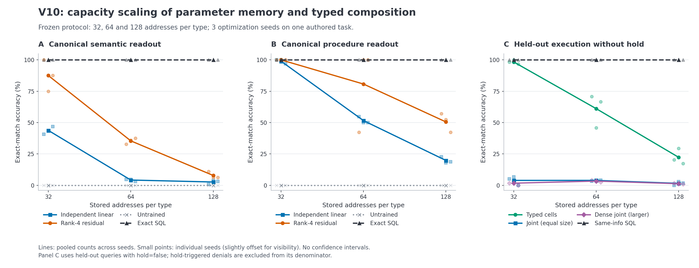
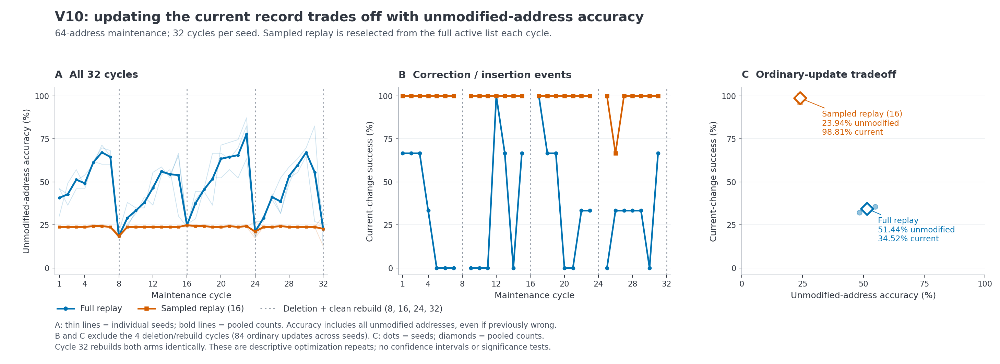

# Hepta memory cells：V10 冻结实验结果与边界

## 结论

本轮完成了真实参数训练、保存后独立进程读取、独立线性基线、等输入与等呈现预算的多类型组合、数据驱动分裂候选、增 rank 与固定专家对照，以及三个 seed 各 32 周期的维护实验。**结果支持有限参数记忆可以运行，也支持固定 typed 分工在这组新组合任务中优于两种 joint 模型；结果没有建立可靠、可扩展、成本更优的通用 memory system。** 强 SQL 同信息对照持续领先，容量扩大、直接未见措辞、learned 寻址和维护质量都暴露出明显问题。[完整计数](analysis/COUNTS.md)；[机器可读数据](analysis/COUNTS.json)。

| 工作包 | 本轮观察 | 不能据此声称 |
|---|---|---|
| 真实参数记忆 | 训练后能从持久化参数独立读出部分新值；untrained 对照为零 | 语言泛化或大容量记忆已解决 |
| 可靠寻址 | 确定性 registry 基线满分；learned router 几乎没有 coverage | 低 unknown 接受率代表高可用性 |
| 固定多类型组合 | Typed 优于等参数 joint 和更大 dense joint | 超过同信息 SQL planner，或已经出现通用推理 |
| 参数分化 | 子 adapter、合并候选与重载实际执行；9/9 分裂质量门槛失败 | 动态分工优于增 rank，或结构已经自发晋升 |
| 持续维护 | 来源干净的重建机制通过；当前变化与未改地址准确率存在明显权衡 | 长期质量、真实 owner 执行和完整生命周期成本优势均已证明 |

本报告只覆盖冻结 Python 研究及其独立读取证据。**它不报告 native CI 已通过，不用研究服务 guard 代替真实 owner、控制 socket 或进程停止证据。** Native 集成状态需要由总报告中的独立 CI／actual execution 证据说明。

## 1. 冻结、数据与评估口径

远端冻结提交为 `dd727713ad8074a74f88b5782b2a86f26a1cc30b`，source manifest SHA-256 为 `38559a7e81e22b6742febb4fdca9b52e567495cb0233eabd28aae9979c6c24b7`。协议固定容量 32、64、128，优化 seeds 1741、1742、1743。先完成全部九个 fit worker，再打开和编码 held wording，随后启动独立 evaluator 读取已保存权重。正式运行共 21 个子进程，全部 exit 0；没有根据 held 结果修改预算或阈值。[远端冻结凭证](formal-01/REMOTE_FREEZE.json)；[协议](formal-01/PROTOCOL.json)；[进程清单](formal-01/PROCESSES.json)。

每个容量都包含相同数量的 semantic 地址和 procedure 地址。例如容量 64 表示 64 个策略与 64 个程序。Semantic 值是三个 0–15 整数：reserve、pack、limit；procedure 值是四个 opcode。另有显式事件、时间和 hold 来源，所有 learned 方案和 SQL planner 使用同一有界解释器。新组合是**已知实体与已知流程的未见配对**，并非未见事实或未见流程的归纳。[协议](formal-01/PROTOCOL.json)。

编码器是固定 MiniLM 表示，未对 Transformer 求梯度。新模型用 NumPy float32 Adam 真正更新参数。可训练 head 下的 residual 为：

\[
z=x+BAx,\qquad \ell=Hz+b=H(I+BA)x+b.
\]

它仍是 frozen representation 上的 affine map。因此 residual 相对独立 linear 的结果反映本轮参数化、初始化和固定优化预算的差异，不能证明函数族更强。技能 cell 读出的是程序序列；数值运算由公共解释器完成，不能把程序记忆称作神经网络独立学会复杂技能执行。

三个 seed 使用相同人工任务分布，属于优化重复。本文和图中使用 pooled counts，并展示 seed 点或轨迹，**没有置信区间、显著性检验或独立现实场景的统计推断**。容量增加而每次 fit 的总呈现预算固定，每地址预期曝光随之下降；容量曲线同时包含干扰和优化预算不足等影响，不能当作模型理论容量上限。

关键指标定义如下：

- **Canonical exact match**：给定已知 canonical 地址后，完整策略三个值或四个 opcode 全部正确。
- **直接未见措辞**：直接把 held 问题表示送入内容模型，不借助地址 oracle 转成 canonical 输入。
- **Held-out execution without hold**：held-out 查询中 `hold=false` 的完整执行结果和 trace 精确一致；这里排除的是 hold 例外，不是排除 held-out 测试集。
- **未改地址准确率**：本周期未被修改地址的答案正确数／全部这些地址数。分母包含此前可能已经答错的地址；它不是“此前答对地址中仍答对的比例”。

## 2. 参数记忆：参数中有知识，容量与措辞访问仍受限

表中每格是三个 seed 的 pooled 完整值正确数，而不是逐 bit 正确率。SQL 数字来自真实逐条 `SELECT`，同时检查返回值、key 和 source ID。

| 每类型容量 | Semantic linear | Semantic residual | Procedure linear | Procedure residual | Untrained | SQL |
|---:|---:|---:|---:|---:|---:|---:|
| 32 | 42/96，43.75% | 84/96，87.50% | 95/96，98.96% | 96/96，100% | 两类型均 0/96 | 两类型均 96/96 |
| 64 | 8/192，4.17% | 68/192，35.42% | 99/192，51.56% | 155/192，80.73% | 两类型均 0/192 | 两类型均 192/192 |
| 128 | 10/384，2.60% | 30/384，7.81% | 76/384，19.79% | 194/384，50.52% | 两类型均 0/384 | 两类型均 384/384 |

这说明训练改变了参数中的有限映射，但不能把 pooled 结果当作稳定表现。例如容量 64 的 procedure residual 在三个 seed 下分别为 **27/64、64/64、64/64**。新进程读取保证了持久化边界，不能消除训练不稳定性。[各 seed 原始计数](analysis/COUNTS.md)。

直接换成未见措辞，表现更差：

| 容量 | Semantic linear | Semantic residual | Procedure linear | Procedure residual |
|---:|---:|---:|---:|---:|
| 32 | 7/192，3.65% | 1/192，0.52% | 30/192，15.63% | 4/192，2.08% |
| 64 | 5/384，1.30% | 0/384，0% | 24/384，6.25% | 6/384，1.56% |
| 128 | 0/768，0% | 1/768，0.13% | 42/768，5.47% | 10/768，1.30% |

内容存储能力与访问能力必须分开衡量。Canonical 读出较好时，直接措辞泛化仍可能失败；因此不能只展示参数 checkpoint 被成功加载，就称用户能可靠访问这些记忆。Residual 的 canonical 优势也没有转化成直接未见措辞优势。[数据：content 计数](analysis/COUNTS.json)。



**图 1。** A/B 是已知 canonical 地址下的完整语义／程序读出；C 是 held-out 查询中 `hold=false` 的完整执行。线为 pooled counts，浅色小点为三个优化 seed，横向微移仅用于避免重叠。[SVG](figures/figure_1_capacity.svg)；[绘图数据](figures/plot_data.json)。

## 3. 固定多类型组合：结构偏置有效，强 SQL 对照仍领先

Typed、block-head joint 使用完全相同的 768 维 pair 输入、40 个目标坐标、七个输出 loss group 和 row schedule，均有 21,544 个 float32 参数。Dense joint 有 36,904 个参数，其更大容量与成本单独计量。所有方案使用相同事件、hold 信息和解释器。[协议](formal-01/PROTOCOL.json)。

| 容量 | Typed：held-out execution without hold | 等参数 joint | 更大 dense joint | 同信息 SQL |
|---:|---:|---:|---:|---:|
| 32 | 177/180，98.33% | 7/180，3.89% | 3/180，1.67% | 180/180，100% |
| 64 | 220/360，61.11% | 14/360，3.89% | 12/360，3.33% | 360/360，100% |
| 128 | 162/726，22.31% | 11/726，1.52% | 9/726，1.24% | 726/726，100% |

这是固定 typed 分解在本次新配对设置下的正结果。但完整执行相同不保证两个参数值都正确：不同策略或程序可能在某个事件值上产生相同 trace／结果。因此还需要并列检查参数精确性。

| 容量 | Typed：两个参数值都精确 | Joint | Dense joint | SQL |
|---:|---:|---:|---:|---:|
| 32 | 182/192，94.79% | 2/192，1.04% | 0/192 | 192/192 |
| 64 | 115/384，29.95% | 1/384，0.26% | 0/384 | 384/384 |
| 128 | 32/768，4.17% | 0/768 | 0/768 | 768/768 |

第二张表使用全部 held-out pair，包括 hold 条件，因此分母与上一张表不同。不能把 128 容量的 22.31% 执行正确率解释成 22.31% 的完整参数记忆。Typed 的优势来自这组任务、已知事实和固定训练配对下的结构归纳偏置；实验没有证明它超过同信息强检索，也没有证明网络自行产生了通用推理。[Composition 全计数](analysis/COUNTS.md)。

## 4. 寻址：拒绝大多数请求不能算可靠可用

阈值仅由 calibration 选择：要求 unknown／ambiguous 校准请求零接受，在此条件下最大化正确 known 接受数，平局选更高阈值；若没有合格阈值则全部拒绝。Held 结果没有用于放宽规则。

设 known 总数为 K、被接受 known 数为 A、其中地址正确数为 C、被误接受 unknown 数为 U：

- Known coverage = A/K。
- Accepted-known precision = C/A；A=0 时为 `null`／NA。
- Correct-known acceptance = C/K。
- 所有接受请求的精确率 = C/(A+U)，把 unknown 误接受也计入分母。

| 容量 | Learned：C/A/K | Coverage | Known precision | Unknown 误接受 | 所有接受请求 precision |
|---:|---:|---:|---:|---:|---:|
| 32 | 1/2/768 | 0.26% | 1/2，50.00% | 0/384 | 1/2，50.00% |
| 64 | 6/11/1536 | 0.72% | 6/11，54.55% | 6/768 | 6/17，35.29% |
| 128 | 3/3/3072 | 0.10% | 3/3，100% | 2/1536 | 3/5，60.00% |

容量 128 的 known precision 为 100%，只涉及三条接受的 known 请求，另外还误接受了两条 unknown。它既不是高覆盖率系统，也不是所有输出全对。Nearest embedding 在本轮冻结规则下没有接受任何 held 请求，其零 unknown 接受率伴随零 coverage。

Deterministic 与 oracle 在三个容量上都正确接受全部 known，并拒绝全部 unknown。这个强基线针对完整显式名称、有限操作词表和封闭 registry；它的满分也不应外推为开放域寻址已经解决。[逐 seed 阈值、计数和零接受情形](analysis/COUNTS.md)；[calibration 候选统计](analysis/COUNTS.json)。

## 5. 参数分化：当前候选没有胜过增 rank

分裂由训练梯度提出，两组私有 rank-4 adapters 与固定交替专家、一组 rank-8 adapter 比较，使用相同全局 row schedule 和共享 frozen head。Worded 结构读出使用真 registry 地址选择已保存 cluster，属于 **oracle-address 条件**；它没有包含 learned router 的错误。

| 容量 | Dynamic children canonical | Fixed experts canonical | Rank-8 canonical | Merge canonical |
|---:|---:|---:|---:|---:|
| 32 | 69/96，71.88% | 77/96，80.21% | 96/96，100% | 54/96，56.25% |
| 64 | 66/192，34.38% | 76/192，39.58% | 132/192，68.75% | 41/192，21.35% |
| 128 | 37/384，9.64% | 53/384，13.80% | 87/384，22.66% | 26/384，6.77% |

Dynamic children 的 canonical 正确数在 **9/9 配置都低于 rank-8**；九个结构质量门槛全部失败。合并后的 canonical 结果在九个配置均低于对应 children，九个 merge 无质量退化门槛也全部失败。因此不能只说“因为成本没测完而未晋升”：质量门槛本身已经失败。所有候选均保留且未晋升。

九次 sleep/wake 的参数身份与 raw 输出均一致，证明保存、释放 Python 参数数组和重新加载的机械一致性。它没有证明拓扑改进、操作系统 RSS 释放或自主通用记忆形成。[结构各 seed 的 canonical／calibration wording／held wording 计数](analysis/COUNTS.md)；[质量门槛与重载数据](analysis/COUNTS.json)。

## 6. 持续维护：当前变化与未改地址准确率的权衡

每个 seed 执行 32 周期，共 96 个周期观测。两个 arm 是 full replay 和兼容名称 `reservoir16`。后者每个普通周期从完整 active 列表重新抽取 15 条，再加入当前更正或插入记录；它不是独立维护的持久流式 reservoir。每个 fit 都是同样的 600×32 呈现预算。周期 8、16、24、32 删除地址并从原初始化、全部保留源进行清洁重建；两个 arm 在这些周期执行相同重建。[协议](formal-01/PROTOCOL.json)。

为比较普通更新本身，下表排除四次共同重建，剩余每 seed 28 次、合计 **84 次更正／插入**。每次有 63 个未改地址，分母合计 5,292。

| 普通更新 arm | 未改地址正确数 | 未改地址准确率 | 当前变化成功次数 | 当前变化成功率 |
|---|---:|---:|---:|---:|
| Full replay | 2722/5292 | 51.44% | 29/84 | 34.52% |
| Sampled replay (16) | 1267/5292 | 23.94% | 83/84 | 98.81% |

Sampled replay 更容易学会当前变化，但未改地址准确率低于 full replay。两项实测差距分别为 27.49 和 64.29 个百分点。两种策略都没有达到可靠长期服务所需的整体表现。这个指标不条件化于“先前答对”，不能直接称为此前正确记忆的保留率。[192 条 arm×cycle 记录](analysis/COUNTS.json)；[绘图聚合数据](figures/plot_data.json)。



**图 2。** A 展示全部 32 周期的未改地址准确率，浅线是 seed、粗线是 pooled counts。B 展示当前更正／插入成功率，删除重建周期留空。C 只汇总普通 84 次更新，点是 seed、空心菱形是 pooled counts。虚线标记四次删除及清洁重建。[SVG](figures/figure_2_maintenance.svg)。

最后周期不能单独代表全过程：

| Seed | Cycle 31：full | Cycle 31：sampled | Cycle 32：full | Cycle 32：sampled |
|---:|---:|---:|---:|---:|
| 1741 | 17/63 | 15/63 | 16/63 | 16/63 |
| 1742 | 52/63 | 15/63 | 8/63 | 8/63 |
| 1743 | 36/63 | 15/63 | 19/63 | 19/63 |

Cycle 32 两 arm 结果相同，是因为它们都执行了同一清洁重建。Full replay 的 seed 1742 从 52/63 降到 8/63，说明这套重建训练预算没有恢复先前质量。来源干净性与重建后的回答质量应分别验收，而不是用来源排除检查替代质量验证。

24 次 arm 级删除重建的初始化和删除来源排除检查均通过；192 次 stopped guard 与 24 次 deleted guard 请求，研究 guard 进入模型推理的次数为零。离线 forensic 评估仍可能探测全部地址，历史文件也仍保留。因此这些结果不证明物理抹除、一般机器遗忘，或真实 native owner 已完成停止与撤销。**维护真值来自每周期保存的当前源值；本研究没有实测逐周期 SQL UPDATE 服务的维护成本。**

## 7. 成本：活动模型、共享资产与研究证据分别计量

正式运行实测 300 次 fit、219,600 个梯度步骤、7,027,200 次样本呈现。21 个非重叠子进程 wall 合计 **133.224451 秒**；user CPU 为 128.864546 秒，system CPU 为 4.259358 秒；累计 child peak RSS 为 524,976 KiB。Fit 内部 wall 合计 72.666420 秒已经包含在进程成本里，**不能再次相加**。[进程清单](formal-01/PROCESSES.json)；[完整成本字段](analysis/COUNTS.json)。

以下是单个活动 bundle 的部分组成，单位为字节：

| 容量 | 两类 linear 内容权重 | 两类 residual 内容权重 | Typed / joint 组合权重 | Dense joint 权重 | Learned router 权重 | Canonical f32 缓存 | SQL 文件 |
|---:|---:|---:|---:|---:|---:|---:|---:|
| 32 | 61,600 | 86,176 | 各 86,176 | 147,616 | 120,088 | 98,304 | 40,960 |
| 64 | 61,600 | 86,176 | 各 86,176 | 147,616 | 218,648 | 196,608 | 61,440 |
| 128 | 61,600 | 86,176 | 各 86,176 | 147,616 | 415,768 | 393,216 | 98,304 |

共享 encoder 另计 **127,536,988 字节**。SQL 文件包含语义、程序、事件与 hold；模型侧仍需事件、hold、来源日志、manifest 和 owner 状态。只比 adapter 权重字节会漏项。如果 encoder 在其他应用功能中已经常驻，可以讨论共享摊销，但仍需明确记账；本轮没有建立整体存储或服务成本优势。

封存 raw evidence 为 2,215 个文件、153,096,915 字节。其中包括全部候选与历史权重 14,928,312 字节、特征及 pair target NPZ 18,069,261 字节、样本日程 42,425,088 字节和原始 pipeline JSONL 52,175,456 字节。这个审计包不是每次服务请求都要装载的活动模型大小。[原始文件清单](formal-01/RAW_FILES.json)。

成本解释还受以下边界约束：

- Pipeline timing 包含参考查询与证据写出，不是隔离的 serving latency。
- 六个读取 arm 只在三个 seed 下轮换起始位置 0、1、2，属于 partial rotation，没有完全平衡顺序效应。
- 安装、上传、外部 host、native 服务生命周期和能耗不在本研究进程成本内。
- 研究模型的历史依赖不是活跃 owner 授权；不能把 offline 结果直接发布成可用服务。

## 8. 可审计范围与缺口

模型参数、训练日程、来源快照、held 查询与特征、fresh evaluator 输出、执行 trace 和进程 return code 均保留。训练与 held 评估的进程边界、冻结提交和文件身份可核对。

同时保留以下证据边界，不把可重算内容冒称为已保存的原始逐条记录：

1. **Calibration 路由保存了候选阈值的计数，没有保存逐条 calibration 预测。** 可通过保存的模型和 calibration features 额外重放，但这不是现有逐条预测日志。
2. **Composition 保存了逐 pair 的 `policy_exact`／`program_exact` 标志及执行结果，没有同时保存对应的逐 pair decoded policy/program 值。** 要独立复算这些精确标志，需要重载参数与特征；不能把标志本身当作完整 decoded-value trace。
3. 三个 seed 重复同一人工分布；任务规模、封闭输出词表、完整显式名称和确定性解释器都限制外推。
4. Held 结果已打开，本轮不据此重调超参数。后续若修改任务、模型或预算，应另行预注册新的比较与测试集。
5. Native actual 证据需要单独证明真实 owner 的写入、快照、读取、来源失效、遗忘、重建和停止。本报告不提前给出 native 通过结论。

## 9. 对后续设计的含义

当前较可信的工程方向是把可验证的来源、事件、例外和 owner 控制层作为基础，再让 typed 参数模型作为候选能力进入比较。事实读取与来源保留不应因为模型能输出值而被取消；这轮强 SQL 和确定性 registry 的优势正说明这些基础能力仍有价值。

固定 typed 分解值得继续研究，但应保持同信息、同输入与同预算的强对照。动态分裂需要首先胜过等参数增 rank 和固定专家，并通过未改地址质量、删除重建质量及完整成本门槛。低 coverage 的 learned router 不应凭少量接受结果取得部署资格；更正速度也不能单独代表维护成功。

本轮程序 cell 仍在存储短 opcode 序列，semantic cell 仍在拟合有限整数映射。更长知识、真正技能泛化、跨任务迁移和自发 meta-network 都需要新的数据与证据。**本轮实现了可测量的候选系统，也给出了明确的失败边界；没有证据支持把它宣布为已经超越传统 memory 的通用系统。**

## 10. 数据、图与复现

- [完整按 seed／容量计数](analysis/COUNTS.md)
- [机器可读 COUNTS.json](analysis/COUNTS.json)，SHA-256：`47ecece56054bd7fd262ec001abacc2b00d0986d8f880cb1068cfb78585da016`
- [计数生成脚本](analysis/derive_counts.py)
- [科研绘图脚本](plot_research_results.py)
- [绘图数值](figures/plot_data.json)与[环境及输出身份](figures/REPRODUCTION.json)
- [图 1 PNG](figures/figure_1_capacity.png)／[SVG](figures/figure_1_capacity.svg)
- [图 2 PNG](figures/figure_2_maintenance.png)／[SVG](figures/figure_2_maintenance.svg)
- [冻结协议](formal-01/PROTOCOL.json)、[远端冻结凭证](formal-01/REMOTE_FREEZE.json)、[原始证据运输清单](formal-01/TRANSPORT.json)

在仓库根目录，使用已固定依赖的研究 Python 环境重绘：

```bash
MPLCONFIGDIR=/tmp/hepta-v10-mpl python \
  qualification/memory-cell-v10-results/plot_research_results.py
```

脚本核对 COUNTS.json 的固定 SHA-256，输出两幅 PNG、两幅 SVG，以及所有绘图聚合数值和版本 receipt；不读取、修改或重训模型。
