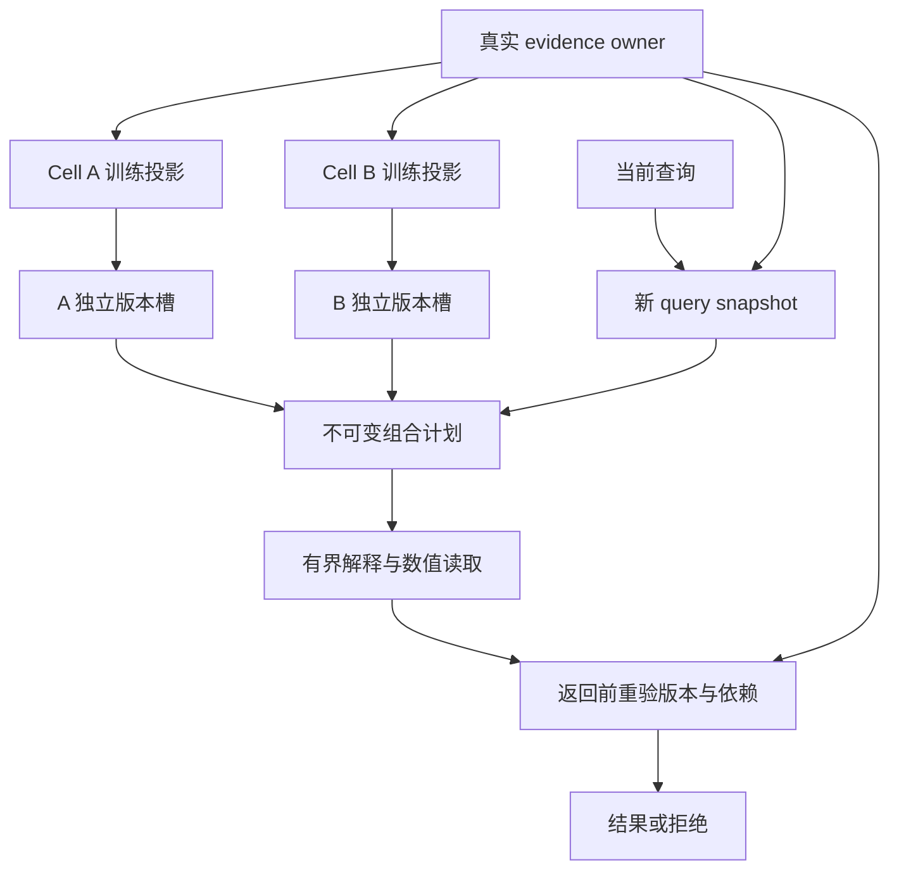

# Memory Cell V11：六项实现、实测与验收边界

本分支把六项工作推进到了可运行代码和保留原始证据的实验阶段。本次有限语料与受控干扰实验支持两个明确结论：**真正的内部 adapter 能学会新内容；有界持久 replay 能减少遗忘。** 当前证据仍不足以证明，它们组成的网络优于强检索、单模型，或能通过结构演化获得可重复净收益。

V11 是建立在 V10 上的研究分支。原 V10 的负结果保留；回顾诊断不会被改写成 V10 通过验收。正式实验采用新的输入或独立的已声明诊断范围，原始失败、拒绝候选、弃答、资源中断与校准问题均可恢复检查。

## 六项工作的实际状态

| 工作包 | 已落地内容 | 实际结果与验收判断 |
| --- | --- | --- |
| 1. V10 瓶颈 | raw/centered/with-bias 几何、pinv/ridge 正控、总预算/每地址曝光/loss-threshold 诊断 | canonical 表示在 32/64/128 容量满行秩；优化和改写寻址均有问题，不能简单归为容量耗尽 |
| 2. 独立生命周期 | 原生 owner 投影、独立 signed release slot、不可变 ServingPlan、fresh query 与返回端校验 | scoped 原生测试 517/517 通过，含 8/8 V11 用例，另有 24 skipped；随后 fix/fmt 成功且零改树。精确受测 source 与范围见 [原生验证记录](NATIVE_REPORT.md) |
| 3. 可学习模型 | 非线性 MLP、真正 Transformer 内部 LoRA、soft associative、强检索/registry/affine 对照 | LoRA 三 seed 新措辞 raw exact 均 48/48；两个 seed 在严格校准后拒绝全部已知请求，稳定可访问性未过 |
| 4. 持久维护 | SQLite 增量队列、有界 replay、有效版本监督、派生撤销、clean rebuild、模型/optimizer 重启 | 最后一批新增的 raw exact 均 100%；buffer32 把旧记录无条件保留从 5.75% 提高到 52.87%；遗忘和 held 误接收仍存在 |
| 5. 固定多类型协作 | 事件、语义、技能、预测、路由的 Python 任务组合，真实 rustc/可执行程序闭环 | 所有强对照和 typed 网络均到 100%，消融也不降；尚未证明协作收益，任务为 authored compiler fixtures |
| 6. 预算结构演化 | 实际 split/merge/sleep/wake/本机迁移、paired gate、held confirmation、cell 消融信用与累计探索成本 | 三个 split 全被拒绝，held 未确认收益；wake 恢复休眠能力不能当作演化超过原 awake 网络 |

这些状态分别描述实现、有限实验结果与科学验收。原生生命周期、Python 训练器和任务网络是可审计的纵切面，尚不是已经贯通并启用的生产通用记忆服务。

## 1. V10 真正卡在哪里

在保存的原始 V10 特征上，with-bias canonical 矩阵的行秩为 N；条件数随容量上升，但闭式线性拟合对所有六组 canonical 测试都达到 100%。原始规范表示因此有能力表达这批映射。centered 矩阵秩为预期的 N−1，不应当作异常秩亏。

128 地址时，增加训练曝光明显改善拟合。例如 procedure residual 从固定总预算的 57.03% 提高到固定每地址曝光的 100%；semantic residual 从 10.94% 提高到 28.13%，在更长预算下到 49.22%。后者仍远未证明容量极限。12 个 loss-threshold run 有八个到 12,000 步仍未达到预定 loss 阈值；即使 exact 达到 100%，也不能自动称为 loss 收敛。

闭式正控的陌生措辞直接读取很差：semantic 全部为 0，procedure 随容量增加也降至 0。它的权重范数远大于原训练权重。因此这项诊断同时提示**拟合/优化**与**查询表示/寻址**问题，没有提供稳健通用 memory 的捷径。

完整矩阵、条件数、预算表、FP32 表示与 float64 reference 运算的区别、原始输入哈希和复现命令见 [WP1_DIAGNOSIS.md](WP1_DIAGNOSIS.md)。

## 2. Cell 独立性落实在什么地方

新增的 `MemoryTrainingProjectionV11` 只能从真实 owner snapshot 创建。它绑定 owner、scope、cell selector、该 cell 的全部当前训练记录，同时保留 acquisition 时的完整 cut。旧 V10 payload 的完整 owner-cut 字段没有被偷换成局部摘要。

每个 cell 复用现有签名 artifact owner，但有独立 registry/CURRENT。不可变计划固定 cell version、artifact digest、projection digest 与 registry binding。模型训练依赖和一次查询使用的当前 snapshot 分开认证：



无关写入可以改变全局 cut 而不改变某个 cell 的训练投影，因此不需要重训或作废所有参数。相关更正、撤销以及已保存 future-effective 版本的生效都会使相关投影失效。后一种情况不一定伴随数据库新写入，所以返回端也重验完整训练投影。

一个 cell 失效后，含它的旧计划整体拒绝。新的计划可以复用未受影响 sibling 的原参数；实现不会悄悄修改旧计划。query snapshot 的一致性检查仍可使发生并发变化的一次读取重试，这与把所有已训练 cell 永久标为 stale 是两件事。

恢复依赖真实 live owner、signed selection 和 withdrawal frontier。序列化 pin metadata 不产生 authority。原生测试使用标明的 analytic numeric fixtures，证明生命周期合同，不证明学习质量。当前 plan 校验会唤醒全部 selected cells，按查询稀疏唤醒尚未实现。

还存在一个必须区分的范围：既有 V3 artifact admission 绑定整个 withdrawal scope 的 frontier。如果同一 scope 的新 frontier 广播给多个 cell owner，未命中的 sibling 也需要对同一参数版本重新 admit/install，并重建计划。它可以复用原参数而不重训，但没有实现“任何共享撤销前沿变化都无需重新认证”。来源投影的局部性和 artifact 权威前沿的认证范围分别记录，不能通过不向 sibling 发送通知来证明后者独立。

## 3. 真正学进去，不等于稳定读出来

新内容实验使用同一个冻结 FP32 multilingual MiniLM 基座，比较 linear、MLP、soft associative 和 rank-4 attention-internal LoRA。LoRA 改动 attention query/value 投影，48 个内部 A/B 张量都得到非零梯度并实际改变；关闭这些更新后，三 seed 的 held raw exact 分别从 48/48 降到 1/48、5/48、0/48。

| 模型 | 三 seed held raw exact | 三 seed 校准后“接受且正确” |
| --- | --- | --- |
| Linear | 23/48、25/48、24/48 | 11/48、10/48、9/48 |
| MLP | 46/48、47/48、46/48 | 28/48、29/48、32/48 |
| Associative | 9/48、6/48、5/48 | 6/48、3/48、3/48 |
| 内部 LoRA | 48/48、48/48、48/48 | 0/48、0/48、48/48 |

MLP 的 held unknown/ambiguous false accepts 为 1/8、2/8、3/8。LoRA 前两个 seed 选择了拒绝全部已知请求的阈值；这种情况下 precision 是 null。强 explicit identifier registry 则在相同查询上回答全部已知请求并拒绝八个负例。问题不能通过只报告 raw accuracy 或忽略拒答来回避。

成本也没有被隐藏：LoRA+head 为 78,348 个可训练参数，原始 FP32 参数 313,392 bytes，完整 mutable checkpoint 每 seed 332,626 bytes；共享基座/tokenizer 另有 484,793,822 bytes。48 条训练查询、16 个地址的有限 corpus 不支持“整体存储压缩成功”的结论。

完整逐 seed 结果、干预、成本、资源收据和独立读进程说明见 [CONTENT_REPORT.md](CONTENT_REPORT.md)。

## 4. 持久维护闭环的进展与边界

`SQLiteReplayStore` 保留版本、显式 sources、派生依赖、checkpoint 祖先、撤销 tombstone 与训练 lease。常规训练从 indexed pending queue 和有界 replay hot set 取数；全量历史 archive 单独计量，不冒称所有存储都有界。

三 seed 的受控干扰实验中，最后一批八条新增在四个 arm 的 raw exact 都达到 100%；这是忽略拒答门槛的内容正确率，不能替代“接受且正确”的可访问性。旧记录无条件保留率依次是 no replay 5.75%、buffer16 32.76%、buffer32 52.87%、full-active clean rebuild 100%。条件于上一检查点答对的保留率也另列，避免通过缩小分母隐藏过去失败。

更正和撤销使旧 lineage 失效；实验从经哈希验证的同一初始化重建，所有 remaining-known 恢复为 100%。这不是靠继续微调 dirty 参数得到的保留成功。12 次 SQLite+模型+optimizer 重启均保持 probe 预测逐位一致。撤销的两个根记录和两个派生记录不能通过旧 checkpoint 或重启重新进入服务。

这些是服务拒绝与 clean reconstruction 的保证。历史 evidence payload 仍保留，不声称物理擦除或参数数学遗忘。有限校准条件也没有保证 held 集安全：已知错误接受和未知错误接受都出现了。完整成本和例子见 [MAINTENANCE_REPORT.md](MAINTENANCE_REPORT.md)。

## 5–6. 协作与演化没有获得特殊待遇

固定 typed 系统和单模型都消耗 9,600 training presentations；typed 参数 payload 为 200,760 bytes，capacity control 为 201,764 bytes。相同呈现次数不代表相同 FLOPs 或训练时间。所有策略使用相同公开源码、compiler observation 与两步工具预算；embedding arms 共享 256-token 截断，BM25 使用完整文本。原始任务结果出现 ceiling，连 semantic/predictive 消融都不降低成功率，因此没有证据表明协作本身带来了收益。

独立审阅发现原任务 runner 的两个派生计数错误，以及按固定 arm 顺序共享 feature cache 的成本偏差。原始记录完整保留；`task_audit.py` 恢复保存的 checkpoints，核对所有原始决策/概率、逐条重建 source 变化和真实 compiler 次数，再为每个 arm 清空 feature cache 单独重测决策成本。全部概率/决策重放一致。不能把原顺序下的 wall time 当作公平的延迟优势。

结构实验对 split 使用与 fixed experts 相同的训练数据分区，以继续训练 parent 和相同参数规模的单模型作额外控制。验证之后才生成新的 held 任务；held confirmation 单独计算，不回流训练。所有 split 在所有 seed 都没有超过这些强对照，门槛保持原 parent。

每个 child 继承 parent 的全部训练依赖，并在 checkpoint metadata 中保留。把 routing keys 分成两组不会使其他 parent 依赖消失；这些子模型不能直接被声明为独立 clean-fit owner projection。

拒绝候选的训练时间、验证时间、参数文件、SQLite 和决策收据都进入 exploration ledger。存储定价使用实际 checkpoint 目录大小，活跃权重内存单列；utility price 是预先声明的研究权重，不是货币收益。完整证据与限制见 [TASK_STRUCTURE_REPORT.md](TASK_STRUCTURE_REPORT.md)。

另行执行的[迁移功能验证](MIGRATION_REPORT.md)使用同机两个真实子进程、实际训练的 MLP checkpoint 和研究层 SQLite generation CAS。15 项功能检查通过，涵盖预算拒绝、切换前目标禁止服务、切换后旧 lease 及计算中结果拒绝、更正与撤销否决，以及新 checkpoint 恢复。这里验证的是 serving checkpoint 的同机授权切换；没有传输 optimizer，也没有测试跨物理主机、网络延迟或分布式可用性，不能替代原生 owner 验收。

## 复现与证据

环境使用 Python 3.12.14、CPU Torch 2.14.1、NumPy 2.3.5、Transformers 4.57.6；精确依赖见 [requirements.txt](requirements.txt)。没有把公开预训练模型权重重复放入仓库。可用以下命令获取并验证声明的八个固定资源：

```bash
python prepare_encoder.py --output /path/to/new-empty-model-directory
python prepare_encoder.py --output /path/to/pinned-model --verify-only
```

各实验及重放脚本拒绝覆盖已有正式输出。归档保留模型增量、optimizer（在维护实验中）、训练 schedule、所有预测、校准选择、source identities 和负结果。既有执行源按原哈希保留；当前代码的计数修正不覆盖历史 source snapshot。

从 [evidence/README.md](evidence/README.md) 恢复完整包。包使用有 SHA-256 的纯文本分片，恢复器验证每片、整体 tar 和每个文件，拒绝路径逃逸与链接。Git commit 锚定发布身份；本地实验的预先冻结是本地 commitment，报告不会称其为事前远端 preregistration。

原生测试、fix、format 的 source identity 与失败历史单独记录。后续 research/evidence 提交不重复触发 Rust CI；需要核对已测 commit 到发布版本的全部 native/build inputs 零差异，才能继承该原生验证结论。

## 当前工程判断

继续发展的合理对象是：有明确 owner、可追溯来源、独立版本、真实学习算子、可控回放与可拒绝演化的 memory-cell runtime。学习结果应和寻址、置信校准及生命周期保证分别评估。只有在更真实、更大且存在冗余结构的任务/数据分布上，强检索与单模型控制仍被持续超过，才能把它提升为“通用记忆网络”或“整体压缩优势”的结论。
