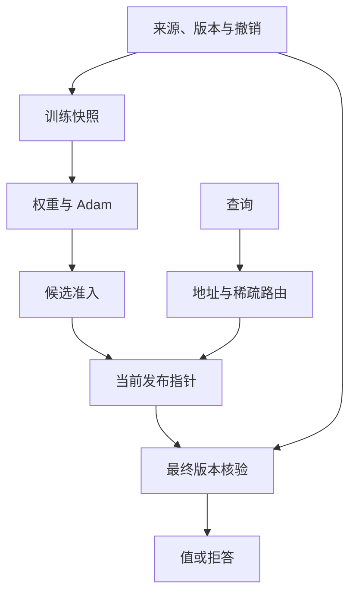

# Hepta Memory Cell V12：六阶段实现与资格证据

V12 把来源、真实可训练参数、发布指针、读取、纠正、结构候选和跨机器服务连接成可执行的研究实现。**实现可运行与研究假设成立是两项不同的验收。** 当前结果支持有界 learned cell 的生命周期与跨机器版本封锁；没有得到参数存储压缩获胜、固定类型协作提高能力、学习路由优于强检索，或结构演化取得累计净收益的证据。

研究分支：`research/memory-cell-v12-20261030`；[PR #4430](https://github.com/TrillionniumFoundation/hepta-private-ci/pull/4430)，基于 V11。真实资料固定为 `527218f9b823540830907f861a309310b71d38c9` 下的 40 份技术指南。指南既描述现状也描述目标，本研究回答的是“文档声明了什么”，不把文档文字当作部署状态认证。

## 1. 按用户的六项标准验收

| 阶段 | 实际交付 | 最有判别力的结果 | 结论边界 |
|---|---|---|---|
| 可靠单 Cell | 文档来源进入 SQLite owner；实际梯度训练；不可变模型与 Adam；准入、发布、读取、纠正、撤销、冷恢复 | 10 模块三字段，更正前后 60/60；20 次显式范围拒答；4 个真实 SIGKILL 边界；独立测试阻止伪造 fresh cut 与缩小 scope 偷继承参数 | 有界契约通过；陌生完整问句由公开 parser 归一化，不能称模型学会任意语言语义 |
| 可计量压缩 | 10/20/40 模块、3 seeds、18 个模型臂；压缩 registry、原文解析、参数/优化器/来源/运行时分账 | 40 模块精确 registry 的 zlib 为 670 B；单模型实际 serving state 为 140,588 B，且持出质量较差 | 本轮没有压缩收益 |
| 固定多类型协作 | Event、Semantic、Procedure、Meta，真实来源步骤的确定性执行；有能力的消融 fallback | 未来 618 次评估：full 与强 BM25 均 582/618；前三类移除后的 618 个输出完全相同 | 类型化执行成立，能力净收益未成立；前三类 reader 是缓存/解析器，不是四个训练好的语言模型 |
| 学习路由 | 真正跳过未选模型的稀疏调用；公开模块地址与共享章节意图分离；两次 top-1 与一次 top-2 的实际读取 | 新模块的 raw top-2 可达 100%，但接受/拒答跨 seed 不稳定；同地址 registry 的历史检索更强 | 解决了部分地址绑定问题；没有证明总系统成本与总 Cell 数无关，也没有陌生语言泛化证明 |
| 预算内结构演化 | 训练 split/merge 候选，sleep/wake 真正保存并恢复参数与 Adam；跨阶段继续维护；记录所有候选成本 | BCE 12 个完整候选与 CE 合并后的 12 个完整候选全部拒绝 | 保留 incumbent 是实际结果。成功结构路径的行为测试显式控制准入，不是正收益实验 |
| 跨节点运行 | 真实 GitHub runner VM 分发/读取检查点；单 authority 的迁移、撤销、最终释放；三台同时在线节点 | 两轮 live 均为三 jobs 成功；严格源码绑定的 `41157871480@ca002c61` 完成最终 10 项检查及两个 replica 确认；不同 boot/instance，同一节点全过程同 PID | 可信单控制器与 artifact relay；物理主机故障、分区可用性、共识、优化器迁移与原生 authority 接入仍未覆盖 |

细节及原始证据入口：

- [单 Cell 闭环与边界](DOCUMENT_CELL_RESULTS.md)
- [真实字段内容与完整成本](CONTENT_RESULTS.md)
- [路由、训练诊断和结构演化](NETWORK_RESULTS.md)
- [四类型执行与消融](TYPED_RESULTS.md)
- [跨机器精确源码与回执](FEDERATION_RESULTS.md)
- [独立证据复核](EVIDENCE_AUDIT.md)、[全部归档索引](EVIDENCE_INDEX.json)
- [远端交付字节核验](DELIVERY_VERIFICATION.json)
- [完整复现步骤](REPRODUCING.md)

CI 的准确提交、执行状态和原生最终格式修复见 [CI 验收记录](NATIVE_CI_RESULTS.json)。不能将一个旧提交上的通过套用于新的原生源码。

## 2. 两条真实模型接入路径

### 真实文档字段 Cell

`document_cell.py` 实现可独立运行的 Python owner 与 learned cell。读路径取得当前来源版本、active 状态和摘要，不按模块查表取答案。答案由实际 ReLU MLP 参数输出，经过共享标签词表解码。当前模型有 4,458 个 FP32 参数；校正前后的 Adam step 为 0 → 600 → 1200。

地址和操作由显式 parser 识别，再转换为规范模型输入。因此 60 次正确回答对应 10 个规范输入 × 3 种完整措辞 × 2 个来源状态。unknown 的测试族及重复性都在报告中列明。它验证的是当前版本下可访问的、受约束的字段关联，不是开放语义记忆。

发布使用两次独立的校验：来源 cut 必须仍是拟合时的版本；候选必须实际重建当前来源字段。仅把旧权重的 cut 改成新版本，不能通过准入。任何拟合依赖的撤销都会使旧 Cell 拒绝读取。缩小 scope 会从独立初始化重新训练，不暗中继承父模型及其 Adam。

不可变 artifact 先写入私有 staging 目录，文件及目录 fsync 后原子 rename；相同候选重试先校验既有产物，不能覆盖损坏的同名对象。完整字节落盘并不产生服务权限，SQLite 中的发布指针才决定当前 release。

### Hepta 原生模型路径

`codex-rs/hepta-agentd/src/memory_mlp_v12.rs` 与 `memory_independent_model_v12.rs` 将真正训练过的 f32 参数接入既有原生 owner、signed artifact、release 与 serving plan。`MemoryCellCandidateV12` 复用 V11 的生命周期协议，同时保留明确的 V11 residual 与 V12 MLP schema 分派；未知版本、修改后的参数和来源替换不能被静默接受。

这条原生 profile 当前处理有界 inventory policy 与程序 opcode，使用已绑定摘要的 canonical feature bank。Python 导出回归把实际训练的权重交给 Rust 数值 reader，并比较全部 24 个 logits。**文档字符串三字段的 Python codec 尚未直接成为原生 inventory codec。** 两条路径分别有实证，不能拼接成一个已经完成的通用语言服务。

原生升级修复把“逻辑目标身份”和“模型格式身份”分开：V11 → V12 可以保持同一个 Cell 目标，schema 与数值 compatibility 仍分别变更并验证。注册表的 objective lineage 门禁没有放宽。

## 3. 状态与读取关系



参数文件负责可学习表示。来源 owner 决定哪些记录当前有效；发布与最终读取核验决定哪个结果可以被释放。休眠、迁移、复制和结构候选都不能绕过这个关系。

结构控制器在当前版本里是有预算的候选搜索。它训练候选，保留失败探索的账单，再用后续窗口与强对照判断是否采用。正式实验选择不变的 incumbent；没有通过修改准入门槛制造“细胞分裂成功”。

## 4. 本轮排除的错误解释

1. **模型比整份指南小不代表压缩获胜。** 三字段模型只提供三字段服务，公平对照是同能力的精确 registry。正文中未被模型回答的知识不能进入有效压缩分母。
2. **训练失败不等于容量上限。** 首轮 BCE 的来源分类器连训练集也没有充分拟合。索引审计和相同预算的 CE 随访将优化问题与后续新地址访问问题分开。
3. **新模块不等于新语言。** Factorized phase 1/2 的 403 个 known 请求去除公开 module 后都属于过去出现过的 31 种语言形态。历史问题 nearest 达到满分与该结构一致。
4. **消融后失败不能靠接口缺失来制造。** 移除前三类 Cell 后，通用 reader 实际完成原事件重放、字段解析、程序解析与执行，因此这里准确率没有下降。
5. **少量 Cell 调用不等于总成本常数。** registry、router 输出维度、历史路由训练与来源索引的成本仍需计量。当前结果没有做出无限 Cell 规模下的系统扩展保证。
6. **撤销不是数学遗忘。** 本轮证明当前接口不再释放被撤销依赖的结果；历史原文、旧参数和归档仍被保留，不能宣称所有权重都已擦除旧信息。

这些限制也限定了下一轮的研究问题：应先加入语言形态真正未见、查询组合真正新颖、来源纠正频繁且任务服务能力一致的负载，再判断预训练小模型或更强的参数表示是否值得其完整成本。当前新鲜训练的小型 MLP 结果不构成对所有 pretrained model/adapter 方案的否定。

## 5. 文件与复现

| 模块 | 文件 |
|---|---|
| 实际训练、完整 optimizer、独立数值读取 | `learned.py`、`categorical.py`、`export_native.py` |
| 固定真实来源与分阶段任务 | `corpus.py`、各 `*_PROTOCOL.json` |
| 单 Cell 来源、发布、恢复与更正 | `document_cell.py`、`document_cell_experiment.py` |
| 同能力字段压缩比较 | `content_experiment.py` |
| 稀疏专家与结构状态 | `network.py`、`network_lifecycle.py`、`network_experiment.py` |
| 共享意图与新地址绑定 | `factorized.py`、`factorized_experiment.py` |
| 四类型任务与强 fallback | `typed.py`、`typed_experiment.py`、`typed_analysis.py` |
| 单 authority、冷恢复与在线 handoff | `federation.py`、`federation_experiment.py`、`federation_live.py` |
| 无损证据传输与恢复 | `evidence_pack.py`、`evidence-packs/*/manifest.json` |

本机及隔离 GitHub CI 的 Python 行为测试均为 38/38；CI 为 `41160216394@38ffc1a5`，其全部 32 项源码摘要与当前文件一致。这与科研优越性指标分开。隔离 CI 固定实际实验依赖：NumPy 2.3.5、SciPy 1.17.0、scikit-learn 1.8.0、joblib 1.5.3、threadpoolctl 3.6.0。首次隔离 CI 遗漏后四项，造成两个测试模块导入失败；失败回执与修复后的运行分别保存。运行所有行为回归：

```bash
OPENBLAS_NUM_THREADS=1 OMP_NUM_THREADS=1 PYTHONDONTWRITEBYTECODE=1 \
python3 -m unittest discover -s qualification/memory-cell-v12 -p '*_tests.py' -v
```

生成一份新的单 Cell 生命周期证据，输出目录必须不存在：

```bash
OPENBLAS_NUM_THREADS=1 OMP_NUM_THREADS=1 PYTHONDONTWRITEBYTECODE=1 \
python3 qualification/memory-cell-v12/document_cell_experiment.py \
  --repo "$PWD" --out /tmp/hepta-memory-v12-document-reproduction
```

各实验的实际执行源码保存在对应 `EXECUTED_SOURCE` 与无损包中；当前源码含审查之后的修复，不能假称旧实验已经执行了这些修复。旧实验重放应使用包中保存的源码与协议，并显式传入 `--repo`。

例如恢复完整文档 Cell V2 证据：

```bash
python3 qualification/memory-cell-v12/evidence_pack.py restore \
  --pack qualification/memory-cell-v12/evidence-packs/document-cell-v2 \
  --out /tmp/hepta-memory-v12-document-exact-evidence
```

每个包验证分片、完整 archive、每个原始文件三层 SHA-256 与字节数。所有分片不超过 400,000 B，满足仓库单 blob 限制；没有删除失败候选或把它们从成本中隐去。原始源码、参数、Adam、预测、SQL 状态、故障残留和诊断都在相应包中。归档压缩是传输方法，不是 learned memory 的压缩成绩。

CE 首次 run 因共享磁盘耗尽而中断，完整端到端 CPU/wall 尾回执缺失。已记录的训练成本只能作为下界；重复前缀与第三 seed 补跑均保留，不重复增加统计样本数。独立索引诊断也未保留临时调用脚本，这些缺口没有补写成不存在的原始记录。

原生 Rust 验证按仓库规定执行 `just test`、最终 scoped `just fix` 和 `just fmt`；同一验证 run 中 fix/format 后不再测试。若 finalization 改变源码，则审查实际 patch，发布新提交，再验证该准确提交。跨机器 workflow 必须重跑整个 run，不能混用不同 attempt 的阶段快照。
