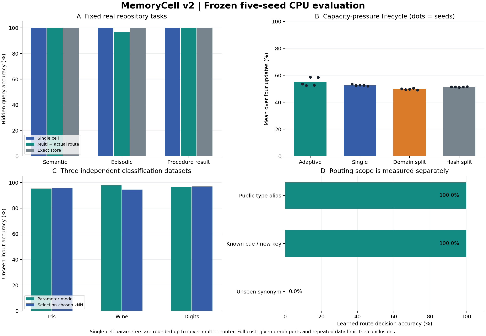

# MemoryCell v2：冻结实现、正式结果与未闭合项

**结论：v2 的训练、产物加载、实际路由、类型组合、持续结构维护和独立领域评测均已真实执行。按原验收标准，仍不能宣布所有 blocker 闭合。** 参数记忆和给定类型图的组合机制成立；固定多 cell 的优势未通过，自适应结构只在 2/5 个正式流上满足严格条件，开放语义寻址与通用记忆迁移仍未建立。

本报告由冻结后的正式结果生成，不使用开发结果替代正式结果，也不在看到正式结果后改变模型、阈值或通过标准。



## 1. 执行与证据身份

| 项目 | 结果 |
| --- | --- |
| 执行源码 commit | `d1204d6108eef75de384c8c8e98304b68984ffd1` |
| 正式 seeds | `211, 223, 227, 229, 233` |
| 开发 seeds | `8001, 8003`，与正式 seeds 分离 |
| 正式阶段 | routing、real、growth、external 全部完成 |
| 正式运行耗时 | 117.2115 秒，本机 CPU，未使用 GPU |
| 新增机制测试 | 65 项通过，真实 MiniLM 测试已执行，无跳过 |
| 正式文件完整性 | 1,641 个输出文件，72 个源码／协议／固定数据文件，精确绑定到上述 commit |
| 原 v1 证据 | 945 个文件、27 个源码文件仍通过原验证器；v1 源码和正式结果未改动 |
| 新进程读出 | 20 次，合计 2,685 条预测；加载、摘要、文件清单和预测一致性全部通过 |
| 格式化 | 测试之后执行 Ruff format 和仓库 `just fmt`；28 个 Python 文件的格式化前后 AST 完全一致，未在最终格式化后重跑单元测试 |

正式结果清单 SHA-256：

```text
a5cb0b3075a2aff203f88a2e97c8278a4014d5b2d9d229558312270f776529be
```

主要证据：[完整结果](results/20261026-v2-frozen/results.json)、[正式文件清单](results/20261026-v2-frozen/MANIFEST.json)、[执行状态](results/20261026-v2-frozen/execution_status.json)、[统计分析](analyses/20261026-v2-frozen/analysis.json)、[测试日志](validation/preformat-tests.txt)、[冻结协议](PROTOCOL.json)。机器可读结论见 [QUALIFICATION.json](QUALIFICATION.json)。

每次新运行都保存精确源码快照。形式化的文件完整性检查不等于模型有效性证明，也不是完全密闭的运行环境证明；Python 与依赖版本有记录，依赖 wheel、运行时二进制和硬件没有全部逐字节固定。

## 2. 实际实现了什么

共享底座是官方 `all-MiniLM-L6-v2` 的固定量化 ONNX，输出 384 维特征。真正训练的是小型 `tanh(XA)B` 参数模型；底座保持冻结。这轮没有把“训练分类 head”描述成已经微调了生成式语言模型的 transformer 权重。

底座 revision 为 `1110a243fdf4706b3f48f1d95db1a4f5529b4d41`，模型文件 SHA-256 为 `b941bf19f1f1283680f449fa6a7336bb5600bdcd5f84d10ddc5cd72218a0fd21`。完整来源和文件摘要在 [MODEL_SOURCE.json](MODEL_SOURCE.json)。

真实仓库写入集共有 **409 个事件**：semantic 190、episodic 149、procedural 70。三种模型分别输出 124、24、29 个值类别；单模型输出合并后的 177 个类别。

实际读出链路为：

1. 作用域和查询地址进入实际 router。
2. 不含答案的版本索引按 key／as-of 选 revision。
3. 独立编码版本索引生成的规范地址（type、key、revision），运行已加载的模型参数。
4. 值目录把预测类别解码为字符串或规则。
5. 程序解释器执行未见输入，或把上游模型的输出交给下一节点。

**参数保存的是地址与值类别之间的关联。** 值目录、规则正文和版本索引属于显式外部状态，其保留字节已计入。解释器是预置实现，其实际执行时间包含在线计时，但解释器代码与运行时部署成本未全额计入。不能据此声称任意正文、时间推理和程序逻辑已经全部压入权重。

新进程 reader 的请求只含 artifact、base path、texts、encoder digest 和 schema；不允许携带 targets、history、samples 等字段。进程内的期望输出用于外部核对，不会进入 reader。允许文件清单是两份 adapter 文件和七份 base 文件，包内固定模型身份在审计边界前加载。Python 文件审计不是 OS sandbox。

代码入口见 [README.md](README.md)，核心实现位于 `v2/encoder.py`、`adapter.py`、`addressing.py`、`real_routing.py`、`real_study.py`、`growth.py` 和 `external_domains.py`。

模型、训练回执、逐条任务预测、新进程文件访问和存储组件的独立只读审核见 [real-artifact-audit.json](validation/real-artifact-audit.json)。其计数与正式产物一致；fresh-process 一致性只证明重新加载行为可重复，不替代答案正确率。

## 3. 固定多 cell：路由接通，优势没有成立

多 cell 的总训练参数为 **10,656**，包括 router；单 cell 为 **10,659**，仅因向上取整多 3 个参数。共享底座相同。主要比较使用实际 learned routing 的多 cell，以及有公开 task-schema 地址的单 cell。

下表为五个 seed 的等权均值；前三项各占主指标的三分之一，避免大量程序 probe 掩盖其他任务。

| 真实任务 | 单 cell | 多 cell＋实际路由 | Exact |
| --- | ---: | ---: | ---: |
| 模块语义属性 | 100% | 100% | 100% |
| 采样文件变更的情景读出 | 100% | 96.8348% | 100% |
| 程序规则执行 | 100% | 100% | 100% |
| 三任务宏平均 | **100%** | **98.9449%** | **100%** |

程序规则身份准确率也为 100%，不是仅凭最终布尔值判断成功。未训练模型的三任务宏平均仅为 18.2111%。

多 cell 减单 cell 的配对平均差值为 **−1.0551 个百分点**，按 seed 的 95% bootstrap 区间为 **[−2.9874, 0] 个百分点**。因此相同参数预算下的优势 gate **不通过**。这是五次固定任务设计下的重复试验区间，不是开放任务总体的保证。

这里 learned、typed、literal 的逐条路由和预测相同，实际路由与 oracle 的差距为 **0**。主要损失来自参数记忆：seed 211 的情景任务为 59/69，seed 233 为 74/75；其余 seed 的该任务全部正确。不能继续把这批误差归因于 router。

另有 `single_learned_route` 诊断臂，它在单 cell 上额外增加 router，不能作为严格同参数预算臂。

### 开放寻址仍有明确缺口

独立路由研究的每个 seed 有 156 个 held queries：

| Learned 路由查询组 | 五 seed 平均决策准确率 | 覆盖率 |
| --- | ---: | ---: |
| 公开类型名 | 100% | 100% |
| 已知 cue、新 key、新问法 | 100% | 100% |
| 未见同义词 | **0%** | **0%** |
| 未知 scope、未知 cue、歧义、冲突、拒绝意图 | 各 100% 正确拒绝 | 各 0% |

全部查询决策准确率为 76.9231%，coverage 为 38.4615%，错误接受为 0。它能够可靠处理已声明线索，但会拒绝所有未见同义词。该行为不能表述为开放自然语言寻址已解决。输入守卫对拒答有贡献，不能全部归功于训练后的 softmax。

证据：[真实任务摘要](results/20261026-v2-frozen/real/summary.json)、[路由摘要](results/20261026-v2-frozen/routing/summary.json)。

## 4. 类型组合与持续维护

### 给定图上的跨节点组合通过消融检查

| 组合链 | 正确连接 | 去边 | 合法同类型 ID 置换 |
| --- | ---: | ---: | ---: |
| semantic 字段指针 → procedural 规则 → 执行 | 100% | 0% | 69.5135% |
| episodic commit 模块 → semantic owner | 80% | 0% | 0% |

两个任务都超过了冻结协议要求的 10 pp 去边／置换下降。第二个任务每 seed 只有 3 个查询，不能与第一项合并制造大样本印象。第一个任务的置换后布尔准确率仍较高，说明“错误规则偶尔输出正确布尔值”是实际存在的问题；独立的规则身份指标必须保留。

首跳由实际学习路由执行，第二跳使用给定 typed port。任务 schema、解释器与连接候选由代码提供；这里验证了组合对边的依赖，**没有证明网络自行发现了拓扑**。

### 维护机制成立的范围

v1 已分开评估无回放、回放、更正和 clean retrain：旧知识无回放保留率为 36.67%，回放／clean 为 100%。v2 的压力流继续验证来源污染传播、撤回、旧快照拒绝和全量 clean consolidation。

v2 五 seed、四个比较臂的撤回 guards 全部通过。每 seed 撤回 16 个 source revision；污染 checkpoint 和旧恢复路径不能继续服务，clean 训练集不包含被撤回来源。采用 checkpoint 会经过真实保存、重载、参数检查和 generation/CAS 路由迁移。

子 cell 继承 parent 参数时也继承 parent 的来源污染。因此这轮使用**重新初始化后的完整重训**，没有宣称局部无损擦除、统计 unlearning 认证或分布式生产删除完成。保留的研究审计文件不是一个已经执行物理清除的产品存储系统。

独立审核发现，正式结果保存了删除 key 的 raw 命中汇总，尚未保存逐条 raw 预测。已从原有 **20 个 clean checkpoint、32 份模型**补做 320 条读出并独立封存；没有重训或改变原 gate、计时。服务接口 **320/320 拒绝**。有意绕过 key tombstone 的审计读出中，policy、single、domain、hash 的旧值命中分别为 **2/80、1/80、3/80、3/80**，与原汇总全部一致。读出输入的 target 被置空；旧 target 只用于外部比较。这闭合了逐条留证缺口，不是已证明参数擦除，也不能把这些旧值命中直接解释为服务泄漏。

补充审计明确标注为 **post-formal supplemental saved-model inference**。证据：[逐条读出汇总](results/20261026-v2-deletion-readout-audit/summary.json)、[独立清单](results/20261026-v2-deletion-readout-audit/MANIFEST.json)、[文件和行记录重计](validation/deletion-readout-audit-verification.json)。补充清单 SHA-256 为 `a557e5266eaee5c76e8e9409b2b71b457c959ba2bec8a8bb4090fef2662624dd`。

## 5. 分裂、合并、巩固：有条件收益，严格 gate 未通过

压力流为 **256 → 1,280 → 2,048** 个随机写入关联，最后再做撤回后的 clean consolidation。四次更新等权。所有臂的部署参数均为 **24,576 B**；固定比较臂包括单模型、按 domain 分区、按 key hash 分区。

| Seed | 自适应宏平均 | 固定单模型 | 固定 domain | 固定 hash | 采用操作 | 严格条件 |
| --- | ---: | ---: | ---: | ---: | --- | --- |
| 211 | 53.5530% | 53.5530% | 50.0928% | 51.4748% | 保持结构 | 未通过 |
| 223 | 52.4923% | 52.4923% | 49.3896% | 51.5266% | 保持结构 | 未通过 |
| 227 | 58.6326% | 52.7963% | 49.8234% | 51.0759% | 1,280 条时 split 12/4 | 通过 |
| 229 | 52.7597% | 52.7597% | 50.4993% | 51.4847% | 保持结构 | 未通过 |
| 233 | 58.4733% | 52.1361% | 49.1074% | 51.5329% | 1,280 条时 split 12/4 | 通过 |
| 均值 | **55.1822%** | **52.7475%** | **49.7825%** | **51.4190%** | 2/5 采用分裂 | **总体未通过** |

真实 split 子模型和 hard-distillation merge 候选均已训练、保存和重载。没有 merge 候选被采用，拒绝的候选也计入成本。

相对固定单模型的平均增益为 **+2.4347 pp**，95% 配对 seed 区间 **[0, +4.9696] pp**。相对 domain、hash 的平均增益分别为 +5.3997、+3.7632 pp。不能用这些均值替代原来“每个 seed 均满足增益和净收益”的严格条件。

### 搜索和维护并不免费

五 seed 的实际平均账目：

| 项目 | 自适应 policy | 固定 single |
| --- | ---: | ---: |
| 训练／保存／重载的 write 时间 | 3.9784 s | 2.0398 s |
| 保留产物、来源、回放等 | 5,191,597 B | 2,831,766 B |
| 每次更新 H=10,000 下四次更新的计价资源成本 | 7.0160 | 4.4466 |

Write 时间约为固定 single 的 **1.95 倍**，保留字节约 **1.83 倍**，声明资源价格下的总成本约 **1.58 倍**。给定每次更新 10,000 次读取，平均净收益仍为每查询 +0.0242828 效用；三个未改变结构的 seed 相对 single 净收益均为负。

资源价格在协议中预先声明，是准确率效用的计价假设，不是货币。结果包含其他 H 的曲线。迁移是维护时间的子项，不能重复加总；单批计时没有延迟置信区间。此研究比较相同参数预算并全额计价额外优化工作，尚未用相同优化工作量的固定结构独立隔离“结构变化本身”的因果贡献。

四更新均值包含初始 256 条写入时的 100%。最终 clean policy 的准确率只有 **32.49%–37.62%**；采用 split 12/4 的两个 seed，其 B 域最终准确率分别为 **14.42%（227）和 11.96%（233）**。容量配置仍会牺牲另一分区，当前结果不适合高可靠事实记忆。

独立产物审计核对了 **100 个 checkpoint、154 个模型／fit 回执、46,200 个本次实际 optimizer steps、80 份采用／恢复记录和 108,718 条已保存原始预测**。每个 fit 回执为 300 步；模型 manifest 的累计步数包含祖先训练，不能直接相加。审计重算了来源、分区、选择规则、指标和完整成本，未发现不一致。证据：[growth 摘要与账目](results/20261026-v2-frozen/growth/summary.json)、[独立审核摘要](validation/growth-artifact-audit.json)。

## 6. 存储压缩与独立领域迁移

### 真实仓库记忆尚未获得完整存储优势

| 方案 | 冷部署保留字节均值 | 已共享底座时的增量 |
| --- | ---: | ---: |
| 多 cell＋router | 24,113,859.8 B | 597,408.8 B |
| 单 cell | 24,108,256.4 B | 591,805.4 B |
| Exact | 547,507 B | 547,507 B |

共享底座本身为 23,516,451 B。即使扣除已经共享的底座，多 cell 仍比 exact 大约多 **9.1%**。仅报告 85,248 B 的模型参数会漏掉重要成本。

明确计入的组件包括：57,226 B 的地址索引、136,682 B 的保留写集、7,503 B 的多 cell 值／规则目录、1,442 B 的 router artifact、来源与来源清单、部署绑定、模型和训练 receipts。运行时库、Python 对象开销、能源和硬件价格没有全部计入，不能把此表当作完整生产基础设施成本。

### 三个独立数据集验证了接口复用

同一个 65 维输入契约、rank 32、600 步学习器用于三个固定来源。相同特征行整组分配到一个 split，normalizer 只拟合 train。1NN／5NN 的选择只使用 selection，不按 test 结果选择。以下两表均为五个 seed 的等权均值；固定 1NN／5NN 结果、每 seed 的 K 和最小—最大范围见[独立审核记录](validation/external-artifact-audit.json)。

| 数据集 | 未见输入：模型 | Selection 选定 KNN | 已写入恢复：模型 |
| --- | ---: | ---: | ---: |
| Iris | 95.3763% | 95.4194% | 100% |
| Wine | 97.8378% | 94.5946% | 100% |
| Digits | 96.3736% | 96.9231% | 100% |

Wine 的描述性增益为 +3.2432 pp，Iris 基本持平，Digits 略低。Exact 对已写入输入也为 100%；它对未写入输入弃答，不能把这一点当成参数模型超过精确存储的证明。

| 数据集 | 模型无回放 | 模型含回放 | Exact | KNN |
| --- | ---: | ---: | ---: | ---: |
| Iris | 18,262.2 B | 19,652.6 B | 1,426.4 B | 2,029.8 B |
| Wine | 18,588.8 B | 22,837.4 B | 4,280.6 B | 5,221.6 B |
| Digits | 22,080.8 B | 69,390.4 B | 47,351.6 B | 50,077.6 B |

Digits 在不保留回放时出现了模型压缩优势，保留回放后该优势消失。共享实验源文件 159,987 B 另列，不在上述部署表内。

独立审核直接核对了 15 个 case、8,499 条逐样本预测记录（每条包含全部比较臂）、2,126 个 selection 样本、90 个实际部署组件文件，未发现计数、分割、K 选择、normalizer 或账目异常。五个 seed 是重复划分；独立数据源数是 **3**，不能称为 15 个领域。Digits 使用 sklearn 的 1,797 行原 UCI test 子集，再按样本划分，没有 writer-independent 保证。

这证明固定小模型接口能够用于三个分类来源。它没有证明新的自然语言记忆流已经获得通用写入、寻址与跨节点组合能力。证据：[external 原始摘要](results/20261026-v2-frozen/external/summary.json)、[数据来源与许可](sources/external/SOURCES.json)。

## 7. 本轮闭合的问题，以及仍开放的 blocker

### 已修复并验证的具体问题

- 预训练底座、模型参数、tokenizer、维度和来源绑定，真实训练后可以保存及读出。
- 实际 learned routing 进入 memory path，错误 route 不会被 oracle type 修复。
- 版本索引不保存答案，程序规则身份与最终布尔结果分开计分。
- 同输入在不同批次分组下读出变化的问题，见下述完整故障记录。
- 统一 runner 的输出目录与 development-mode 契约不一致。
- 字节成本遗漏的来源清单、部署绑定和额外验证工作。
- 失败／中断的状态封存，及声明阶段、实际结果、seed 的一致性验证。
- 开发失败时精确源码的可重构性，以及 v1 依赖和固定数据的完整绑定。
- 参数、路由、父模型 lineage、撤回和旧快照恢复的机制回归。
- 删除 key 原始预测只有汇总、缺少逐条留证的问题；通过独立封存的补充读出审计闭合。

### 仍开放的实证或实现缺口

| Blocker | 当前证据 | 能关闭它的后续证据 |
| --- | --- | --- |
| 固定多 cell 的可靠优势 | 主指标低于单 cell 1.0551 pp | 新冻结任务／容量范围中，实际路由下的同预算增益及相应不确定性达到门槛 |
| 未见语义寻址 | 未见同义词全部拒绝 | 独立语义改写、未见问法和 OOD 流中的准确率、覆盖率及错误接受率 |
| 自主类型图学习 | 图和 typed ports 由任务代码给定 | 由选择反馈学习连接，在独立任务上通过连接消融与强基线比较 |
| 稳定的结构经济收益 | 只有 2/5 流达到原严格条件 | 更稳定的 selection-only 结构决策，覆盖无收益搜索及维护成本，不改变原门槛解释本批结果 |
| 完整成本下的压缩 | 真实仓库任务没有优势；Digits 无回放时才有局部优势 | 明确精度、容量、回放／更正约束下的存储—失真—维护成本优势 |
| 通用 memory transfer | 三个分类数据集复用接口 | 新的 episodic／procedural 任务流中的写入、自然寻址和组合共同迁移 |

这些未通过项不能通过关闭 issue、增加 mock 或改变统计口径来消除。本轮完整保存负结果，作为后续设计选择的依据。

### 已保留的批次敏感故障

原量化编码器仅改变 190 条 semantic 请求的分组，就改变了 **4/190** 个预测；模型摘要、进程身份和文件清单均正确。改为逐条独立分词及 native batch 1 后，原 409 条混合输入、190 条类型子集、批次参数 1/32/128、重排与新进程的特征逐元素一致，最大差为 **0**。

新的 encoder digest 为 `8f20a0eeb9a246e055b69dcccf659dcc9ae5fc141232395a82a9685d62c03595`。旧失败的 61 个文件、71 个执行源码文件的精确归档，以及修复前后诊断全部保留。没有把旧 adapter 重新绑定新 encoder，也没有调 rank、学习率、步数或 router 阈值。

证据：[旧故障诊断](results/development-read-diagnostics-20261026/diagnosis.json)、[修复后特征一致性](results/development-read-diagnostics-20261026/contract-after/check.json)、[诊断文件清单](results/development-read-diagnostics-20261026/DIAGNOSTIC_MANIFEST.json)。

## 8. Hepta 集成结论

现有工作位于 `qualification/memory-cell-v2`，是可执行研究组件。原生 Hepta owner 接线、生产 admission、分布式恢复和产品启用属于后续集成范围，参见 [INTEGRATION.md](../memory-cell-research/INTEGRATION.md)。

当前证据更支持以下实现方向：精确来源和版本 owner 保持事实权威；参数 cell 负责可测量的关联、规则选择与模式压缩；router 和结构控制器只在有证据的范围内作选择；新结构经过真实训练、成本评价和 coherent generation 迁移后才采用。模型预测与经来源重验证的事实需要保持类型上的区别。

完整复现与读出命令见 [README.md](README.md)。正式原始结果、源码快照和已保存权重均随交付历史保留；固定预训练底座按 `MODEL_SOURCE.json` 的 URL 和摘要恢复。
