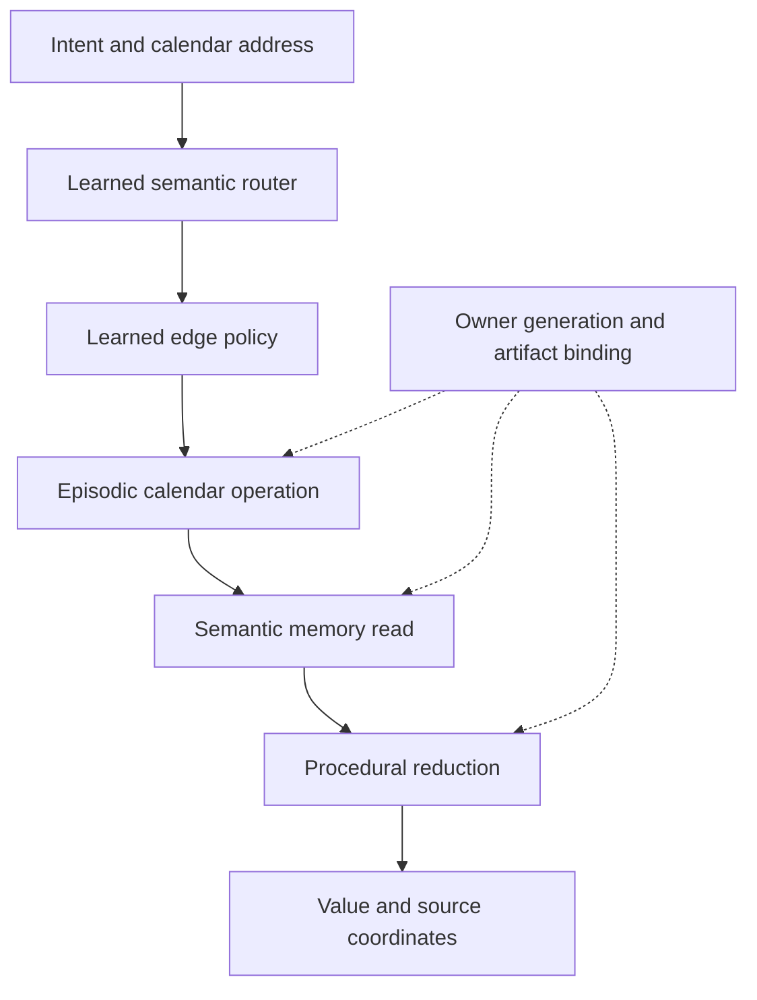

# Typed memory cells: v3 qualification

This package implements and measures the next memory-cell iteration against the
six-stage research plan. It preserves the original v1/v2 sources, results and
failed qualification gates. The frozen protocol is [PROTOCOL.json](PROTOCOL.json).
Execution success, byte integrity and scientific superiority are different claims.
The final measured status belongs in [RESULTS.md](RESULTS.md) and
[QUALIFICATION.json](QUALIFICATION.json).

## Implemented components

| Component | Implementation | What is actually learned or checked |
| --- | --- | --- |
| Portable neural memory | `v3/bitcell.py` | Real BCE/Adam fitting of a small two-layer network; int16 Q12 artifact; integer parameter readout; no answer-class catalog |
| Numeric factor memory | `v3/factor_cell.py` | Actual SVD fitting of record latents, decoder and centers; serialized routes, masks, precision and headers |
| Exact replay codec | `v3/codec.py` | Explicit residual plus matching model, compared with 12 real raw/packed/delta and compression baselines |
| Semantic routing | `v3/semantic_router.py`, `v3/routing_study.py` | Trained routing and unsupported class; selection-only risk calibration; raw utterance and explicit entity/date slot arms |
| Typed layout learning | `v3/learned_graph.py`, `route_graph_study.py` | Edge preferences fitted from actual compatible-path terminal feedback; no correct path supplied to the optimizer |
| Numeric capabilities | `v3/numeric_graph.py` | Supplied semantic reads, calendar navigation and arithmetic programs; their implementation is not learned into weights |
| Version owner | `v3/lifecycle.py` | Immutable prepared versions, durable publication intent, independent monotone witness, rollback rejection and per-hop admission |
| Split/merge/consolidation | `v3/structure.py`, `structure_study.py` | Real candidate fits, learned partitions, rank allocation, retention constraints, saved-artifact route migration and complete cost records |
| Native Hepta backend | `codex-rs/hepta-neuron/src/memory_model.rs` | Actual `NeuronModelPort` implementation and `NeuronRuntime` execution; original journal/witness and admission behavior retained |

`IntegerBitCell` is a gradient-trained network. `FactorBank` is a fitted low-rank
numeric model; SVD calls are not reported as gradient steps or pretrained
language-model fine-tuning. The frozen MiniLM encoder is shared by semantic
routing. It is charged once in the graph deployment's cold footprint and is not
used by coordinate-only factor reads.

## Read and write boundaries

The writer sees the facts it was asked to store. It can fit parameters, inspect
declared selection coordinates, test candidate structures, and encode residuals.
Hidden read coordinates and held language folds do not select the model.

The parameter reader receives a saved model and value-free addresses. It does
not receive source values, residual corrections, an answer dictionary, or a
live training closure. The exact codec reader is a separate mode that loads
explicit residual bytes. Its decoded matrix and mask cache are measured as
ordinary resident memory. Exact codec success never counts as exact
parameter-only recall.

For the graph study, the provided types support paths such as:



The catalog and operation code are supplied. Learned composition is evaluated
against an exact typed planner, one-hop reads, removed cross-cell edges, and
valid same-port permutations. A successful oracle-route diagnostic is not an
end-to-end semantic routing success.

## Durable publication and maintenance

`prepare_version` clean-fits a model from the valid source frontier, writes its
matching replay residual and address index, then fsyncs the files and their
directories. Before publication the owner parses every component, reconstructs
the exact valid replay frontier, and checks its commitment. A hash-consistent
but malformed candidate cannot advance the witness.

Publication persists an intent, then the independent witness, then the active
pointer. Recovery may complete a matching witnessed intent after an interrupted
publication. An old pointer restored without that intent is rejected. The
reader parses the exact bytes it verified instead of reopening an unchecked
address file. Every graph operation rechecks generation, artifact and frontier.

The owner assumes one writer and that the separate witness is protected from
joint rollback. It is not distributed consensus. Withdrawn coordinates are
refused, and clean fitting excludes their values. Old immutable audit artifacts
are retained and charged; this is not proof of complete weight-level erasure.

## Fixed sources and transfer

The primary numeric sources are pinned with raw bytes, parsed matrices and
SHA-256 inventories under `sources/`:

| Source | Written values | Role |
| --- | ---: | --- |
| NOAA/Scripps Mauna Loa monthly CO2 | 804 | Capacity, policy training/selection, maintenance |
| NASA GISTEMP global temperature anomaly | 1,752 | Independent scientific source; development outcomes disclosed |
| WDC-SILSO monthly sunspot numbers | 3,324 | Independent scientific source; development outcomes disclosed |
| US BLS monthly unemployment rate | 348 | Economic domain withheld from all policy development evaluation |

Dates are addresses of already written observations. These are not forecasting
experiments. New-domain facts may be written into a new memory bank, with write
cost charged; the semantic router and layout parameters may not be updated on
the held economic domain. The English template folds and numeric task family
do not establish open-ended or multilingual memory generality.

Digits pixel recall uses the existing v2 Digits source as a new numeric memory
task, not as a fourth new independent scientific dataset. Synthetic tests vary
the amount of local structure and include an independent random-value control.

SILSO is distributed under CC BY-NC 4.0 and remains a research data asset with
its original attribution. It is not relicensed as repository code. Source
headers and inventories retain NOAA/Scripps, NASA, SILSO and BLS credits.

## Budget and cost rules

Every serialized latent, decoder, center, route, mask, header and necessary
address/provenance record is charged. Equal-budget comparisons use the same
byte ceiling; integer rank granularity can leave different actual unused
budgets, which are also reported. Single centered SVD and a learned codebook
with up to 256 prototypes are measured controls.

All candidate fits and rejected search attempts execute and enter their work
ledger. A fixed structure is measured at its natural required cost, and a
separate control actually repeats fitting until it meets the adaptive work
budget. Padding a control is never allowed to make the deployable fixed
baseline artificially expensive. Work proxies are algorithmic operation
counts, not measured hardware FLOPs or currency.

Structural drift tests retain natural-cost and matched-work fixed K=1/2/4
comparisons. Static heterogeneous, stable and random controls retain their own
failures and overhead. A convergent-flow capability cannot overwrite an
all-flow failure or the original v2 gate. The reported gain divides by
`max(fixed_mse, 1.0)`; below that floor it is a normalized improvement, not a
literal relative percentage.

## Reproduction

Use Python 3.12 and the versions in `requirements.txt`. The MiniLM source is the
same pinned model identity as v2; the runner checks its canonical source
manifest against `memory-cell-v2/MODEL_SOURCE.json`.

```sh
python -m venv /tmp/hepta-memory-v3-venv
/tmp/hepta-memory-v3-venv/bin/pip install -r qualification/memory-cell-v3/requirements.txt
```

Build the real three native crates without modifying production dependency
manifests. The extractor copies manifests byte-for-byte, links the checkout's
actual sources, and verifies every resolved dependency version and checksum
against the original lock. Only nextest overrides that name absent packages
are removed in this isolated workspace; the original policy is also retained.

```sh
python qualification/memory-cell-v3/prepare_native_workspace.py \
  --destination /tmp/hepta-memory-native-v3 --build-example
just test --manifest-path /tmp/hepta-memory-native-v3/Cargo.toml -p codex-hepta-neuron
```

Tests precede the final repository fix/format step, as required by `AGENTS.md`.
After committing the exact source, rebuild the native example to bind its
receipt to that commit. No test shortcut or full-production-workspace pass is
implied by this isolated build.

```sh
OPENBLAS_NUM_THREADS=1 OMP_NUM_THREADS=1 \
  /tmp/hepta-memory-v3-venv/bin/python qualification/memory-cell-v3/run_study.py \
  --base /path/to/pinned/all-MiniLM-L6-v2 \
  --native-binary /tmp/hepta-memory-native-v3/target/debug/examples/memory_cell_read \
  --output /tmp/hepta-memory-v3-formal

/tmp/hepta-memory-v3-venv/bin/python qualification/memory-cell-v3/verify_evidence.py \
  /tmp/hepta-memory-v3-formal
```

The formal runner requires committed source bytes before it starts. It saves
the exact executable source/data snapshot, environment, protocol, every stage
and a complete file manifest. Outputs must be new directories; failures are
sealed instead of overwritten. `--development` uses only 8011/8017 and never
evaluates the economic holdout. Formal seeds are 307/311/313/317/331.

Independent audit scripts write outside the immutable run directory. Historical
pre-integration development attempts that did not capture an initial source
snapshot are explicitly labeled unsealed development in
`DEVELOPMENT_CAPACITY.md`, `DEVELOPMENT_ROUTING.md`, and
`DEVELOPMENT_STRUCTURE.md`; no later commit is retroactively called their
executed source.

## Research context

The full-cost comparison follows the description-length principle of counting
both the model and what it takes to reconstruct the data; see Blier and
Ollivier, [The Description Length of Deep Learning Models](https://arxiv.org/abs/1802.07044).
[NNCP](https://bellard.org/nncp/) is a practical example of learned probability
models used inside an explicit lossless compressor. Neither result establishes
the present memory-cell design's efficacy. The measured results here must do so.
Learned module layouts have a separate research precedent in
[End-to-End Module Networks](https://arxiv.org/abs/1704.05526); this package learns
bounded typed composition over a supplied capability catalog.
