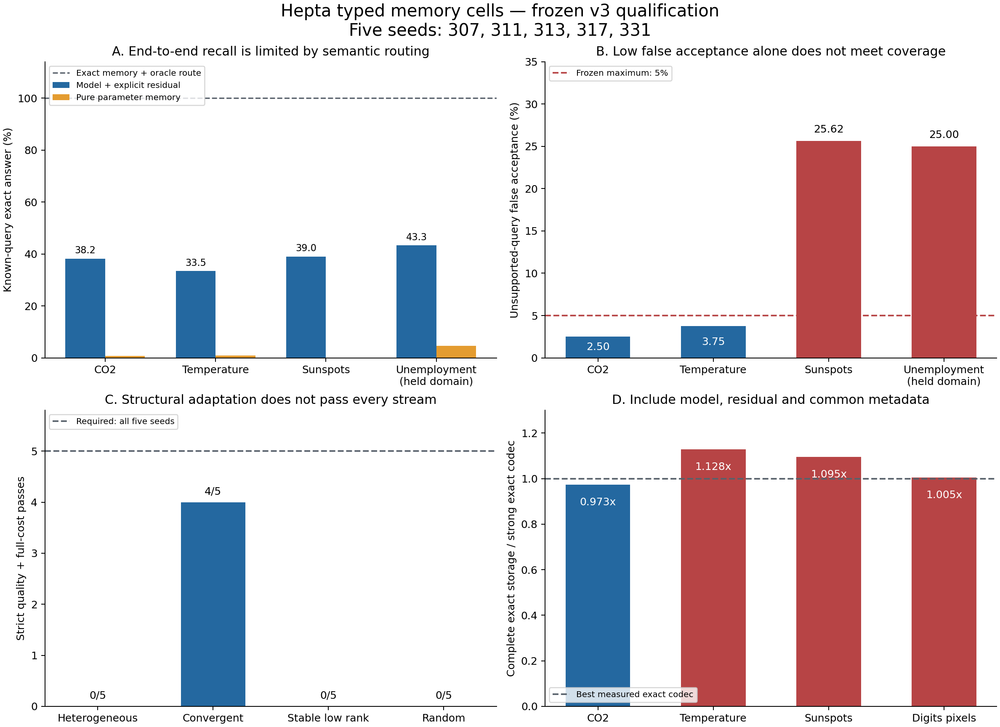

# Hepta typed memory cells：v3 正式实验与 blocker 判定

## 结论

本轮完成了真实实现、冻结后的五 seed 全链路实验、独立审计和可恢复的完整证据。**不能宣称所有 blocker 已闭合；`all_blockers_closed=false`、`general_memory_system_established=false`。** 已证明小型参数记忆及单写入者维护机制可运行；部分低预算数据受益于局部 cell；使用显式残差的类型化组合具有可测的边依赖。可靠语义寻址、跨流结构净收益、普遍完整存储优势以及新类型/新任务泛化仍未达到要求。

正式源码为 `66dc3a2ed500a60b8abb6c01eb6fe9d501dc8ea2`；seeds 为 **307、311、313、317、331**。正式执行用时 **236.0132 秒**，使用 CPU，无 GPU。执行后没有调整模型、阈值、价格或门槛，也没有丢弃 seed 331。v1/v2 的源代码、原始证据和失败门槛保持原样。

| 阶段 | 本轮结论 | 是否按完整目标通过 |
| --- | --- | --- |
| 1. 单 cell 参数记忆 | qualified_within_declared_small_workload | 限定范围通过 |
| 2. 固定多 cell | qualified_within_declared_type_budget_conditions | 限定范围通过 |
| 3. 类型化 meta network | lossless_composition_mechanism_pass_semantic_addressing_fail | 未全部通过 |
| 4. 持续学习与维护 | qualified_within_single_writer_owner_contract | 限定范围通过 |
| 5. 分裂、合并与巩固 | not_qualified | 未全部通过 |
| 6. 扩展通用性 | zero_update_transfer_mechanism_pass_reliable_generality_fail | 未全部通过 |

图中为五 seed 的均值或严格通过数。均值仅条件于本次固定工作负载与语言模板，不是总体可靠性估计。图 D 计入 model、residual 和共同地址/来源 metadata；共享 encoder 和运行时的成本另列。

## 1. 实际实现了什么

`IntegerBitCell` 是实际以 BCE/Adam 训练的两层小网络，输出整数的 bits；产物使用 int16 Q12 和固定整数读出规则，没有类别答案目录。`FactorBank` 使用真实 SVD 拟合行 latent、decoder 和 centers，序列化所有 routes、mask、precision 与 header；这属于低秩数值模型拟合，不是预训练语言模型微调。MiniLM 仅作为共享且冻结的语义编码器。

原生 `MemoryModel` 实现 `NeuronModelPort`，经真正的 `NeuronRuntime`、`SparseJournal` 和 `FileAnchorWitnessStore` 执行、持久化及恢复。正式结果 **320/320** 个已写入事实读回正确；**2,560 logits 与 2,560 bits** 逐项与 Python 一致；共 **10 个独立原生进程、320 个 journal frames、30/30 个被拒负例**。每个模型产物 **1,128 B**，每 seed 的 durable owner state **35,545 B**。实际训练合计 **8,000 optimizer steps、512,000 examples seen**。

这里的隐藏查询询问已经写入的事实，查询顺序和读出与训练过程分开。独立进程只接收参数产物和不含目标答案的输入，不依赖先前对话上下文。这不证明未知事实泛化。所有 native signals 仍为 `abstain`，`calibration_admitted=false`，没有开启生产准入。原生 integer bitcell 与 Python numeric factor owner 是两条已测路径，不能混称 factor 模型已在 Rust 内执行。

## 2. 容量、失真和固定多 cell

比较 global centered SVD、学习局部分区的 cells 和至多 256 个原型的 VQ。每种模型遵守同一个真实序列化**字节上限**，实际占用会因整数 rank 粒度而不同。共同的地址与来源 metadata 另行逐字节计入完整部署；坐标读出无需 MiniLM。写入者可以看到待存储的事实，隐藏读坐标不参与模型选择。这是记忆读回实验，不是预测未来观测。

下表包含四个真实来源的**全部预声明预算**。阶段 2 的冻结条件在 sunspots 的两个低预算和 Digits 的两个低预算上成立，每个条件五个 seed 均超过 5% 增益；协议明确不要求全域全预算统一获胜，因此不新增这种失败门槛。MSE 使用来源的整数刻度；不同来源之间的 MSE 大小不能直接比较。增益对每 seed 的 global/VQ 较强者计算，再报告均值与配对 bootstrap 区间；不是先求均值再相除。正值代表 local 较好。基线 MSE=0 时比例无定义，明确保留为缺失，不能计成平局。

| 来源 | 模型预算 B | global MSE | VQ MSE | local MSE | local 相对较强基线增益 | 配对 seed bootstrap 95% 区间 | local exact |
| --- | --- | --- | --- | --- | --- | --- | --- |
| co2 | 402 | 558.063672 | 289,855.939453 | 295,949.800391 | -53352.48% | [-61836.53%, -44868.43%] | 0.90% |
| co2 | 804 | 302.1875 | 76,412.207812 | 456.292969 | -51.40% | [-60.28%, -42.06%] | 1.95% |
| co2 | 1,608 | 56.307422 | 13,595.479687 | 101.353906 | -80.77% | [-102.02%, -62.32%] | 3.87% |
| co2 | 3,216 | 0 | 1,198.826953 | 0.003516 | — | —（强基线 MSE=0） | 99.65% |
| temperature | 876 | 64.455469 | 111.269922 | 84.458984 | -31.11% | [-34.74%, -27.87%] | 4.84% |
| temperature | 1,752 | 28.514063 | 71.834766 | 35.506641 | -24.92% | [-32.60%, -19.02%] | 8.67% |
| temperature | 3,504 | 4.583203 | 37.35625 | 6.201953 | -35.26% | [-46.25%, -24.27%] | 30.35% |
| temperature | 7,008 | 0 | 6.264453 | 0.000391 | — | —（强基线 MSE=0） | 99.96% |
| sunspots | 1,662 | 40,358.386328 | 41,626.807031 | 33,949.834766 | 14.62% | [10.16%, 22.11%] | 0.16% |
| sunspots | 3,324 | 20,474.010156 | 27,949.045312 | 14,494.944141 | 29.12% | [24.17%, 34.07%] | 0.55% |
| sunspots | 6,648 | 1,631.799609 | 12,959.038672 | 1,717.056641 | -4.79% | [-16.89%, 6.95%] | 53.59% |
| sunspots | 13,296 | 0 | 956.392187 | 0 | — | —（强基线 MSE=0） | 100.00% |
| digits-pixels | 57,504 | 3.089062 | 3.833984 | 2.066797 | 32.97% | [28.45%, 37.89%] | 45.82% |
| digits-pixels | 115,008 | 0.815234 | 3.508594 | 0.582422 | 28.27% | [22.22%, 33.91%] | 62.46% |
| digits-pixels | 230,016 | 0 | 3.508594 | 0 | — | —（强基线 MSE=0） | 100.00% |
| digits-pixels | 460,032 | 0 | 3.508594 | 0 | — | —（强基线 MSE=0） | 100.00% |

Sunspots 的 1,662 B 与 3,324 B、Digits 的 57,504 B 与 115,008 B 是清楚的条件性正例；CO2 和 temperature 的低预算 local cells 反而明显更差。最高预算的 CO2/temperature local exact 仍分别只有 **99.6484% / 99.9609%**，对应 global 均为 100%；Digits 与 sunspots 的最高预算才是真平局。不能用最佳预算结果替代全部预算结果。容量实验的坐标路由使用产物内已计费的行地址/route 表，相对该同一分区的 oracle gap 为 0 是构造性结果，不代表已解决自然语言寻址；语义 actual/oracle 的实测差距见第 4 节。

容量审计重新计算 **199,705 项检查、840 个参数文件（800 selected＋40 archival）**，全部一致。**640/640** 个同工作量对照达到其实际执行目标。训练账本记录 **83,193 个实际 fits、59,308 个 SVD calls、44,661 个额外 control fits**；work proxy 是声明的算法工作量，不是硬件 FLOPs 或货币费用。SVD 自身确定性不能被五个 query/partition seeds 包装成五个独立学习算法。

## 3. 完整精确保存并未普遍压过传统 codec

纯参数读出与“model＋显式 residual”是不同服务模式。后者能精确还原原始 valid frontier，但 residual 是普通显式数据，不能隐去其字节、解码缓存或 replay 成本。以下已取已审计模型档案中最小的完整 exact 保存，并与 raw/packed/delta × raw/zlib/lzma 的 **12 种真实 exact codecs**中的最佳者比较，两侧包含相同 metadata。

| 来源 | 最小已审计 model＋residual＋metadata B | 强 exact codec＋同 metadata B | 节省 |
| --- | --- | --- | --- |
| co2 | 2,361 | 2,426 | 2.68% |
| digits-pixels | 42,033 | 41,841 | -0.46% |
| sunspots | 6,530 | 5,966 | -9.45% |
| temperature | 3,182 | 2,822 | -12.76% |

CO2 只节省 **65 B（2.68%）**；其他三个真实来源均未节省。结构化 synthetic 有较大节省，随机值负对照则不支持普遍压缩；完整逐 seed 结果保存在容量审计。已经知道的随机数据可以被参数拟合，但参数、寻址和恢复成本仍需支付，不能由“存在细胞网络”推出无条件压缩优势。

## 4. 类型化组合有效，语义寻址仍失败

提供了六类目标：当前值、前一月、变化、三期均值、三期范围和峰值；calendar、numeric read 和 arithmetic 是给定的 typed primitives。布局策略通过实际执行兼容的 1–3 hop 路径并获得终端数值/来源坐标反馈来学习 edge preferences，不接收正确路径标签。它没有发明新的 primitive 代码或新 cell type。

路由器只在 CO2 的训练和 selection 折上更新。raw utterance 和仅替换显式 entity/date 的 slot 版本合计训练 12 个候选；按原定风险优先规则选 primary，保留所有候选并计费。下面的 formal 数据没有用于重新校准。正确接受率以全部支持的 known queries 为分母，不能把支持但拒绝的查询改标成成功。

| 域 | 正确接受已知查询 | 未知意图误接 | 纯参数 exact | model＋residual exact | model＋residual oracle exact | 删边 exact | 置换 exact |
| --- | --- | --- | --- | --- | --- | --- | --- |
| co2 | 38.19% | 2.50% | 0.69% | 38.19% | 100.00% | 7.08% | 16.11% |
| temperature | 33.47% | 3.75% | 0.97% | 33.47% | 100.00% | 7.08% | 15.56% |
| sunspots | 39.03% | 25.62% | 0.00% | 39.03% | 100.00% | 12.50% | 21.11% |
| unemployment | 43.33% | 25.00% | 4.58% | 43.33% | 100.00% | 13.33% | 20.28% |

全部 **20/20 seed-domain** 的语义质量检查失败：正确接受率均低于 80%；部分域又超过 5% OOD 误接上限。CO2/temperature 的平均 OOD 低于 5% 也不能弥补覆盖不足。主表是条件于固定英文模板的 seed 均值；选择集 OOD 样本很少，不能由零 selection errors 推出总体 5% 风险保证。

同时，model＋residual 图在全部 **20/20** 个 case 中，相对删跨 cell 边以及有效同端口置换，都有超过 **10 个百分点**的 exact 增益。这关闭了“是否真的依赖跨节点连接”的机制疑问。给相同实际 router 的强 typed planner 与 learned layout **准确率差为 0**，所以不能宣称学习布局超过强程序规划器。纯参数 exact 仅 0%–4.58% 的域均值，与 lossless 结果必须分开。

## 5. 持续学习、纠错、撤回与回放

三种科学来源各跑五 seed，顺序为初始 60% 年份、追加、8 次注入更正、8 次撤回、clean replay。更正是明确的实验事件，不代表原出版者修改观测。准备版本先写入并 fsync 模型、residual、地址和 manifest；发布采用 durable intent → independent witness → active pointer。读取验证同一份已校验 payload，并在图的每个 hop 核对 generation、artifact 和 frontier。

独立审计重建 **135,180 条 stage 记录**，复算 parameter 和 codec 输出、valid frontier、旧知识留存和新进程请求。**15/15** 域-seed 满足旧事实 exact 降幅不超过 2pp 的预声明门槛；model＋residual 的 valid facts、旧知识和更正均为 100% exact。最终 **120/120** 个撤回坐标被接口拒绝；75 个过期版本、错误 artifact/frontier、指针回滚、产物篡改探针全部记录为拒绝。30 个新 owner 进程复现最终参数/codec 输出；纯参数进程不加载 residual，exact cache 为 0。

| 来源 | append 纯参 MAE | 最终纯参 MAE | 最终纯参 exact | 最大旧事实 exact 降幅 | 2pp retention gate | 撤回值的原始参数巧合命中 |
| --- | --- | --- | --- | --- | --- | --- |
| co2 | 0.137575 | 0.227523 | 8.92% | 1.25% | 5/5 | 0 |
| temperature | 0.049886 | 0.066491 | 9.71% | 0.46% | 5/5 | 1 |
| sunspots | 11.316546 | 11.302708 | 0.49% | 0.18% | 5/5 | 0 |

上述 MAE 分别以 ppm、°C anomaly 和 sunspot index 为单位。CO2/temperature 的纯参数 MAE 仍可能随追加、更正、撤回而上升；2pp exact retention 通过不等于保留了高精度。撤回后的原始参数探针出现 **1 次旧值巧合命中**，因此这里只证明服务拒绝和从有效 frontier clean refit；旧审计版本仍保留并计费，没有完全遗忘证明。独立 witness 假设仍存在，也没有多写入者分布式一致性。

## 6. 分裂、巩固和实际成本：正式未过关

在固定 4,096 B 模型上限下比较四种预声明任务流。固定 K=1/2/4 对照每次写入都会学习 routes/ranks，最佳 K 甚至允许使用完整流 selection hindsight；自然成本对照和实际重复拟合至相同工作量的对照分别报告。每个拒绝候选、trigger、迁移、replay、owner metadata 和保存模型都进入账本。

| 任务流 | 严格通过 | adaptive MSE | 自然成本 best fixed MSE | 自然成本 priced regret | 匹配工作量 priced regret |
| --- | --- | --- | --- | --- | --- |
| heterogeneous | 0/5 | 14.197338 | 0.00194 | +0.244275 | +0.110669 |
| convergent | 4/5 | 7.202392 | 6.476704 | +0.015480 | -0.067355 |
| stable_lowrank | 0/5 | 0.025508 | 0.025255 | -0.414832 | -0.433717 |
| random | 0/5 | 1,521.527948 | 1,367.951605 | -0.342320 | -0.363190 |

负 priced regret 表示在冻结价格下 adaptive 较好。**仅 4/20 case 通过**；convergent 为 4/5，其余为 0/5；`all_flows_strict_gate=false` 且 `convergent_specific_gate=false`。convergent 的匹配工作量均值虽较好，自然成本均值仍差 **+0.015480**；全五 seed 平均 MSE 7.202392 高于自然固定结构的 6.476704。不能以让固定模型重复做无用拟合后的结果替代真实部署成本。

失败 seed **331** 的第一阶段 adaptive MSE 为 70.971447，其中一个子域达 283.642951。第一轮 energy candidate 的 retention 最低字节为 4,532 B，下一轮 raw/energy 为 4,904/4,652 B，都超过上限；当前控制器只选到较差的可行分区。相同数据和预算下的 fixed_4 却能达到 0.002258，故这指向**候选/控制器缺陷**，不能解释成所有 4,096 B 结构都不可能成功。第二阶段 consolidation 后 MSE 0.220380，不能抹去已经发生的损失。

正式共训练 **24 个 split candidate bases**，接受 **10 次 split、5 次 freshly-trained global consolidation、5 次 parameter refresh**。**Pair-merge 候选训练 0、采用 0**；十次 pair-merge 决策都因先前 global retention 检查而跳过。consolidation 是真实替换模型，但不能改名成 pair-merge 成功。全部 20 个 selection retention floors 通过，也不能当作绝对质量保证。开发 2/2 convergent 成功已保留，正式 4/5 才是本轮资格依据。

## 7. 新域迁移的边界

首次正式评估 US BLS unemployment 的 **348 条月度事实（1996–2024 完整年份）**；新域写入拟合一次数值记忆，router/layout **0 次更新**，全部五个 seed 均保持各自冻结策略的摘要不变。冻结策略能够迁移接口和可执行组合，但新域正确接受率均值仅 **43.33%**、OOD 误接率 **25%**，五个 seed 的可靠语义质量全部失败。在 model＋显式 residual 模式下，给 oracle route 为 100%；纯参数＋oracle 的 exact 均值仅 10.2778%，说明寻址与参数失真是两个独立限制。

本轮新 primary 数值事实共 6,228 条：NOAA CO2 804、NASA temperature anomaly 1,752、WDC-SILSO sunspots 3,324、BLS unemployment 348。前三种的开发表现已被观察，不能重新称为完全未见域。Digits 是既有来源的新像素记忆任务。SILSO 保留 CC BY-NC 4.0 研究数据属性和原始署名，未改作代码许可证。原始来源、精确解析、完整年份筛选和 SHA-256 均在 `sources/`。

## 8. 系统成本与工程判断

一次四域 routed 部署的共享 encoder 为 **23,516,451 B**；选中 router **22,198 B**；学习布局 **3,129 B**。纯参数 memory＋address metadata 为 **8,278 B**；exact model＋residual memories 为 **14,970 B**；强 exact codec memories 为 **10,989 B**。后两者相差 **3,981 B，model＋residual 多 36.23%**。codec 解码缓存另需 **31,140 B**。

包含共享底座、选中 router、布局和 memory 的序列化总量为：纯参数 **23,550,056 B**，model＋residual **23,556,748 B**，强 exact planner **23,549,792 B**。这是序列化组件范围，**共同解释器、程序代码、完整进程 RSS、能耗与货币成本未计为这些数字**。正式路由训练合计 36,000 optimizer steps、10,296,000 example updates，保留 60 候选和 10 选中副本；研究留存与最小服务部署分开报告。

设计上，cell 应拥有明确的类型、容量/失真契约、版本 owner、可审计的读写接口及拒绝机制；参数表示适合确有结构的分布。需要精确更正与恢复时，显式证据/residual 仍有价值。分裂控制器应把强固定结构纳入可用候选并按自然成本做取舍；新 policy 必须用新的冻结数据流验证，不能在此次失败 seed 上修好后宣称同一正式门槛已经通过。这些是本次结果支持的后续设计约束，尚未作为新的正式算法实施或取得资格。

## 9. 验证、审计与证据位置

- 47 个 Python 机制/审计测试与 90 个 Rust 测试通过。Rust 按仓库要求使用 `just test`，之后 `just fix` 和 `just fmt`；未在 fix/fmt 后重跑 unit tests。最终 Python 格式化的 51 个源文件 AST 不变。后续独立分析脚本单独格式化和实际运行，不追加到这 47 项测试。
- 原生资格使用真实三个 crates 和原 lock 中完全相同的 27 个 package tuples/checksums；没有改变生产 Cargo manifests/lock。只移除提取 workspace 中不存在包的 nextest override，不声称完整产品 workspace 通过。
- 正式运行 **4,920 个输出文件，327,220,847 B**；manifest 本体另为 925,934 B；**229 个 source/protocol/data 文件**与已提交源码逐字节一致。封存 manifest SHA-256：`5f52760eebc7407811b7778d09795e843bc73d1bbf9fe48cf27dfa5fad40af42`。
- 容量、路由、native/structure、lifecycle 分别有 run 外独立审计。独立算术和指标复算与原执行收据分开；历史 wall time、原进程隔离和 fault execution 不能被只读重放重新证明。没有把数据完整性当作科学优越性。
- 所有早期开发尝试、失败、原始模型、精确源快照、负例和 raw predictions 保留；缺少历史 source snapshot 的 legacy 开发结果明确标注，未事后追认其 executed commit。

机器判定见 [QUALIFICATION.json](QUALIFICATION.json)，紧凑数值与所有真实来源预算见 [MEASURED_SUMMARY.json](MEASURED_SUMMARY.json)，接口/运行方法见 [README.md](README.md)。完整审计与结果在 `validation/`、`analyses/` 和 `results/20261026-v3-frozen/`；GitHub delivery mirror 的大规模原始产物通过随附 exact-history bundle 恢复，见相邻 `memory-cell-v3-delivery/README.md`。API 创建的 mirror commit 不是实验实际执行源码，二者身份单独保留。

## 仍未闭合的 blocker 与主张范围

1. **可靠语义寻址**：覆盖与 OOD 风险必须同时过线，目前 20/20 不满足。
2. **更广的压缩主张尚未证明**：阶段 2 的四个预声明条件已经通过；协议并未要求所有来源/预算统一获胜。完整 routed model＋residual 存储仍比强 exact codec 大，尚不能据此主张全面替代传统 memory。这是范围限制，不是事后新增的阶段 2 失败门槛。
3. **稳定的结构演化净收益**：保留 seed 331、所有失败流和自然成本；pair-merge 也没有正式收益证据。
4. **新类型、新任务的通用 memory 能力**：零更新传递 numeric 接口不等于学习新程序、发现新类型或形成自发通用系统。

这些属于实测未通过或尚未证明的科学/能力要求。本轮已完成的实现与审计不能把它们自动变成通过项。
