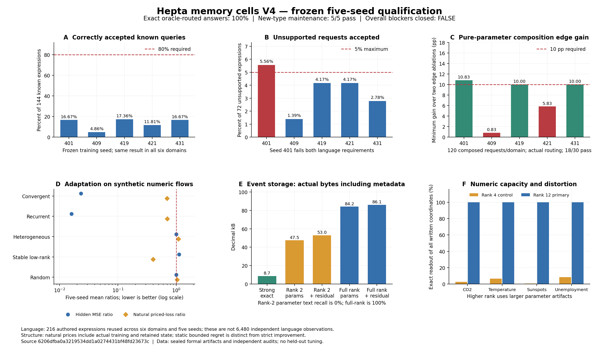

# Hepta memory cells v4：五种子正式结果与剩余阻塞

日期：2026-10-26。正式执行源码：`6206dfba0a3219534dd1a0274431bf48fd23673c`。

**本轮已经完成真实训练、独立进程加载、四阶段正式运行、全部独立审计及结果封存。`all_blockers_closed=false`，`production_admitted=false`。** 新事件类型的参数读出、带版本维护、变化流中的结构适应取得了通过证据；自然语言寻址、所有种子上的实际组合增益、相对强传统编码的存储优势仍未通过。执行成功与科学门槛通过分开记录，历史失败没有被覆盖。

正式封存标识：`ec975d0e9afc53903ba2d26129446e263d06ebea0abb8b9e729e556546eca3ff`。封存范围为 **6,181 个输出文件、868,339,762 B**，另有 1,313,135 B 的 MANIFEST；源码快照绑定 **320 个文件**。整轮实际墙钟 **272.052392 秒**，使用 CPU、单线程 BLAS，无 GPU。

## 1. 六阶段目标现在到哪一步

| 用户阶段 | 已得到的证据 | 尚不能声称的结果 |
| --- | --- | --- |
| 1. 单 cell 参数记忆 | V3 原生小网络历史证据保留；V4 全秩数值、事件整数及 UTF-8 字段可从保存参数读取。独立进程的隐藏事件查询 1,600/1,600 正确。低秩失真和实际字节已量化。 | 参数存储普遍小于传统精确编码；小模型能无损压缩任意记忆。 |
| 2. 固定多 cell | V3 的同预算、强单模型对照与有限条件下的优势保持原判定。V4 的 K1/K2/K4 对照和实际寻址成本进一步保存。 | V3 的条件性优势不能扩大为所有来源、预算与实际语义路由都优于单 cell。 |
| 3. 类型化 meta network | 参数 cell、时间地址节点、程序节点实际组合；正确路由下六域、五种子的答案 exact 均为 100%。实际路由下，纯参数去边/乱边增益 18/30 案例达标。 | 全部种子和域的实际组合门槛。语义门槛为 0/30；同路由强精确 planner 与当前系统答案表现相同。 |
| 4. 持续学习与维护 | 新 Event/Affine owner 的五种子各 17/17 检查通过。追加、更正、撤回、清洁重训、程序替换及中途更新传播都经过真实产物与故障验证。 | 低成本增量更新、物理遗忘、分布式一致性或正式产品准入。 |
| 5. 分裂、合并与巩固 | 两种预声明变化流的 10/10 案例同时改善质量、自然计费损失和匹配工作量对照。五次真实 pair-merge 均完成 4→3 cells 和地址迁移。 | 所有静态流的严格优势、所有 merge 都改善质量，或每次变化都减少计算量。严格全流诊断仍为 10/25。 |
| 6. 扩展通用性 | 从此前的数值类型扩展到零售事件、三个文本字段及仿射程序；冻结写读代码能处理新的已写事实和未写入的程序输入。 | 正式时自动发现未知类型、任意程序族、开放问法和任意任务流。类型和操作族在开发期已经定义。 |

机器判定见 [QUALIFICATION.json](QUALIFICATION.json)，逐种子数值及置信区间见 [MEASURED_SUMMARY.json](MEASURED_SUMMARY.json)。V1/V2/V3 的源码、结果、门槛和失败记录均未修改。



图中 D 的质量比和自然计费损失比均为逐种子比率的均值。静态 bounded-regret 是单独诊断；图中绿色通过项不替代总体资格判定。

## 2. 冻结、数据及有效分母

正式种子为 **401、409、419、421、431**；公开开发种子为 **8011、8017**。结构开发额外使用了已披露的 V3 失败种子 331，该结果没有冒充新正式样本。正式前训练规则、候选集合、选择策略、阈值规则、预算和门槛已提交冻结。正式数据未参与模型选择或之后的门槛调整。

四个科学域为 CO2、温度、太阳黑子和失业率，它们在 V4 之前均已见。事件来源为 Daqing Chen 的 [UCI Online Retail](https://archive.ics.uci.edu/dataset/352/online+retail)，DOI [10.24432/C5BW33](https://doi.org/10.24432/C5BW33)，原始来源使用 CC BY 4.0。固定选择规则得到 384 条开发事件与 **640 条正式事件、3,200 个目标字段**；原始归档与选择结果均有字节哈希。目标字段没有包含客户 ID 或商品描述。

五种子共享这一个正式事件样本；事件参数在同一 rank arm 中逐字段字节相同。随机种子改变查询地址和仿射示例，不能据此声称完成五个独立数据集的泛化。每 arm、每读取模式的事件查询为 64/字段/种子，总计 **1,600 次、1,317 个唯一事件字段坐标**。重复的父进程检查与独立进程读取不增加唯一事实数量。

语言留出集包含 **216 条独立编写的表达**：144 条支持请求，72 条近邻 OOD，覆盖 12 个 OOD 家族。六个域和五个种子产生 6,480 次路由执行；这些不是 6,480 条独立语言表达。每种子中六域的槽位归一化文本及路由决策相同。报告的 seed bootstrap 区间使用冻结的 10,000 次重采样、随机种子 1913，条件是这份固定工作负载，不是人类语言总体的置信保证。

路由输入只有 `utterance`、显式 `series_name`、显式 `date` 三字段。源事实先写入参数，再隐藏目标值执行读出；该实验没有把未知事实预测与记忆读取混为一谈。零售的月份视图选取每月已写样本中 `source_row` 最小的一条事件，读取其数量或单价；它不是全体交易的月度销售统计。时间戳和事件 ID 属于提供且计费的地址元数据。

协议、来源及查询边界分别见 [PROTOCOL.json](PROTOCOL.json)、[sources/retail](sources/retail)、[held-language/SCHEMA.md](held-language/SCHEMA.md)。

## 3. 参数容量：读出问题被容量改善，压缩问题仍存在

科学数值主模型将 rank 从 4 提升到 12，保留 rank 4 对照。下面是**全部已写坐标**的参数读出 exact，参数文件字节之外另计寻址与绑定元数据。

| 科学来源 | Rank 4 exact | Rank 12 exact | Rank 4 参数文件 | Rank 12 参数文件 |
| --- | ---: | ---: | ---: | ---: |
| CO2 | 2.6119% | 100% | 708 B | 1,972 B |
| 温度 | 6.5639% | 100% | 1,340 B | 3,868 B |
| 太阳黑子 | 0.5415% | 100% | 2,388 B | 7,012 B |
| 失业率 | 8.3333% | 100% | 404 B | 1,060 B |

读出使用实际保存、重新加载后的整数量化因子，没有通过向主参数臂添加答案缓存或残差来获得 exact。较高 rank 的容量显著更大，因此这些结果不是同预算战胜 V3 rank 4 的证据。因子拟合采用 SVD；它与 V3 的真实 BCE/Adam 小网络是不同的模型实现，不能把每种参数拟合都称作完整语言模型微调。

### 事件与文本

事件 cell 为两个整数和三个文本字段训练参数。文本直接编码 UTF-8 字节坐标，不使用答案类别字典。五种子正式查询结果如下。

| 字段 | 全秩纯参数正确 / 查询 | Rank 2 纯参数正确 / 查询 |
| --- | ---: | ---: |
| quantity | 320/320 | 320/320 |
| unit_price_pence | 320/320 | 320/320 |
| stock_code | 320/320 | 0/320 |
| country | 320/320 | 0/320 |
| invoice_no | 320/320 | 0/320 |

全秩整体为 **1,600/1,600**，五种子全部超过预声明的 95% 门槛。Rank 2 整体为 40%，文本为 **0/960**，其中 921 次返回了非空错误字符串，39 次拒答。合法的字符串格式并不保证记忆正确。两种 rank 的显式残差读取都达到 1,600/1,600；这些是另计费用的精确编码臂。

| 事件存储方案 | 参数状态 | 参数加残差状态 | 精确状态 / 最强传统精确编码 |
| --- | ---: | ---: | ---: |
| Rank 2 | 47,541 B | 53,010 B | 6.1093× |
| 全秩 | 84,195 B | 86,133 B | 9.9266× |
| 最强传统控制 `columns_lzma` | — | 8,677 B | 1× |

相同字段、地址和元数据范围下，当前参数方案没有精确存储优势。全秩纯参数本身也已经大于传统精确控制，增加 residual 不是导致全部差距的唯一原因。

### 程序 cell 与强对照

每种子从每程序 24 组 demonstration 拟合三个仿射程序。五种子共 640 个未写入程序输入，包括 480 个插值输入和 160 个相对第一段程序训练区间的外推输入。学习的程序与普通 OLS 都在固定 `1e-7` 绝对容差内通过 **640/640**；字面 float64 exact 分别只有 127/640 和 36/640。最近 demonstration 控制与“用仿射族拟合二次关系”的负对照均为 0/640。

事件数量×单价→程序链在固定 0.005 容差内通过 640/640，并保留正确来源。该链只使用两个数值字段，不能用来掩盖 rank 2 文本失败。乘法、函数族、输入输出类型和链结构由实现提供，学习的是仿射系数，没有出现任意算法发现或超越普通 OLS 的证据。

完整事件＋三个程序＋同一链的全秩参数部署为 **85,915 B**，显式残差部署为 **87,853 B**；加 demonstration replay 后为 **89,639–89,643 B**。普通精确事件＋OLS＋同一链为 **9,880–9,882 B**，加相同 replay 为 **11,666–11,671 B**。这里的整套比率与上表 event-only 的 9.9266× 分母不同。

完整类型分析见 [formal-typed-findings.md](analyses/formal-typed-findings.md)；独立数学审计完成 **7,023 项检查、零失败**，见 [formal-transfer-audit.json](validation/formal-transfer-audit.json)。

## 4. 自然语言寻址仍是主要阻塞

本轮实际训练了 14 个候选/种子：dense/hybrid 线性头和 MLP、两种分解双头、使用上下文 token 的 attention 头，各自搭配两个 L2 设置。MiniLM 底座保持冻结；所有上层参数是真实训练的，完整底座没有在本轮进行端到端微调。候选只依据公开 selection 选择，失败的 selection 覆盖率没有被隐去。

下表每行适用于六个域。正确接受率的分母为 144 个已知请求，OOD 误接受率分母为 72 个不支持请求。

| Seed | Selection 选中模型 | 正确接受已知请求 | OOD 误接受 | 语义门槛 |
| --- | --- | ---: | ---: | --- |
| 401 | dense MLP | 24/144，16.67% | 4/72，5.56% | 失败 |
| 409 | sequence attention | 7/144，4.86% | 1/72，1.39% | 失败 |
| 419 | dense MLP | 25/144，17.36% | 3/72，4.17% | 失败 |
| 421 | sequence attention | 17/144，11.81% | 3/72，4.17% | 失败 |
| 431 | dense MLP | 24/144，16.67% | 2/72，2.78% | 失败 |

正确接受率均值为 **13.4722%**，固定工作负载下的 seed bootstrap 95% 区间为 **[8.7500%, 16.9444%]**。OOD 均值为 3.6111%，但 401 单独超过 5% 上限；全 seed、全域必须通过的预声明标准不能改用平均值。语义门槛为 **0/30**。

对已保存的同一已选模型作 raw argmax 计数，其已知请求正确率仅为 **35.42%–50.69%**，去域重复均值 45%；raw OOD 误接受均值为 25%。拒答阈值只能删掉输出，无法修正 argmax 标签，因此只调整拒答阈值达不到 80% 的正确接受要求。此处为事后诊断，没有用正式样本重选阈值、模型或候选。

实际 OOD 误接受中，比例/归一化占去域重复后 13 次中的 8 次。`previous` 的实际正确接受只有 9/120（24 模板×5 模型）；431 还出现置信度约 0.995 的前一格→当前格错误。分类型混淆、错误例子和所有训练成本见 [formal-routing-findings.md](analyses/formal-routing-findings.md)。不能据此比较所有未选候选的正式表现，因为它们没有在正式语言上被重新评价。

## 5. Meta network：实际组合、oracle 差距与消融

图包含 11 个给定类型的操作节点，布局参数从最终数值与有序来源反馈中学习；训练没有提供目标路径标签。时间导航、算术原语和端口类型仍由实现给定。每种子的图布局和路由在正式前冻结，跨六域复用，域内策略更新数为 0。

纯参数主臂在正确路由 oracle 下的答案 exact 为 **30/30 案例均 100%**。实际路由下平均为 **13.4722%**，oracle 差距为 **86.5278 个百分点**。显式 residual 也不能消除这个差距。同一学习路由器配普通精确 source codec 和给定 typed planner，得到相同的实际答案表现，因而本轮没有证明学习布局优于该强 planner。

去边和打乱连接确实作用于执行图：`removed` 截断不同 `cell_type` 之间的边，`permuted` 置换输入、输出端口类型相同的操作节点。审计复算真实读取、每跳输入、来源次序和数值。下面的组合准确率以每域 **120 个非 `at` 支持请求**为分母，即五种组合意图各 24 条；前段总体答案 exact 与 oracle 差距的分母为 144。纯参数组合准确率相对两种消融的较小增益分别为：

| Seed | 相对两种消融的较小增益 | ≥10 pp |
| --- | ---: | --- |
| 401 | 10.8333 pp | 通过 |
| 409 | 0.8333 pp | 失败 |
| 419 | 10.0000 pp | 通过 |
| 421 | 5.8333 pp | 失败 |
| 431 | 10.0000 pp | 通过 |

因此纯参数和 residual 组合门槛分别为 **18/30**，没有通过全 seed 全域要求。数值容量已经改善，实际系统仍受寻址覆盖率与误分类约束。该结论来自固定模型和真实执行，不是把 oracle 路由当作真实路由。

独立图审计重放 **51,558 跳**；独立部署模型审计再次执行真实 ONNX，**6,480/6,480 个 RouteDecision 的所有字段精确一致，容差 0**，所有模型参数推理前后哈希不变，额外审计调用为 1,080 次。新进程仅加载部署产物和三字段请求；进程仍共享文件系统，未宣称 OS 级隔离。见 [formal-joint-audit.json](validation/formal-joint-audit.json) 和 [formal-selected-replay-audit.json](validation/formal-selected-replay-audit.json)。

## 6. 新类型持续维护已经得到有界通过证据

新 Event/Affine 类型没有直接继承 V3 数值 owner 的维护资格。本轮实现并单独验证了版本化 owner：初始写入 **320 条**事件，追加到 **640 条**，更正八项字段，撤回八条不同事件，清洁重训剩余 **632 条**，最后从新 demonstration 拟合并替换程序。更正、撤回及程序替换是冻结的合成维护计划作用于真实零售来源，并非宣称观测到了这些交易修订。

六个发布阶段、两个读出模式的所有有效事实均 exact，旧正确且未变化的事实保留率均为 100%。未写入和撤回地址返回 `None`，依赖它们的派生结果也拒绝输出。图执行在两跳之间发生 refit 后，旧 snapshot、旧 callback 和旧程序回执会被拒绝；仅篡改结果再重算摘要也无法通过当前参数重算准入。

| 正式五种子合计 | 数量 |
| --- | ---: |
| 已发布阶段 | 30 |
| 真实训练候选，包含未发布的失败尝试 | 35 |
| SVD / 程序 OLS | 150 / 10 |
| 独立审计的字段输出，含缺失地址与双模式 | 192,000 |
| 派生输出 | 1,440 |
| 真实子进程 | 35 |
| 受控进程退出 / 显式恢复 | 10 / 10 |
| 普通 fresh reader 旧 snapshot 拒绝 | 50 |
| 损坏 demo 后读出附加旧 snapshot 拒绝 | 25 |
| 旧派生回执拒绝 | 50 |
| 图案例 / 故障案例 | 30 / 25 |

五种子各 **17/17** 检查通过。独立标量读出与保存输出最大差为 0；对程序目标的最大绝对误差约 `1.43245e-11`，小于固定 `1e-7`，此容差判断没有冒充浮点逐位 exact。

每种子的当前参数 serving 为 **86,002 B**，模型加残差 serving 为 **87,938 B**，带当前 replay 为 **88,503–88,512 B**。完整 owner 与独立 witness 历史为 **685,556–685,566 B**；故障副本另外约 3.428 MB/seed，整个维护阶段证据为 **52,244,209 B**。失败候选和旧模型没有从成本中扣除。

正常 parameter 读取的实际文件访问清单不含 residual、replay 或写入 delta。恢复和写入验证会读取明确保存的 replay，不能把恢复过程描述为无原始状态。fresh 请求只含地址、模式和版本令牌；旧派生值的 admission 测试独立保存。较早开发运行在 fresh 请求中带旧回执的尝试完整保留，没有回写追认为严格地址输入的证据。

这个 owner 的范围是本地 POSIX 单写者、独立 witness、实际进程退出和 store-only rollback 探针。它没有证明物理擦除全部历史、断电耐久性、恶意进程控制全部文件后的安全性或分布式并发。主 joint 实验仍使用不可变 transfer 产物，独立维护实验的通过不等于已接入完整产品运行链。详见 [维护与结构分析](analyses/formal-structure-maintenance-findings.md) 和 [维护独立审计](validation/formal-typed-maintenance-audit.json)。

## 7. 分裂、合并与巩固：变化流取得净收益

结构实验的五类流由冻结生成器产生，使用 **256×32 的合成数值矩阵**。变化流 10/10 的结果不代表真实零售交易变化流已通过资格。

修复了 V3 中局部候选预算分配可能错失完整可行分区的问题。V4 控制器先支付全局 K1 探针，再按选择误差实际训练完整 K4 候选；没有借用固定对照的产物。固定 K1/K2/K4 可用整个流的 selection 选择最优 arm，隐藏结果不用于选择。每次训练、候选、保留状态及迁移都记入账本。

当前 split 通过重新训练完整子分区并迁移地址实现，父权重没有遗传复制；巩固也包含完整重拟合。它建立了结构控制与成本证据，尚未实现基于父参数的局部继承式分裂。

所有 arm 的部署预算为 **4,096 B**。自然计费损失为**归一化 MSE + 0.02×归一化实际工作代理量 + 0.02×归一化完整保留状态字节**；工作与字节分别使用保存的单 cell 拟合工作量和参数字节作归一化分母。工作代理量不是测得的 FLOPs、货币或能耗。自然固定对照没有人为补训；匹配工作量控制另列，动态门槛要求同时优于二者。

| 流 | 自适应 mean MSE | 最强自然固定 mean MSE | 自然 priced-loss 比均值 | 正式判定 |
| --- | ---: | ---: | ---: | --- |
| convergent | 0.099864 | 4.573353 | 0.6955 | 动态 5/5 通过 |
| recurrent_regimes | 0.094493 | 6.061886 | 0.7027 | 动态 5/5 通过 |
| heterogeneous | 0.001886 | 0.001886 | 1.0929 | 静态诊断 5/5；严格改善 0/5 |
| stable_lowrank | 0.026994 | 0.024215 | 0.4006 | 静态诊断 5/5；严格改善 0/5 |
| random | 1,395.423085 | 1,395.423085 | 1.0379 | 静态诊断 5/5；严格改善 0/5 |

变化流合计 **10/10** 通过：convergent 的 MSE 逐种子下降 97.14%–98.51%，recurrent 下降 97.77%–98.67%。实际 cell 数分别形成 **4→1** 与 **1→4→1→4**。recurrent 的 421 种子训练和选择工作量仍比自然固定对照多 1.64%，所以计费损失改善不能换写为所有案例计算量下降。

静态诊断允许额外 MSE 不超过 `0.01 * max(best_fixed_MSE, 1)`、自然计费损失比不超过 1.10。它不是字面相对误差上升≤1%。stable_lowrank 有 4/5 种子 MSE 上升，最差绝对增加约 0.005837、字面相对增加 **27.07%**；heterogeneous 的质量相同而自然计费损失多 9.19%–9.36%；random 的质量相同而多 3.77%–3.81%。严格全流优势仍然为 **false，10/25**。

五个单独的 pair-merge 案例实际完成 **4→3 cells、2,164→1,900 B**，重训父/子候选与 192 行标签迁移均计费、重载读出一致。三个种子质量改善，409 与 431 的隐藏 MSE 分别增加约 2.30% 和 4.05%。这个结果支持真实合并和部署字节减少，没有证明 merge 普遍带来净收益；全局 4→1 重拟合也没有被冒充为 pair-merge。见 [formal-structure-audit.json](validation/formal-structure-audit.json)。

## 8. 完整成本与验证

| 正式成本或验证 | 实测值 |
| --- | ---: |
| 路由候选 | 70 个 |
| 路由优化器 steps / example updates | 54,000 / 6,336,000 |
| 正式研究实际编码器调用 | 16,780 次 |
| 审计追加编码器调用 | 1,080 次，另计 |
| 实际训练/selection 特征缓存 | 610,389,040 B |
| 全部路由模型副本与每 seed 两份 PRIMARY | 50,526,719 B |
| 完整 router 与 deployed 目录 | 670,117,907 B |
| 共享 MiniLM 底座，每个部署计一次 | 23,516,451 B |
| 纯参数记忆部分，六域共享事件模型一次 | 101,545 B |
| 显式 residual 记忆部分 | 103,975 B |
| 强普通精确记忆部分 | 19,666 B |
| 纯参数 joint 最小序列化部署状态，含底座、路由、图、地址 | 23,795,203–23,825,194 B |
| 同路由强精确 planner 的 joint 最小序列化部署状态 | 23,710,349–23,740,340 B |
| 当前 V4 Python 测试 | 40 通过，0 跳过 |
| 当前源码 Ruff / 仓库 `just fmt` | 通过 |
| 格式化前后 Python AST | 82 文件完全相同 |

上表前七行是五 seed 的研究合计；每 seed 两份 PRIMARY，正式总共十份。共享底座、记忆部分与 joint 序列化部署范围对应单个六域部署，共享事件模型只计一次。后两项不含 Python/NumPy/ONNX 的执行代码和运行时，也不合并独立 transfer 程序实验与 maintenance 历史；它们不是完整软件包大小或运行内存。

模型字节、最小部署、回放与历史、全研究缓存各有不同分母。大共享底座会稀释总系统百分比差距，不能用接近的整套字节数遮掩记忆部分的劣势。序列头和 dense 头的 example updates 也不是等 FLOPs 计费。局部 transfer reader 的实测峰值 RSS含共享运行时，最大约 159.5 MB；它不是全 joint 的峰值内存。

最终格式化之后没有重跑单元测试。初次检查中的单个 E731 开发审计器样式错误、修正后的 40 项测试、Ruff 与格式化日志均保留。V4 没有改动 Rust，V3 的原生构建和 90 项 Rust 测试仅作为历史证据，没有把它们冒充为本轮全产品 CI。未合并 PR，未宣称远端 CI 已通过。

独立审计使用独立整数乘加、标量程序、源加 delta 重建、指标和成本复算；容器解析器和部分无损解码器与运行时共享。只读审计能核验封存回执一致性，不能重新认证历史墙钟或进程实际退出事件。相应边界在每份审计文件中保留。

## 9. 复现、审查与剩余决策

完整历史以原始 Git bundle 交付；API 镜像提交用于 PR 审查，不是本次实验的执行源码。恢复后应进入上述正式执行提交来重训，或在最终证据提交上读取并验证保存结果。运行时依赖见 [requirements.txt](requirements.txt)，固定底座哈希见 `../memory-cell-v2/MODEL_SOURCE.json`；报告图使用 [requirements-report.txt](requirements-report.txt)。

```bash
# 从精确正式执行源码创建独立 worktree；输出目录必须不存在。
git worktree add --detach /absolute/path/to/v4-source 6206dfba0a3219534dd1a0274431bf48fd23673c
cd /absolute/path/to/v4-source

OPENBLAS_NUM_THREADS=1 OMP_NUM_THREADS=1 python qualification/memory-cell-v4/run_study.py \
  --base /absolute/path/to/all-MiniLM-L6-v2 \
  --output /absolute/path/to/new-run

python qualification/memory-cell-v4/verify_evidence.py /absolute/path/to/saved-run

python qualification/memory-cell-v4/audit_joint.py /absolute/path/to/saved-run \
  --output /absolute/path/to/new-joint-audit.json

python qualification/memory-cell-v4/audit_typed_lifecycle.py /absolute/path/to/saved-run \
  --output /absolute/path/to/new-maintenance-audit.json
```

其他独立入口为 `v4.typed_memory_audit.audit_transfer`、`v4.structure_audit.audit_structure` 和 `v4.semantic_replay_audit.audit_selected`。正式核验不使用 development 豁免。报告衍生脚本位于 `analyses/`，只读取封存结果，不属于训练和推理源码，不修改 RUN。

剩余 blocker 已有具体失败证据和关闭标准：

1. **语义寻址。** 需要实际改善支持意图识别和相邻 OOD 区分，在新的独立语言集上达到正确接受≥80%、OOD≤5%，并覆盖所有种子。固定模型的当前 raw 上界排除了仅靠放宽阈值关闭它的可能。
2. **实际端到端组合。** 正确路由时的 100% 证明执行能力，但正式要求的是实际路由下所有种子/域的去边和乱边增益≥10 pp；409、421 仍未达到。
3. **参数压缩的经济性。** 当前全秩精确事件状态约为强普通编码的十倍。后续只有在相同事实、失真、版本和完整成本范围内超过强控制，才能把“训练式存储”提升为“优于传统存储”的结论。
4. **更广的迁移能力。** 当前新增类型、仿射族、显式地址槽和操作目录都经过人为定义。未来的通用性资格需要冻结之后的新领域、任务族或类型扩展证据，不能重复计算同一零售来源与 216 条表达。

这些是可复现的研究失败或尚未覆盖的能力，不是通过补充文档就能改成通过的工程事项。本轮交付保留了它们，同时把有界参数读出、版本维护和变化流结构收益落实为可训练、可重载、可独立核验的实现。
