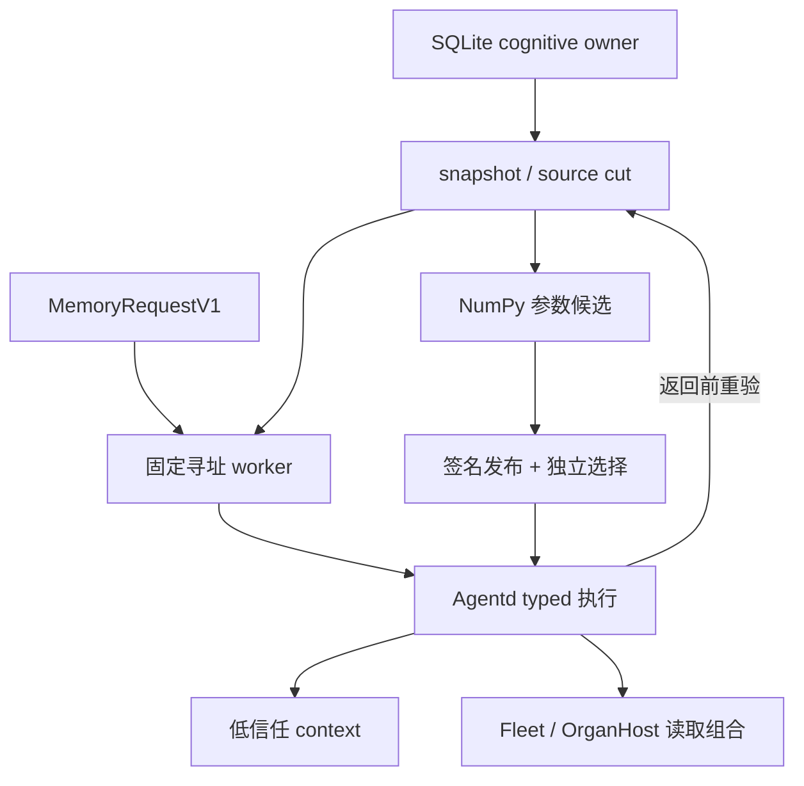

# Memory Cell V7：可执行实现与验收边界

本文记录 `research/memory-cell-v7-owner-integration-20261027` 的实现和现存证据。
当前交付是接入真实 owner、参数推理、发布与消费路径的研究实现；六项验收没有全部通过。
自然语言覆盖、结构演化的全成本优势、学到的专业化分工仍不成立，不能据此宣称通用记忆已经涌现。
文中的“已实现”表示存在执行路径；“已验证”只对应明确保存的运行结果，最终 CI 汇总仍需补充。

## 1. 六项交付的实际状态

| 项目 | 本轮代码 | 仍需满足的验收条件 |
| --- | --- | --- |
| 1：类型化请求与寻址 | 严格 `MemoryRequestV1/MemoryReadoutV1`；固定模型 worker；owner registry 与完整请求绑定 | 独立 known 覆盖仅 80/240；日期适配补丁待真实时间链路验证 |
| 2：事件、语义、过程 cell | SQLite 事件；真实参数语义/过程；`apply` 跨三类组合 | 实际写入→训练→socket 读回的 ignored 集成测试仍在 CI 中 |
| 3：训练、回放、校准、清洁重建 | 有界 NumPy worker、父参数校验、纠错/撤销后 clean rebuild、真实 ledger 接口 | 训练诊断不等于未来任务改善；尚无长期遗忘或总体校准保证 |
| 4：分裂、合并、休眠、预算竞争 | V2 population、实际 shard fit、驻留缓存、NoChange 与 topology proposal 桥 | 同允许计数空间内的最强固定方案胜出；全成本门未通过 |
| 5：多节点、迁移、一致发布 | Fleet owner/socket 验证；完整版本向量；OrganHost 只读路由迁移 | 本机多个 owner/control socket；未交付跨机器复制、共识或网络分区下可用性保证 |
| 6：新领域、组合、专业化迁移 | 新实体自动地址分区、重训、typed 组合读回 | 确定性地址分片没有证明学习专业分工；不能以开发读回替代新任务族验收 |

模块名称以真实源码为准；表中的系统层名称不表示新增了同名顶层服务。

## 2. 执行关系



owner 提供来源事实，参数模型提供预测，发布 owner 与 selector 决定可使用的 artifact。
训练器、寻址器、population 和图结构 proposal 都不能自行授予这些权限。

## 3. 类型契约与六种操作

契约位于 [`memory_cell.rs`](../../codex-rs/hepta-cognitive-types/src/memory_cell.rs)，值域位于 [`memory_cell_values.rs`](../../codex-rs/hepta-cognitive-types/src/memory_cell_values.rs)。
请求包含 schema、query ID、scope、canonical entity、text、at、since、max_hops、max_cells；不接受 caller 提供 gold operation、model selection 或权限字段。
`since <= at`，时间整数小于 `2^53`，cell/hop 预算均为 `1..=8`，未知 JSON 字段拒绝。
`MemoryCellAddressResolverV1` 产生操作；执行端要求 resolver 返回的请求与原请求、owner cut、固定 model digest 完全绑定。

| 操作 | 执行语义 | cell / hop 最小预算 | 返回来源类别 |
| --- | --- | --- | --- |
| `current` | owner 当前观察时间下的最新事件 | 1 / 1 | `SourceEvidence` |
| `history` | `at` 截止时刻的事件 | 1 / 1 | `SourceEvidence` |
| `semantic` | 当前语义参数模型预测 | 1 / 1 | `ModelPrediction` |
| `procedure` | 当前过程参数模型预测 | 1 / 1 | `ModelPrediction` |
| `change` | 当前事件减去 `since` 截止时刻事件 | 1 / 2 | `SourceEvidence` |
| `apply` | 当前事件、语义、过程组合计算 | 3 / 3 | `Mixed` |

具体执行见 [`memory_cell_execution.rs`](../../codex-rs/hepta-agentd/src/memory_cell_execution.rs)。
事件是有界整数；语义值为 `{factor,label}`；过程值为 `{opcode,bias,limit}`。
注册 opcode 只有 `identity/add_bias/multiply/affine/clamp`；执行器不解释任意生成代码。
当前契约不支持过去语义/过程版本、两个历史端点相减、百分比变化、因果解释或任意模拟输入。
readout 保留 source IDs、bundle generation/digest、cell digests、prediction kind 与 hops。
失败 readout 清空 value、source IDs、cell digests，不能把拒绝附带的猜测带入后续上下文。

## 4. owner、source cut 与完整依赖

真实来源代码是 [`memory_cell_write.rs`](../../codex-rs/hepta-memory/src/memory_cell_write.rs) 和 [`memory_cell_owner.rs`](../../codex-rs/hepta-memory/src/memory_cell_owner.rs)。
`write_memory_cell` 支持创建和带 expected revision 的纠错；`forget_memory_cell` 写入撤销语义。
`memory_cell_snapshot` 从实际 SQLite owner 取得当前 scope 的记录、修订、有效时间、撤销地址与当前 source IDs。
`MemoryCellOwnerSnapshotV1` 没有供调用者任意反序列化出可信 owner 证据的入口；JSON export 只是训练输入。
`owner_cut_digest` 绑定真实来源切面；它不是 caller 提交的计数器，也不是访问授权。
每个模型的支持集合必须精确等于该类型当前训练记录的地址散列→source ID 集合，lineage 必须完整。
bundle 同时绑定 scope、owner cut、代际、两类模型及 lineage；只校验文件哈希不足以通过 owner 验证。

[`AgentdMemoryCellRuntimeV1::read`](../../codex-rs/hepta-agentd/src/memory_cell_runtime.rs) 在执行前重新取得来源快照。
返回前再次验证 artifact 当前选择及 `revalidate_memory_cell_readout`；期间改写、撤销、换版或 scope 不一致均拒绝。
对直接调用原生模型得到的 prediction，调用者仍负有 owner 校验职责；原生张量输出本身不是来源事实。

## 5. 真实参数训练、回放与清洁重建

训练入口是 [`MemoryCellTrainerConfigV1::train`](../../codex-rs/hepta-agentd/src/memory_cell_training.rs)，worker 为 [`training_worker.py`](training_worker.py)。
host 固定解释器、导入文件 hashes、时间与尺寸上限，从 owner 取得 export，再以 `-I -u -B` 启动训练进程。
host 验证响应与原始请求绑定、native 参数格式及实际 owner cut；完成 fit 不会选中或发布模型。
[`training.py`](training.py) 调用冻结的 [`AssociativeCell.fit`](../memory-cell-v6/v6/cells.py)：NumPy tanh MLP、Adam、真实权重更新。
这不是 LLM/LoRA 微调，也没有证明自然语言知识被压缩进小语言模型参数。
每个 cell 保留显式 catalog 值，支持表只保存地址与来源；正确值由张量分类选出，catalog、来源账本都必须计成本。
[`native_export.py`](native_export.py) 导出 float32 权重，Rust [`AssociativeMemoryCellV1`](../../codex-rs/hepta-neuron/src/associative_memory.rs) 用固定数值协议执行。
native loader 检查数组形状、有限值、参数 digest、值域、catalog、支持与 lineage；未知写入地址 abstain。
softmax 标为 `uncalibrated-softmax`；训练读回率与固定 threshold 不构成独立概率校准。

`Clean` 不接收父参数；`Replay` 校验父 artifact 能重导出为当前独立选择的 native digest。
父 lineage 必须仍在当前来源集合中；来源被纠错或撤销后，旧父参数重放被拒绝，必须 clean rebuild。
重建检查参数 digest 可重复，以及被撤销 source 不再进入新模型依赖；历史证据和旧发布记录仍需保留审计。
具体真实链路测试在 [`memory_cell_training_tests.rs`](../../codex-rs/hepta-agentd/src/memory_cell_training_tests.rs)，当前不能提前标为通过。
参数 population 的 clean shard fit 另在 [`population_training.py`](population_training.py)，没有改变单模型默认训练输出。

## 6. 发布、选择与 learning ledger 的职责

[`MemoryCellBundleCandidateV1`](../../codex-rs/hepta-agentd/src/memory_cell_bundle.rs) 只构建候选。
`from_owner_snapshot` 保留 V1 单模型；`from_owner_populations` 构建 V2，两者都校验真实 owner 支持集合。
[`MemoryCellReleaseHostV1::publish`](../../codex-rs/hepta-agentd/src/memory_cell_release.rs) 调用既有 `LearningArtifactOwnerService` 的持久事务。
writer lease、签名 CURRENT、撤销 frontier、完整 manifest 与候选 bytes 必须匹配；publication 本身不产生 reader selection。
`install_selected` 需要独立 `VerifiedArtifactSelectionV1`，核对 selector/owner trust、有效期、当前 registry head 与精确后继。
旧 generation、分叉、scope 变更或撤销后 retained reader 失效；恢复必须显式重新验证，不能静默回退旧参数。

[`MemoryCellLearningDecisionV1::from_training`](../../codex-rs/hepta-agentd/src/memory_cell_learning.rs) 绑定来源切面、训练代码、receipt 与 candidate。
`MemoryCellLearningSinkV1` 消费既有 `LedgerWriter`，由 Generator 签名追加 decision，独立 Observer 签名追加 outcome。
`append_outcome` 检查 episode、support、active decision 和真实账本记录；训练 receipt 不冒充 outcome。
单次 fit 的 candidate set 不宣称穷举了所有模型或结构；ledger 记录也不替代 artifact selector。
当前部署仍须由 embedding host 提供真实信任配置与签名来源；测试 fixture 的签名身份只证明相应契约路径。

## 7. population、休眠与 NoChange 门

[`MemoryCellPopulationV2`](../../codex-rs/hepta-neuron/src/memory_population.rs) 支持每种参数类型 1–8 个真实 shard。
单模型包装保留原 artifact/parameter/head digest；V2 identity 绑定整个 population，并可取得成员 shard digests。
分区协议 `hepta.memory.sha256-address-rank.v1` 按地址散列排序平衡划分，不读取 target。
loader 拒绝支持重叠、遗漏、未知 route、类型错误、lineage 不完整或不符合该协议的重分区。
这是自动确定性分片，不能称为“模型自发学到领域专家”；新的学习型路由需要独立 schema、来源验证与评估。
[`memory_population_cache.rs`](../../codex-rs/hepta-neuron/src/memory_population_cache.rs) 提供 sleep、LRU 淘汰和有界唤醒。
[`memory_population_cost.rs`](../../codex-rs/hepta-neuron/src/memory_population_cost.rs) 区分 raw、serialized、驻留参数及 catalog/support/route/lineage；重叠分类不重复相加，逻辑字节不是 RSS。

[`evaluate_memory_structure_v1`](../../codex-rs/hepta-plasticity/src/memory_budget.rs) 要求 KeepFixed 和完整冻结固定库存。
候选必须共享 source cut、task set、training profile 和评估量；所有成本权重必须为正，缺测不能填零。
adaptive 方案计入全部候选的搜索、训练、回放、保留材料、读取、唤醒及通信，比较器取同预算下最强固定方案。
收益不为正或没有独立证据时保持 NoChange；通过也只由 `propose_memory_structure_v1` 生成待独立接受的 topology proposal。
提案永远保留 NoChange，authority 为 DENY_ALL；实际激活仍需外部签名发布与 selector。
真实 1→2→1 训练、签名发布、sleep/wake 和 source-cut 拒绝测试见 [`memory_cell_population_tests.rs`](../../codex-rs/hepta-agentd/src/memory_cell_population_tests.rs)，尚待相应 CI 完成。

## 8. 多 owner 读取与 OrganHost 迁移

[`MemoryCellNetworkV1`](../../codex-rs/hepta-agentd/src/memory_cell_network.rs) 使用 FleetRegistry 和真实 Agentd control sockets。
每个 [`MemoryCellNodeBindingV1`](../../codex-rs/hepta-agentd/src/memory_cell_network_bindings.rs) 固定 owner、spawn generation、真实 FederationCapability，以及 scope/cut/bundle/generation pin。
`MemoryCellDeploymentV1` 是完整版本向量，各 owner 保持自己的来源切面；调用者不能伪造一个共享 owner snapshot。
`recover` 探测完整向量；`read` 在读取前后重验全部节点；`revalidate` 再检查 admission epoch 与 owner 状态。
任一节点故障、授权撤销或版本变化会使该次组合读取不可用，不能拼接部分新旧结果。
`migrate` 要求精确后继 generation，先关闭读取，再验证目标节点，最后调用 OrganHost 的只读代际替换。
[`memory_cell_network_organ.rs`](../../codex-rs/hepta-agentd/src/memory_cell_network_organ.rs) 迁移的是已准备节点之间的读取路由元数据。
目标节点的数据、训练和签名发布必须预先由其 owner 完成；这里没有复制数据库、训练模型、授予联邦权限或触发 TaskFlow effects。
网络测试在同一 Rust 测试进程内启动本机多个 owner/control socket；不能据此声称已验证多个 OS 进程或主机节点。
这些 Unix control peers 属于同一主机故障域，不代表跨机器独立性、分布式共识或线性一致数据库。
成本计 RPC 尝试、实际应用层发送/接收字节与累计尝试 elapsed；包括失败/取消路径，排除内核帧、远端 CPU 与存储。

## 9. 实际 context 消费者

[`realize_memory_cell_evidence_v1`](../../codex-rs/hepta-context-compiler/src/memory_cell.rs) 只接受成功且 query 匹配的 typed readout。
它验证操作预算、值域、source/model 数量和 prediction kind，保留完整 host binding，仅规范化易变的 elapsed time。
供模型看到的片段硬限制为 **768 bytes**，角色为 `ContextRoleV2::UntrustedEvidence`；这是字节限制，不是精确 tokenizer 准入证明。
完整来源、请求与版本仍保留在 host binding / evidence digest 中；超限拒绝，不截断后宣称原绑定仍完整。
[`AppServerModelDriver::with_memory_request`](../../codex-rs/hepta-infer-worker-host/src/native_memory_cell.rs) 把完整请求加入 admission identity。
driver 通过 `AgentdClient::memory_cell_read` 新取证据，并在最终使用前再次 fresh read，比对 request/evidence digest 和 realized 内容。
来源、参数版本或返回值变化会阻止 dispatch；一份缓存 context 片段不能代替当前 owner 授权。
CLI [`--memory-request-file`](../../codex-rs/hepta-infer-worker-host/src/bin/hepta-infer-worker.rs) 只读绝对路径下有界查询 JSON，不允许指定路由 gold 或选择模型。
该片段不会签发 final-use grant，既有独立 final-use authority 仍然必需；实际消费者测试尚待最终 CI 汇总。

## 10. 语言证据应如何解读

以 [`evidence/addressing/REVIEW.json`](evidence/addressing/REVIEW.json) 为审计入口，保留 [`INDEX.json`](evidence/addressing/INDEX.json) 与所有旧锁和失败结果。

| 保存结果 | 可支持的结论 | 不能支持的结论 |
| --- | --- | --- |
| known intent 80/240，160 abstain | 正确接受覆盖 33.33%；已接受 known 错误为 0 | 不能写成 100% 任务正确率 |
| OOD 4/120 被接受 | 样本错误率 3.33%，这些仍是错误 | 后续执行失败不能洗掉 intent 错误 |
| alias 诊断 40/40，负例 40/40 | 预先声明的 `max_cells<=8`、合成 owner-listed registry 诊断 | 不能代表开放世界 entity linking 或真实权限校验 |
| 原 entity 请求 80/80 拒绝 | 原始 `max_cells=32` 全部越过 `1..8` 契约边界 | 不能算未知/歧义实体识别成功 |
| complete plan 11/40 | 操作与 canonical entity 同时正确 | 不含记忆值、参数执行、版本准入或最终 owner 校验 |
| 保存 440 行，`executed=0` | 原完整 runtime 协议没有执行 | 抽象 fixture 与 native `{factor,label}` / program 不兼容，不能称端到端通过 |

[`language-public-smoke.json`](evidence/language-public-smoke.json) 是真实 worker 的 8 条固定公开用例，6 条支持请求被接受，未重训、未读 held。
该 smoke 没有 SQLite/native readback，也不是新的独立语言质量证据；原 held 失败结论保持不变。
校准概率界需要相应独立同分布采样条件；作者构造的任务族没有建立该条件，`population_risk_established=false`。
canonical `MemoryRequestV1`、owner 记录与最终执行始终保留 Unix seconds；冻结 Python 的遗留 `YYYYMMDD` 仅用于私有 transport view。
[`memory_cell_time_view.rs`](../../codex-rs/hepta-agentd/src/memory_cell_time_view.rs) 定义 profile `hepta.memory.host-utc-midnight-time-view.v1`，在 [`worker wire`](../../codex-rs/hepta-agentd/src/memory_cell_address_worker_wire.rs) 边界转换该私有视图。
对于文本中的明示日期，profile 只接受与其 UTC 零点精确相等的 cutoff：`history` 核对原始 `at`，`change` 核对原始 `since`；同日非零点不算匹配。
没有明示日期时保留原始秒值；明示日期不能使 `current/semantic/procedure/apply` 获得新的日期语义。
host 保存完整原始请求 hash，worker 回应须匹配私有 view 的请求 hash、字段、registry、model 与 source cut；返回 runtime 的请求仍是原始 Unix 秒请求。
这是新 host adapter，不在冻结 classifier 的 held 覆盖内；真实日期、日边界与 socket 集成仍待 CI6 验证，不能把代码存在写成测试通过。
旧 `at=15/since=10` smoke 不能证明现代时间戳正确；适配没有改写冻结权重、阈值或旧 held 标签。

## 11. 启动与复现

[`AgentdConfig`](../../codex-rs/hepta-agentd/src/config.rs) 默认 `memory_cells=None`；[`main.rs`](../../codex-rs/hepta-agentd/src/main.rs) 没有自动 bootstrap 这些模型、信任或发布身份。
embedding host 必须准备真实 cognitive owner、artifact owner/selector、选中 bundle 和固定 resolver，构造 `AgentdMemoryCellRuntimeV1::new` 后调用 `AgentdConfig::with_memory_cells`。
该入口检查 owner、spawn generation 与 workspace scope；默认 daemon 启动成功不等于 memory cells 已就绪。
语言 worker 使用 `MemoryCellAddressWorkerV1::start` 预热并固定 imports、encoder/model digest；取消或协议错误会丢弃子进程，不能复用残留响应。

在仓库根目录，用新的绝对输出目录准备固定运行环境；准备过程下载核对依赖与 encoder，不执行 fit 或 held 推理：

```bash
memory_ci_profile=/tmp/hepta-memory-v7-language-profile
python3.12 qualification/memory-cell-v7/prepare_language_ci.py "$memory_ci_profile"
source "$memory_ci_profile/environment.sh"
export MEMORY_CELL_TRAINING_RECEIPT_PATH="$memory_ci_profile/training-runtime-receipt.json"
export MEMORY_CELL_POPULATION_RECEIPT_PATH="$memory_ci_profile/population-runtime-receipt.json"
just test -p codex-hepta-cognitive-types -p codex-hepta-neuron -p codex-hepta-plasticity
just test -p codex-hepta-memory -p codex-hepta-learning-artifacts
just test -p codex-hepta-context-compiler -p codex-hepta-infer-worker-host -E 'test(memory_cell_)'
just test -p codex-hepta-agentd -E 'test(memory_cell_)'
just test -p codex-hepta-agentd --run-ignored only -E 'test(memory_cell_) & test(actual_)'
```

[`prepare_language_ci.py`](prepare_language_ci.py) 输出 `PREPARATION.json`、`environment.sh`、`github.env`；formal Python 为 3.12.14，其他 3.12 patch 会如实记录，不宣称逐位等价。
`--model-only` 只校验并重建冻结模型 transport，不创建可运行环境；不要据此跳过真实 worker 测试。
仓库测试入口是 `just test`；ignored 测试必须显式执行，普通套件 skipped 不能当通过。
预算重跑使用 [`population_benchmark.py`](population_benchmark.py)，必须新输出路径，传入每份历史 receipt，不能覆盖已有负结果。

## 12. 已确认 CI 与待补摘要

以下是各自 source commit 上的组级结果，不表示最新整条分支已经全部通过；最终汇总须绑定新 commit 与原始 receipt。

| 组 | 当前已核结果 | 证据或状态 |
| --- | --- | --- |
| typed/native | 128 passed | [`122356498696.json`](evidence/ci/122356498696.json) |
| release owner | 92 passed，1 skipped | [`122358149222.json`](evidence/ci/122358149222.json) |
| source owner | 301 passed，7 skipped | 最新通过 [`122371741205.json`](evidence/ci/122371741205.json)；原 300/301 失败仍保留于 [`122356498801.json`](evidence/ci/122356498801.json) |
| population | 149 passed | [`122371741084.json`](evidence/ci/122371741084.json) |
| daemon / consumer / actual ignored | CI 仍在进行；不提前写通过 | 后续填入真实训练、语言、population、context 结果 |

CI5 再次遇到编译失败（`json!` 内数组索引表达式）；修复已提交，daemon 仍没有测试通过证明，CI6 结果待补。

结构开发实验 [`population-costs-v2.json`](development/population-costs-v2.json) 比较固定 1–8 全计数空间；84 次真实 fit，最强固定为 fixed-1，决策 keep-fixed。
该轮已测部分加权净收益为负；独立未来任务、原生全链路成本、源账本与通信/RSS 缺项不能由 NumPy 诊断补成完整验收。
旧完整 42-fit 结果 [`population-costs.json`](development/population-costs.json) 原样保留；累计可核搜索 wall 为 4,293,320,888 ns，权重单位不是美元或 FLOPs。
[`population-first-run-summary.json`](development/population-first-run-summary.json) 记录一次详细 JSON 覆盖缺项；仅保存摘要可核，未知字节、fit 明细与 pins 不补猜值。
v1/v2 实验没有预 fit 登记；未来 runner 已增加 create-only manifest、来源/代码 hashes、追加进度和失败 receipt，不把新机制追认到旧运行。

当前应保留研究分支。只有新独立任务上的可靠覆盖、遗忘控制、同预算全成本净收益和跨节点/最终消费验证同时成立，才可提升相应验收状态。
