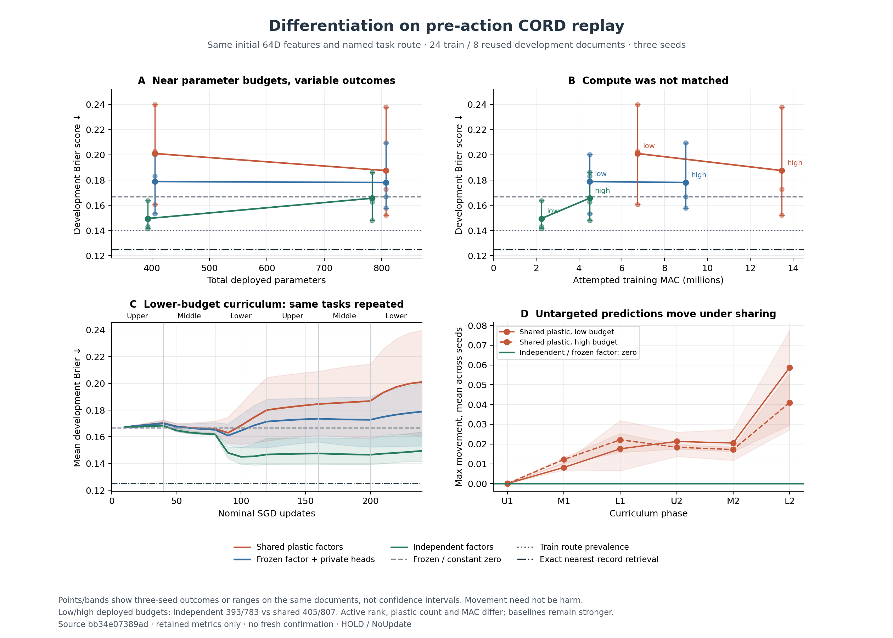
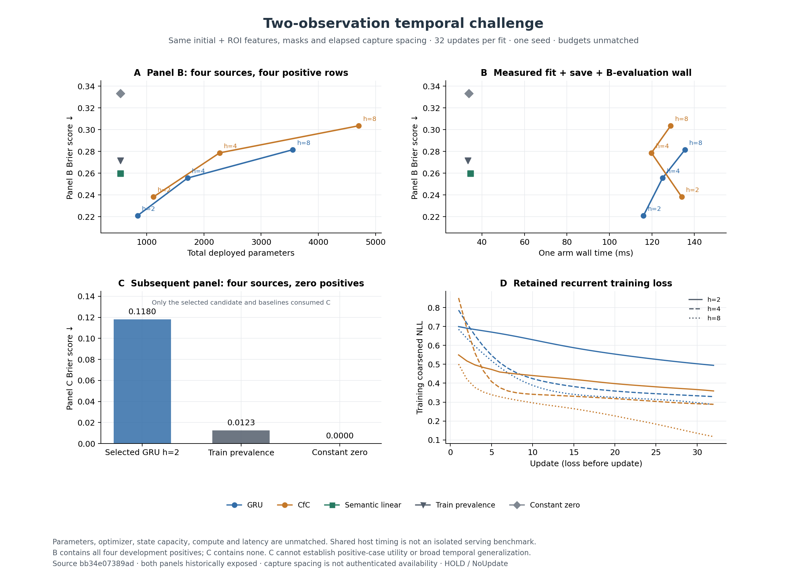
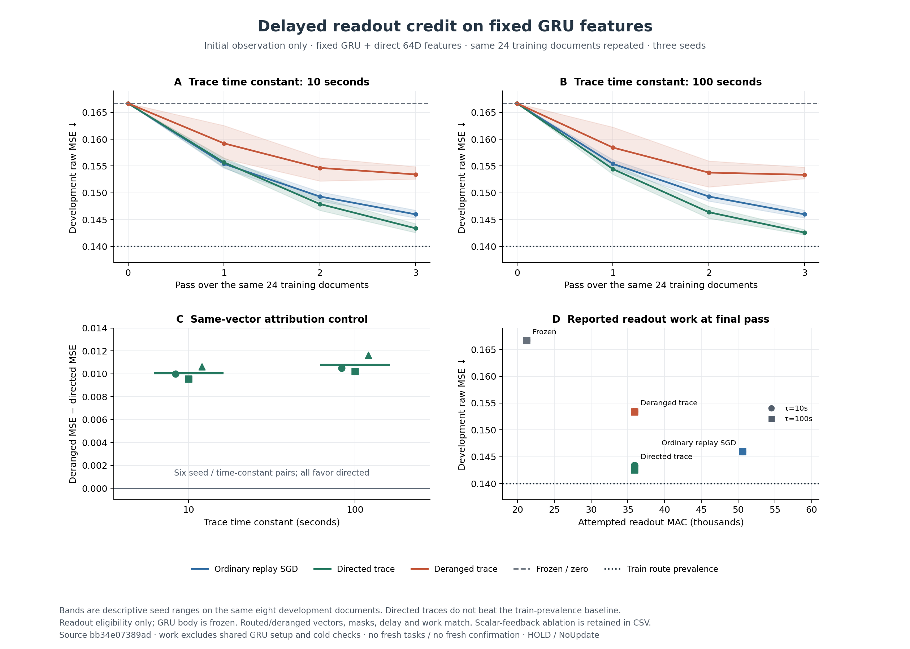

# 性能与成本曲线

图中种子范围仅为同一批历史文档上的描述性重复结果，不是置信区间；不同信息面板不能合并排名。数据表为 [原始数据压缩包](performance_cost.csv.evidence.gz)，解释与限制见 [RESULTS.md](RESULTS.md)。

## 分化

## 语义、GRU 与 CfC

## 延迟反馈归属

原始 CSV 的文件名、CRLF 字节、SHA-256 和大小仍以 `ARTIFACTS.json` 为准。从仓库根目录运行
`python3 qa/repository-consolidation/20261115/restore_raw_evidence.py <新输出目录>`
可按原路径恢复，恢复器会校验摘要。
