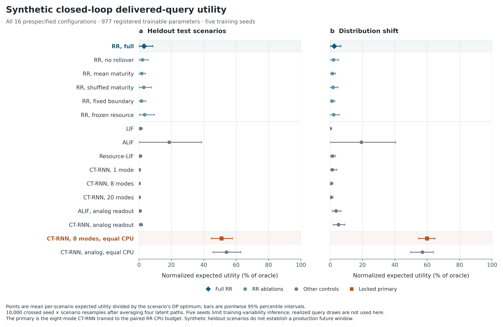
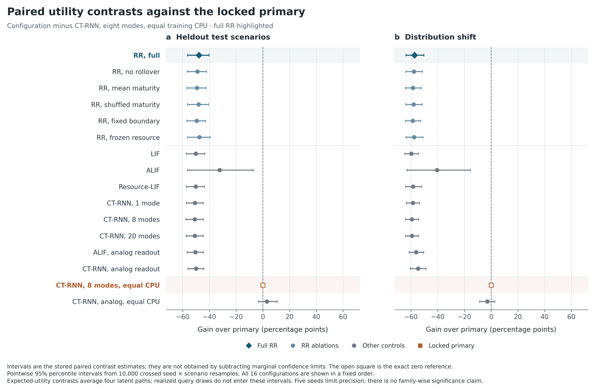
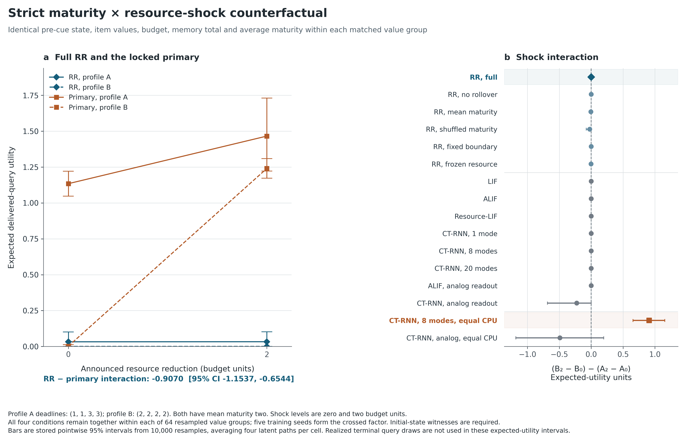
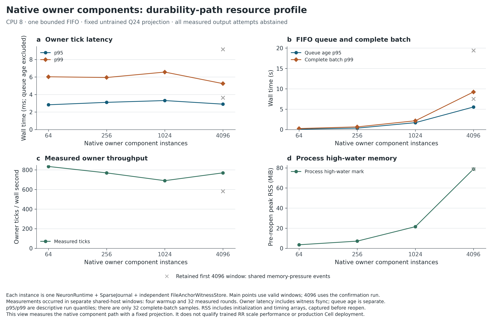

# RR-SNN V4：完整实验与 blocker 结案报告

证据日期：2026-10-29。文中数据来自实际执行；原始实验、精度修复和原生组件分别保留身份。此文件由 `build_closeout.py` 在全部矩阵完成后，依据已核验 SHA 的结果生成。

## 1. 结论

**当前 RR-SNN @@OUTCOME@@。** 80/80 个训练检查点、960/960 份正式评估、60/60 份原始解析—数值比较、60/60 份隔离精度修复验证，以及 80/80 个策略资源条件均已完成。执行覆盖与验收通过分开记录。

@@MAIN_GAIN@@

主对照在数据生成前固定为 `ctrnn_state_cpu`。验收要求 test **和** shift 的 RR−对照效用差置信区间下界都大于零。这里的百分点是各场景相对其精确期望 DP 上界的效用比例之差，不是 raw 效用单位或金融收益率。

原始单精度事件一致性门槛失败，独立修复不能覆盖原主表。真实独立未来窗口、完整 Cell、dot、生产 owner 生命周期及完整仓库 CI 也没有被局部实验替代。机器记录 `results/closeout.json` 的 `all_blockers_closed` 和 `production_activation_allowed` 均为 `false`。

## 2. 从金融模型迁移到神经算子的内容

He–Xiong 的启发是：未来到期义务和续约成本会改变当前继续／停止边界。首达时间、更新方程、价值匹配与光滑拼接提供可迁移的技术；金融论文并未直接给出本项目的神经元公式。

本项目的受限标量原语是漂移 Brownian 证据、固定输出成本、发放后重置到零、确定长度的不应期。阈值为

$$
\gamma=\frac{\sqrt{\mu^2+2\rho\sigma^2}-\mu}{\sigma^2},\qquad
h=c+\frac{1+W_0(-e^{-\rho r-1-\gamma c})}{\gamma}.
$$

在声明的正成本和折现条件下，主支给出唯一括区 $c<h<c+1/\gamma$。完整推导与验证不等式见 [数学范围](MATHEMATICAL_SCOPE.zh-CN.md)。

实际 V4 神经单元使用 16 个活跃状态、两个 Erlang 不应期相位的有限 CTMC；区间传播为 $p\exp(Q\Delta)$，实际跃迁通过 Gillespie 采样，顶端到不应期的跃迁标记为脉冲。控制在公开观测刷新、区间内保持，允许区间内多次发放；下边界反射、有限网格和重置插值均明确规定。

**解析精确性有范围。** 矩阵指数对应这个有限链。标量阈值对应确定不应期重置模型。实际二相 Erlang 的折现因子 $(1+\rho r/2)^{-2}$ 通常不同于 $e^{-\rho r}$，整个有限链不能继承标量最优性定理。动态预算和完整期限测度下的 QVI 尚未求解；当前把预算／期限压力映射为成本再调用解析原语，是冻结的启发式控制结构。

首达、最优停止、更新过程、适应性 SNN 和闭式连续时间网络均有先例。本次检验的是特定期限／资源耦合是否产生增量效用。采用金融术语、Lambert W 或矩阵指数本身不构成新颖性证明。

## 3. 任务、训练与公平性

每回合四个信息项目，终点 4，续约延长 2，通信延迟 0.1。续约和通信输出各扣一个共同预算单位。只有真正发出、到达并被终端查询命中的项目获得效用；未输出的存活记忆没有免费终端奖励。查询概率为 0.75，查询位在所有策略调用结束后生成。预算冲击及补给在初始 cue 中公开，这是**已公告冲击**实验。

所有架构获得相同的 22 维原始观测、完整逐项目期限与相同的 81 个行动合法性掩码。初始时刻只给 cue，第一决策在 0.25。内部神经脉冲与语义通信输出分别计数；没有把每次内部发放假定为一次有价值的通信。

所有模型有 977 个注册训练参数，实际非零梯度支持另见训练收据。固定预算训练为 16 epochs／128 更新；两个 CPU 对照达到对应 RR 的进程 CPU 预算后在整 epoch 边界停止，并保留小幅超额。训练目标是教师强制状态上的最优行动集合模仿损失，闭环效用另外评估。

@@TRAINING@@

状态主对照 292 B 不超过 RR 的 309 B；676 B 的 20 模式版本明确作为更大状态控制。数值状态字节不含 RNG 对象、共享参数、任务队列和 Python 开销。ALIF 使用连续变化的适应阈值；连续时间对照实现为 CT-RNN，没有宣称复现完整 LSNN 或论文 CfC。

80 次训练全部完成、梯度有限、训练未打开 heldout；其中 @@TRAIN_PRESSURE@@ 个共享资源压力窗口完整保留。更低验证 NLL 不能直接证明闭环效用更高。

## 4. 全量效用主表

数值为相对各场景期望 DP 上界的效用百分比及点态 95% 区间。每个模型五个训练 seed；先平均同一场景的四个潜在路径，再做 10,000 次训练 seed × 场景／价值组交叉配对 bootstrap。四个查询重复另行嵌套。64 个反事实组的四条件一起重采样，不当作 256 个独立价值组。五个训练 seed 与有限路径限制推断强度；区间不提供多重比较总体显著性保证。

@@UTILITY@@





@@RAW_GAIN@@

次对照 `alif_analog` 按五个训练 seed 的平均 `best_validation_nll` 最小值选择，选择规则、全部检查点和次对照在 heldout 执行前已发布。全部次对照差异、每 seed 值、实际脉冲和账本统计见 `results/aggregate.json`。

负迁移先在匹配路径上形成指示变量再平均，包含有限路径随机性，不是独立真实用户的受损概率。这里的实际查询仍来自独立合成 observer，没有被称为真实生产未来窗口。

### 已观测到的失败模式

@@BEHAVIOR@@

表中三个百分比均以各 split 全部 5,120 条路径为分母，不是条件于“有脉冲”或“零输出”子集的百分比。

独立只读诊断逐项核验了 180 个原始评估文件，并重算以上计数、均值和资源等式。RR 大部分路径具有内部脉冲，却没有语义交付；很多零输出路径在终点仍有预算。不能将低效用概括为整体神经元静默或仅由终点预算耗尽造成；正终点预算也不证明所有早期决策都不受约束。

固定 128 次更新的状态对照 CT-RNN 同样几乎无输出，而获得同等训练 CPU 的版本明显改善。这与训练预算敏感相符，但未分离教师强制分布偏移、优化、读出、随机性和架构因素。上述原因仍是待验证假设；本次没有为解释结果而重训或更换种子。证据及边界见 `results/delivery_behavior_diagnostic.json`。

## 5. 当前状态相同、期限结构不同

A 的期限为 `[1,1,3,3]`，B 为 `[2,2,2,2]`，平均期限均为 2。每组价值、初始预算 3、补给 1 和信息数量相同；A0/A2/B0/B2 在 cue 前的物理状态和 RNG 状态完全一致。所有模型都看到完整期限；0、2 表示公告预算冲击量。

@@COUNTERFACTUAL@@

交互是在 raw 期望效用上计算的“冲击效应之差 (B2−B0)−(A2−A0)”，符号本身不是模型优劣。RR 与主对照的交互差为 **@@INTERACTION_GAIN@@**。学习策略可能在公告较大冲击时反而交付更多；这不意味着减少预算提高最优可达效用。前置输出数量如下；需要结合效用和强基线解释，不能只凭 A/B 行动不同就宣称续约机制有用。

@@PRE_SHOCK@@



## 6. 全部机制消融

下表始终为**完整 RR 减去该消融**，单位为归一化效用百分点。保留全部预先声明的消融，不挑选有利子集。补充使用原配对 bootstrap，属于描述性报告，没有改变主验收。

@@ABLATIONS@@

@@ABLATION_INTERACTION@@

所有消融仍获得完整原始期限观测；合并／打乱只发生在指定内部支路。跨零区间不支持确定的机制收益；低于零的比较不支持当前完整耦合优于该消融。

本次 test 与 shift 的全部五种消融差异区间均包含零，因此没有得到这些内部机制带来正增量的明确证据。大量零输出形成的低效用状态也限制了机制比较的信息量。这是否能由其它训练方法改善，当前实验没有回答。

## 7. 原始数值失败与隔离修复

原实现先用 float32 形成 gamma 和指数实参，Lambert W 迭代内才提升到 float64，返回后继续单精度算术。Brent 参考从输入开始用双精度。原先的双精度核对没有覆盖这个实际运行差异。

@@NUMERIC@@

@@NUMERIC_SPLITS@@

原 453 条综合失败中，202 条事件类型序列不能对齐，251 条在类型可对齐后超过 $10^{-7}$ 时间容差；不能把 453 条都写成可直接测量的超时差。原始 test 的 seed503/rep0 发生离散路径分岔，最大类型对齐事件时差约 0.88577，后续边界差约 0.32999。test/shift 的向量化批次共享 actor RNG 流，一次分岔可能改变后续随机数分配，受影响行不是独立局部舍入事件。

原任务行动、交付、账本及期望／实际效用相同，仍不能抵消内部事件门槛失败。全部原始比较和失败标记保留。

独立 4,225 点诊断定位到完整表达式精度。修复仅把原表达式内部提升到 float64，在末端按 `torch.result_type` 恢复输出类型；复用原 `controls` 字节码、只改一个私有函数绑定。14 个冻结源、权重、成本映射、截断、W 主支、16 次迭代、种子、Brent 参考和容差均不变。

修复 commit `b84d18757b022110eafd9d2239b0e9fca5e13e53` 的四文件经过远端原文字节与 Git blob 校验后才执行正式回放。修复比较全部通过：**@@REPAIR_PASS@@**。原始数值门槛通过：**@@ORIGINAL_PASS@@**。修复没有重新训练或重写正式效用主表。

60 项复用固定 Brent 事件／任务记录。原记录缺少每一步完整状态和 RNG 原文，所以没有声称 60 项全状态／RNG 逐位等价。另有六个新鲜开发场景执行实际双路逐观测控制／事件／RNG probe，支持已记录字段范围内的隔离和一致性。该 probe 也不是每一步十字段 CoupledState 全量比较。

后续修复没有新的原生桥 manifest；R5 的训练桥证明仍只绑定原冻结 RR 源，不外推为精度修复版本已获得原生集成资格。

## 8. 梯度、删失与概率

完整 CTMC score 包含初始采样、全部跃迁计数、停留时间退出率及观测重映射；保留区间最后被删失的停留段。独立路径重评分误差约 1.78e-14，已检查固定路径的有限差分梯度缩放误差不超过 4.92e-9。脉冲基线的计数训练代理梯度明确有偏，真实事件前向不意味着计数梯度精确。

@@CALIBRATION@@

五 seed 与汇总的预定四倍标准差 sanity 条件都通过。检查在独立合成开发场景上，以 killed-generator 概率对照同一有限模型生成的轨迹，只支持数值内部一致性；它尚不是真实预测、生物拟合或生产校准。

## 9. 64／256／1024／4096 策略实例的真实成本

每个条件使用共享权重、独立策略状态与任务账本，一个 CPU 线程、两个暖机回合、五个测量回合，新进程计峰值 RSS。下表保留全部五 seed；p95/p99 是各 seed 内部批量 `model.step` 经验分位数的中位数，不是合并尾分位数或端到端请求延迟。吞吐也取五 seed 中位数。

本 80 项资源矩阵中的 RR 条件全部使用冻结的原 `rr_full` 核，没有使用后续 `precision_repair`。修复版的事件一致性验证通过，不意味着它的延迟或峰值 RSS 已经测量。

@@POLICY_COSTS@@

共 @@POLICY_PRESSURE@@/80 个条件观察到共享 cgroup limit 事件，全部原值保留。`policy_benchmark_results/summary.json` 单列无新增事件的敏感性表，不替换全量结果；“无新增事件”也不等于独占机器。

前 64 条条件在原 overlay 工作目录完成（包括 4096 实例的 seed101 四种策略）；共享卷写满后，剩余 16 条在字节一致的 tmpfs 工作副本完成。全部已完成记录逐 SHA 保留，代码、协议、权重、CPU3、条件顺序及 200 MiB guard 不变。输出写入、加载、哈希和轮间 GC 不在冻结的两个计时区间内，但 tmpfs 页计入共享 cgroup 内存，会影响压力、调度和缓存，因此资源环境并非完全相同。约 103 MB 文件副本不能加到各进程 RSS；迁移前约 4.9 GiB 文件系统空闲空间也不是 8 GiB cgroup 之外的额外内存。迁移前后记录和独立审核见 workspace_migration.json 与 workspace_migration_review.json。

恢复通过正常权限流程使用了不同的挂载与进程命名空间视图；解释器、可解析依赖版本、所检核心库指纹与 CPU 配额／可用亲和范围的核对见 `workspace_migration_runtime_review.json`，这些身份一致性没有被扩大为资源环境完全相同。

进程 RSS 包含 Python、PyTorch、场景、队列、暖机和临时数组，不是每个策略的纯状态。仅五个完整回合的尾分位数不能证明 SLA；摊销每实例时间不能当作单请求延迟。未测能耗。

LIF 使用精确越阈事件，连续适应 ALIF 使用事件求根。72 条独立 DOP853 事件轨迹的最大状态误差约 2.66e-15，事件时间误差约 1.15e-14。解析实现因此没有仅与小步长 Euler 比较。

原始数值控制的 probe 计时包含复制和摘要开销；后续修复复用了缓存 Brent 参考。这些都不能用于宣称纯解析核加速比。资源表测量的是参考实现，而不是理论最优实现或未来编译优化后的成本。

只读源码核查显示，当前 RR 推理仍分配稠密生成矩阵及完整路径计数／停留时间，并计算路径 log-likelihood，保留了训练所需的统计计算。尚未通过 profiling 分离各部分开销，也未测量精简推理版本，不能据此推算优化比例或把当前峰值视为所有解析神经算子的固有下限。具体函数、冻结源身份及已完成窗口的高水位记录见 `policy_benchmark_results/inference_scope.json`。

## 10. Hepta 原生组件、持久化与实际故障恢复

下表来自实际上游 NeuronRuntime、SparseJournal、FileAnchorWitnessStore 和 InferenceControlModelPort。固定 8×22 Q24 投影不是训练 RR；这些是 owner 组件实例，不是完整 Cell。一个 FIFO 线程，四个暖机 batch、32 个测量 batch；tick 包含 witness fsync。4096 首次受压窗口保留，下表使用已单独说明原因的确认运行。

@@NATIVE_COSTS@@



VmHWM 在所有 owner 恢复前采集、包含测量数组，不是每 Cell 内存。全部 tick 均 abstain，权限为 DENY_ALL；没有测量被接受下游动作的成本。4096 下约 5.54 秒排队 p95 和 9.23 秒 batch p99，说明毫秒级 tick 不能替代系统响应时间。

### 首次提交的恢复缺口

原始四次实际 SIGKILL 中三次恢复；首次 journal 已提交但首 witness 尚未写入的窗口失败。新增 `recover_bootstrap_anchored` 要求独立可信来源提供**当前**首 intent 与期望 anchor，检查序号、witness 缺失和第一条 checkpoint，在尾修复前验证，再进行 CAS。

六次实际 SIGKILL（含修复中断）和十四个拒绝检查通过；恢复不调用模型，正常继续仅调用一次。历史 intent 不能单独侦测确认后 journal 与 witness 同时回滚，当前可信前沿仍是外部生命周期前提。

补丁为独立草稿 [PR4274](https://github.com/TrillionniumFoundation/hepta-private-ci/pull/4274)，没有合并或激活。86 个真实修改 crate 单测针对最终 rustfmt 前源码通过；末次布局和可选尾逗号差异由单独收据绑定。完整上游 nextest profile 在缩减工作区因过滤器引用缺失包而未进入测试，没有放宽过滤器制造通过。

### 训练 RR 特征桥

实际装载已选择的 `rr_full/seed101` 权重并接入原生模型端口。十个耦合状态字段与 PCG64 完整状态无损编解码；六次实际 SIGKILL 和十九个负例通过。已确认 prepare 重试不再执行模型；未独立固定的孤立 prepare 从可信前状态重算、计入额外计算，提交状态与 RNG 只前进一步。

桥输出八维 Q24 脉冲轨迹特征，没有接管 81 类动作头；所有原生 tick 仍 abstain。RR 状态位于侧车，而非 native V1 状态。独立可信 supervisor 的当前前沿、其自身崩溃及 pin 丢失的活性没有被证明。

故障范围从首个联合 checkpoint 建立后的 transaction2 开始。原生 journal/witness 首次提交另有条件证明；训练桥的 sidecar／supervisor 首个联合 checkpoint 建立过程仍是先决条件。这是限定合同下的实际集成证据，尚不能直接提升为生产 owner 生命周期资格。

### 精确补丁 head 的 CI

补丁 commit `fda9689456189c7dad3a1d033b5488d02b29334a` 的自动 CI 并非全绿。格式、manifest、cargo shear 与三平台 Native Hepta path 检查通过；路径检查不替代运行单测。

已读取的 Linux Clippy 日志包含未修改 fleet/automation/memory/agentd 的 lint 和缺失方法；Windows release 日志含未修改目标的 MinGW/MSVC 链接符号问题。这是具体日志观察，没有声明完整基线等价。未能取得的其它失败原因不作猜测。证据和准确 URL 见 `hepta/ci_observation/observation.json`。

## 11. 各阶段处理结果与尚未成立的门槛

| 阶段／门槛 | 处理结果 | 范围与限制 |
| --- | --- | --- |
| R0 标量解析原语 | 受限推导及独立审核完成 | 完整预算／期限 QVI 未证明；有限链不继承标量最优性 |
| R1 事件与脉冲 | 区间真实事件、多次发放、重置及不应期已验证 | V4 控制在公开观测刷新，不扩称任意完全异步网络 |
| R2 队列与资源 | 共同账本、延迟输出、重放／拒绝检查完成 | 合成任务合同 |
| R3 可训练性 | 80 次训练、score／删失／概率诊断完成 | 模仿与效用分开；内部校准不等于外部校准 |
| R4 原始数值验收 | 执行完成，原始门槛失败 | 后续隔离精度修复单独保留 |
| R4 效用主验收 | @@UTILITY_GATE@@ | 不改主对照、阈值或取样子集 |
| R5 局部工程 | 原生组件及条件故障合同完成 | trusted frontier、权限、实际作用和资源范围受限 |
| 真实独立未来窗口 | 未闭合 | 合成 observer 查询不能代替生产未来窗口 |
| 完整 Cell 的四档规模 | 未闭合 | 已实测的是策略实例和 owner 组件两套对象 |
| dot 与生产生命周期 | 未闭合 | 执行环境与可信前沿来源未获生产资格 |
| 完整仓库 CI | 未通过 | 局部单测与部分 CI 不能替代完整门槛 |
| 全新理论与全局解析最优性 | 未成立 | 金融迁移及解析原语本身不足以证明 |

本轮完成了一次有结论的候选评估和局部工程修复。否定的主结果决定当前候选不能晋级；没有为了得到正结果而换数据、重选模型或放宽容差。仍未满足的生产和理论要求保留为未成立状态，不能用“执行完成”替换“所有门槛通过”。

## 12. 可复现交付与证据顺序

源码及文档通过分阶段草稿 PR 保存；冻结数据、80 个选定权重与完整原始运行记录通过独立证据包交付。从最终 Git commit 取得 `research/rrsnn_v4`，将证据包的 `rrsnn_v4/` 还原到 `research/`，核对 archive manifest 的 SHA-256。独立重训使用新目录，勿覆盖原始证据。

| 固定环节 | 不可变 commit |
| --- | --- |
| 数据生成前协议 | `a13487edccd39d8a073e774914e9a133fc18f2d5` |
| 训练前数据与源码协议 | `b1811737f746f4c8be400ace60870b34864668fe` |
| 80 检查点及次对照选择，heldout 前 | `ff2925c115a00b348ac1e46016b4a9130447e695` |
| 数学范围与完整消融报告设计 | `f1d54f3a2dd64d13642d4451201bfb0fd1509f94` |
| 隔离精度修复，正式修复前 | `b84d18757b022110eafd9d2239b0e9fca5e13e53` |

Python 环境为 3.12.14、NumPy 2.3.5、SciPy 1.17.0、PyTorch 2.7.1+cpu。8 CPU 共享 cgroup、8 GiB 内存上限，未验证为 dot。磁盘不足和条件边界暂停的原始 attempt 日志、资源记录及 SHA 清单保留。200 MiB 磁盘 guard 未降低；仅明确属于本任务、可再安装或已持久保存的载荷被清理。

```bash
# 在仓库根目录，先还原并核验独立 raw 证据包
PYTHONPATH=research python -m rrsnn_v4.build_closeout --verify-only
PYTHONPATH=research python -m rrsnn_v4.delivery_behavior_diagnostic --verify-only
```

原生依赖、上游文件身份、条件恢复补丁和 raw store capsules 见 `hepta/README.md` 与 `hepta/publication_plan.json`。重测时间需要实际硬件和新的计时；同样 CPU 预算在不同硬件上不保证相同更新次数或逐位训练结果。

以上入口只读核验，不覆盖已发表结果。需要重新生成汇总时，在另一个完整复现目录保存并移开原生成报告，再运行对应报告器；其中部分报告器为 write-once，不能直接对着已还原原件重复写入。重新测量、重新拟合与只读证据核验是不同操作。

## 13. 既有否定结果仍有效

V2 相对强连续时间基线的负增益、V3 在新鲜路径上拟合后欠发放，以及旧奖励下零脉冲占优的诊断全部保留。V4 是有标识交付和未来查询的新任务，不能改写旧结论。此前完整记录见 commit `31cf44ebbf6d25ec0768ec60d4c996b4f6d1fdba` 的 `research/rr_snn_v3/REPORT.zh-CN.md`。

## 14. 主要文献

- He 与 Xiong，`Rollover Risk and Credit Risk`，2012：[作者原文](https://www.princeton.edu/~wxiong/papers/rollover.pdf)。
- Yu，`Optimal Change-Detection and Spiking Neurons`，2006：[原文](https://proceedings.neurips.cc/paper_files/paper/2006/file/5f268dfb0fbef44de0f668a022707b86-Paper.pdf)。
- Schindler、Talkner 与 Hänggi，解析发放时间和离散 Markov 构造，2004：[PRL](https://doi.org/10.1103/PhysRevLett.93.048102)。
- 更新型神经群体、Laplace 变换和不应期密度低维化，2020：[PRE 102, 022407](https://doi.org/10.1103/PhysRevE.102.022407)。
- Bellec 等，适应性脉冲网络与学习，2018：[原文](https://arxiv.org/abs/1803.09574)。
- Hasani 等，`Closed-form Continuous-time Neural Models`，2022：[原文](https://arxiv.org/abs/2106.13898)。
