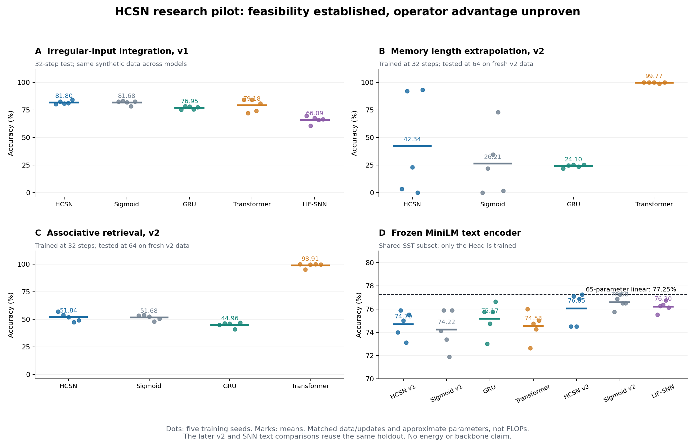

# HCSN 全量研究执行结果

**执行结论：解析模型和连续神经元可以实现，普通 BPTT 可以训练所定义的 C1 神经层；本轮没有建立期权算子的稳定独有优势，没有达到完整语言／多模态 backbone 预训练的前置条件。**

本轮实际执行 160 次神经网络训练：v1 序列 60 次、固定 v2 修复 40 次、未修改 v1 在 v2 新数据上的参考 10 次、冻结 encoder 的 v1 Head 20 次、v2 Head 10 次、LIF-SNN 序列与 Head 对照 20 次。每次均为 300 个更新、batch 32。数学、动力学和梯度验证另计。没有将重复预测重放计为训练。

## 1. 五个阶段的验收

| 阶段 | 已执行 | 实证判断 |
| --- | --- | --- |
| 完整解析基础 | Eq. 8/9/12/A5/A7；26 组参数；独立 Green/BVP/PDE；14 组受控域 JAX AD | NumPy/mpmath 参考和 float64 AD 通过各自声明的数值验收；float32 未通过相同精度标准 |
| 神经元动力学 | 48 组参数扫描；成对刺激、恢复、持续刺激、8 单元耦合；步长与浮点、5 种子梯度 | 已测状态有界及梯度实现通过；严格全或无、不应期、普遍稳定梯度没有成立 |
| 小型序列任务 | 参数／数据／更新预算匹配；5 种子；长度翻倍、检索、异步噪声缺失；含真正 LIF-SNN | HCSN 有局部适用任务；长度外推与检索不足，Put 形状独有收益未建立 |
| 冻结共享 encoder | 真正冻结 MiniLM 与训练集 PCA；1600/400/800 SST 子集；仅替换 Head | HCSN v2 提升均值，但 sigmoid v2 与更小线性参考仍更高；收益不能归因于 Put |
| 完整 backbone | 根据上述实测结果评估是否扩展 | **未启动**；前置质量及归因条件未满足，无全模态预训练、规模规律或同质量成本曲线结果 |

所有判断针对本轮预先固定或明确标为后续探索性的设置。五种子波动不是整个任务总体的置信区间，固定小预算也不是所有模型充分调优后的能力上限。

## 2. 完整 He–Xiong 模型：已从原式复现

完整有限债务期限、再融资损益、流动性溢价和内生边界都保留。债券 Eq. (8)、首达 Eq. (9)、边界 Eq. (12)、股权 A7 及 A5 辅助函数分别有源码、独立参考与原始数值。

基准 Table I 参数得到：

\[
V_B=67.44151539060373,\quad E(100)=36.84608855378063,
\]

\[
d(100,1)=61.129679180394845,\quad F(100,1)=0.06709263516912187.
\]

| 数值核验 | 本次最大误差 |
| --- | ---: |
| 26 组解析边界 vs 独立积分求根 | 2.672e-12 |
| 26 组股权 A7 vs Green 积分 | 8.509e-10 |
| 5 组未知边界 BVP 的边界 | 5.206e-9 |
| BVP 股权价值 | 1.873e-8 |
| 债券 PDE 最细网格，4 组参数 | 2.552e-5 |
| 原文三项一年 BB 利差 | 最大差 0.352 bp |

基准债券 PDE 网格依次加密，误差为 2.4830e-4 → 6.2086e-5 → 1.5521e-5，约二阶收敛。零流动性的可去奇点使用真实极限；极短期限 m<1e-4 使用 60 位原式路径；边界二重零使用由原 ODE 推导的 Taylor 求值。这些均是数值实现处理，未改写经济模型。独立数值法也曾漏掉薄边界层，修复方法与失败证据在解析报告中说明。

### 完整公式的实际自动微分

另实现纯 JAX 核，限定普通参数域，直接对完整 Eq. 12/A7/F/G 求导。没有 custom JVP、STE 或伪导数。固定 V 下的 9 参数总导数包含边界移动。

| JAX 检查 | float64 | float32 |
| --- | ---: | ---: |
| A7 最大绝对误差 | 4.524e-11 | 1.996e-2 |
| 状态导数最大归一化误差 | 3.554e-7 | 0.1387 |
| 9 参数总导数 vs 独立积分差分 | 8.450e-9 | 2.130e-5 |
| Taylor/A7 接缝导数差 | 7.961e-10 | 0.3562 |
| 相同科学精度门槛通过案例 | 14/14 | 0/14 |

float32 的失败不等于神经学习必然失败，但说明不能把此实现直接宣传为稳定的低精度训练内核。此受控 JAX 核尚未用于下文分类训练；后者使用被明确保留的简化 C1 算子。

### 必须纠正的映射前提

原文 E 满足 value matching 与 smooth pasting；F、G 是首达概率／贴现首达概率，并非第二个具有同样贴合条件的独立 put。实际测得 F 延成默认区常数时，基准边界左侧 dF/dV=0，右侧为 −0.0613883，因此并不 C1。不能把“原文存在闭式解”直接等同于“两个全域光滑神经通道已经由论文给出”。完整价值核、平滑风险通道设计、状态动力学是三个需要分别验证的对象。

详情：[完整解析报告](analytic/README.md)、[JAX 报告](analytic/JAX_REPORT.md)；证据：`analytic/validation_results.json`、`analytic/jax_validation_results.json`。

## 3. 神经元动力学：哪些行为实际成立

参考危险坐标 x=log(b/V)，简化算子为：

\[
q(x)=\begin{cases}\tfrac12e^x&x<0\\1-\tfrac12e^{-x}&x\ge0,\end{cases}
\qquad
a(x)=\begin{cases}1-\operatorname{sech}x&x<0\\0&x\ge0.\end{cases}
\]

q 与 a 为 C1，边界 q′(0)=1/2、a′(0)=0。连续多单元模型为

\[
\dot x_i=-kx_i+\kappa a(x_i)+gq(x_i)-y_i+I_i+\sum_jW_{ij}(q(x_j)-1/2),
\qquad \dot y_i=(hq(x_i)-y_i)/\tau.
\]

恢复、再生及耦合是新增神经模型的定义，不是金融论文自动推出的神经生物规律。对有界输入、正 k 与 tau、有限权重可推导显式全局状态界，48 个扫描案例均满足；最终 38 组稳态、10 组周期。成对刺激支持相对恢复，间隔 32 时第二脉冲增量面积约为孤立刺激的 1.00008 倍，但不存在已证明的绝对不应期或普遍全或无发放。高输入可以产生平台而不是更快周期。

五种子、4 单元、350 个不规则步长、22 参数的反传与独立有限差分最大误差为 2.284e-10。指数更新冻结了非线性门控，**不是非线性 ODE 的精确解析流**。它在大步长下保持状态界，但同一步长的误差未必优于 Euler；当前例子反而略大。RK4 更精确，跨 C1 边界时也不保证始终四阶。

状态有界并未消除梯度问题：默认模型一个不稳定平衡点在 T=100 的切向增益约 6.65e17；稳定静息点约 1.49e-12。另给出了有证明的收缩配置，但全局收缩在恒定输入下排除非平凡自主周期。这是实质能力取舍，不可同时宣称普遍振荡和普遍收缩。

详情及轨迹：[动力学报告](dynamics/README.md)。

## 4. 序列任务与传统 SNN、Transformer

每个模型五种子，训练 32 步，长度外推测试 64 步；4 分类随机水平 25%。v1 模型参数为 HCSN/sigmoid 6178、GRU 6257、Transformer 6166、LIF-SNN 6260；数据、minibatch 序列、300 更新与验证选择规则匹配。Transformer 是小型单块全注意力参考，LIF 是单层 hard-spike/surrogate-gradient 参考，都不代表其架构的最强实现。

下表均为 test accuracy 的五种子平均百分比：

| 任务 | HCSN v1 | 同结构 sigmoid | GRU | Transformer | LIF-SNN |
| --- | ---: | ---: | ---: | ---: | ---: |
| 32 步初始符号记忆 | 99.84 | 100.00 | 26.56 | 100.00 | 24.57 |
| 64 步初始符号记忆 | 14.49 | 7.93 | 25.86 | 100.00 | 26.45 |
| 32 步键值检索 | 29.61 | 29.34 | 48.98 | 100.00 | 45.74 |
| 64 步键值检索 | 25.66 | 26.48 | 46.45 | 99.96 | 39.26 |
| 32 步异步积分 | 81.80 | 81.68 | 76.95 | 79.18 | 66.09 |
| 64 步异步积分 | 74.65 | 74.80 | 78.79 | 38.12 | 64.26 |
| 更高噪声／缺失率的异步积分 | 71.91 | 71.84 | 70.94 | 70.94 | 58.71 |

异步任务的标签来自已观察的干净事件按已知衰减时间常数积分，不要求恢复从未观察到的事件。HCSN 在这类连续衰减任务有相容的归纳偏置；同结构 sigmoid 几乎复制收益，因而现有证据更支持“快慢连续动态机制适配该任务”，而不是特定 Put 曲线独有优势。

LIF 的 forward 确为 0/1，surrogate 只用于 backward；没有将膜电位或输入直接旁路至分类头。梯度检查确认实现符合声明的 surrogate，未声称它是硬阶跃的真实导数。所有 SNN 运算仍为 dense CPU 模拟，未测神经形态硬件能耗。

## 5. v2：固定一次修复，而非反复追 test

在观察 v1 长记忆和检索失败后，固定一次结构改变：保留快慢状态，增加输入依赖边界与残差记忆，写门在关闭区值及一阶导均为零，并先读旧记忆再写入当前 token。v2 使用新数据种子，未在其 test 上迭代调参。后追加未修改 v1 在同一新数据上的参考，避免跨数据集均值误比。

| 同一 v2 新数据上的指标 | v1 HCSN 参考 | v2 HCSN |
| --- | ---: | ---: |
| 32 步记忆 | 97.81% | 100.00% |
| 64 步记忆 | 19.96% | 42.34% |
| 32 步检索 | 34.80% | 53.125% |
| 64 步检索 | 27.23% | 51.84% |

改善是真实的，但 v2 的 64 步记忆标准差高达 **46.78 个百分点**。同一新数据上 Transformer 的记忆外推为 99.77%，检索外推为 98.91%；v2 对 sigmoid 的检索外推增量仅 0.156 个百分点。v2 有 159 个持久状态标量，GRU 37 个；参数匹配不等于状态容量匹配。

因此应把 v2 视作对已定位缺陷的部分修复，不能称为稳定长上下文或 attention 检索替代方案。v2 参数有限差分最大误差 3.53e-10，证明其离散反传实现可用，没有证明学习优势。

## 6. 冻结共享 encoder：真实数据的归因检验

MiniLM 权重和训练集 PCA 全部固定，仅替换 Head。数据为原始官方 SST 分割内的平衡句子子集，train/validation/test=1600/400/800，精确文本摘要跨 split 无重叠。没有审计预训练 encoder 历史语料重叠。每次模型 checkpoint 只按验证 loss 选择。

| Head | 可训练参数 | Test 平均 ± 种子 SD |
| --- | ---: | ---: |
| HCSN v1 | 5930 | 74.700% ± 1.127% |
| sigmoid v1 | 5930 | 74.225% ± 1.710% |
| GRU | 5854 | 75.175% ± 1.385% |
| Transformer | 5959 | 74.525% ± 1.239% |
| HCSN v2 | 6060 | 76.050% ± 1.421% |
| sigmoid v2 | 6060 | 76.575% ± 0.556% |
| LIF-SNN | 6002 | 76.200% ± 0.456% |
| 全局 mean 线性参考 | 65 | 77.250%，单次确定性拟合 |

HCSN−sigmoid 的配对差，v1 为 +0.475 个百分点，v2 为 −0.525 个百分点。两者都没有建立 Put 门控的稳定优势。v2 与 SNN 复用已经检查的文本 test，应标为探索性后续比较；v2 设计在文本结果之前固定，也不能把同一个 holdout 重新称为新的确认性测试集。

文本扰动只丢弃已上下文化的局部特征块，仍保留含整句信息的 global mean。它不验证原始缺字或缺模态鲁棒性。**本轮只完成文本冻结 encoder 实验，没有完成图像、音频或跨模态训练。**

## 7. 独立审查、修正与成本声明

独立审查未发现使当前准确率作废的直接 train/test 泄漏。20 个原 Head checkpoint 逐一重放，test accuracy 完全复现；线性参数数从错误记录的 130 修正为实际 65；ECE 改为无交叠分箱，最大变化 3.58e-8。修正前记录保留，模型权重未改。

计时发现必须保留：HCSN/sigmoid 初始化的 weak-type 参数会在第一次更新后改变 JAX 签名，第二次更新可能额外编译。原 `warm_training_seconds` 仅扣了第一步，因此不可用作纯 warm 时间或速度排名。共享进程 RSS、含指标计算的 sequence latency、排除 encoder 的 Head logits latency，也不能混成端到端同质量成本曲线。本轮没有 GPU、能耗或优化 kernel 结果。

审查记录：[INDEPENDENT_AUDIT.md](dynamics/INDEPENDENT_AUDIT.md)。

## 8. 完整 backbone 的决定及下一步研究边界

**本轮不启动完整语言／全模态预训练。** 这是用户要求“前述结果成立后再扩展”的实验决策：长记忆还不稳，检索仍有明显差距，冻结 encoder 上未建立算子独有收益，低精度完整原式也尚未稳定。该结论不等于证明未来所有 HCSN 设计都无效。

继续研究应优先回答四个具体问题：第一，定义并验证与完整原式兼容的 C1 风险通道，而不是将 F 常数延拓误作 smooth-pasting put；第二，研究全式的稳定低精度核与其对学习误差的容忍；第三，分别消融 Call、恢复状态、动态边界和残差记忆，现有 sigmoid 对照只替换 q；第四，在新 holdout、更多预算和真实多模态 encoder 上验证优势后，才研究规模与成本曲线。

当前证据更适合把 HCSN 定位为连续事件／状态融合模块的候选，并保留 attention 或其他内容寻址机制处理检索。此定位是基于本轮差异的研究推断，还不是完成验证的混合模型方案。

