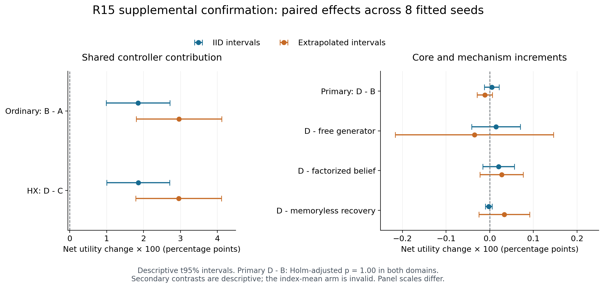

# R15：带地址内容状态与收费决策的补充确认报告

日期：2026-11-01。研究范围是一个受控、可追溯的有限状态任务；正式结果来自补充确认 run_02。数值主源为 [SUMMARY.json](results/SUMMARY.json)，设计与修订分别见 [原协议](PROTOCOL.json)、[补充协议](SUPPLEMENT_PROTOCOL.json) 和 [模型说明](MODEL_SPEC.md)。表内数字保留六位小数，精确值及逐 fit 结果在原始 JSON 中。

## 1. 已得到的结论

本轮支持**共同的 value 控制器在这个任务上有用**：相对验证选出的固定程序，普通核心和 HX 核心都能通过选择何时观察、何时停止，提高扣除费用后的效用。但在控制器相同的主比较 D−B 中，**没有建立 HX 核心增益**。IID 差约 +0.000047，OOD 差约 −0.000113；两域的主检验均未通过。

质量非劣检验通过，成本准入未通过。D/B 在线 CPU 比为 0.992580、0.979844，计入全训练搜索并复用 1,000 次后为 0.994159、0.983960，均未达到协议要求的 0.90。因而不能把微小运行时间差异写成已确立的部署经济优势。

同矩阵普通 HMM 与 D 的 2,048 个完整 episode 逐 query 完全一致。这既是实现正确性的强参照，也限定了归因：本轮算子可以由普通 CTMC/HMM 精确实现，不能声称金融命名本身带来了独有推断能力。以下区分控制器收益、模型参数化、状态近似和研究实现，不用某一层的正结果替代另一层尚未通过的门槛。

## 2. 实际实现与原设想的距离

每个地址保存一个 40 状态条件分布：10 个物理/恢复 phase 乘 4 个离散内容类别。四个地址各有自己的信念与公共时钟，连续时间通过有限生成元推进：

$$
p_k(t+\Delta)=p_k(t)\exp(Q\Delta),\qquad
p_k(z\mid y)\propto p_k(z)E(y\mid z).
$$

HX 模型从既有 R12 边界参数化构造该有限生成元，校准波动率与流动性两个参数；普通 free 模型校准三个自由转移率及一个重置位置参数。恢复协议、发射与原始可用信息相同。另保留完全相同矩阵的普通 HMM，避免把相同算法的不同名称误算成架构差异。[实现](law.py) 并未直接把金融 Call/Put 数值当作两条生物力，也未训练一条逐层传递自由边界的网络。

因此，已完成的是“边界启发的有限动力学、内容条件状态与收费观察决策”的可执行实验。金融价值匹配、平滑拼接，即使在其原模型内成立，也不会自动赋予这里的读写控制器连续最优性。本轮没有求解受控 PDE/QVI，没有验证学习边界的稳定性或完整网络的端到端梯度。有限状态转移的数值一致性与连续自由边界网络的正确性是两项不同问题。

还要分清连续的是哪一个对象。条件分布随时间由矩阵指数推进，隐藏世界本身仍有随机跳变，控制器也仍通过离散行动的比较作选择。即使传播算子可以对某些参数求导，行动切换、地址选择、状态压缩与参数化边界的导数条件仍需单独处理；不能由一个平滑的局部解推导出整条学习系统自动可微。将自由边界视为可学习变量时，还需要约束合法参数域、边界存在性和数值条件，并明确它受什么任务损失训练。这些内容没有被本轮有限网格替代。

### 任务与行动的严格含义

每个 episode 有四个显式 typed 地址、四类内容、六次固定期限查询；初始 WRITE 公开内容而不公开 phase。第 2、4 号查询开始时再公开覆盖一个地址，保留其真实 phase；每次另有一个明确标为 DISTRACTOR 的事件。类型和地址是所有模型共享的基础设施，尚未学习语义寻址或识别未知干扰。

每次查询有三个时槽。READ 消耗一个槽并取得普通观测；REFRESH 消耗两个槽并取得收费、更高质量的外部观测。普通 active READ 正确概率为 0.70，recovery 时返回 erasure；REFRESH 在所有 phase 的正确概率为 0.97。READ/REFRESH 基础费用为 0.025/0.07，再乘公开价格尺度；主动行动另收每单位时间 0.003。**REFRESH 不改变、修复或重置隐藏世界**，这里的自然恢复是 Q 内部的动力学，二者不可混称“再生”。

STOP 提交对固定 deadline 的预测，随后所有地址推进到同一 deadline；补齐的时间不再收费。收益是六次正确性减实际费用的平均值。IID 时槽为 0.25/0.50/0.75；OOD 为 0.35/0.65/0.95，其余世界、观测与价格分布不变。因此 OOD 只检验时间间隔外推，不代表跨动力学族、真实文本或现实环境泛化。

## 3. 数据隔离、冻结与补充确认

八个登记 fit 分别使用 64 条、每条 8 次观测的训练序列，以及独立的 32×8 验证序列。校准只有公开初始 WRITE、dt、quality、token，隐藏状态未作为标签交给模型。每候选上限 80 次评估、8 CPU 秒；free 八次都达到评估上限，HX 三次达到上限、五次报告收敛。冻结的是预算内最优有效候选，不能将预算耗尽写成成功求得全局最优。

另用 48 个公开历史 episode 学习轻量控制器，用独立 32 个任务验证 episode 选择 ordinary 和固定程序。Ordinary 按实际任务效用在 free 与同矩阵 HMM 中选择；校准验证 likelihood 只是独立诊断。六个 fit 选择 HMM、两个选择 free；相等时按预定优先序选 HMM。十二个合法固定行动程序经共同验证，八个 fit 最终都选 STOP，A/C 使用同一程序。

可比性也有范围：HX 与 free 读取相同观测，但参数维数不同，相同评估次数并不等于相同优化难度。发射概率、恢复协议及模型形式由研究者预先给定；生成世界本身也来自所声明的 HX 有限模型族，实验没有使用真实神经或自然语言数据。因而本轮检验的是已知任务族内的小样本校准与控制表现，尚未排除更充分优化的普通状态空间模型，也没有证明跨任务的金融结构先验优势。保留同矩阵 HMM，正是为了将可重用的有限算子和特定参数化的贡献分开核查。

| 冻结对象 | 固定提交 | 读回与开启的 UTC 时序 |
| --- | --- | --- |
| 原源码、协议与依赖 | [7d634a293500982db5beb37fa1d494a75b540a91](https://github.com/TrillionniumFoundation/hepta-private-ci/commit/7d634a293500982db5beb37fa1d494a75b540a91) | 07:56:36.343990 读回；07:56:37.191776 首次训练 claim |
| 八组完整模型与选择 | [8aa146bdb9dc7fae8748393cf718e24a7a9db2d3](https://github.com/TrillionniumFoundation/hepta-private-ci/commit/8aa146bdb9dc7fae8748393cf718e24a7a9db2d3) | 07:59:40.594127 读回；07:59:41.471064 原确认开启 |
| 独立补充协议与 runner | [e4b51213bd19b6532553d252056573c17abc4814](https://github.com/TrillionniumFoundation/hepta-private-ci/commit/e4b51213bd19b6532553d252056573c17abc4814) | 08:08:42.449656 读回；08:08:43.744180 新确认开启 |

原批 16 个 worker 中 11 个完成、5 个因 index-mean 的零观测支持失败。修订没有调模型、选择、阈值或样本量，也没有依据原批性能均值作选择；只隔离精确的 mean 零支持异常。补充批使用全新 namespace 4，保留相同八个冻结 fit，16/16 worker 成功。原批完整与失败记录均保留，但**不与补充批混合估计性能**。

新批每 fit、每域 128 个 episode，共 2,048 个世界。十三臂都逐 episode 尝试；十二个有效臂共有 24,576 个完整 episode。独立统计单位仍是八个 fit；六次查询先在 episode 内平均，再在 fit 内平均，不能把查询数或两批运行次数当成独立训练重复。

## 4. 2×2 主结果与门槛

| 臂 | 核心与控制器 | IID 效用 | IID 正确率 | OOD 效用 | OOD 正确率 |
| --- | --- | ---: | ---: | ---: | ---: |
| A | 任务验证选出的普通核心＋共同固定程序 | 0.907715 | 0.907715 | 0.877116 | 0.877116 |
| B | 同一普通核心＋共同 value 控制器 | 0.926231 | 0.942057 | 0.906733 | 0.927897 |
| C | HX 核心＋共同固定程序 | 0.907715 | 0.907715 | 0.877116 | 0.877116 |
| D | HX 核心＋共同 value 控制器 | 0.926278 | 0.942220 | 0.906620 | 0.928060 |

| 对照 | 所隔离的问题 | IID 均值 [t95 区间] | OOD 均值 [t95 区间] |
| --- | --- | ---: | ---: |
| B−A | 普通核心增加 value 控制 | +0.018516 [+0.009900, +0.027132] | +0.029617 [+0.018024, +0.041210] |
| D−C | HX 核心增加同一控制 | +0.018563 [+0.010052, +0.027074] | +0.029504 [+0.017903, +0.041105] |
| C−A | 固定程序下替换核心 | +0.000000 [+0.000000, +0.000000] | +0.000000 [+0.000000, +0.000000] |
| D−B | 同控制器下替换核心：主比较 | +0.000047 [-0.000122, +0.000216] | -0.000113 [-0.000288, +0.000063] |
| (D−C)−(B−A) | 核心与控制的交互 | +0.000047 [-0.000122, +0.000216] | -0.000113 [-0.000288, +0.000063] |

所有区间均按八个配对 fit、七个自由度计算。主比较 D−B 的双侧 sign-flip 穷举全部 256 个符号配置：IID 原始 p=1.0，OOD 原始 p=0.5；两域 Holm 调整后均为 1.0。其余四项是预设对照的描述性 t95 区间，没有另补未登记显著性检验。主增益门要求两域各自满足均值至少 0.01、t95 下界大于零且调整后 p<0.05；本轮未达到。

B−A 与 D−C 的正差表明，收费观察的共同控制逻辑确实带来任务收益。C−A 恰为零，交互项因此等于 D−B；不能把 D 对固定程序的约 0.0186/0.0295 改善归因于 HX 核心。普通强对照包括可以完整复现 D 的 HMM，六个 fit 的 D−B 由构造恒为零，只有两个 free 被选中的 fit 能产生非零差。这个设计事实限制增益证据的识别力，后续不能通过删除 HMM 或事后重选 ordinary 来制造优势。

收益链可以直接从费用分解看出：D 相对 C 的 IID 正确率提高约 0.034505，同时支付平均 0.015942 的 query 费用，留下约 0.018563 的净差；OOD 对应为正确率增加约 0.050944、费用 0.021440、净差 0.029504。固定 STOP 已经利用初始公开内容与动力学预测，并非随机猜测；它在成本不同的查询上一律执行同一程序，而 value 控制器按当前公开信息选择收费行动。这个结果支持在该信息与成本结构中使用适应性控制，不能据此声称已优于所有学习型策略。

非劣判断同时保护效用与正确率、覆盖两个域，使用四项单侧 98.75% Student-t 下界，Bonferroni 家族 alpha=0.05；要求每项严格大于 −0.01：

| 域 | D−B 效用单侧下界 | D−B 正确率单侧下界 | 是否都大于 −0.01 |
| --- | ---: | ---: | --- |
| IID | -0.000156 | -0.000300 | 是 |
| OOD | -0.000324 | -0.000300 | 是 |

四项通过，表示在登记裕量和统计约定内没有观察到超限退化。它不证明严格优越，也不自动满足节省成本的附加条件。小样本 t 区间依赖冻结的参数假设，精确 sign-flip 推断还要求配对差的符号可交换性；这些限制没有被大量 episode 消除。

## 5. 六项机制对照、学习通道与内容边界

以下六项均为描述性敏感性，不能挽救主增益门。它们的效用 t95 区间全部跨零：

| 预设描述性对照 | IID 效用差 [t95 区间] | OOD 效用差 [t95 区间] |
| --- | ---: | ---: |
| D−自由率 CTMC | +0.000142 [-0.000415, +0.000700] | -0.000350 [-0.002162, +0.001462] |
| D−phase/content 因子化 | +0.000205 [-0.000158, +0.000568] | +0.000273 [-0.000221, +0.000768] |
| D−等均值无记忆恢复 | -0.000024 [-0.000101, +0.000053] | +0.000333 [-0.000249, +0.000915] |
| learned：加 STOP value | -0.000050 [-0.000562, +0.000463] | -0.000051 [-0.000394, +0.000293] |
| learned：再加 risk | +0.000022 [-0.000062, +0.000107] | +0.000244 [-0.000171, +0.000659] |
| learned：value/risk−普通双特征 | -0.000081 [-0.000568, +0.000405] | +0.000265 [-0.000313, +0.000842] |

因子化只保留 phase/content 边缘；memoryless 将两阶段恢复换为相同平均恢复时间的指数时钟，保留其他拟合参数。它们是同权重干预，不是重新训练后的必要性证明。实际轨迹中，D 与 factorized 的首动作差为 IID/OOD 11/32 次，最终答案差 1/1 次；与 memoryless 为 9/29 次、答案差 1/5 次。每域分母为 6,144 个 query。状态近似可以改变行为，但动作改变并不必然产生净效用收益，且轨迹分叉后并非同一公开 prefix 上的局部因果效应。[动作证据](results/MECHANISM_INTERPRETATION_ZH.md)

另一项固定诊断构造了 phase/content 边缘相同、joint 不同的信念，得到严格偏好的 STOP/READ 差异。这证明有限模型存在决策敏感的相关性，不证明该合成信念自然可达。预定的真实历史探针在 16 个 episode、768 组格点检查中没有找到合格见证；这个有限阴性结果也不能证明所有可达历史都不敏感。[decision_probe.json](results/decision_probe.json)

自然首次越界、恢复中的剩余等待和重复事件计数也必须区分。例如数值诊断在时间窗 10 下给出首次事件概率约 0.836，而期望重复事件数约 1.968；后者可以超过一，不能作为概率通道直接使用。两阶段恢复与等均值指数恢复也有不同的条件剩余时间。只保留吸收前的状态会丢失概率质量，把重置集中放在时间窗末尾则改变了恢复后的继续演化。相关负对照验证了这些替代并不等价，但“替代公式错误”本身仍不构成正确模型获得任务增益的证据。

### Mean 失效的正确解释

IID 的 mean 尝试为 0/1,024 失败；OOD 为 16/1,024 失败。两邻点 phase-index 均值投影有时抹掉全部 recovery 质量，使真实 READ erasure 的模型概率恰为零。补充 runner 保存 null outcome、原始失败位置、信念、真实 token 和已耗费用，没有 epsilon 补洞、零奖励代填、回退或重置。

按预先发布的补充规则，**两域的 mean 性能与 D−mean 都为 null**，包括没有失败的 IID。只报覆盖和成本，不对成功子集计算总体收益。该缺陷属于此投影，不足以宣称所有点状态模型失败；下一轮应先建立保留合法观测支持的压缩基线。

### 学得了什么，尚未学得什么

四组 learned 特征从 phase-index 均值、内容置信度、时间、价格、熵出发，逐步加入终点 STOP 正确率预测和自然首达风险；普通双特征使用相同维数的非金融变换。这里的“状态”并不是字面上的 V−Vb，STOP value 不是金融股权价值或完整 continuation value。所有变体都执行共同的完整特征计算，不能宣称少用一个特征就实际省下相应算子成本。

学习标签是固定 STOP 历史前缀上，实际执行一次 READ/REFRESH 后 STOP 的配对收益，使用 ridge 回归。它不是完整 Qπ、策略梯度或六查询全局策略优化。部署时先前观察会改变之后的历史，训练前缀与部署前缀也不完全相同。本批 learned 策略实际未发出 READ，主要形成 STOP/REFRESH 选择；value/risk 与普通双特征的差异没有建立稳定净收益。

地址、事件类型和四类内容都是公开给定的。没有训练语义 WRITE gate、未知干扰识别、可变长内容编码、学习型地址绑定或长程检索；因此不能把 typed 内容成功等同一般 learned/gated 记忆。当前精确 planner 也只在本 query 三时槽内最优，没有计入为后面五次查询保留信息的全局价值。

同样，当前 learned 通道的近零增量只约束这组标签、特征和训练预算。终点预测与首达风险可能在更有判别力的状态和价格区域影响选择，但需要先证明这些区域可由公共历史到达，再在冻结的新任务中检验。若未来学习写入、读取或重置门，必须把门的实际执行、内容保持、延迟与费用共同纳入回报；仅画出不同的内部状态曲线不足以证明有用控制。本轮没有把这类未来方案的预期收益记作已完成结果。

## 6. 完整搜索成本与累计研究支出

每个替代部署账户采用原登记公式：

$$
C_N=C_{\text{全部训练搜索 worker}}
+C_{\text{模型与转移准备}}
+C_{\text{一次 belief checkpoint I/O}}
+N\,C_{\text{在线六查询 episode}}.
$$

全训练搜索包括公共数据、全部候选拟合、验证选择和控制器训练，以及 worker 导入与最终写出。B/D 都承担同一完整搜索账；这是两个替代部署方案，不能相加。表中是先对八个 fit 的成本取均值，再求 D/B，并非逐 fit 比值的平均。

| 范围，CPU 秒 | IID B | IID D | IID D/B | OOD B | OOD D | OOD D/B |
| --- | ---: | ---: | ---: | ---: | ---: | ---: |
| online：每个六查询 episode | 0.013877 | 0.013774 | 0.992580 | 0.014654 | 0.014359 | 0.979844 |
| N=1 的累计替代部署账户 | 3.780241 | 3.780052 | 0.999950 | 3.781933 | 3.781519 | 0.999891 |
| N=100 的累计替代部署账户 | 5.154020 | 5.143638 | 0.997986 | 5.232719 | 5.203064 | 0.994333 |
| N=1,000 的累计替代部署账户 | 17.642920 | 17.539871 | 0.994159 | 18.421686 | 18.126195 | 0.983960 |
| N=10,000 的累计替代部署账户 | 142.531926 | 141.502205 | 0.992776 | 150.311351 | 147.357511 | 0.980349 |

质量保护的成本门要求两域同时通过前述非劣，并且 online 和 N=1,000 两个 D/B 比都不超过 0.90。本轮非劣通过，但四个成本比均未达标。其他复用次数不能替换登记的主复用点，微基准中的缓存加速也不能替代此全流程比较。HMM 复制已付款矩阵的低增量成本，只有在校准已完成并计账时成立，不能写成其独立学习免费。

另一个账户是实际研究过程的累计开销。正式训练为 30.111223 CPU 秒；原确认含失败为 171.435688 秒；补充确认为 293.518550 秒，三者合计 **495.065461 秒**。原失败 worker 的 22.476902 秒已包含在原确认总数内，不再重复加入。连同已记录开发、诊断、监督及两种独立审计，非重叠记录合计为 **547.075013929 CPU 秒**。[RESEARCH_COST_LEDGER.json](results/RESEARCH_COST_LEDGER.json)

547.075 秒是已记录 CPU 的下界，不能称为完整项目成本。早期无完整凭据的开发、部分外层启动与写出、报告制图、打包传输、远端存储及人/代理设计时间仍未完整计量；能耗、GPU 和真实网络账也未测量。内部 timer 不与包住它的 worker 时间再次相加。统计审计的一次序列化失败也保留在账内，没有悄悄消失。

## 7. 验证强度与原生 neuron 的关系

[独立执行审计](results/INDEPENDENT_EXECUTION_AUDIT.md) 重建了 159,707 个完成或失败前缀 query checkpoint、49,607 个真实观测 token，动作费用与原记录精确一致。826 个 world/query 若误用右极限会得到不同目标，154 个真实观测会得到不同 token；本轮实际记录全部使用正确左极限。同矩阵 HMM 的 2,048 对完整轨迹相同。

[独立统计审计](results/INDEPENDENT_STATISTICS_AUDIT.json) 没有调用项目统计函数，完成 1,379,725 项数值比较，无差异项，最大浮点差约 5.68×10⁻¹⁴。两份审计覆盖的“完整 query”与“完成加失败前缀”口径不同，不能把记录数差误认为数据丢失。完整 confirmation 还可逐字节重建 2,048 行、89,314,299 字节 progress，十六个 SHA 与本地文件一致，省略重复上传不损失证据。

[numerics.json](results/numerics.json) 对同一有限 Q 比较 expm 与 uniformization，六个登记时长的最大元素误差约 1.65×10⁻¹⁴。此结果验证有限算子的数值实现，不是网格到连续 PDE 的收敛证明。四地址 float64 信念本体为 1,280 字节，也不等于完整进程内存或生产 checkpoint 成本；首次越界概率、重复事件次数和带恢复的完整转移必须继续分开。

原生 main 的固定版本 [732e934ba496d90fbe042b8d41d479ef901643e5](https://github.com/TrillionniumFoundation/hepta-private-ci/commit/732e934ba496d90fbe042b8d41d479ef901643e5) 已有 Q24 数值状态和幅度输出：[sparse.rs](https://github.com/TrillionniumFoundation/hepta-private-ci/blob/732e934ba496d90fbe042b8d41d479ef901643e5/codex-rs/hepta-neuron/src/sparse.rs) 执行有界递推、抑制、正值候选与 top-k，选中者保留幅度，并有稳态阈值与 eligibility。因此不能把本轮贡献写成“从纯 0/1 首次变为连续输出”；Q24 仍是定点数，硬 top-k、阈值筛选和 clipping 仍在。

[plasticity.rs](https://github.com/TrillionniumFoundation/hepta-private-ci/blob/732e934ba496d90fbe042b8d41d479ef901643e5/codex-rs/hepta-neuron/src/plasticity.rs) 已有 eligibility/modulator 的参数组投影及信赖域；[runtime.rs](https://github.com/TrillionniumFoundation/hepta-private-ci/blob/732e934ba496d90fbe042b8d41d479ef901643e5/codex-rs/hepta-neuron/src/runtime.rs) 已有模型执行、journal 与 witness CAS。HCSN 可能提供新的条件状态或预测信号，但其接入价值应按同控制器、同信息、完整费用重新验证。本轮 Python belief 的本地 fsync/read/restore，并未覆盖原生 owner 的完整崩溃恢复、并发提交和迁移。

当前可交付的是一套可审计的有限模型研究基线、明确的阴性增益结果和可复用对照。连续可学习边界、端到端内容门控、可达联合状态的稳健收益、全序列控制、原生数值格式与真实部署资格仍开放。后续计划与准入边界分别见 [NEXT_RESEARCH_ZH.md](results/NEXT_RESEARCH_ZH.md)、[BLOCKERS_ZH.md](results/BLOCKERS_ZH.md) 和 [ACCEPTANCE.json](results/ACCEPTANCE.json)；后续研究应在新对象与新冻结上处理这些问题，保留本轮未通过的结果。
