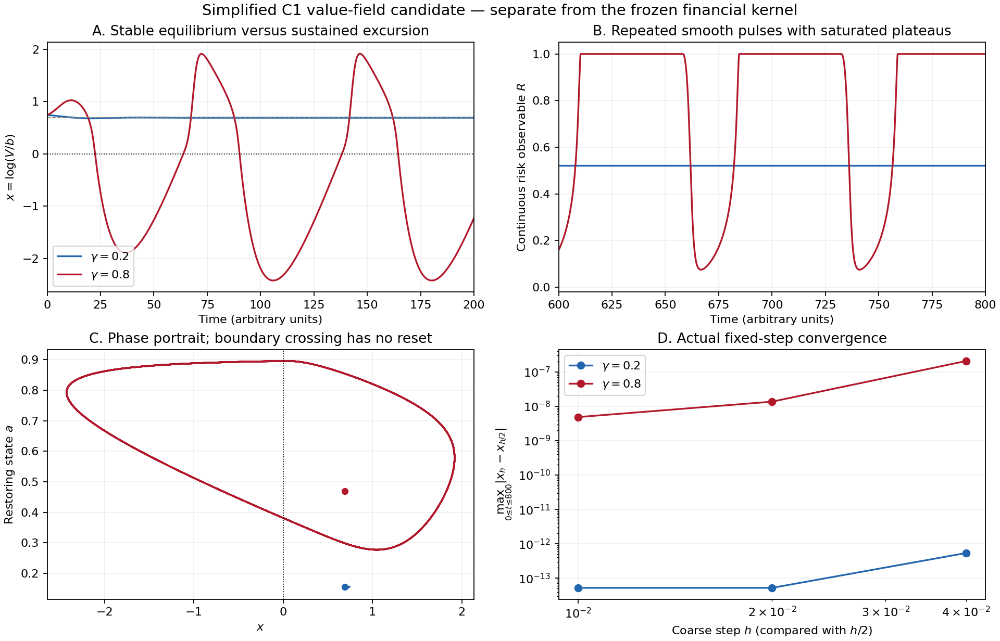

# Hepta R16 延续：解析核、连续动力学与工程修复

## 当前结论

真实 H–X 解析核已经接入普通一阶 BP 与有状态 BPTT；固定物理状态的独立
候选也验证了可训练自由边界相对输入移动。跨边界 C1 风险观测量有明确
的条件证明，简化连续系统有独立周期轨道存在性证明。固定短程功能通过
仍不满足原效果门、成本优势、全模态和完整生产网络的验收。新候选训练
更偏向 default 饱和区域，不能把本轮成果表述为“全部 blocker 已闭合”。

[PR #4550](https://github.com/TrillionniumFoundation/hepta-private-ci/pull/4550)
保存代码和证据。本节最新已通过的金融 BP/BPTT 与有限任务回归对应源码头
`cf74634be5c1d7de8d2b0f24a1c4a8a4ab361b20`；其 merge 树与 source 树相同。
固定物理坐标扩展及原生平台矩阵须按各自实际执行记录评估。编译核完整证据已先保存至
`bfd3a5a6f9445ae681b27d3947865ad67ef5651e`，其远端 Git 树与本地独立计算一致。

## 1. 编译核的独立数值验收

在预评估检查点 `086baf3ee2ca51c20ac732d069d46b39fc37b918` 保存新协议后，
才评估 seed `2026110127` 的 128 组参数、每组 6 个状态。每行核查五个
输出和完整 5×10 Jacobian；所有原接受阈值保持不变。

| 同一 C++ 模板的计算模式 | 通过行 | 整组通过 | 最大值缩放误差 | 最大 Jacobian 缩放误差 |
| --- | ---: | ---: | ---: | ---: |
| FP64 | 768/768 | 128/128 | 7.37318e-11 | 2.72874e-7 |
| 普通单字 FP32 | 155/768 | 0/128 | 0.141436 | 613.957 |
| 双字补偿 FP32 | 768/768 | 128/128 | 5.66184e-8 | 1.01239e-5 |

误差逐元素按 `abs(error)/max(1,abs(reference))` 缩放。FP64 值门为
`2e-8`，双字 FP32 值门为 `8e-7`，完整 Jacobian 门均为 `2e-5`。
独立 checker 重新计算全部参考值和导数，执行 15,360 个差分邻点分支
检查及 128 个边界续行侧右导数检查；原始数据、协议、源码、构建和
二进制身份在检查前后均绑定。资产 default 行完整保留。

双字 FP32 使用两个 FP32 字及扩展有效尾数，不能改称普通 FP32。
边界右导数不等于原 F/G 在 default 两侧的经典导数。有限矩阵通过也
不构成全参数域保证。

原 432 行开发集、已经打开的 Python 512 行和五个原始失败见证都做了
回归；FP64 和双字模式全部通过。这些回归没有被重新称为独立样本。
完整 [52 文件报告及复现命令](../compiled_fp32_r16_20261101/recovery/README_RECOVERY.md)
和 [逐文件 manifest](../compiled_fp32_r16_20261101/recovery/BUNDLE_MANIFEST.json)
保留全部正负结果。

## 2. 成本结论：CPU 应优先使用内部 FP64

36 个新的完整计时批共记录 97,200 次 timed evaluations 和 16,200 次
warmup。三模式使用相同 C++ 金融模板、相同输入和十列前向自动微分。

| 条件 | FP64 | 普通 FP32 | 双字 FP32 | 双字/FP64 |
| --- | ---: | ---: | ---: | ---: |
| 每状态计算边界 | 10.7490 µs | 8.26642 µs | 243.962 µs | 22.6962× |
| 每三状态复用边界 | 10.1009 µs | 7.04316 µs | 215.298 µs | 21.3148× |

复用前后所有值和完整导数逐位一致，但没有扭转补偿算术的成本劣势。
因此实际 CPU 适配器选择内部 FP64；这不宣称 GPU FP64 同样合算。
Python 原型约贵 93.65 倍的完整负结果也继续保留。

[完整新计时](../compiled_fp32_r16_20261101/recovery/RECOVERY_CPU_COST_V1.json)
属于新的测量，不能与丢失原始时钟的旧 23.93× 摘要混为同一实验。

## 3. 连续阈值的数学修复与实际动力学

原 equity 的值匹配与 smooth pasting 不能自动赋予 F/G 或 debt 相同的
跨边界正则性。新的风险观测量取

\[
R=2F-F^2=1-(1-F)^2,\qquad R_{\mathrm{default}}=1.
\]

在自由边界可微、F 连续趋于 1、完整一阶偏导局部有界等明确假设下，
`R−1` 在边界以二阶消失，完整一阶梯度趋于零，因此得到联合 C1 拼接。
其 PDE 增加梯度平方源项，通常不具备 C2 正则性；它是新观测量。
[条件、证明和反例](../c1_risk_observable_r16_20261101/README.md)
同时说明了阈值处梯度消失的代价。

独立的 perpetual GBM 示例把 E、R 的值直接放入二维连续系统：

\[
\dot x=I-kE(x)-\gamma R(x)+a,\qquad
\dot a=\beta[(\gamma+d)R(x)-a].
\]

这里 `x=log(V/b)` 保留状态信息，a 是恢复状态。固定其余参数后，
`gamma=0.2` 的扰动回到稳定焦点，`gamma=0.8` 产生重复边界穿越和
宽平台。没有硬重置、事件触发或 0/1 动力学输出。四个预先指定 RK4
步长的结果趋近；最细步长尾段的平均周期为 74.308476，平台宽度为
47.981959，占周期约 64.57%。这不是稀疏的窄尖峰。

[动力学报告](../c1_value_dynamics_r16_20261101/REPORT_ZH.md)及
[完整轨迹证据包](../c1_value_dynamics_r16_20261101/C1_VALUE_DYNAMICS_EVIDENCE.zip)
明确限定为简化模型，没有用它替代完整 rollover 神经元、BP 训练或多模态比较。
另有独立审阅的[解析补充证明](../c1_value_dynamics_r16_20261101/analysis/PERIODIC_ORBIT_PROOF_ZH.md)：
对 gamma=0.8 的精确定义连续系统，恢复状态始终在 [0,0.9]；所选轨迹的
x 有界于 [-9,3]。平衡点唯一且为双曲源，局部排斥椭圆使它不属于该轨迹
的极限集。由 C1 平面流的 Poincaré–Bendixson 定理，极限集是一个周期
轨道，且 R 在其上非恒定。证明不依赖先前浮点特征值，不证明周期轨道
唯一、稳定、精确周期、穿越 x=0 或完整 rollover 网络。原数值文件原样保留。

仅把固定边界 b 传到下层不会传递当前 V 的变化；裕度/状态旁路也能避免
只读 default 平台时丢失局部状态与梯度。

## 4. 实际金融核已接入一阶 BP

独立的 [PyTorch 适配器](../hx_autograd_r16_20261101/README.md)调用原冻结
C++ FP64 金融核，接受 CPU FP32 输入，返回 FP64 值及 FP32 一阶 VJP。
它保留原 asset/default 与 log-distance/续行侧右导数约定，明确区分原五
字段、七字段诊断向量和只含 E/b、R、x 的条件 C1 读出。

六个既有功能例的 **168/168 方向差分、32/32 合同检查**通过；完整七字段
链式导数最大缩放误差为 `5.270680520615516e-8`。独立审阅另查原六例
raw5/readout3 共 **48 个通道**：普通一阶值及 VJP 与 V2 逐位相同。
这些是接口回归，没有新增金融 holdout，也没有放宽原金融核数值门槛。

两层、28 个可训练标量的固定 80 步 smoke 中，训练集 MSE 从
`1.2916021347` 降至 `0.1068059132`，八个参数 tensor 均发生更新。
金融参数的独立通道 VJP 非零，asset 的 `-b_theta/b` 链和独立 log x 的
零参数导数均核验。训练 loss 下降不能归因于金融机制：x 旁路和 head
也能参与拟合；没有消融或泛化验收，跨时间结果见下一节。

独立审阅发现并修复了真实高阶合同缺陷：V2 的 `once_differentiable`
不能阻止复合读出返回不完整 Hessian。V3 在 backward 入口显式拒绝
首次 `create_graph=True`。48/48 独立通道确认首次拒绝；全部一阶矩阵、
80 步 loss/梯度和初末参数/预测与 V2 规范 JSON 逐字一致。V1 写出失败、
V2 高阶反例和真实中断退出码均保留。该接口支持普通 BP，不提供 Hessian、
GPU、torch.compile 或稀疏事件优势；每状态保存的 5×10 FP64 Jacobian
本身占 400 字节。

### 实际跨时间 BPTT：通过接线验证，训练损失基本持平

[完整递归单元结果](../hx_recurrent_r16_20261101/RESULTS.md)使用真实 H–X
值场、带符号裕度 x 和恢复状态 a，执行 16 步 FP32 Euler。只有原九个
金融参数可训练，输入、增益与终末目标固定，没有可训练 head。
5 个跨边界读出例、13 个接口合同和 8 组时间梯度比较全部通过。

终末损失对最早 theta_t 的 VJP 范数为 `6.0717976072e-7`；手工离散
Jacobian/adjoint 与实际 BPTT 的最大绝对差为 `9.3853981878e-10`。
切断状态路径的负对照使早期贡献归零。全负区的 theta 梯度严格为零，
但状态仍按独立 2×2 矩阵的 16 次幂传播敏感性。原八条驱动轨迹有
13 次采样相位变化，其中 11 次为严格正负换号，2 次从初始零进入一侧。
这些是驱动下的采样轨迹，不证明自主周期轨道或精确连续时间首达时刻。

12 次更新后，loss 从 `0.0004702643782366067` 变成
`0.0004702617588918656`，相对仅下降 **0.000557%**，基本持平。
9 个 raw/effective theta 分量均改变，完整各步轨迹、梯度及更新链保留；
独立只读重算通过。这个结果证明真实 BPTT 接通，没有证明效果优势。

另一个重要限制是：固定独立 x 会使 V=b(theta)exp(x) 随 b 一起缩放，
因此 b 从 67.4415 变到 67.5699 不能直接解释成阈值相对固定物理状态
移动。下一项候选固定 z=log(V)，重新定义初态与静息参考，独立保留完整
资产坐标链；它不是 V1 的纯坐标重写，也不构成两模型效果的严格对照。

本地源/输入/门槛冻结及完整字节备份先于首次执行；远端源检查点
`a629f9b1a9a1539f5360f8e44d2b81a09fdcf6ae` 在首次 audit 后确认，
没有把这轮功能验证称为远端事前注册的独立科学确认。

### 固定物理状态：边界学习接口通过，饱和问题明确暴露

[完整 fixed-z 结果](../hx_asset_recurrent_r16_20261101/RESULTS.md)与原 V1 分别冻结。
远端 checkpoint `786e535bd2a396b14e9ffab4504bc855c6f4d6b1` 于 17:59:10 UTC
保存九份源/协议/输入；首次 controller 于 17:59:45.837 UTC 启动，实际核评估
于 17:59:49.878 UTC 开始。源码、初态、输入、rest、目标和原门槛均没有用结果调整。

状态 z=log(V)、恢复变量 a，实际 FP32 exp(z) 进入未改动的 V3 asset 接口：

\[
Q=E(V;\theta)/b(\theta),\qquad R=2F-F^2,
\]
\[
\dot z=u-\ell(z-z_{\rm rest})-k_Q Q-k_R R+a,
\qquad \dot a=(k_RR-a)/\tau_a.
\]

z_rest 固定约为 log(67)。本实验使用 16 步同步 FP32 Euler，终末损失仅依赖
z/a；没有直接把可训练的 −log(b) 加到目标，也没有额外可训练 head。
完整资产偏导包括边界参数链，且 exp(z) 不 detach：

\[
Q_\theta\big|_z=\frac{bE_\theta-Eb_\theta}{b^2},\quad
Q_z=VE_V/b,\quad
R_\theta=2(1-F)F_\theta,\quad R_z=2(1-F)VF_V.
\]

导数指代表浮点输入处的连续表达式链，不是对量化舍入映射求导。
每条 16 步 rollout 内共享 theta，因此 b 在这条轨迹内固定，只在优化器
更新之间变化。下述结果尚未实现跨层随时间变化的 b(t) 流。

| 固定协议检查 | 实际结果 |
| --- | --- |
| 物理输入、合同、跨时间比较 | 5 / 15 / 8 全部通过 |
| BPTT 与独立手工离散伴随最大绝对差 | 4.36905e-10 |
| 最早 theta_t 的非零 VJP 范数 | 1.23828e-5 |
| 完整记录重组 | 16 条轨迹、2,057 个状态 |
| 12 次更新中的 raw / effective theta | 各 9 个分量实际改变 |
| 自由边界 | 67.4415143018 → 68.3123767034 |
| 5 个固定 FP32 资产值 | 前后字节相同 |
| 固定资产的安全裕度位移 | −0.0128301935426374，符合 −log(b_after/b_before) |
| 一个固定 V=67.4482727051 的点 | 从续行区进入 default 区 |
| 训练损失 | 0.00047014461597427726 → 0.0004700341960415244 |
| 损失相对下降 | 0.0234864%，仍很小 |
| 初始 / 最终 default 状态占用 | 107/136 → 127/136 |
| 初始 / 最终采样跨区 | 8 → 4 |

这证明边界参数能够在固定物理输入下进入实际动力学和 BPTT。九个参数同时
改变价值曲线形状，没有隔离“边界移动”对任务收益的因果贡献。default 区
Q=0、R=1，其金融参数梯度为零；本次训练更多落入这一平台，不能表述为
更丰富的脉冲、有效的抗饱和优化、质量或泛化优势。

除逐记录独立重算外，辅助 checker 对同一冻结金融核做 1 批 18 个状态调用，
取得 13 组 theta 的实际 b 并复核 5 个局部接口。独立审阅据此重新判断全部
2,057 个 V≤b，均与 margin 分类吻合，最小绝对 margin 为 1.5766e-5。
这只排除了本批记录的阈值舍入歧义，不是第二个金融 oracle 或全域证明。

训练循环内部 wall/CPU 约 0.87984/0.25521 秒；包含启动与导入的 controller
wall 为 12.92495 秒，二者分别记录，不能拿内部计时冒充端到端吞吐。
本实验也没有构建多层递归全模态网络、长程记忆、稳定性或 GPU 能耗证明。

## 5. 已执行的远端回归与新的构建修复

### 新工作流实际红绿回归

源码头 e2252649 的新 BP/BPTT workflow 曾在任务创建前失败：job 级 env
不能引用 runner.temp。原 actionlint 实际退出 1；修复使用前置 step 的
RUNNER_TEMP/GITHUB_ENV 后，修复版与扩展版 workflow 的实际 actionlint 均退出 0。
此前静态审阅遗漏的原结论与两份纠错审阅均保留，不改写历史。

同一头旧有限模型测试把浮点期望次数与整数作 tuple 精确比较，runner
得到 reads=1.0000000000000002。最小修复保留分类动作严格相等，对两个
期望次数使用 rtol=0、atol=16*float64 eps；原算法与所有科学效果门不变。
本地旧六项测试已绿，最初矩阵扰动也没有重现远端累积路径，这次未成功
尝试完整保留。后续断言入口控制验证真实观测的一 ULP 差异旧红/新绿，
1e-12 计数误差及错误分类动作仍拒绝，共七案例、十七次测试执行。

[新头实际 CI 证据](evidence/ci_cf746/REMOTE_REGRESSION.json)绑定 source
cf74634b、相同树的 merge 1a756998 和原始日志。job 124931932431 的真实
V3 审计/训练、signed-margin V1 审计/训练、独立结果 checker、输出归档和
源码清洁性全部通过；job 124931932305 通过原 48 + 22 项有限模型测试。
实际下载 257,659 字节远端归档，SHA-256 与 GitHub 摘要一致，并在本地
重跑冻结记录 checker 通过。这一成功不包含后加的 fixed-z 三步骤，
扩展另按新头执行。

较早源码头 889e7ace 的 job `124919123170` 重新计算了 Python 补偿核的 701 个基本
函数检查、432 行开发回归和 512 行已打开 V1 回归，独立验收、输出归档
与源码完整性全部通过。R14/R15、R13、Codespell、文件大小策略以及
仓库基本构建在已评估源码头也通过。旧头的 8 个 Linux V8 canary
证据保持原身份。[新回归收据与原始日志](evidence/R16_REMOTE_889E_REGRESSION.json)
绑定源码头、同树 merge、真实 job 和归档摘要。

接受的 YAML 维护分支迁移保留 Cargo 导入名 `serde_yaml`，但既有 Bazel
宏没有传递 aliases，导致 GNU release、SDK 和 Clippy 出现真实 E0433。
V2 修复覆盖全部四个直接消费者和九个规则生成点，按实际依赖和平台筛选
别名，并正确处理 workspace 测试替换。实际宏执行的 93 个 target 记录与
原有非 alias 属性一致，原 `just fmt` 通过。源码头 `889e7ace` 的 GNU
release、GNU Clippy 和 SDK 实际编译、SDK lint/test 已全部通过；
[精确 job/step 快照](evidence/R16_REMOTE_889E_NATIVE_SNAPSHOT.json)保留验证范围。
原生测试矩阵仍未全绿，依赖审计失败。随后完成的 Windows shard 1/3
也失败；[完整原日志与部分分类](evidence/native_ci_889e/PARTIAL_WINDOWS_FAILURES.json)
分别记录 6/8 个失败 target，保留重试与具名错误，不冒充四 shard 全量统计。
[修复与证据](evidence/yaml_bazel_alias_v2/VALIDATION_RECEIPT.json)。

Windows 目录测试改用正确句柄/路径操作，macOS V8 限制客户端并发为
30；它们与缺失的安全存储、SSHSIG 后端分开处理。其源补丁和前后身份
已恢复，原历史检查与新运行结果明确区分。GNU 的另外 22 个具名运行
失败有[独立分类](evidence/yaml_bazel_alias_v2/GNU_ADDITIONAL_FAILURES_1E91.json)，
不会被 YAML 编译修复一并宣称关闭。

其中三项继承的测试前置数据已修复：回退旧库时完整移除 v17/v18 新表，
memory ledger 明确期待真实版本 15，outbox 全局 4096 行场景使用独立
fixture issuer，保持每 issuer 512 上限成立。原 SQL 的失败已实际重现；
候选重放真实迁移/容量操作通过，原行为断言保留。源码与基准的 Git blob
一致，故不是本批依赖迁移新引入的问题。[红绿验证](evidence/runtime_fixtures_1e91/SQL_RED_GREEN.json)
与原 `just fmt` 均通过，完整原生测试仍交给新头 CI。

Robrix 两项 artifact 测试还缺少 Bazel 数据声明，且用了构建时路径。
修复声明原 fixture 文件并从 launcher 提供的运行时 workspace 读取。
实际原 launcher 与提取的 Rust 读取函数通过六种情形；数据规则发射和
`just fmt` 通过。合成 fixture 探针不冒充完整原生测试。
[完整收据](evidence/native_repairs/robrix_fixture/ROBRIX_REPAIR_RECEIPT.json)。

十项 Linux SSHSIG 失败已定位为固定 RBE 镜像缺少 `/usr/bin/ssh-keygen`。
Dockerfile 现在明确安装 `openssh-client`，本机真实 OpenSSH 的合法签名、
篡改 statement 和错误 namespace 控制均按预期接受/拒绝。现有镜像的
两架构摘要没有改写；当前没有可用镜像 builder，也未建立原 registry
namespace 的发布能力。故状态是源码补丁就绪、镜像激活仍阻塞，不能把
本机原语测试算作 RBE 验收。[完整激活条件](evidence/sshsig_image_dependency_1e91/ACTIVATION_PLAN.md)
要求真实构建、每架构镜像验签、实际发布摘要和原测试重跑。

授权读 RPC 还存在 capability 合同不一致：Linux 声明没有稳定句柄能力，
直接 RPC 却仍能走普通 stream fallback。新增服务器检查在读取前拒绝该
未支持能力，保留 Linux capability=false；普通读、read-stream 和 Local
bounded API 不变。测试源码补上真实 raw RPC 路径的合法/越界/超限/父目录
及 Unix symlink 断言。RemoteFileSystem 的 unsupported 分支会由客户端
拦截，不能冒称执行服务器 RPC。本地实际原 suite 执行数为 0，只有源码
审阅、原 `just fmt` 与 patch 检查通过；[原生验收仍待 CI](evidence/native_repairs/authorized_read_rpc/EXEC_AUTHORIZED_READ_REPORT_ZH.md)。

另外三项 supervisor 失败已经有小范围修复：受控测试子进程按当前代际
实际回复 DrainSnapshot；生产队列补发已经声明的自动重启诊断事件；
重启预算耗尽测试明确期待原有的故障报告。真实预算拒绝不变，原断言
数量保留。提取的真实源逻辑与明确的 stub 边界做了红绿验证，原
`just fmt` 和 patch 检查通过。[完整收据](evidence/supervisor_lifecycle_1e91/VALIDATION_RECEIPT.json)
不冒充原生 suite，必须在包含这次补丁的提交上执行。

signed-intent Abort 恢复还有独立的安全前提缺口。精确源码复核确认：
public Supervisor 恢复没有持有与 daemon 统一的 owner 锁，单文件
lifecycle CAS 也不覆盖 intent、lease 和 transaction 的共同快照；Matrix
的一条恢复路径在 kill 请求后即丢弃句柄与 lease，尚不能证明进程已退出。
直接把 Aborted 加入终态还可能绕过未决 release transaction 的独立隔离。
25 份原源码、71 条 writer/定义调用位置及真实文件系统上的两个合成
并发反例已经保存。没有启用不安全 Abort，也没有删除原失败断言。
[最小完整迁移方案](evidence/signed_abort_1e91/OWNER_RECOVERY_DESIGN.md)
和[独立复核](evidence/native_repairs/signed_intent_lock_audit/SIGNED_INTENT_LOCK_AUDIT.json)
列明统一 owner 能力、持久化次序、退出证据和原生并发验证要求。

其中一条现存自动启动路径已另行修补：pending MAIN restart 在
RecoveryRequired 下拒绝 dispatch，保留 pending/deadline/journal。
合法的 release target/rollback continuation 保持原状态机调用。
新增原生回归保留原测试全部断言；完整 tick_slot 的源提取红绿从
6 过 2 失败变为 8 过 0 失败，实际格式化与独立审阅通过。
[范围限定的修复收据](evidence/automatic_restart_quarantine_1e91/VALIDATION_RECEIPT.json)
不等于统一 owner、Matrix 退出或 Abort 功能已经完成。

新增独立的 BP/BPTT workflow 使用只读权限、精确 source-head checkout、
冻结 binary/protocol/source hashes 和临时输出目录，执行四个实际入口及
独立结果 checker。格式化、Bash/CLI 接线和 hash 负例检查通过；其真正
远端执行仍以包含新 workflow 的提交结果为准。

## 6. 继续保留的实质障碍与历史证据

- 原有限任务的最优公开策略相对固定 B 的期望上限，仅为 IID
  `0.000624852`、OOD `0.000824513`，低于原 `0.01` 门槛。原确认失败
  不因算子精度或共同控制器提速而改变。
- 原审计数据库和许可策略下，接受的迁移把 22 项降至 6 项。后来
  keyring 候选引入不符合现有许可清单的 C 库，AWS 签名库升级也未移除
  旧 P256 父依赖链；均未合入。剩余项继续开放。
- Windows 缺失的安全后端需要真正的访问控制、句柄绑定、链接攻击
  防御、持久化和验签语义；普通文件打开或跳过测试不能替代。
- 生产神经元状态归属、完整 rollover 动态网络、全模态泛化优势、GPU
  与焦耳成本尚未获得资格。一阶 BP 和固定短时 BPTT 接线已通过，
  固定物理状态下的边界移动及规模化训练仍另行验证。

旧执行环境丢失的未上传 C++ 768 行 raw、完整旧协议和 36 批原计时没有
恢复；只有源码与重编译二进制身份精确恢复。此次新协议、新独立样本和
新计时已完整保全。已发布 Python capsule、接受的依赖迁移原始证据不受
此影响。后来的 keyring/AWS 原归档也未恢复，其恢复收据明确只依据
保留记录重建，不能冒称原始日志。

## 7. 与原构想和其他网络的关系

[He–Xiong 原文](https://www.princeton.edu/~wxiong/papers/rollover.pdf)
提供债务 PDE、equity ODE、值匹配与 smooth pasting，以及解析边界和
价值函数。这里借用这些解析函数作为神经元的值场；F/G 是首达相关
量，不能直接改称同时满足 equity smooth pasting 的两份 call/put。
原 default 终止企业；让神经元恢复并重复越界，是新增的神经动力学。
解析值函数也不自动给出整个递归 ODE 的解析时间流。

| 比较维度 | 本轮证据支持的结论 | 尚缺的资格 |
| --- | --- | --- |
| 普通反向传播 | 条件 C1 的 Q/R 值通道及 margin 可接普通一阶 BP/BPTT，无需训练 0/1 事件输出 | 全参数域、长时间稳定训练、高阶梯度 |
| 与传统 SNN 比较 | 连续信号可保留幅度与裕度信息，固定小模型有真实跨时间梯度 | 连续稠密计算没有自动获得事件稀疏性、低带宽或低能耗 |
| 与 Transformer 比较 | 固定宽度递归状态可让状态更新次数随序列长度线性增长，这是结构性质 | 内容寻址、跨模态绑定、并行训练、吞吐及质量成本均未胜出 |
| 实际实现成本 | 当前 CPU 内部 FP64 比双字 FP32 合算；完整 Jacobian 每状态 400 B | 当前 eager/ctypes bridge、BPTT 保存量、GPU 融合内核与真实焦耳成本 |
| 新颖性 | H–X 价值/边界函数的具体神经动力学参数化可以作为研究对象 | 仅靠金融类比、自由边界或闭式函数不能取得首创资格 |

与既有方法的比较还应包括 [CfC](https://arxiv.org/abs/2106.13898) 和
[selective SSM / Mamba](https://arxiv.org/abs/2312.00752)：闭式近似的
连续时间模型、选择性递归和线性序列缩放均有既有工作。自由边界与
integrate-and-fire 的联系也已有[直接研究](https://arxiv.org/abs/1806.01934)，
金融系统风险与神经网络的共同 Stefan 表述已有[相关论文](https://arxiv.org/abs/2010.05281)。
这些先例不否定当前具体参数化，但排除了仅靠跨领域命名证明新颖性。

当前可以交付的是具有明确边界语义和可核验梯度的研究模块。它适合先
作为受控时间序列或 encoder 的动态部件评估；这属于研究方向判断，
不是多模态大模型替换能力的实证结论。

---

## 以下保留原 R15 报告与原验收结论

# Hepta R15：共同控制器提速、有限任务上界与 blocker 状态

## 本轮结论

已完成可执行的 R15 优化和验证。共同控制器在保持既有行为的条件下，
整次执行 CPU 降低约 **38.1%–43.0%**；极端数值输入、无 RESET 通道和
临界动作一致性问题已修复。原 R14 质量收益门及跨域保质成本门仍未通过，
不能把这些工程结果表述为“全部 blocker 已闭合”。

基准是 [R14 / PR #4547](https://github.com/TrillionniumFoundation/hepta-private-ci/pull/4547)，
固定提交 `ad32ceac6972e811ce74802ab5c44dc63b40bd4b`。
所有 R14 冻结科学源码、协议、候选和原始结果保留；本轮没有新增训练或
打开新的科学确认集。新代码位于独立的 `continuation_r15_20261101` 目录。

代码和证据已发布到 [PR #4550](https://github.com/TrillionniumFoundation/hepta-private-ci/pull/4550)。
首批研究提交 `0ee3bb576e3db6156dad9b914ef5bae83a5387db` 的七个远端提交树
逐个与本地一致；R14/R15、R13、文件大小和仓库格式检查均已远端通过。
后续原生测试和拼写修复需要检查其各自最终提交的结果，不能借用首批绿灯。

## 1. 为什么停止在 R14 上追求原 0.01 效应

本轮把 IID/OOD 的每个公开时间表完整积分：每域 27 个等概率时间表、
8 个既有 fit、B/D 两个冻结策略，合计 864 个策略期望。实际策略前向
联合质量枚举与独立后向 alpha 值计算一致；最大差异为 `4.44e-16`。
另一套 Decimal 算术复核覆盖 10,453 项汇总与身份检查。

| 期望净收益                         |             IID |             OOD |
| ---------------------------------- | --------------: | --------------: |
| 固定普通基线 B                     |     0.668865853 |     0.648344144 |
| 固定 HX 策略 D                     |     0.669481137 |     0.649168205 |
| 已知真实有限模型的最优公开历史策略 |     0.669490705 |     0.649168657 |
| D−B                                |    +0.000615284 |    +0.000824061 |
| 最优策略−B                         | **0.000624852** | **0.000824513** |
| 原预登记平均增益门槛               |        **0.01** |        **0.01** |

最优策略知道真实有限模型，仍只使用协议允许的公开历史与剩余时间表，
不能直接观察隐状态。对这八个固定 B 策略，任何替代策略的期望 D−B
都不可能超过这个最优值差。数值上界与 0.01 相距很大，继续拟合相同
小任务不能解决原效应大小要求。

这严格限定于现有有限任务、参数、时间表分布和固定 B。它不是 HCSN
普遍不可行的证明，也不是区间算术认证。原抽样确认的 D−B 均值
`−0.000642944 / −0.006720825` 和原置信区间继续保留；本次完整积分
属于诊断，不能替代独立确认或把原失败结果改写为通过。

证据：[完整汇总](evidence/ATTAINABILITY_SUMMARY.json)、
[原始记录](evidence/ATTAINABILITY.json.gz)、
[算术复核](evidence/ATTAINABILITY_REVIEW.json)。

## 2. 实际修复的数值与接口问题

1. 有限但极大的时间间隔可能使矩阵指数变成 NaN。原比较没有检查
   有限性，随后可能静默选择 STOP。新实现明确拒绝非有限转移和价值。
2. 极大费用可在实际策略评价中变成无穷值。检查已覆盖 `action_values`、
   `evaluate_policy` 和 `paired_q_pi`，避免只修最优规划入口。
3. 永久禁用 RESET 时，原 `channels` 会对空值做减法。新通道查询保留
   无 RESET 语义，后续规划也遵守相同动作约束。
4. 浮点临界处，通道报告和执行曾走不同的动作选择路径。现在统一调用
   同一个选择器，严格保留原逐步 `1e-12` 并列规则，并在临界处回退参考。

这些是通用接口缺陷，没有证据显示它们造成了 R14 正常参数域的原负结果。
原 48 项测试以及新 22 项测试均通过。

## 3. 优化机制和完整行为验证

新控制器利用非负联合概率质量下的价值齐次性，将 WAIT、RESET 与所有
READ 观测分支合并成矩阵计算，减少逐分支 Python 递归和重复归一化。
奖励、费用、动作预算、完整剩余时间和可用信息均沿用原有限模型。
支持的批量范围是期限最多三步、符号最多八种；其余情况回退参考递归。

| 验证                    |       结果 |
| ----------------------- | ---------: |
| 完整冻结策略/时间表组合 |        864 |
| 正概率可达决策节点      |     19,927 |
| 终止公开历史            |     16,523 |
| 动作不一致              |      **0** |
| Q 值最大绝对差          | `5.55e-16` |
| 七项期望结果最大差      |      **0** |
| 临界动作回退            |   1,815 次 |

没有按小概率阈值剪枝。这补上了随机重放可能没有遇到的观测分支。
它验证的是冻结有限任务的全部实际策略可达历史；不扩张为任意输入、
任意模型或更长期限上的严格浮点证书。

证据：[穷举审计](evidence/PLANNER_EXHAUSTIVE.json)、
[逐组合记录](evidence/PLANNER_EXHAUSTIVE.records.json.gz)。

## 4. 测得的整次执行成本

按 8 fit × 2 域 × B/D × 512 条既有轨迹，分别运行原控制器和新控制器，
每种重复三次并交错顺序。合计 192 次完整执行调用、98,304 次轨迹执行；
独立 actor/episode 组合是 16,384，不把重复计时当成新增训练样本。
每一条动作、观测、费用、正确率和净收益均逐字比较一致。

| 域与核心   | 原控制器 CPU 合计 | 新控制器 CPU 合计 |   CPU 降幅 |
| ---------- | ----------------: | ----------------: | ---------: |
| IID 普通 B |        2.101811 s |        1.300162 s | **38.14%** |
| IID HX D   |        1.823425 s |        1.077881 s | **40.89%** |
| OOD 普通 B |        2.151554 s |        1.260774 s | **41.40%** |
| OOD HX D   |        1.944569 s |        1.109213 s | **42.96%** |

表中先对每个 fit 的三次计时取中位数，再跨八个 fit 求和。所有原计时
保留。计时覆盖原 `execute` 的冷控制器、模型复制和初始化、推断、控制、
环境执行及轨迹组装；共同环境准备单列。此次完整测量管线耗时约
40.17 CPU 秒；这不包括前面的上界诊断，也不是训练总成本或能耗。

**普通核心和 HX 均得到相同优化。** 因此这是可复现的共同工程收益，
不能据此声称 HX 独有的解析优势或 GPU、焦耳、生产通信成本优势。
原质量收益与跨域非劣门不因控制器等价提速而变为通过。

证据：[预先冻结的重放协议](REPLAY_PROTOCOL.json)、
[执行汇总](evidence/replay_001/SUMMARY.json)及同目录全部原始重复计时。

## 5. 证据运输与 CI

原 R14 的九个 ZIP 超过仓库 512,000 B 限制。现按 450,000 B 原始分片
封装成 26 个真正的 gzip 容器，最大为 450,151 B。全部原 ZIP 可逐字节
重构，原 Git blob、整包 SHA256 和 134 个正式/开发成员全部核验。
原科学 manifest、源码和接受阈值未更改；没有加入文件大小例外。

R13 workflow 仅做格式修复，解析后的 YAML 语义不变。新增 R14/R15
定向 workflow，实际运行原 48 项测试与新增 suite，并检查源码未被修改。
首批发布的远端专项确实运行 48 项 R14 与 22 项 R15 测试，全部通过；
源码清洁检查通过。远端文件大小检查核对 120 个修改文件，全部通过。
同一发布候选的 R13 及仓库 `build-test` 也通过。

收据见 [远端研究验证](evidence/REMOTE_RESEARCH_VALIDATION.json)。其中
GitHub merge candidate 与 source head 的文件树相同，提交身份分别记录。

完整 CI 还给出了继承错误，本轮继续处理了以下具体根因：

- 拼写检查的 2,649 个命中中，2,608 个来自 219 个实际归档载荷；其余
  41 个来自 19 个文件中的合法术语、变量和旧诊断原文。逐字节核对载荷，
  将文本语境审定为 31 条完整原句；保留原 pinned action，采用精确路径
  和完整原句处理，并新增只读身份检查。没有增加目录或扩展名通配排除、
  全局短词白名单。真实 Codespell 2.4.3 的 12 项验证通过，普通新错拼、
  在例外原句后追加错拼、修改冻结文件和扩大排除范围仍会失败。
- `plasticity_process_e2e` 的测试 fixture 需要已经存在的 qualification
  ledger，但 Bazel 集成测试依赖仍指向默认产品库。现在仅该测试使用
  对应测试专用依赖，覆盖普通、分片和 Windows cross 三种生成路径；
  产品库和二进制依赖不变。真实宏与 helper 的 56 目标生成检查通过；
  该检查使用明确的外部依赖 fixture，不冒充真实 Bazel 编译。
- 当前原生日志还确认了测试辅助函数的 `expect/unwrap` 与两处直接
  SQLite pool 构造错误。修复使用已有 `SqliteConfig` 入口，并让辅助
  函数返回 `Result`。临时目录保留到数据库关闭，历史迁移、checksum、
  回滚、授权、重放与拒绝断言保留；生产实现前缀字节不变。

组合代码已执行实际仓库 `just fmt`，8 个原生源码/构建文件均无需进一步
修改。按照仓库 recipe 实跑 `just test -p codex-hepta-fleet --locked --offline`，
两个测试二进制共 41 项全部通过、0 跳过。memory/automation 的依赖闭包
分别涉及 552/550 个包，缺少兼容编译缓存且共享磁盘余量不足，未启动其
本地大规模编译；这些模块的实际验证由新提交的远端流程继续完成。

兼容依赖修复已同步更新 Cargo 与 Bazel 锁：四个 TLS 包和 `zstd-sys`
共五个包，Cargo manifest、审计政策和 ignore 列表均未改动。固定 RustSec
数据库 `2295466c4e9df26647fd67d8fa1c705ac2fc7f81` 的实际检查由
22 项降到 14 项，移除 8 项、新增 0 项；剩余 8 个漏洞与 6 个停止维护
公告使 Cargo-deny 仍以 1 退出。两个阶段均实际执行 `just bazel-lock-update`。
新上游已包含 MSVC visibility guard，现有平台补丁只保留 include-directory
修复，针对新源码的零偏移、零 fuzz dry-run 通过；这不代表 Windows 编译
通过。上述 Fleet 41 项使用旧锁，新依赖图的原生回归需要另行验证。

首批 Windows job 还实际出现 native crypto 对象的 MSVC 链接失败，
包括 MinGW 符号和 stack-check 符号未解析，以及 V8 sandbox 测试失败；
这些另行记录在 [Windows 原生失败](evidence/WINDOWS_NATIVE_FAILURES.json)。
测试 fixture 修复和依赖更新尚不能关闭它们，需继续定位工具链与运行行为。

以上后续修复的实际远端编译和测试应以 PR 当前提交为准。依赖策略的
当前失败仍保留，不能把专项成功写成全仓成功。证据见
[拼写审阅](evidence/CODESPELL_REVIEW_SUMMARY.json)、
[完整原生错误位置](evidence/EXACT_HEAD_NATIVE_FAILURES.json)、
[目标生成](evidence/NATIVE_TARGET_EMISSION.json)、
[测试修复审阅](evidence/NATIVE_TEST_REVIEW.json)与
[memory 测试审阅](evidence/MEMORY_TEST_REVIEW.json)，以及
[实际 fleet 测试](evidence/SCOPED_NATIVE_TEST.json)和
[SQLite 项目依赖检查](evidence/SQLITE_PROJECT_DEPENDENCY_PREFLIGHT.json)、
[兼容依赖完整收据](evidence/DEPENDENCY_REVIEW_RECEIPT.json)和
[MSVC 补丁检查](evidence/MSVC_PATCH_DRY_RUN.json)。

## 6. 剩余门槛与下一步约束

| 项目                                      | 当前状态                                     |
| ----------------------------------------- | -------------------------------------------- |
| 数值入口、无 RESET 和临界动作一致性       | 首批源码已通过本地与远端专项                 |
| 原策略保持、共享控制器 CPU 优化           | 在明确有限范围内通过                         |
| 原证据超限和 R14 专项验证配置             | 首批发布的实际远端检查已通过                 |
| R14 原 D−B 与跨域保质成本准入             | **仍未通过**                                 |
| 当前固定任务的 0.01 期望增益空间          | 上界诊断显示不足；不能继续用该任务追求原效应 |
| 完整金融核纯 FP32                         | 当前源码失败见证已重现；完整核仍未通过       |
| 生产 Rust ownership                       | 未完成神经元状态归属与替换准入               |
| 多层语义、长期可寻址内容、跨模态优势      | 不能由本轮小任务证明                         |
| GPU、能耗、真实生产通信/恢复成本          | 未测量                                       |
| 全仓 Codespell、继承 Rust/API、cargo-deny | 精确修复及最终提交验证继续推进；不声明全绿   |

下一科学协议需要独立注册，并保留普通核心＋同解析摘要、同最终矩阵
HMM、完整 2×2 和全成本核算。应在具有实际决策空间的内容任务上验证，
不能降低 R14 门槛或替换已经打开的结果。另一个正在推进的内容寻址
分支 [PR #4548](https://github.com/TrillionniumFoundation/hepta-private-ci/pull/4548)
需按它自己的冻结协议完成确认，不能把候选训练完成当成内容准入。

准确机器状态见 [BLOCKERS.json](BLOCKERS.json)。

## 7. 完整金融核 FP32 的当前实质缺口

新增只读诊断重新验证了 R11 全部参考归档的分片身份、长度与偏移，并在
当前发布的 kernel 上重现五个失败见证。所有输出及 Jacobian 与原失败
记录逐元素相同。原生 FP32 原矩阵是 **136/432 行、0/18 完整案例通过**；
原值误差门槛为 `8e-7`，完整十列 Jacobian 门槛为 `2e-5`。

| 见证                     | 当前原生 FP32 | 独立高精度参考 |
| ------------------------ | ------------: | -------------: |
| 短期限近边界 equity      |  -0.014980316 |    0.001306961 |
| 混合区的 equity 状态导数 |    267.517639 |       4.258822 |
| 边界对流动性的导数       |     38.746212 |      38.764250 |
| 零回收近边界 debt        |   0.000030518 |    0.000296808 |

另一个 fixed-asset 见证中，计算边界 `87.50793457` 大于输入资产
`87.50782776`，而真实参考边界为 `87.50774202`。错误的 default 分支
进一步改变了风险和债务的参数梯度。问题分别涉及边界公式、补概率、
权益大项抵消和混合区导数；单独扩大 Taylor 区间不能修复全部问题。

在内存中检查的正项债务重排，使 debt 值及十列导数共同通过行数从
214/432 提高到 229/432，没有已通过行退化。但 debt-only 完整案例仍
为 4/18，不能与完整五输出的 0/18 混用，也不能授予完整 FP32 资格。
`mixed32` 的 FP64 内核以及 R12 已生成有限矩阵的 FP32 传播均保留原有
适用范围。稳定 FP32 金融核需要新的附加实现和独立验收，原失败证据保留。

诊断脚本为 [audit_fp32.py](audit_fp32.py)，执行收据为
[FP32_DIAGNOSIS.json](evidence/FP32_DIAGNOSIS.json)。退出码零只代表
诊断完成，不代表数值资格通过；脚本拒绝覆盖既有输出和冻结目录。
