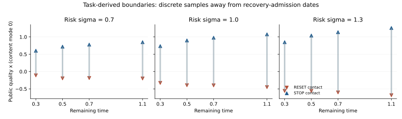

# R18：连续任务边界已经接入真实费用与复位后续收益

本轮新增一个真正连续状态、有限期限、带 STOP／WAIT／RESET 的任务闭环。任务价值产生随剩余时间变化的停止／复位边界，owner 实际支付费用、完成恢复、改变内容状态并取得随机正确性收益。**修复后的三个有限 profile 数值门通过；完整 He–Xiong／HCSN 自由边界、核心独立收益、全参数梯度和生产采用门仍未闭合。**

任务推导及边界条件见 [TASK_DERIVATION.md](TASK_DERIVATION.md)，范围台账见 [BLOCKERS.json](BLOCKERS.json)。这次没有把独立永续 put 演示换名为神经任务，也没有把旧有限 CTMC 自动称为连续模型。

## 1．同一任务法用于价值后继和实际执行

公开状态为 `x∈[−4,4]` 的检索质量与两个可观察内容模式；质量服从反射 Brownian diffusion。STOP 的实际成功概率为模式相关的 sigmoid 质量函数，owner 采样实际成功；actor 在停止前没有看到该成功标签。它是**已知质量／模式的合成内容评分任务**，并非学习语义寻址、真实音视频绑定或未知生成器。

WAIT 支付每时间 `.03`。RESET 与 STOP 分开：支付模式相关费用及恢复时间费用，完整消耗 `ρ=.2`，回到 `x=.6`，按明确内容转移矩阵抽样新模式，然后继续使用剩余时间。价值中的复位后继为

`B_j(t)=−k_j−c_rec ρ+Σ_l M_jl V_l(t−ρ,x_reset)`。

后续重复复位和内容收益全部保留；`t<ρ` 不允许启动无法在 deadline 前完成的复位。实际 owner 使用同一法、相同初态与费用。Gaussian fold 采样连续反射过程的网格端点，**动作只在时间网格发生**；没有冒称精确模拟连续首次触界停止时间。

## 2．先保留原失败，再作明确的数值修复

原冻结源先发布于 `59270cd6a7cda3a8a18328c4036603c4f4ea989a`；独立源审计在任何正式结果开启前修复可能空集合通过的梯度 gate，V2 发布于 `236e32f1627e64277bc03c0265981e2c26711221`，冻结 SHA256 为 `cd57be519842bd4962028a7a874bcf73fa8bbeab8856a8ff99a6929a226abfaf`。早期矩阵索引失败与精确旧源码亦保留。

[run_01/RESULTS.json](run_01/RESULTS.json) 完成三风险 profile、四层网格、27 个固定策略候选和 **3,072 owner 世界／12,288 次策略执行**。十项 gate 中两项失败：最大主解／独立参照差 `.00334238` 超出原 `.003`；低风险首末网格参照差没有下降。粗 DCT 截断核出现负系数，最大约 `−.00308`，原记录没有裁掉它。

还定位到真正的恢复时间问题：确定性最短恢复会在 `t=kρ` 新增可完成的复位机会。原隐式法把刚到达的 RESET obstacle 通过整个隐式步传播，出现了提前借用恢复机会的数值偏高。第一次准入点的最大偏高依风险为 `.001612／.002462／.003342`。

明确的**看过原结果后的数值修复与加强对照**另行冻结并发布于 `4644b9cdf8b75a9e43711d6f62cb3298866bebd4`，冻结 SHA256 为 `61763182517f4149fe63d7b2421e296a09dd9152f15f77a0d5288b5e7172fce3`。原物理任务、费用及数值阈值没有改变，原失败没有删除，也没有把 followup 重标为原先的独立科学确认。

新法先演化准入时刻的左极限，再点态加入新 RESET obstacle；后继分别使用正确的左右极限。参照改为 Gaussian image 密度对非负 hat 的正权积分，FFT 仅实施卷积；**没有截负数或重新归一化**。有限插值／投影仍有误差，不被称为固定网格上的精确半群。

## 3．修复后的有限数值门通过

Followup 三层 `(dx,dt)` 为 `(.015625,.0025)`、`(.0078125,.00125)`、`(.00390625,.000625)`。预先固定的十一项 gate 全部通过，完整行在 [run_02/RESULTS.json](run_02/RESULTS.json)。

| 风险 σ | 主解／正参照最大差：首层 → 末层 | 末两层主解差 |
| --- | ---: | ---: |
| .7 | .0008320 → .0002090 | .0001452 |
| 1.0 | .0005602 → .0002733 | .0001936 |
| 1.3 | .0007144 → .0003525 | .0002444 |

最细层全局离散互补残差最大 `2.08e−14`；正核质量误差最大 `2.22e−16`，8／16 节点积分权差最大 `5.55e−17`。准入 jump 条件误差为零。注册的正常时刻中，最大空间 smooth-fit 差 `.000583`；value matching 达浮点精度。没有在准入时间 kink 上要求时间可微，也没有为无 continuation 区域的模式捏造两条边界。

例如 σ=1、完整内容模式的 RESET／STOP 接触位置随剩余时间 `.3／.5／.7／1.1` 分别约为 `−.328／.734`、`−.395／.898`、`−.398／.977`、`−.449／1.074`。这些是有限网格接触估计，不是严格连续边界夹逼。



有限误差和经验细化不是全参数域收敛率定理、完整金融模型的最优性证明，或原生精确连续事件执行资格。

## 4．加强普通对照后，核心独立收益仍未建立

原九项固定策略共用两个模式的同一阈值，表达能力受限；不能把其较大差距全归因于移动边界。本 followup 改为 **81 项按模式分别设置阈值的固定策略**，用相同正参照为每个风险 profile 选择策略，全部候选和费用均计入，选择在新 owner 世界开启前保存。它仍是明确的有限候选族，不声称穷尽所有固定策略。

另外保留**不受该固定阈值族限制的同法普通正参照**。两种自由控制器均用同一公共状态、费用、恢复和 deadline。

新 **3,072 世界／12,288 次执行**的实际 `成功−全部动作费用` 为：

| σ | 任务边界控制 | 普通正参照控制 | 按模式固定策略 | 立即 STOP |
| --- | ---: | ---: | ---: | ---: |
| .7 | .635760 | .638665 | .640593 | .415039 |
| 1.0 | .643480 | .637846 | .639421 | .430664 |
| 1.3 | .668473 | .660263 | .632105 | .417969 |

任务边界控制减去普通正参照为 `−.00290／+.00563／+.00821`，三个配对 95% Monte Carlo 区间均跨零。**没有独占解析核心／金融神经元收益。**

相对加强后的模式固定策略，实际净收益差为 `−.00483／+.00406／+.03637`；前两个区间跨零，最后一项只是未作多重校正的单 profile 正向区间。不能宣称三个风险域均稳定优于强固定策略。相对立即 STOP 的实际净收益均明显提高，说明任务控制和恢复机制确实进入了实际收益；它不替代强普通参照比较。

同时保留 `当前状态成功倾向−费用` 作为模型条件诊断，不能与实际随机成功率混写。每个 profile 的独立单位为 **1,024 个世界**，同 seed 的四策略配对；大量动作或四策略执行数没有被当作更多独立样本。区间只描述这些已知合成 task profile 的 Monte Carlo 变化，未包含离散误差、跨生成器变化或架构不确定性，也未作总体神经能力外推。

## 5．梯度、成本及剩余工作

原固定网格的四个 task 坐标（σ、WAIT 单价、第一模式 reset 费用、第一模式保持概率）共十二个 active-branch 检查均无 active-set 改变，最大中心差分缩放差 `5.22e−9`。这只验证**原数值映射**。不能自动移植到新 jump-aware 解、连续边界拓扑、所有金融参数或 hard action 的导数；这些仍 open。

外层 Linux `wait4` 包含解释器、导入、全部数值／策略候选、owner 执行和输出：原 run **9.148359 CPU 秒**，followup **38.146055 CPU 秒**，合计 **47.294414 秒**。独立审计另计；早期未完整计时的开发探针不记作零。本轮没有逐策略保质在线 CPU／吞吐／能耗采用比较，没有将这项总 CPU 账称作完整项目生命周期成本。

仍需完成：完整金融／神经任务连续自由边界及误差证明，新 jump solver 全参数梯度，未知内容生成器与真实长距离跨模态绑定，解析核心在强普通参照下的独立增益，连续事件原生执行、生产 Rust 所有权，以及 GPU／FP32／能耗与同质量采用门。生产启用保持 false。

## 复现

从仓库根使用新输出名运行；现有证据全部 create-only，不覆盖失败或成功记录：

```sh
OPENBLAS_NUM_THREADS=1 OMP_NUM_THREADS=1 MKL_NUM_THREADS=1 python -m tools.hcsn.continuous_task_r18_20261101.campaign --output /tmp/new-r18-run01
OPENBLAS_NUM_THREADS=1 OMP_NUM_THREADS=1 MKL_NUM_THREADS=1 python -m tools.hcsn.continuous_task_r18_20261101.followup --output /tmp/new-r18-followup
```

原始 owner 记录按 128 世界分批保存在各 run 的 `owner_profile*_part*.jsonl.gz`；各原始／压缩 SHA256、行数和字节数由结果内 `raw_manifest` 绑定。解压可逐行独立复核；不需要重新打开世界来读已有结果。同源码同 namespace 重跑是可重复性 replay，不是另一批独立科学确认。
