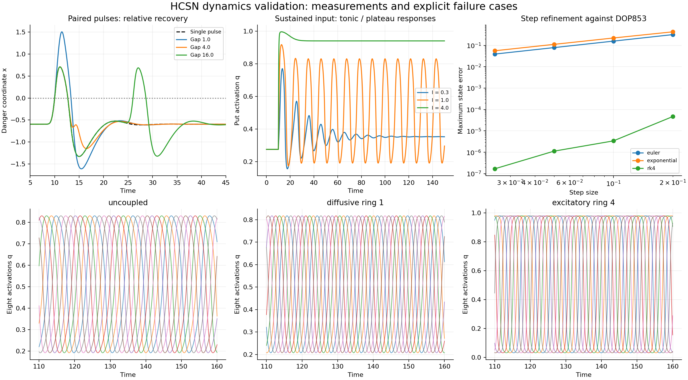

# HCSN 神经元动力学核验

## 范围和状态

这是前一轮 C1 Call/Put 参考单元的扩展实验。所有结果来自本目录脚本的实际执行；不包含语言任务训练、神经形态硬件能耗或生物真实性实验。这里的 q 是归一化放弃期权激活，不是预测概率或贴现首达变换 Q。

原经济学启发见 [He & Xiong (2012)](https://www.princeton.edu/~wxiong/papers/rollover.pdf)。本目录的快慢反馈、通信耦合和数值步进均是新设计。完整金融公式复现由独立 analytic 目录负责。

运行：

```bash
OPENBLAS_NUM_THREADS=1 OMP_NUM_THREADS=1 python run_validation.py
python write_report.py
```

依赖：Python、NumPy、SciPy、Matplotlib；无需 GPU 或下载数据。

## 1. 被测模型

危险坐标为 x=log(b/V)，边界为 x=0。参考参数 beta=-1，归一化算子为

\[
q(x)=\begin{cases}\frac12e^x,&x<0,\\1-\frac12e^{-x},&x\ge0,\end{cases}
\qquad
a(x)=\begin{cases}1-\operatorname{sech}x,&x<0,\\0,&x\ge0.\end{cases}
\]

二者 C1，通常不是 C2。特别地 q'(0)=1/2、a'(0)=0。多单元方程为

\[
\dot x_i=-k x_i+\kappa a(x_i)+gq(x_i)-y_i+I_i(t)
+\sum_jW_{ij}[q(x_j)-1/2],
\qquad
\dot y_i=\frac{hq(x_i)-y_i}{\tau}.
\]

默认参数 k=1, kappa=1, g=4, h=6, tau=5。耦合项显式居中，不把常量偏置误作连接效应。

## 2. 连续时间的全局有界性

只要 k>0、tau>0、h>=0、各参数和 W 有限、输入满足 |I_i(t)|<=U_i，定义

\[
Y_i=\max(|y_i(0)|,h),\quad
F_i=|\kappa|+|g|+Y_i+U_i+\tfrac12\sum_j|W_{ij}|.
\]

因为 0<=q,a<=1，线性方程的积分表达给出

\[
|y_i(t)|\le Y_i,\qquad
|x_i(t)|\le e^{-kt}|x_i(0)|+(1-e^{-kt})F_i/k.
\]

因此 max(|x_i(0)|,F_i/k) 是全局显式界。有界门控及有限矩阵还使向量场对状态全局 Lipschitz；这提供全局解的基础。

**这不证明收缩、不证明唯一吸引子，也不保证长时间梯度稳定。**相同有界系统可以有稳态、周期或较大的瞬态敏感性。

## 3. 参数扫描

固定扫描 g∈{2,4,6}、h∈{4,6}、tau∈{2,5}、I∈{-0.2,0,1,2}，共48组。先积分150时间单位，以最后50单位的幅度和峰数分类；对仍有瞬态的配置延长到500，保留初始分类和扩展结果。分类阈值为 late span<1e-5 判稳态，突出度0.02下至少3峰判周期；这只是该观测窗口的分类。

| 窗口 | 稳态 | 周期 | 瞬态或未决 |
| --- | --- | --- | --- |
| 先积分至150 | 34 | 10 | 4 |
| 对未决项延长至500 | 38 | 10 | 0 |

全部48组的实际轨迹均符合上述状态界。结果不支持所有参数或所有输入都自然产生脉冲。

## 4. 成对刺激与恢复

静息输入I=-0.2；两个幅度1、标准差0.5的高斯脉冲，第一个中心t=10。增量响应使用成对轨迹减去单脉冲反事实轨迹，再取正部积分；分子、分母使用同样从脉冲中心开始的14单位窗口。短间隔下脉冲可能合并，不把合并峰计作两个独立事件。

| 间隔 | 上穿边界次数 | 第二窗口最大x | 增量面积/孤立面积 | t=100静息距离 |
| --- | --- | --- | --- | --- |
| 0.5 | 1 | 1.623062 | 0.403828 | 5.57e-11 |
| 1.0 | 1 | 1.507252 | 0.483507 | 5.67e-11 |
| 2.0 | 1 | 1.139933 | 0.627646 | 5.65e-11 |
| 4.0 | 1 | -0.532973 | 0.162552 | 4.56e-11 |
| 8.0 | 2 | 0.262926 | 0.729793 | 1.9e-10 |
| 16.0 | 2 | 0.687174 | 0.986659 | 3.4e-09 |
| 32.0 | 2 | 0.709374 | 1.000085 | 2.6e-07 |

观察支持相对恢复：某些间隔下第二刺激受抑制，长间隔后接近孤立刺激。模型没有硬不应期变量，因此没有证明绝对不应期；短间隔合并或峰值增强也被保留。

## 5. 持续刺激与适应

在t=10把输入从-0.2改变为固定值。后期周期的频率趋稳，不能称为无限持续的发放频率适应；高输入还可能进入高位平台。

| I | 150时分类 | 扩展后分类 | 早期最大q | 后期平均q | 后期周期 |
| --- | --- | --- | --- | --- | --- |
| 0.3 | transient_or_unresolved | steady | 0.769989 | 0.352928 | — |
| 0.7 | oscillatory | oscillatory | 0.880290 | 0.462936 | 10.86667 |
| 1.0 | oscillatory | oscillatory | 0.917043 | 0.507173 | 10.78333 |
| 2.0 | transient_or_unresolved | steady | 0.970543 | 0.715337 | 11.25000 |
| 4.0 | steady | steady | 0.995474 | 0.939986 | — |

后期平均/早期最大值仅描述输出幅度变化；均值与峰值不同，不能据此单独宣布神经适应。详细峰间隔及扩展窗口在JSON中。

## 6. 八单元耦合

初始状态取孤立周期轨道的8个不同相位。对比无耦合、不同强度的扩散环、兴奋环、混合符号矩阵和异质输入。同步与状态有界是不同性质；耦合也可以形成行波或保持相位差。

| 配置 | 单元间平均标准差 | 平均相关 | 1e-6扰动最大增益 | 最大界占比 |
| --- | --- | --- | --- | --- |
| uncoupled | 0.2429 | -0.142831 | 2.73756 | 0.62872 |
| diffusive_ring_0.25 | 0.2424 | -0.142851 | 1.89415 | 0.62859 |
| diffusive_ring_1 | 0.235 | -0.142854 | 1.00000 | 0.62845 |
| diffusive_ring_4 | 5.755e-10 | 1.000000 | 15.96419 | 0.62872 |
| excitatory_ring_4 | 0.4095 | -0.142324 | 2.72090 | 0.71619 |
| mixed_signed_row_l1_4 | 0.2314 | 0.249208 | 2.50548 | 0.72163 |
| heterogeneous_diffusive_ring | 0.2162 | -0.142751 | 1.00000 | 0.62834 |

全部配置保持所推导的状态界。有限扰动增益是这个实验的实际轨迹差，不能据此证明全局收缩或任意矩阵下的同步。

## 7. 步长与浮点精度

参考解使用DOP853，rtol=1e-11、atol=1e-13、max_step=0.025。比较同一连续系统的Euler、冻结门控指数Euler和RK4；记录float64与float32的实际轨迹dtype。

| 精度 | 方法 | dt | 最大状态误差 | 相对上次减半的经验阶 |
| --- | --- | --- | --- | --- |
| float64 | euler | 0.2 | 0.319775 | — |
| float64 | euler | 0.1 | 0.158591 | 1.012 |
| float64 | euler | 0.05 | 0.0789507 | 1.006 |
| float64 | euler | 0.025 | 0.0392513 | 1.008 |
| float64 | exponential | 0.2 | 0.431544 | — |
| float64 | exponential | 0.1 | 0.22238 | 0.956 |
| float64 | exponential | 0.05 | 0.111939 | 0.990 |
| float64 | exponential | 0.025 | 0.0560647 | 0.998 |
| float64 | rk4 | 0.2 | 4.67443e-05 | — |
| float64 | rk4 | 0.1 | 3.40565e-06 | 3.779 |
| float64 | rk4 | 0.05 | 1.12844e-06 | 1.594 |
| float64 | rk4 | 0.025 | 1.6806e-07 | 2.747 |
| float32 | euler | 0.2 | 0.319776 | — |
| float32 | euler | 0.1 | 0.158591 | 1.012 |
| float32 | euler | 0.05 | 0.0789501 | 1.006 |
| float32 | euler | 0.025 | 0.0392506 | 1.008 |
| float32 | exponential | 0.2 | 0.431544 | — |
| float32 | exponential | 0.1 | 0.22238 | 0.956 |
| float32 | exponential | 0.05 | 0.111939 | 0.990 |
| float32 | exponential | 0.025 | 0.0560713 | 0.997 |
| float32 | rk4 | 0.2 | 4.73841e-05 | — |
| float32 | rk4 | 0.1 | 3.94591e-06 | 3.586 |
| float32 | rk4 | 0.05 | 1.83448e-06 | 1.105 |
| float32 | rk4 | 0.025 | 1.13534e-06 | 0.692 |

冻结门控指数更新为

\[
x_{k+1}=e^{-k\Delta}x_k+\frac{1-e^{-k\Delta}}k F(x_k,y_k,I_k),\quad
y_{k+1}=e^{-\Delta/\tau}y_k+(1-e^{-\Delta/\tau})h q(x_k).
\]

它对任意正步长保留同一状态界，但只是冻结非线性项的**近似更新**。Euler在 Delta<=min(1/k,tau) 时也有凸组合保持界的保证。指数更新在本例同一步长下误差反而大于Euler；不能用“解析更新”标签替代精度比较。RK4更准确，但跨C1边界时经验阶不必恒为4；float32在细步长下出现误差底限。

大步长压力实验采用恒定I=1、初值(0.1,3)、时长80，避免粗网格漏采窄脉冲：

| dt | 方法 | 最大状态绝对值 | 最大界占比 | 有限值 |
| --- | --- | --- | --- | --- |
| 1.0 | euler | 4.1593 | 0.693216 | True |
| 1.0 | exponential | 4.18189 | 0.696981 | True |
| 2.0 | euler | 4.31294 | 0.718824 | True |
| 2.0 | exponential | 4.50488 | 0.750814 | True |
| 4.0 | euler | 8.70078e+07 | 7.25065e+06 | True |
| 4.0 | exponential | 4.96813 | 0.828022 | True |

## 8. 多种子梯度与Jacobian

5个固定种子，每次4单元、350个不规则步长、22个参数（6个共享参数及完整4×4矩阵）。初值、输入时刻、目标不随所求导参数变化。对实际执行的Euler递推手写反向传播，与每个参数的中心有限差分比较；另核验连续向量场Jacobian。

| 种子 | 最大梯度绝对误差 | 最大梯度相对误差 | Jacobian最大误差 | 通过 |
| --- | --- | --- | --- | --- |
| 101 | 4.7333e-11 | 1.4363e-08 | 8.2267e-11 | True |
| 202 | 4.0094e-12 | 1.0622e-08 | 1.5433e-10 | True |
| 303 | 5.0657e-11 | 1.0946e-08 | 1.5393e-10 | True |
| 404 | 3.8875e-11 | 1.5642e-08 | 8.2267e-11 | True |
| 505 | 2.2838e-10 | 1.6201e-08 | 3.6446e-10 | True |

这是离散计算图的正确梯度，不是连续ODE的精确求解，也不证明训练任务上的收益。

**框架实现注意：**数学上q'(0)=1/2。若使用exp(-abs(x))再分支实现q，自动微分可能继承abs在0的约定梯度，未必得到复合函数的正确边界导数。此处手写导数直接实现q'=0.5exp(-|x|)；接入训练框架时必须额外检查精确x=0。本目录未执行PyTorch自动微分测试。

## 9. 状态有界不等于梯度稳定

在平衡点上，切向流可直接计算exp(JT)。同一个默认模型既有衰减，也有增长：

| 平衡点 | T=1 | T=10 | T=50 | T=100 |
| --- | --- | --- | --- | --- |
| stable_rest_I_minus_0.2 | 1.04536 | 0.0885898 | 1.22708e-06 | 1.49207e-12 |
| unstable_equilibrium_I_1 | 2.65173 | 157.457 | 9.84922e+08 | 6.64828e+17 |

这构成明确反例：解析且C1的算子仍可能产生梯度消失或爆炸。

### 一个可证明的收缩配置

在加权范数 max(||dx||∞,w||dy||∞) 下，若kappa>=0且

\[
\alpha_x=k-\tfrac12(|g|+\|W\|_\infty)-1/w>0,
\quad
\alpha_y=(1-wh/2)/\tau>0,
\]

则相同输入下两条轨迹以至少 alpha=min(alpha_x,alpha_y) 的速率收缩。这里的矩阵范数是最大行绝对和。证明直接来自Jacobian的加权无穷范数对数范数上界；Call支路导数非正，可保守忽略它的额外阻尼。

实际配置为 leak=6，其他共享参数保持默认，八单元扩散环行范数0.5，w=0.3。证书速率 **0.02**；实际距离/证书包络最大值 **1**，核验通过=True。

这个稳定配置具有明确代价：在恒定输入下全局收缩排除了非平凡自主周期轨道。它适合做可控稳定基线，不能同时宣称保留默认模型的自发周期行为。是否改善任务学习需要后续独立比较。

## 10. 本阶段已覆盖与尚未建立的结论

已完成：声明参数域下的连续状态有界性、参考单元刺激和相对恢复、多单元耦合、浮点和步长收敛、五种子完整参数梯度、明确的梯度不稳定反例，以及一个有证书但能力取舍清晰的收缩配置。

未建立：严格全或无放电、绝对不应期、一般的持续发放频率适应、任意训练参数下的稳定梯度、任意耦合下同步、动态自由边界的最优性、比普通门控网络更好的表示学习或能耗。



## 原始证据

- `model.py`：门控、动力学、显式界、收缩证书和步进。
- `gradient_check.py`：22参数多单元反向传播及独立有限差分。
- `run_validation.py`：固定协议和原始结果生成。
- `dynamics_results.json`：完整参数、指标、失败情形、环境和源文件SHA-256。

本次核验耗时 49.107 秒；总通过标志 `True` 只表示脚本中明确列出的状态界、梯度和收缩检查通过。它不代表上列未建立的科学假说已经成立。
