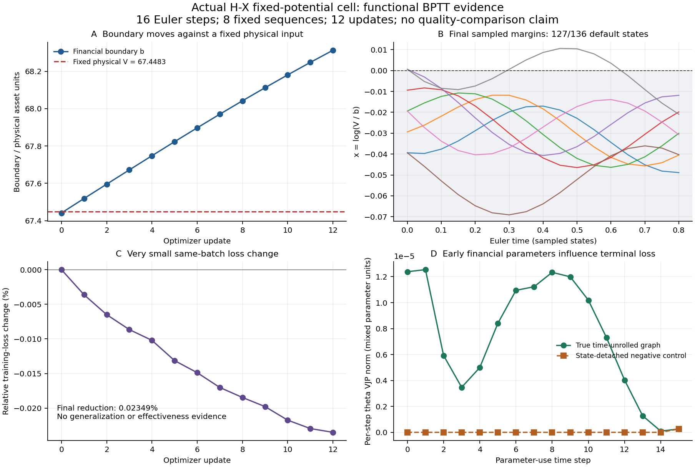

# 固定绝对状态的实际 H–X recurrent / BPTT 结果

**固定物理输入下的边界参数链、实际时间反传和参数更新已通过有限功能验证。
训练效果仍很弱，而且默认平台占比增加。** 本报告保留这两方面的结果。

协议与原 9 个文件先在远端检查点
`786e535bd2a396b14e9ffab4504bc855c6f4d6b1` 固定，随后才首次执行。
协议 SHA256 为 `7e4791bee5b934f0aa55f603529d7ada5362b6908e70955f1441f5378691ddaa`。
此前独立 margin V1 的源、门槛、完整结果及近乎持平的损失全部保留。
本候选没有改变原金融核、V3 adapter 或金融精度资格。

## 这次具体闭合了什么

状态采用固定的 z 和恢复状态 a。实际输入为 FP32 exp(z)，再调用原 V3
`asset.readout` 得到 Q=E/b、R=1-(1-F)^2、x=log(V/b)。初态、z_rest、外部
驱动和终末目标都不随 theta 或 b 重算。训练损失只读取 z/a，不直接读取
含有 -log(b) 的 x，也没有可训练 head。

| 固定物理输入的见证 | 初始 | 12 次更新后 |
|---|---:|---:|
| 金融边界 b | 67.44151430180042 | 68.3123767033789 |
| 同一固定探针的 V | 67.44827270507812 | 67.44827270507812 |
| 该探针 x=log(V/b) | 0.00010020630076338322 | -0.012729987241874232 |
| 原金融分支 | 续行 | 默认 |

全部 5 个固定 z 探针的 FP32 V 都保持相同。它们的 margin 统一移动
约 **-0.0128301935426374**，等于 -log(b_after/b_before)。因此，这次确实
观察到了阈值相对固定绝对状态移动，不再只是独立 x 坐标下 V 和 b 一起缩放。

局部梯度直接使用原资产接口在固定 V 下的完整偏导：Q 的 quotient rule
含 -E*b_theta/b²，x_theta=-b_theta/b；状态 z 方向还包含 exp(z) 的 V 倍数。
原金融函数的 asset Jacobian 已含边界依赖，没有再重复加一次边界平移项。
实际 log(V_repr)-z 的浮点回差也保留，未声称浮点 exp/log 严格互逆。

这仍不是“只移动阈值”的因果实验：9 个金融参数同时改变价值场形状。
每条 16 步 rollout 内 theta 与 b 固定，b 在优化器更新之间变化；本实验
没有把 b 当作独立时间状态，也未证明动态 b(t) 在层间传递的完整架构。

## 真正的时间反传，而不只是末步参数梯度

固定协议包含 5 个物理状态 fixture、15 个接口合同、8 组时间梯度比较，
以及 16 步 × 8 条驱动序列 × 12 次更新。全部原门槛通过，实际 audit 和
training 进程均以 0 退出，没有调输入、参数、步长或容差以追求通过。

- 终末损失对最早 theta_t 的 VJP 范数为 **1.2382783188276665e-5**。
- 对初始 z 的梯度范数为 **0.009892534827372448**。
- 手工离散 Jacobian/adjoint 组成与实际 BPTT 的最大绝对差为
  **4.369049245653289e-10**；最大误差/允许量约 0.01132。
- 故意逐步 detach 状态后，前向数值保持相等，但早期 theta、初态和早期
  驱动对终末损失的梯度消失。
- 全 default 控制保留了真实的零 theta 梯度，并通过独立的 2×2 Euler
  状态矩阵的 16 次幂核验。它不表示进入 default 会删除此前的历史敏感性。

手工时间链使用同一个此前已验证的金融 Jacobian，独立实现时间展开和
Q/R/exp 的链式法则；这是对 PyTorch 图连接的独立核对，不是第二份独立
金融高精度 oracle。只支持一阶反向 AD，高阶请求仍由 V3 明确拒绝。

## 负面结果和仍然缺失的证据

| 观察量 | 初始参数 | 最终参数 |
|---|---:|---:|
| 同一训练批次的终末损失 | 0.00047014461597427726 | 0.0004700341960415244 |
| 相对损失下降 | — | **0.0234864%** |
| 实际 default 状态数 / 全部采样状态 | **107/136** | **127/136** |
| 采样相位变化次数 | **8** | **4** |

loss 变化很小。边界上移后，更多状态落入 Q=0、R=1 的平台，跨界反而减少。
在这种平台上，金融参数的局部通道梯度为零；本次更新没有提供“更强再生”
或“更有效脉冲”的证据。9 参数都发生了实际更新，raw 参数合计更新范数
0.5113682962089355；这证明接线可训练，不能证明机制有效。

旧 margin V1 的相对损失变化只有约 0.000557%，仍保留为原结果。两候选的
固定初态族和恢复项不同，不能把它们的损失变化比例当成公平的性能提升。
本轮也没有泛化、真实模态、SNN/Transformer 对照、事件稀疏计算或能耗结论。



图 A 对比真实边界与固定探针；图 B 是最终参数下的 Euler 采样 margin，
阴影区表示默认侧；图 C 直接标出很小的损失百分比；图 D 对比真实时间图与
detach 负对照的逐时 theta VJP。连接采样点的线不是解析轨道或硬脉冲输出。
图表仅重绘既有记录，未调用金融核或重跑模型。

## 原始分支、数量和输入绑定的复核

冻结模型的 `true_asset_default_Q_R` 日志门采用报告 margin 的符号。
浮点 log(V/b) 的符号在一般情形下不能无条件替代原始 V<=b 判断。因此，
候选之外的结果 checker 另从同一个冻结 C API 取得 13 组实际 theta 的
原始 b，并逐一复核全部 **16 条完整轨迹、2057 个状态**。

这些状态中，实际 V_repr<=b 与报告 margin<=0 全部吻合。最小报告
|margin| 为 1.576608232500358e-5。固定探针的局部值和全参数/z 梯度也
直接与原 asset 核再算结果核对。该附加检查仅 1 batch / 18 states：
13 组边界加 5 个局部点；不重跑原 768 点验证，不称独立金融 oracle。

结果 checker 还重算完整 FP32 Euler、终末 z/a loss、手工 adjoint、
参数更新链、真实边界移动与固定输入身份。10 个针对性错误记录全部被拒，
包括遗漏 fixture/更新、NaN、错误 Euler/早期梯度、移动所谓固定 V、错误
b 诊断、改变目标、错误协议绑定和遗漏跨界记录。没有重演 Adam，亦没有
通过这些记录测试扩张金融准确率或模型质量资格。

独立审阅再次核对模型、原始分支、16 条轨迹、参数链与时间梯度，实际退出
码为 0；没有启动新的 Torch/金融计算或训练。完整 receipt 与审阅脚本随包
保留。原 9 个冻结文件的 SHA256 在所有运行与封包后均未变。

## 实际时间、精度和成本

| 本机功能运行 | 内部 wall | 内部 CPU | 金融调用 |
|---|---:|---:|---:|
| 首次 audit | 0.2662594510 s | 0.0718549750 s | 73 calls / 435 states |
| 12 更新、最终轨迹和固定探针 | 0.8798394240 s | 0.2552076010 s | 223 calls / 1778 states，另 1 call / 2 states 的 b 诊断 |

完整控制器时间分别为 **6.4876450920 s** 和 **12.9249456400 s**，包含
导入及启动等内部计时外的成本。这是本机功能运行记录，不是性能基准。

远端检查点时间为 2026-11-01 17:59:10 UTC。首次 audit 控制器启动于
17:59:45.837394 UTC，数值评估开始于 17:59:49.877505 UTC；训练控制器
启动于 18:00:45.200088 UTC，数值评估开始于 18:00:53.573984 UTC。
精确命令、实际退出码、stdout/stderr、时间与产物哈希均保留。

环境为 CPU PyTorch 2.15.0+cpu、NumPy 2.3.5。输入与 Euler 状态为 FP32，
金融内部与保存的 5×10 Jacobian 为 FP64，不能改称全金融 FP32 实现。
固定步长、有限时间内的有界数值记录不是步长收敛、连续 ODE 解析解、全局
稳定性或极限环证明。这些参数和时间尺度也没有经过生理数据标定。

## 复现与退出码

冻结 README 给出两个模型入口。对新产生的审计/训练结果，追加：

```
python -B check_asset_results.py --root ASSET_ROOT --protocol-sha256 7e4791bee5b934f0aa55f603529d7ada5362b6908e70955f1441f5378691ddaa --audit NEW_AUDIT.json.gz --training NEW_TRAINING.json.gz --financial-root FROZEN_FINANCIAL_ROOT --output NEW_CHECK.json
```

三个入口的 0 均表示相应门槛通过，不是单纯 writer 完成；输出 create-only。
结果 checker 不需要 Torch，但会进行上述同核 18 状态的分支/局部一致性复核。
图表生成另需 Matplotlib 3.10.8，不是模型或 CI 门槛的新增依赖。
已打开的固定功能输入在后续 CI 中属于回归，不再称新的独立验证集。
