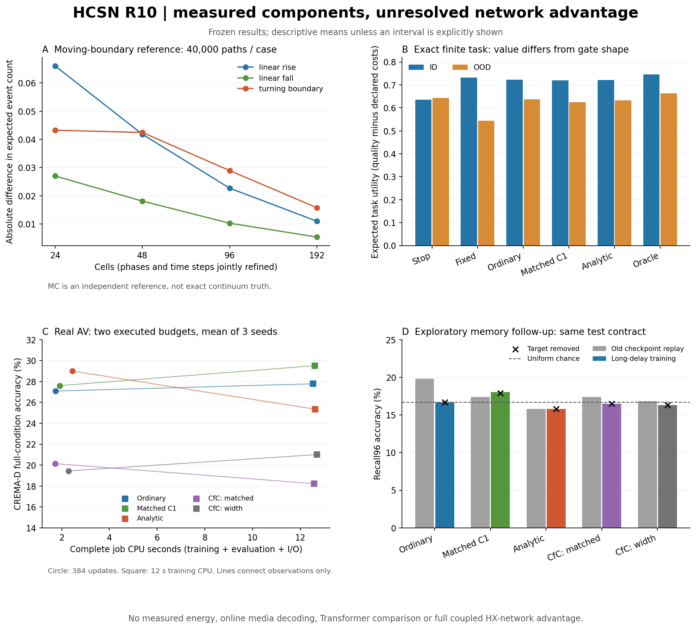
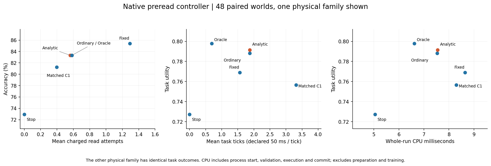

# HCSN 五线实证报告：过程、预读控制、任务价值、解析对照与真实视听

日期：2026-10-31。代码与证据以本目录所在提交为准；原生资格实验明确固定在 `41a38cd4f05924c57d0ff841ea392de10704d9b3`。本轮延续 R9 的 `e7eaa5e0be835269636216c8fe8b1ae2f1a22361`，精确基线身份以 [README](README.md) 与 [构建清单](integration/UPSTREAM_NATIVE.json) 为准。

## 结论

**本轮完成了可运行组件、反事实任务、原生预读链路和真实视听训练的实证验证；尚未建立完整 He–Xiong 连续自由边界网络，也没有证明解析结构优于同信息普通门控。**

已经得到三类正面证据：两个原始数学参考缺陷被实际复现并修正；移动边界首达—复位过程在选定案例上显示质量守恒与数值收敛；在真实原生读取之前决策可以运行，付费读取确实会改变答案和正确性。另两类结果限制了强主张：解析门控未稳定胜过 ordinary / matched_c1，补充长延迟训练也未建立有用的内容保持。

关键架构缺口很具体：**Brownian 过程、任务 Bellman 控制器、AV 的 erfc recurrence 尚未共用同一个可恢复状态和转移核。** 当前原生 READ 由导出 Q table 决定，潜在 CTMC firing 没有决定 READ；AV 臂每步重新生成 gap，没有传播同一个首达—存活—复位分布。不能把三条独立证据相加，称作完整网络已通过验收。

| 用户的五个问题 | 本轮实际证据 | 判定范围 |
| --- | --- | --- |
| 1. 算子描述与执行一致吗？ | 2 个原始缺陷；120,000 条 Brownian 路径；四级数值细化；存活子事件与总质量核验 | 选定过程、输入和离散近似得到支持；一般任务自适应边界、训练与原生的共同连续过程未闭合 |
| 2. 事件产生真实收益机会吗？ | 原生读取前决策；576 次执行；48 个配对 world；失败、预算、期限、不应期和真实 decoder 结果对齐 | 预读任务控制有真实信息作用；未证明解析发放本身有额外收益 |
| 3. 自由边界优化实际任务吗？ | 精确有限 Bellman 教师；280 个条件动作值的独立枚举；完整状态克隆；任务成本边界扫描 | 有限任务动作价值成立；连续自由边界及 smooth fit 尚未由同一任务推导并部署 |
| 4. 解析结构优于平滑门控吗？ | 3 类价值头 × 3 seeds；5 类 AV 模型 × 3 seeds × 2 预算；值/斜率匹配与梯度检查 | 主比较未支持解析结构的独特优势；部分 CfC 缺失模态比较通过，不能扩成总体优势 |
| 5. 收益扩展到真实多模态吗？ | 720 个同录制 AV 对；30 次主训练、15 次记忆补训、15 次旧 checkpoint 重放 | 完成离线小模型证据；在线异步、长程有效记忆、能耗和大模型扩展尚未证明 |

图中的连线仅连接两种实际训练预算，不是额外测量的性能曲线；各模型结果是三个初始化种子的均值。精确统计区间见下文与各子报告。

## 一、原论文提供什么，神经网络还必须增加什么

He 与 Xiong 的正式论文联合确定债券价值、股权价值及违约边界。债务展期损益进入股权现金流；平稳债务结构给出常数边界，股权满足 value matching 与 smooth pasting：

\[
E(V_B)=0,\qquad E_V(V_B)=0.
\]

这不是对所有风险概率同时施加零斜率的条件。来源为作者公开的正式版本：[论文 PDF](https://www.princeton.edu/~wxiong/papers/rollover.pdf)，正文式 (5)–(11) 及第 399–401 页；[正式 DOI](https://doi.org/10.1111/j.1540-6261.2012.01721.x)。

对神经模型的映射必须保留对象定义：股权／续行价值、首达概率、折现损失价值不是同一个量。把两个通道命名为 Call / Put 并不会自动赋予它们金融模型的耦合关系；把 equity value 直接加入状态也不会自动产生稳定的恢复力。恢复与再生反馈需要通过明确的漂移、势函数梯度或状态依赖耦合定义，并检验符号、量纲和稳定性。

当前 `FullHX` 是冻结 decoder 组件的名称，其存在不等于整个债券—股权—自由边界系统已经转化为任务最优神经元。本轮 value 实验的 analytic 算子是有限窗零漂移 Brownian 首达门：

\[
g(z,T)=\operatorname{erfc}\!\left(\frac{\operatorname{softplus}(-z)}{\sqrt{2T}}\right).
\]

AV 实验另外使用固定噪声尺度 3 与 gap 下限 .001：

\[
g_{AV}(z,\Delta t)=\operatorname{erfc}\!\left(\frac{\operatorname{softplus}(-z)+.001}{3\sqrt{2\Delta t}}\right).
\]

两者均有可微解析表达式，但不是相同的参数化。是否保存了跨步首达过程、是否决定任务动作、是否提高质量，是三个需要单独检验的问题。

## 二、过程真实性：首达、存活、复位、不应期和动态边界

### 2.1 两个执行过原源码的缺陷

**折现首达的低噪声抵消。** 负漂移下直接计算

\[
\frac{\nu+\sqrt{\nu^2+2q\sigma^2}}{\sigma^2}
\]

在极小噪声时丢失有效数字，使折现首达权重错误地成为 1。四个原源码反例覆盖 `sigma=1e-40,dps=50` 与 `sigma=1e-80,dps=100`：`q=.2` 的正确值约为 `.8187307531`，`q=1.25` 约为 `.2865047969`。原有 `0≤G≤F≤1` 检查无法发现这种错误。修复在负漂移下改用等价的 `2q/(sqrt(nu²+2q sigma²)-nu)`，并在 `q=0` 时精确令 `G=F`。

**联合存活子事件约束遗漏。** 原 renewal 参考接受 `no_fire_active > active` 的不可能持久化状态。例如 active=.1、no_fire_active=.8，推进后仍返回 .131871 与 .780219。修复在输入、输出及零时间路径检查 no-fire active / refractory 分别受物理 active / refractory 概率支配。

这些修复有原始 commit、Git blob、原输出、修正输出、独立 Decimal / 积分 / 矩阵参照。4 个折现反例、4 个非法状态调用、4 个独立时间积分与 16 个独立矩阵／占用积分检查通过。修复对象是**数学参考的冻结副本与原路径补丁**；没有把它冒称为生产 native 修复。见 [dynamics 报告](dynamics/README.md)、[回归记录](dynamics/results/regression.json)、[32 行补丁](dynamics/patches/two_reference_fixes.patch)。

### 2.2 必须守恒的对象

令物理 active 密度为 \(\rho_A\)，不应期年龄密度为 \(\rho_R\)，第一次首达之前的 killed 密度为 \(q_0\)。正确的检查包括：

\[
\int\rho_A+\int\rho_R=1,\qquad
P(\tau_1>t)=\int q_0(t),\qquad
\mathbb E[N_t]=\int_0^t J(s)\,ds\ge P(\tau_1\le t).
\]

首达质量进入不应期，经过真实延迟才重新注入 active；它不能在每步被归一化掉，也不能以 `1-survival` 代替可重复发放的累计事件数。存活末态必须来自条件存活分布，保留其总质量。移动边界下，绝对位置复位与相对安全裕量复位也必须分清。

本轮独立 Brownian 参照直接采样逆高斯／Levy 首达时间；存活末态以 Brownian bridge 存活概率拒绝采样。实际首达时刻复位到绝对位置，并冻结到实际释放时刻；边界在不应期内继续运动。对照是独立 SciPy 有限体积／Erlang 实现：有限反射下界、上风空间速率、分段保持边界与概率重映射。**这不是执行上游 PyTorch 的声明**。

### 2.3 实测精度及未闭合误差

三条预先固定轨迹各 40,000 条路径，另有 12,000 条用于采样器校验。四级联合细化为 `(24,6,32)`、`(48,12,64)`、`(96,24,128)`、`(192,48,256)`，依次表示空间 cells、不应期 phases、时间 steps。

| 轨迹 | Brownian E[N] | P(至少一次发放) | 最细 E[N] 绝对差 | 最细均值绝对差 | 最细首达 CDF 全时段最大差 |
| --- | ---: | ---: | ---: | ---: | ---: |
| 上升边界 | 0.921075 | 0.752775 | 0.010978 | 0.014916 | 0.013245 |
| 下降边界 | 0.804625 | 0.668150 | 0.005385 | 0.009204 | 0.006673 |
| 转折边界 | 1.282975 | 0.930450 | 0.015770 | 0.019917 | 0.022740 |

12 次注册数值运行的最大总质量误差为 `4.58e-14`，no-fire 子事件支配最大浮点超量为 `1.12e-16`。三条轨迹均满足注册的终点容差加 6 个 Monte Carlo 标准误，联合细化都降低了综合误差。

全时域诊断仍发现有限残差，因此追加一次转折轨迹 `(384,96,512)` 细化，保持原注册结论不变：首达 CDF 最大差 `.022740→.012252`，未首达终态联合 CDF 差 `.009760→.006537`，事件数差降至 `.006923`。这次更细运行的最大总质量误差为 `1.09e-13`，不能把注册四级的 `4.58e-14` 冒称为所有追加运行的最大值。

这些结果支持选定连续过程的近似收敛。空间、时间与 Erlang 相位共同细化，尚未分别给出三个误差的独立界；下域路径耦合概率界也不直接控制无界矩误差。边界是外部指定的，并非任务 Bellman 产生。原始样本、全概率向量与时序见 [dynamics 数据](dynamics/results/moving_v1/summary.json)，全部样本可由 [归档清单](BUNDLES.json) 恢复。

## 三、真实收益机会：读取前动作已经接入原生执行

### 3.1 本轮新增的因果顺序

R9 owner 会先解码调用方选好的内容，然后推进 cell。本轮增加了公开状态驱动的 READ / WAIT / STOP 决策，策略不接收隐藏 truth 或未读 payload。选择动作以后，先持久化 intent，再执行实际内容访问，随后共同发布任务与原生 checkpoint。STOP 和非法 READ 的 guard 都不会接触 payload。

READ 消耗一次读取预算、一个任务 tick 与 read cost；失败仍消耗包、预算、时间，并额外支付 failure cost，保持先前 posterior。WAIT 消耗 tick 与 latency cost；STOP 支付 stop cost，用现有 posterior 提交答案，不假装推进物理时间。READ / WAIT 都调用真实 R9 owner 与 Hepta NeuronRuntime；只有合法 READ 进入实际内容读取与冻结 FullHX 解码路径，WAIT 使用 `content=None`。详细合同见 [native/README](native/README.md)、[task_contract.json](native/task_contract.json)。

### 3.2 实际执行与统计单位

固定原生源码经全新依赖构建后通过 **11 个既有测试、5 个新测试**。随后执行 `8 configs × 6 world seeds × 6 policies × 2 physical families = 576` 个实际进程运行，动作、解码观测、状态和成本全部与 Python 合同一致。

**独立配对环境只有 48 个，不是 576 个。** 两个 physical family 和多个策略是同一环境上的重复执行。任务为至多四包的二元证据环境，本次配置包含 2–4 包；FullHX 实际读取固定 32-symbol 模板。这验证真实调用链，不能冒充开放域媒体任务。

| 策略；展示 ordinary physical family | 正确率 | 净 utility | 平均收费 READ 尝试 | 平均 task ticks | 整次运行 CPU ms |
| --- | ---: | ---: | ---: | ---: | ---: |
| 初态 STOP | 0.729167 | 0.727167 | 0 | 0 | 5.049 |
| 固定阈值 | 0.854167 | 0.768897 | 1.291667 | 1.5625 | 8.643 |
| ordinary head 导出表 | 0.833333 | 0.788137 | 0.583333 | 1.8750 | 7.531 |
| matched_c1 导出表 | 0.812500 | 0.756581 | 0.395833 | 3.3125 | 8.293 |
| analytic 导出表 | 0.833333 | 0.791373 | 0.562500 | 1.8750 | 7.549 |
| 精确期望价值 oracle | 0.833333 | 0.797933 | 0.583333 | 0.6875 | 6.616 |

同一个 world 内对比初态 STOP，analytic 有 7 次正确性改善、2 次受损、39 次不变；ordinary 也是 7/2/39。**analytic 与 ordinary 的 48 个最终正确性逐项相同**；净 utility 差 `+.0032362379` 全部来自声明的任务成本。oracle 最大化条件期望净 utility，不是拿隐藏 truth 每次挑事后最优动作，因此有限 realized world 的正确率不必最高。

这些 CPU 数字含 `run_owner` 内父进程验证、子进程启动、执行、原生与新 task checkpoint 提交、退出；不含此前的配置／Q-table／payload 准备、编译、训练或 checkpoint 克隆。task ticks 每单位声明为 50ms，**不等于实测 wall latency**；read cost 也不等于焦耳。计时范围和全体原始记录见 [资格报告](native/evidence/qualification/REPORT.json)、[独立审计](native/evidence/INDEPENDENT_AUDIT.json)。

### 3.3 恢复与中途反事实的准确含义

8 对真正退出后另开进程的恢复轨迹，其稳定 receipts 逐项一致。8 个原生 frontier 的完整状态被克隆，共执行 24 个请求分支；对应 5 种不同 `(config, public task state)`，18 个请求合法、6 个非法 READ 被 guard 转为 STOP，仅 2 个 frontier 同时允许三种动作。被拦截 READ 均未读取内容。

这 8 组中途分支的最终答案和正确性均相同，utility 差异来自成本。它们证明完整状态复制、guard、续行成本与合法后继一致，不能描述成 8 个中途状态都证明了读入内容提高质量。prefix sunk cost 已扣除；原始 clock / reads 仍是累计量，审计补充了续行口径。

恢复采用外部 acknowledgement、完整绑定、ledger 回放与未完成 intent 拒绝恢复。它不是任意崩溃时序下的自动 exactly-once 恢复保证。

### 3.4 当前最重要的机制缺口

在 288 对 physical-family 对照中，任务状态、答案、正确性、utility、读取次数与 clock 全部相同。当前策略只读公开任务 Config / State，不读 cell 分布；READ / WAIT 推进 CTMC，**CTMC 的潜在 firing 不触发 READ**。task refractory 也是独立的离散合法性约束。因此，已经建立的收益机会属于预读任务控制；解析发放机制对收益的额外因果作用仍未建立。

## 四、任务价值边界：精确有限目标与可学习动作头

有限任务的停止价值是 \(\max(p,1-p)-c_{stop}\)，续行动作值为

\[
Q(s,a)=-c(s,a)+\mathbb E[J(s')\mid s,a],\quad
J(s)=\max_{a\in\mathcal A(s)}Q(s,a).
\]

状态包含时钟、剩余预算、恢复期限、下一个包、观测／失败历史与由此重建的 posterior；动作后继、失败概率及成本与 native 合同一致。每个 counterfactual 分支使用相同完整状态、预算、期限和条件隐藏环境分布。已发生费用不重复进入续行价值。

从 12 个配置各抽取 12 个状态，独立对潜在 world 求和，核对 **280 个合法条件动作值：144 STOP、93 WAIT、43 READ**，最大绝对误差 `1.4433e-15`。36 个不可访问的 private-world guard 样例验证 WAIT / STOP / 非法 READ 没有提前读内容。另有读取成本扫描展示动作优势随成本改变。这是有限 DP 的任务价值分界，尚不是连续 smooth-pasting 解。[条件审计](value/evidence/conditional_audit.json)

训练集 128 个配置、18,628 个状态；验证集 32 配置、5,442 状态；ID 与 OOD 各 48 个配置。ordinary / matched_c1 / analytic 各 3 个 seeds，均为 29 个输入特征、24 hidden、770 参数、1,800 次 Adam 更新、batch 256。全部信息、目标与容量相同，验证集选模型；native 导出预先指定 seed 17 的 Q table。matched_c1 在每个时间跨度、`z=0` 处匹配 analytic 的值和一阶斜率；不等于全局曲率或算术开销相同。梯度最大绝对误差 `1.68e-10`。

| 策略 | ID 期望 utility | OOD 期望 utility |
| --- | ---: | ---: |
| 精确 Bellman | 0.745645 | 0.662506 |
| 验证集选择的固定阈值 | 0.732220 | 0.544544 |
| 初态 STOP | 0.635500 | 0.643833 |
| ordinary | 0.723205 | 0.636497 |
| matched_c1 | 0.719771 | 0.624624 |
| analytic | 0.720984 | 0.632137 |

| 比较 | ID 差值与名义 95% CI | OOD 差值与名义 95% CI |
| --- | --- | --- |
| analytic − ordinary，主要比较 | −.002221 [−.009857, +.004648] | −.004360 [−.016061, +.008428] |
| analytic − matched_c1 | +.001213 [−.006504, +.008062] | +.007513 [−.002393, +.016552] |
| analytic − fixed | −.011236 [−.022703, −.0000074] | +.087593 [+.056821, +.117174] |
| 精确最优 − 初态 STOP | +.110145 [+.083893, +.138097] | +.018673 [+.007523, +.032642] |

这说明任务中有值得优化的信息价值，但当前 analytic 近似头没有显著胜过 ordinary。OOD 胜过固定阈值不能单独作为成功证据：它的均值仍低于 initial STOP。辅助区间未做多重比较校正，不能抬升为全局确认性发现。

`confirmation` 只是补齐 State 校验后用相同 seeds/configurations 重放，9 个 checkpoint 与配对 utility 逐字节相同；不是额外独立样本。value 源码在训练前准备 test teacher，但拟合／选模仅用 train / validation；不能套用 AV 的“test 到 checkpoint 封存后才打开”叙述。完整记录及额外明确标识的探索性 analytic−STOP 比较见 [value/REPORT.md](value/REPORT.md)。

## 五、同信息解析结构对照与真实多模态

### 5.1 主实验及 CfC 对照

CREMA-D 恢复 720 个真实同录制音视频对，30 位 actor；384 train / 144 validation / 192 test，actor 划分为 16/6/8，互不相交。音频、视频使用固定 32×128 特征，全部小型 recurrent 与 readout 权重经完整 BPTT 更新。**低层特征没有训练，整段 clip 长度参与重采样，因此是离线序列实验。**

五类模型为 ordinary、matched_c1、analytic、参数近似匹配的 CfC(H=6) 与相同宽度 CfC(H=12)。前三者参数 6,654；CfC 分别 6,474 与 13,230。3 个种子与固定 384 updates / 12 秒训练 CPU 两种预算，共 **30 个新训练任务**；240 组 condition/logit 指标得到原始预测重建。

CfC 使用官方默认模式、无 backbone 的方程，来源固定于 [官方源码](https://github.com/mlech26l/ncps/blob/695ec22d7d1831f2ced67346ef7d2f08c525bd47/ncps/torch/cfc_cell.py)。这里执行的是独立 NumPy float64 实现与手写 BPTT：前向与独立字面方程一致，32 个方向梯度检查最大误差 `3.07e-11`。共同 zero-bias 初始化不同于原 PyTorch Linear 的随机 bias；未运行官方 Torch 环境，也未复现原论文完整训练配方。CfC 本身来自近似解析连续时间动力学，不能将其当作“没有解析结构”的控制。[CfC 论文](https://www.nature.com/articles/s42256-022-00556-7)

本地保存的官方参考源码仅增加一个末尾 LF；移除此字节即复现官方 blob `564885f723882dc4b9f8d3046ada152474eb9294`。本地源的原始实验 hash 保留不变，具体审计见 [PACKAGING_PATH_AUDIT.json](PACKAGING_PATH_AUDIT.json)。

### 5.2 等训练 CPU 的实测结果

| 模型 | 完整 AV | 缺音频 | 缺视频 | Shift4 | Recall96 | 完整进程 CPU 秒／任务 |
| --- | ---: | ---: | ---: | ---: | ---: | ---: |
| ordinary | 27.78% | 21.35% | 34.90% | 26.91% | 17.88% | 12.539 |
| matched_c1 | 29.51% | 22.74% | 35.59% | 26.91% | 14.93% | 12.608 |
| analytic | 25.35% | 21.01% | 31.60% | 25.52% | 15.10% | 12.631 |
| CfC，参数匹配 | 18.23% | 17.71% | 15.45% | 16.84% | 15.28% | 12.575 |
| CfC，相同宽度 | 21.01% | 17.36% | 17.01% | 20.31% | 14.06% | 12.701 |

主指标 full accuracy：analytic−ordinary 为 **−2.43 pp，95% CI [−9.38, +3.30]**；analytic−matched_c1 为 **−4.17 pp，[−9.03, +0.69]**。8 项注册对比经 Bonferroni 门限后仅 **2/8** 通过，均为缺失模态均值相对两种 CfC；没有相对 ordinary 或 matched_c1 的通过项。

固定 384 updates 下 analytic full accuracy 为 28.99%，ordinary 27.08%，但完整进程 CPU 为 2.447 秒对 1.736 秒，且等 CPU 比较方向改变。因此不能只挑固定更新数的均值称解析门效率更高。所有任务完整子进程 CPU 合计 219.490 秒，包含启动、读取、训练、验证、测试与写盘；训练 CPU 为其内部子范围，不再相加。

原主实验的 Recall32/96 使用跨 actor donor，因此只给描述均值，不把其当成独立 actor bootstrap 的确认性结果。full / missing 主统计不使用 donor。历史 heldout cohort 已被早期工作使用，本轮注册在运行前写入，但已有历史 aggregate；它不是全新独立确认数据。[主 AV 报告](av/REPORT.md)、[SUMMARY](av/SUMMARY.json)

### 5.3 长延迟训练补充实验

为排查“训练与验证没有对齐长延迟”的解释，另完成 **15 次新训练 + 15 次旧 checkpoint 无更新重放**，保持原 30 项与 8 个主门不变。训练和验证混合 gap32/96；同 actor、不同录制、无标签选择的 donor 保证统计依赖留在 actor 内；所有模型得到相同 target-phase/query/时间/可用性信息。新旧模型在同一新测试合同下比较。

| 模型 | 旧 checkpoint Recall96 重放 | 新长延迟训练 Recall96 | 新模型清除 target 后 |
| --- | ---: | ---: | ---: |
| ordinary | 19.79% | 16.67% | 16.67% |
| matched_c1 | 17.36% | 18.06% | 17.88% |
| analytic | 15.80% | 15.80% | 15.80% |
| CfC，参数匹配 | 17.36% | 16.49% | 16.49% |
| CfC，相同宽度 | 16.84% | 16.32% | 16.32% |

均匀六分类猜测为 16.67%。analytic 的新减旧差约 0 pp，95% CI [−3.82,+3.48]；四项探索性 analytic 比较 **0/4** 通过。清除 target 的两模态、可用性和时间后，analytic 的净准确率没有变化，但 576 个 seed×clip 预测中有 1 个类别改变，平均绝对 logit 差约 `.000187`。正确结论是**本轮未建立对预测有用的长程内容保留**，不是内部状态信息严格为零，也不是这类模型永远无法记忆。

此补充同时改变训练延迟、donor、增强和选模目标，不能把新旧差归因于单一因素。Recall96 是真实 clip 特征构造的人工延迟回忆任务，不是自然长视频。补训完整进程 CPU 合计 190.693 秒，重放／审核另为 2.673 秒。[补充报告](av/memory_followup/REPORT.md)、[目标敏感度](av/memory_followup/TARGET_SENSITIVITY.json)

## 六、BP、SNN、Transformer 与大模型扩展的实际结论

本轮证明连续价值头与 recurrent 权重可以用 BP / BPTT 训练，并核验了具体梯度。它没有证明实际 READ / WAIT / STOP 的 argmax、合法性 mask、离散 I/O 和恢复提交已经全部成为可微端到端图。一个可微 erfc 表达式不能消除其外围所有非光滑决策。

如果后续把边界写成 \(G(b,\theta)=0\)，隐式微分需要所选根条件对边界的 Jacobian 非奇异，且训练和执行使用同一个条件。不能直接对含 smooth-pasting 的 `E(b)=0` 用 `db/dtheta=-E_theta/E_V`，因为其分母恰可能为零。退化扩散、边界根分叉、动作相等、预算耗尽等位置都需要明确定义梯度或期望目标。

对 SNN，可能的价值在于概率流表示、异步时间和首达统计，但真正节省计算取决于事件是否在读取／计算前排除昂贵操作，以及维护分布、求边界、特殊函数、恢复状态的总成本。连续密集流本身不保证事件稀疏；erfc 的浮点成本也不能等同于一次廉价门操作。

对 Transformer，固定维度 recurrent 状态可避免随已见长度增长的全部历史保存，但会引入记忆容量与内容寻址限制。本轮长延迟结果尚未证明这些限制得到解决。没有执行同数据同预算的新 Transformer 或传统 SNN 训练对照，因而没有架构优越性、参数规模扩展或预训练收益的实证结论。

目前最合理的可检验角色是：昂贵 encoder 前的任务价值感知采样／更新控制，或与现有内容记忆模块结合的连续时间处理层。这个角色仍是研究假设。要宣称可替代多模态大模型，至少需要原始媒体因果读取、可学习前端、语言／跨模态内容目标、更大数据与参数尺度、长上下文能力及完整部署成本证据。

## 七、质量—延迟—计算—能耗：已经测到和没有测到的内容

| 维度 | 本轮可核对证据 | 不能推出的结论 |
| --- | --- | --- |
| 质量 | 有限任务期望 utility；原生 realized accuracy；AV accuracy/CE/Brier；缺失和错位条件 | 开放域泛化、自然长视频、语言能力 |
| 延迟 | task clock、整次 native wall/CPU、AV 进程 wall | 真实流媒体端到端响应、GPU latency |
| 计算 | 相同参数／更新数、相同训练 CPU 两套对照；完整进程开销；已纠正 affine FLOP 子项 | 把部分 affine FLOP 当全部计算；把 native Q table 当 native MLP |
| 能耗 | 环境能力记录；所有 energy 字段为空 | 焦耳节省、由 event count / FLOP / CPU 时间推导的能效倍数 |

当前环境没有 GPU，也没有可用 RAPL 能耗计数器。[环境记录](integration/LOCAL_RUNTIME.json) 明确这一点。没有以零值或估算曲线填补能耗空缺。

## 八、完整网络的下一个判别性验收

统一条件应为：**同一份可恢复状态、同一动作与费用合同、同一首达／存活／复位转移核，同时用于价值标签、可微训练和原生执行；解析状态通过任务价值边界实际改变内容读取或更新，并在全部成本计入后产生独立可复现的收益。**

共同状态应明确包含内容或 belief、active 与 killed 分布、不应期年龄／相位、待到达观测、预算、期限；固定不应期与 Erlang 近似需要明确对应。训练时每步新 gap、参考 Brownian 连续时钟、native 离散 task ticks 不能未经映射即视为同一过程。

有判别力的后续比较是普通／解析动力学 × 固定／任务价值控制的 2×2 设计，使用相同真实内容与合法后继。完整状态克隆以后，干预边界或解析状态必须改变真实动作，并证明这种改变有净价值。此后再做普通门控、matched_c1、CfC、SNN、Transformer 的同信息预算比较，避免把控制器收益与解析 cell 收益混合。

这一节列的是**尚未完成的科学主张及其验收条件**。它不改变本轮的负面或不确定结果，也不把未来工作计入现有完成数。

## 九、复现、原始证据与源身份

- 总入口：[README.md](README.md)。机器可读结论：[ACCEPTANCE.json](ACCEPTANCE.json)。
- 数学来源、原始与修正副本、精度记录：[dynamics](dynamics/README.md)。
- 有限任务、训练、所有期望值与反事实：[value](value/REPORT.md)。
- 原生合同、完整 receipts、状态审计：[native](native/README.md)、[独立审计](native/evidence/INDEPENDENT_AUDIT.json)。
- 真实 AV 主实验：[av](av/REPORT.md)；独立记忆补充：[memory followup](av/memory_followup/REPORT.md)。
- 原始压缩证据与逐成员 hash：[BUNDLES.json](BUNDLES.json)；[restore_evidence.py](restore_evidence.py) 在恢复前核对身份，拒绝覆盖不同证据。
- 完整 CI zip：[CLEAN_BUILD.zip](native/evidence/CLEAN_BUILD.zip)，含原生二进制、锁文件、构建输入和全部工作状态；身份为 [CI_ARTIFACT.json](integration/CI_ARTIFACT.json)。
- [原生资格 CI 41185622819](https://github.com/TrillionniumFoundation/hepta-private-ci/actions/runs/41185622819)，源码 `41a38cd4...`；首次缺少生成 manifest 的 libc 依赖而失败的尝试也保留在 [CI_ATTEMPTS](integration/CI_ATTEMPTS.json)。

冻结的主实验、补充实验和派生审核各自保留；confirmation、checkpoint replay、physical-family 重复执行、统计 bootstrap 都没有被加算成新的独立样本。代码、checkpoint、预测和原始 receipts 可分别核对。当前证据支持继续检验这条路线，尚不足以命名为已经胜过 SNN / Transformer 的全模态新基础网络。
