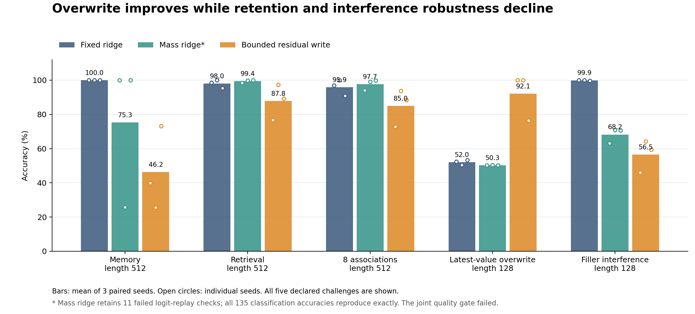

# HCSN task values, separate observation/flow, and memory mechanisms

**The implemented studies are complete. The finite FP64 time-flow contract
passes; stable task-value superiority, a uniquely financial shape benefit,
joint memory improvement, and equal-quality computation savings remain
unestablished. The strict memory replay audit retains 11 failed conditions.**

This campaign implements the five follow-up questions authorized on 2026-10-30.
The fixed baseline is `b1934022821f3fdafd509b43cf0c4d7d45852e6e`, from PR #4330.
All 1,025 historical `tools/hcsn` files remain byte-identical. The preceding
495 trainings and 148-run campaign, including their negative gates and
unexecuted conditional confirmation, are preserved.

[中文完整报告](RESULTS.zh-CN.md) · [delivery verifier](verify_campaign.py) ·
[recorded runtime](RUNTIME.json)

## Five acceptance decisions

| Question | Implemented intervention | Observed decision |
| --- | --- | --- |
| Does a neural decision boundary reflect task continuation value? | Shared frozen trained content; matched value, ordinary boundary and simple policies; a separately frozen repair with complete public state | Original value readout loses. Repaired value mean improves by 0.2088 utility, but its 95% interval includes zero. No stable superiority. |
| Are the time semantics coherent? | Observe once, then propagate without a fabricated observation; active/refractory mass and repeated event integrals | 28/28 checks pass for the specified finite FP64 process. No arbitrary nonlinear-flow or FP32 certificate. |
| Do financial function shapes add value? | FullHX, same-Call sigmoid and ordinary C1 templates, matched parameter graph, initialization and update opportunity | 0/8 prespecified superiority gates pass. Slopes are not matched, and no equivalence claim follows. |
| Can long retention, overwrite, capacity and interference improve together? | Bounded normalized residual writes versus unchanged fixed/mass ridge | Overwrite improves, but long retention, capacity and interference deteriorate. Joint quality gate fails. |
| Does dynamic control save actual computation at equal quality? | Real file/model READ, SKIP before access, terminal STOP; controller/setup costs included | Real actions are verified. Original value loses quality; repaired value is slower. No equal-quality speedup or energy result. |

## What ran and what did not become a unified model

The new work comprises **30 memory-model trainings**, **15 nonlinear controller
trainings**, **15 linear readout fitting tasks with 45 ridge candidates**, and
**5,000 actual heldout owner executions**. The two neural studies retain 540
candidate checkpoints. These are distinct units, not 60 backbone trainings or
5,000 independent training seeds.

| Module | Evidence and scope |
| --- | --- |
| [flow](flow/README.md) | New observation/gap interface, independent dense matrix exponential and Frechet references, content gradients and separate-process recovery. No content-task training result. |
| [memory](memory/RESULTS.md) | Thirty 6,217-parameter synthetic-task trainings, all 360 candidates, 30 selected models, 18,000 update records and 135 saved prediction conditions. This remains an event recurrence. |
| [control v1](control/README.md) | Frozen historical 6,217-parameter content decoder; 15 small linear readouts and 4,200 owner executions across seven policies and three prices. |
| [control v2](control_v2/README.md) | Prospective repair after v1's public-state omission: fifteen 2,852-parameter controllers, 180 candidates, development gate, then 800 fresh executions. |

The flow API, trained memory models and task controllers have separate declared
models and populations. Control reads the historical trained checkpoint; it
does not run a jointly trained composition of the new flow and delta memory.
Native Rust Hepta ownership, real multimodal corpora, GPU execution and energy
measurements were not part of these experiments. There is no new matched
Transformer/SNN comparison on these cohorts.

## Main outcomes

### Task values: preserve the failed trial and the prospective repair

Both trials use real inherited-content inference and shared public-information
permissions. Hidden labels and unread packet contents never enter a policy.
FIRE answers the current job and includes next-job continuation after reset and
one refractory tick. The reference DP is exact for its TRAIN-fitted finite
observation law, not a globally optimal coupled-neuron HJB/QVI.

| Trial, primary price multiplier 1.5 | Value utility | Ordinary boundary utility | Paired difference | Interval | Benefit gate |
| --- | ---: | ---: | ---: | --- | --- |
| v1, compact shared features | 0.26085 | 0.68655 | -0.42570 | Family-adjusted 95% [-0.61008, -0.24132] | FAIL |
| v2, complete public state | 0.79215 | 0.58335 | +0.20880 | 95% [-0.13532, +0.55292] | FAIL |

V1 omits the next job's public reliability/price schedule from the learned
features even though full FIRE value depends on it. Its exact DP and myopic
reference utilities are 1.18345 and 0.87415. V2 fixes the representation,
masks infeasible targets, gives all three families the same 84→32→4 network,
initialization, minibatches and 600 updates, and selects every checkpoint by
the same validation DP action regret. These changes form a new prospective
study; they are not a one-factor causal estimate of the omitted feature.

V2's development mean regrets are 0.025899 for full value and 0.030635 for the
ordinary boundary, below the frozen 0.05 mean / 0.08 every-seed limits. Only
after all 15 trainings and that gate pass are the new heldout sessions created.
The heldout paired seed differences are +0.23325, +0.49925, +0.44550, -0.15100
and +0.01700. They do not support a stable benefit at the specified uncertainty
threshold. Exact fitted-model DP reaches 1.23000 on this cohort.

V1 value/ordinary complete runtime means are 10.493/12.875 ms; value is quicker
while losing utility. V2 means are 13.16/9.80 ms; value is slower while its mean
utility is higher. Neither establishes equal-quality acceleration. V1 and v2
use different cohorts and model sizes; their raw means are not a paired
cross-version effect estimate. V2 does not re-evaluate v1's myopic policy.

### Memory: overwrite is a real local gain with substantial tradeoffs

The new write is

\[
\widetilde M=M+\frac{w}{10^{-4}+\|k\|^2}k(v-k^TM),\qquad
M^+=\Pi_{\text{column radius }8}(\widetilde M).
\]

For fixed key/value/write, the map is nonexpansive and bounds each memory
column. That fact does not bound learned-key gradients, prevent interference,
or make the projection seam globally smooth. All five trained arms have the
same parameter graph, initial bytes and update opportunity; their final
trained content weights and total computation are not shared or equal.

| FullHX memory mechanism | Memory512 | Retrieval512 | 8 associations512 | Latest overwrite128 | Noisy filler128 |
| --- | ---: | ---: | ---: | ---: | ---: |
| Fixed ridge | 100.00% | 97.98% | 95.90% | 52.02% | 99.87% |
| Mass ridge | 75.26% | 99.41% | 97.66% | 50.26% | 68.23% |
| Bounded residual write | 46.22% | 87.76% | 84.96% | 92.12% | 56.51% |



The ordinary C1 and same-Call sigmoid delta controls also reach 92.12% mean
overwrite accuracy. That gain is not unique to the financial template.
FullHX-minus-C1 or sigmoid has no positive result among the eight frozen
familywise comparisons. With only three paired seeds, the intervals are wide;
zero differences on ceiling tasks do not establish population equivalence.

### Numerical verdicts retain their precision and model boundaries

Flow's FP64 maximum probability L1 error is 2.4153e-13, repeated-event error
2.7542e-12, whole-state gap-composition error 3.2596e-13, and physical-parameter
AD/Frechet scaled error 5.1303e-11. Separate-process recovery matches exactly
under the same precision configuration. The API initializer defaults to FP32;
those accuracy claims do not transfer to default or mixed-precision recovery.
Eight active cells plus two Erlang phases retain spatial error and a random
refractory delay. A 40-unit gap gives expected repeated count 4.34719 and
next-event probability 0.979826; these are different quantities.

Memory's independent replay is **124/135 passing, 11 failing**, all failures in
the unchanged mass-ridge arm. Saved target labels and all 135 aggregate
accuracies match; this does not assert identical per-example predictions.
The maximum logit difference 0.00321531 still violates the frozen
1e-4 criterion. Each of the three delta arms and fixed ridge passes 27/27.

The worst exposed mass case is diagnosed independently: FP32 Gram/cross state
differences are approximately 1.49e-8/1.34e-7, with condition number 1171.
On identical matrices, JAX, NumPy and an 80-digit Decimal solver agree to
4.77e-13. Promoting the same saved-weight recurrence to FP64 reduces the
worst-batch independent logit difference to 3.62e-12. This explains that case's
rounding sensitivity; it neither replaces predictions nor certifies all eleven
failures. The original replay gate stays false.

## Costs and reproducibility

The memory completed-run scopes total 1280.685 CPU seconds; the measured CPU
lower bound including its audited/diagnostic/archive scopes is 1455.808 seconds.
Its complete campaign cost is unknown. The v1 study runner uses 84.503 CPU /
93.045 wall seconds. V2 uses 37.215 CPU / 37.242 wall seconds, or 38.852 wall
seconds with its separately measured source imports. Audits and publication
work are separate; parallel wall durations must not be added as elapsed time.
See [memory cost ledger](memory/cost_ledger.json), [v1 analysis](control/analysis.json)
and [v2 corrected accounting](control_v2/cost_accounting.json). V2 preserves the
original derived grid and separately corrects its omitted heldout-generation
setup cost; the measured runner already included that generation.

From the repository root, with the recorded Linux/Python 3.12 CPU environment
and dependencies (the resource-admission runners use Linux cgroup/affinity APIs):

```bash
python -m pip install -r tools/hcsn/task_flow_20261030/requirements.txt
python tools/hcsn/task_flow_20261030/control/restore_evidence.py
python tools/hcsn/task_flow_20261030/memory/restore_evidence.py
python tools/hcsn/task_flow_20261030/control_v2/restore_evidence.py
python tools/hcsn/task_flow_20261030/verify_campaign.py
```

The delivery verifier checks source and receipt identities; its success is
separate from the explicitly false scientific and memory replay verdicts.
The independent numerical/behavioral commands are:

```bash
OPENBLAS_NUM_THREADS=1 OMP_NUM_THREADS=1 MKL_NUM_THREADS=1 \
  python -m tools.hcsn.task_flow_20261030.flow.validate \
  --output /tmp/hcsn-flow-new-replay
OPENBLAS_NUM_THREADS=1 OMP_NUM_THREADS=1 MKL_NUM_THREADS=1 \
  python tools/hcsn/task_flow_20261030/control/audit.py
OPENBLAS_NUM_THREADS=1 OMP_NUM_THREADS=1 MKL_NUM_THREADS=1 \
  python tools/hcsn/task_flow_20261030/memory/audit.py
OPENBLAS_NUM_THREADS=1 OMP_NUM_THREADS=1 MKL_NUM_THREADS=1 \
  python tools/hcsn/task_flow_20261030/control_v2/audit_v2.py
OPENBLAS_NUM_THREADS=1 OMP_NUM_THREADS=1 MKL_NUM_THREADS=1 \
  python tools/hcsn/task_flow_20261030/control_v2/delivery_audit.py
```

Use a separate checkout/output directory to preserve the delivered receipts.
The flow output directory must not already exist. **Memory audit exit 1 is the
retained strict failure, not a command expected to turn green.** Replaying an
existing cohort does not create a new confirmation. Fresh training runners
refuse completed or mismatching outcomes; follow each module's frozen protocol
in a separate experiment copy.

## Review and integration boundary

Repository integration also changes three files outside this campaign.
`.github/blob-size-allowlist.txt` adds nine exact paths for immutable evidence
assets under the existing asset exception; the 512,000-byte limit is unchanged.
`.codespellrc` excludes two exact historical non-prose data fragments and accepts
the technical word `retuned`. The previously empty root `README.md` links to the
existing readiness guide, as required by the documentation verifier. These
changes preserve every historical HCSN byte and all frozen scientific gates.
The local blob-policy and codespell checks pass; full repository CI status is
reported by [PR #4367](https://github.com/TrillionniumFoundation/hepta-private-ci/pull/4367).

Implementation commits are split into coherent numerical API, references,
task owner, readouts, memory mechanism, runner, independent audit, numerical
diagnosis, repair and reporting stages. Handwritten logical stages stay below
500 lines. Generated snapshots, raw outcomes and archives are separately
identified evidence, not new handwritten algorithm complexity.

Independent cross-module review checked the continuation recursion, event
semantics, memory proof boundaries, public-information aliasing, checkpoint
selection and evidence interpretation. The repository-requested `just fmt`
attempt could not run because this task's sparse checkout lacks `codex-rs`
and its PATH lacks `just`/Rust; no Rust source changed. No production activation
or large-model superiority is implied by this research delivery.
