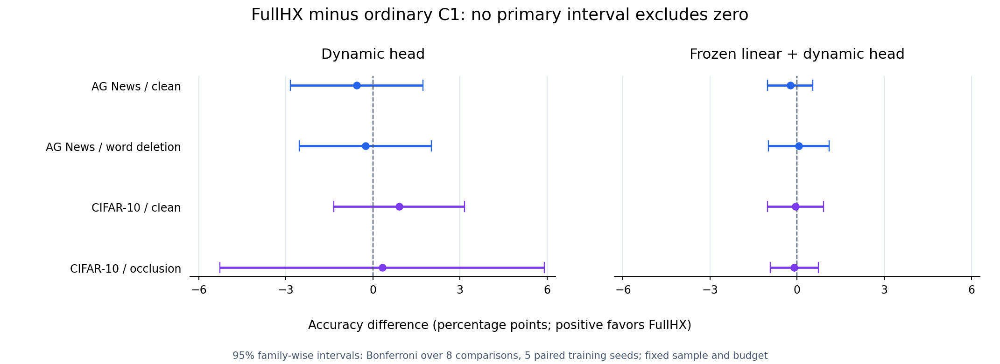

# 新样本冻结 encoder 对照：100 次训练

## 结论

本轮按预先冻结的协议完成 100 次训练及两个全局线性参考拟合：
2 数据集 × 2 结构 × 5 模型 × 5 配对种子。保存预测、权重、标签、
划分和冻结源的独立核验通过，重算 accuracy / cross entropy 的最大误差为零。
**两个结构的金融特异收益门槛均未通过**；八个主要比较的 Bonferroni
家族 95% 区间全部跨零。这里的执行成功与科学验收结果分别记录。

这是一组小型、静态、独立单模态探针。金融参数和编译表固定；神经投影、
边界坐标、时间常数、状态耦合和输出层参与学习。风险通道包含明确的新 C1
补片，Call 通道来自完整 A7 的有界归一化及数值插值。整套递推不具有原
金融停止问题的整体闭式解，也未实现任意金融参数的端到端学习。

## 已冻结的比较

- AG News 使用冻结 MiniLM，CIFAR-10 使用冻结 MobileNetV2。每个数据集有
  2000 个新训练、500 个新验证、1000 个新测试样本。
- 对全部既往 clean / corrupted 内容指纹去重，文本还排除旧 SST。实际
  排除的不同历史指纹数为 7299 / 4500；7000 个新 clean 样本内部无交叠。
  预训练语料交叠未审计。
- 每个输入保留 16 个局部特征和一个全局特征，PCA64 只拟合新 clean train。
  所有时间间隔为 1，因此这组实验不能证明异步时序建模能力。
- FullHX、same-Call sigmoid 和普通 C1 使用相同递推、参数叶、初始化、状态、
  minibatch 随机性及 300 次更新。后两者分别替换风险门、或两个固定门形。
  三组同图前向/梯度和普通 C1 拼接的数值验证在生成新样本前完成。
- 另含 GRU、小型 Transformer 和单独全局线性参考。神经参数目标约 6000，
  参数与更新数匹配；FLOPs 和状态量没有匹配。
- 第二种结构给每个模型添加同一份仅由训练集拟合、系数固定为 1 的线性
  logits 通路；没有按测试结果选择混合比例。
- 删词和遮挡发生在原始输入上，所有局部与全局特征完整重编码。

## 准确率

以下为五种子均值，单元格为 **干净 / 扰动**，单位为百分比。

| 数据与结构 | FullHX | 同 Call sigmoid | 普通 C1 | GRU | Transformer |
| --- | ---: | ---: | ---: | ---: | ---: |
| AG News，动态 Head | 86.86 / 86.10 | 87.50 / 86.40 | 87.42 / 86.36 | 87.68 / 87.20 | 86.64 / 85.56 |
| AG News，线性＋动态 | 88.02 / 87.16 | 87.86 / 87.12 | 88.26 / 87.10 | 88.08 / 86.96 | 86.74 / 86.34 |
| CIFAR-10，动态 Head | 78.22 / 40.64 | 77.62 / 40.34 | 77.32 / 40.32 | 77.98 / 40.74 | 77.74 / 36.72 |
| CIFAR-10，线性＋动态 | 80.12 / 38.80 | 80.28 / 38.88 | 80.18 / 38.90 | 80.24 / 38.86 | 79.64 / 37.78 |

全局线性参考只有 260 / 650 个参数，分别为 88.20 / 87.00 和 80.00 / 38.60。
它们说明冻结 encoder 已提供强语义表示；动态层的附加价值需要另行证明。

主要比较为 FullHX 减普通 C1，单位为百分点。区间是八项比较校正后的
家族 95% Student-t 区间，描述固定样本和预算下五个训练种子的随机性。



| 数据 | 结构 | 条件 | 均值差 | 校正区间 |
| --- | --- | --- | ---: | ---: |
| AG News | 动态 Head | 干净 | -0.56 | [-2.845, +1.725] |
| AG News | 动态 Head | 删词 | -0.26 | [-2.539, +2.019] |
| AG News | 线性＋动态 | 干净 | -0.24 | [-1.013, +0.533] |
| AG News | 线性＋动态 | 删词 | +0.06 | [-0.987, +1.107] |
| CIFAR-10 | 动态 Head | 干净 | +0.90 | [-1.351, +3.151] |
| CIFAR-10 | 动态 Head | 遮挡 | +0.32 | [-5.264, +5.904] |
| CIFAR-10 | 线性＋动态 | 干净 | -0.06 | [-1.024, +0.904] |
| CIFAR-10 | 线性＋动态 | 遮挡 | -0.10 | [-0.932, +0.732] |

CIFAR 动态 Head 的 +0.90 是待确认信号；它未通过校正区间，也未达到预定
至少 1 个百分点的幅度门槛。添加线性通路后，FullHX 的 CIFAR 干净得分
上升，但遮挡得分下降，不能概括成普遍鲁棒性提升。未检出优势不构成等价性
证明，也不能外推为所有 HCSN 设计都没有价值。

## 成本

100 次神经 Head run 累计 CPU 为 561.474 秒，累计墙时为 470.068 秒。
特征编码及 PCA 另用 123.808 秒墙时；两个线性参考的成本单列。
这些数值不包括全部研究开发、失败调试、启动与模型加载。

完整金融表的 FP64 源数值为 262256 字节，实际转换成 FP32 的表数值为
131128 字节。原 result 的 `fixed_operator_bytes` 字段指前者；
`audit.json` 明确区分二者。该数值不等于整个进程内存或编译可执行文件。
离线重建三次用时为 6.812 / 5.821 / 5.959 毫秒，与存量表逐项一致。

纯动态 FullHX 的 Head batch1 延迟均值约为 AG 0.124 毫秒、CIFAR 0.119 毫秒；
普通 C1 为 0.110 / 0.092 毫秒，GRU 为 0.053 / 0.043 毫秒。
原始输入到 logits 的暖运行中位数为 FullHX AG 18.715 毫秒、CIFAR 12.950 毫秒。
完整编码占主要时间。原始管线只测预定第一种子、12 个固定输入、共享 CPU，
加载和编译已完成；没有建立等质量成本前沿、GPU 吞吐或能耗优势。

## 复算与证据

执行脚本针对本次 Linux CPU 环境。依赖和冻结 encoder 下载过程沿用
`../../next/encoder/` 及 `../../encoder/`；数据与权重摘要均在 manifest。
从 `tools/hcsn` 运行：

```bash
python third/encoder/validate.py
python third/encoder/prepare.py all
python third/encoder/study.py all
python third/encoder/analyze.py
python third/encoder/audit.py
python third/encoder/runtime.py
```

`study.py` 拒绝重跑已完成的矩阵。重现实验时先在独立工作目录保留原始结果，
再创建新的运行输出；不得覆盖原证据。数值检查有各自环境耗时，不算新增训练。
`audit.py` 后加作独立只读证据检查，未参与模型选择或修改冻结训练源。

主要文件为 `protocol.json`、`freeze.json`、两个 `*_manifest.json`、
两个 `*_results.json`、`analysis.json`、`audit.json`、`runtime.json`。
`checkpoints/` 保留全部 100 个选中权重、对应 validation/test/corrupted logits，
以及两份全局线性权重。六个候选 checkpoint 的选择历史保存在每条 run；
本脚本只持久化最终选中的参数，不声称保存未选中的参数快照。

当前结论：冻结特征上的金融特异收益、等质量成本优势和完整 backbone
扩模门槛均未建立。浅层线性内容通路实验不能替代联合训练的混合 backbone。
