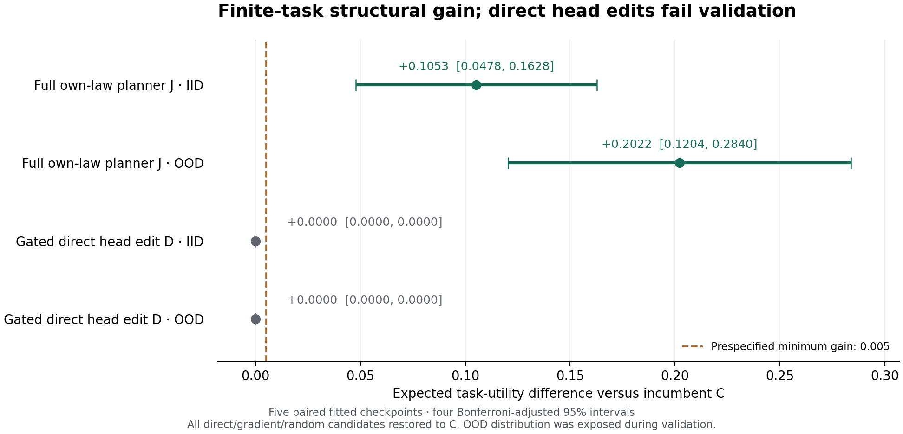

# Hepta Weight-Space Programming：完整价值规划有效，当前头部编译失败

本目录是研究 PR [#4790](https://github.com/TrillionniumFoundation/hepta-private-ci/pull/4790) 的独立后续包。旧目录 `wsp_20261104` 的 253 个文件保持不变。目录采用 UTC 日期；下文面向用户的观测时间采用 America/New_York。

**本轮得到一个限定任务内可复现的正结果：使用 checkpoint 自己的转移表、观测模型和完整 Bellman 递归执行策略，IID 与 OOD 期望任务价值均通过预先冻结的门槛。把同一策略目标编译回原来的 196 个神经输出参数时，直接求解和匹配梯度法均未通过验证。** 因此结构策略的收益没有记到权重编辑名下，也没有据此宣布实际 Trader、任意神经电路或完整连续权重空间已获得全局最优。

本轮同时补充了 pocket4 最新实际候选的源绑定审计、MIT Qwen 修改模型的短序列 cache/full-prefix 一致性执行，以及 Rust 原生硬范数预算与受约束头部求解器。完整科学协议、原始成功与失败记录、独立核验程序和复现命令随包保留。

## 1. 主要实验结果

使用五个既有 renewal checkpoint（fit 11、23、37、53、71），每个保留原来的 64 个 TRAIN world。新增验证集每域每 fit 16 个场景，新增 TEST 每域每 fit 32 个场景，共 160 个验证、320 个 TEST 场景。全部 480 个内容哈希互不重复，且与可取得的 1,936 个内容唯一的历史场景没有重复；内容唯一不证明统计独立，未知外部历史和未取得内容的原 formal-confirmation 不在保证范围内。

协议在 **11 月 4 日 19:34:40 EST**、任何新验证/测试评分前冻结。所有候选先于验证冻结，所有 gate 先于 TEST 冻结。原协议 SHA256 为 `735df99e3366a5d9343e1642a8c370b8d3359169bc70a98572476c6747a88251`。这是本地协议与源码冻结，不是外部预注册。

| 主要比较，相对既有 C | TEST 平均价值增量 | 四项比较的 familywise 95% 区间 | 预定收益门 |
| --- | ---: | --- | --- |
| 完整自身模型 Bellman 策略 J，IID | +0.1052767633 | [0.0477670749, 0.1627864517] | 通过 |
| 完整自身模型 Bellman 策略 J，OOD | +0.2021614690 | [0.1203594012, 0.2839635367] | 通过 |
| 验证后接受/恢复的直接编辑 D，IID | 0 | [0, 0] | 未通过 |
| 验证后接受/恢复的直接编辑 D，OOD | 0 | [0, 0] | 未通过 |

区间以 **5 个配对 fit** 为统计单位，使用 df=4 的 Student-t 与 Bonferroni 四项校正。两个域的下界都必须超过 0.005。320 个 TEST world 不能被当作 320 个独立训练模型来缩小区间。OOD 指相对原 TRAIN 的分布变化；验证已暴露该 OOD 分布，TEST 是该分布的新实例。



### 消融保留了负结果

| 策略 | 实际操作 | IID 价值 | OOD 价值 |
| --- | --- | ---: | ---: |
| A | 原 checkpoint | 0.224856086 | 0.108183409 |
| C | 原研究已发布的 continuation incumbent | 0.237007222 | 0.110282802 |
| P | C 加自身解析 terminal posterior | 0.238325152 | 0.131892905 |
| J | 自身 law 下完整 Bellman 决策 | **0.342283985** | **0.312444271** |
| D | 同时直接编译 147 个 Q 与 49 个 Belief 参数 | 0.188444332 | 0.062361353 |
| G | 同一目标、数据、起点、预算、精度的 PGD | 0.188446032 | 0.062791274 |
| DQ | 只直接编译 Q | 0.190206919 | 0.061990823 |
| DB | 只直接编译 Belief | 0.239730193 | 0.120802224 |
| R | 预定的范数匹配随机编辑 | 0.071049671 | 0.009910565 |
| D/G/R gate 后 | 全部恢复 C | 0.237007222 | 0.110282802 |

D、G、R 各五个候选全部未通过验证，恢复后的完整模型与 C 一致。表中未经 gate 的 D/G/R 仅供解释失败，不是可部署候选。P/DB 是次要消融，其描述性 fit-level 增量区间包含零，没有单独收益资格。

Continuation 的自身目标 MSE 从 0.0238500229 降至 0.0163374851，Belief-logit MSE 从 0.0277612196 降至 0.0193217276，但 D 在冻结评估 law 下的期望任务价值更差。IID 平均读数请求从 C 的 1.2842 增至 D 的 1.6764，费用从 0.136884 增至 0.162510；J 分别为 1.0232 和 0.100136。行为指标沿各策略自己的访问分布计算，不能当作完整同状态因果分解。

这定位到**本轮固定表示、固定预算、均方代理目标的策略编译失败**。它没有证明所有头部修改都不可能有效，也没有证明无限增加训练轮数能解决问题。完整结构策略、局部目标误差、量化后的可行性和最终任务价值必须分别验收。

## 2. 用了哪些数学结构

目标是第 6 时点潜变量的正负号；动作包括 STOP、WAIT、READ、REPAIR 与两个 SUBMIT。传感器修复不是潜变量重置，固定时点二分类不是 first-passage。当前 decoder 已由同一 Belief 生成互补 terminal reward，因此检查这条恒等式不算新修复。逐部位的实际映射与数学约束见 [MECHANISM_SCOPE.md](MECHANISM_SCOPE.md)。

J 只使用 checkpoint 已存储的转移表、坐标、prior 构造和 TRAIN-fitted 观测混淆矩阵，保留未完成观测、完成顺序、设备故障、费用与合法动作。它不从名义参数重新生成一个更理想的 law，不读取真环境 posterior 或 evaluator Q。真 law 只用于独立任务评价。该程序 teacher 提供神经编译目标，因此编辑属于程序监督蒸馏，仍需数据、特征和目标计算。

对原来的 85 维输入、48 维 tanh 隐层保持冻结；将 196 个输出参数分成 Q 与 Belief 两组，分别最小化加权目标 MSE 加 `1e-4` 的参数偏移正则，各受 `0.5 * ||C_group||` 半径约束。直接法求解凸二次子问题；PGD 使用相同目标、独立的 Frank-Wolfe 数值停止门。十个 fit/group 子问题在两种方法下均达到冻结的数值门，共二十个求解结果。KKT/Cholesky 是数值诊断；实际存储 F64 差值的组范数另用 Fraction 精确核对。

这些分别是局部凸参数最优性、声明模型的有限 Bellman 策略，以及冻结评估 law 下的期望任务价值三个层次。它们不能互相替代。权重重参数化、动作边际、统一 Q 误差与固定表示下参数范数的数学边界，见 [POLICY_COMPILATION_LIMITS.md](POLICY_COMPILATION_LIMITS.md)；这些推导没有新增实验资格。有关 MIT、Steer2Edit、CrispEdit 和最新 Hepta 研究的来源及适用范围，见 [RESEARCH_UPDATE.md](literature/RESEARCH_UPDATE.md)。

冻结实验完成后的最后一次来源检查还发现 [Hepta PR #4819](https://github.com/TrillionniumFoundation/hepta-private-ci/pull/4819) 的 continuation-only / entropic-control 工作。其设计、head 源码与 fixture 结果已按精确提交核读；它属于另一多模态任务，仍为 no-update，两个合成像素样例的工程结果没有转记为本研究收益。当前原生 Bellman 仅实现风险中性的可加费用有限 DAG；其分支费用可以表达显式枚举的风险中性费用/后继相关性，但随机相关费用的任务泛化不在本轮验收范围，也没有实现 entropic 联合费用风险递归或一般 NDU/FBSDE。来源观察时间和读取边界保留在 [SOURCE_REFRESH_FINAL.json](SOURCE_REFRESH_FINAL.json)。

### 新增 TRAIN 诊断：原预算内无法精确复制 J 的必要排序

在原科学实验完成后，另行冻结协议 `3d5a657a7f79a5edf1e98365256b898152e384ade4031231e24f03f8f9ecdfd5`，只诊断原 TRAIN，不生成或评分新的验证/TEST，也不保存新模型。生产端重建了全部 **144,397 个原 TRAIN 状态与 320 个 J 表**，H/Y/W 及逐表 SHA 与原记录全部一致；提取 J 选中 continuation、同时存在另一合法 continuation 的 **21,634 条零 margin 必要约束**。

令 `C_Q` 为 147 个原 continuation 参数，`δ` 为其改变，`R²=Σ C_Q²/4`，平方和按实存 F64 的精确值计算。复制 J 的指定动作必须满足 `Aδ ≥ b`；针对实际 F64 点积，再把右侧按整个参数球上的保守舍入误差向更容易可行的方向放松。任意非负证人 `y` 若满足

\[
d=y^Tb>0,\qquad d^2>R^2\|A^Ty\|_2^2,
\]

就与 `d ≤ (Aᵀy)ᵀδ ≤ R‖Aᵀy‖` 矛盾。生产端与另写的验证器均用 Fraction 精确检查，不把优化器状态当作证明。

| fit | 必要约束数 | 含 F64 放松的平方分离比，约值 | 独立证书 |
| --- | ---: | ---: | --- |
| 11 | 4,450 | 1.623935 | 通过 |
| 23 | 4,435 | 1.563267 | 通过 |
| 37 | 4,161 | 1.353668 | 通过 |
| 53 | 3,910 | 1.692281 | 通过 |
| 71 | 4,678 | 2.028128 | 通过 |

表中比值大于 1；真正的资格来自保留的精确分子/分母与严格不等式，非表内舍入数字。独立验证器还重新执行了全部 **21,458 个非零 dual 见证状态**的 hidden 与 own-Q，覆盖全部 320 TRAIN world，逐 hidden 字节及逐表身份一致。它核验全部重建摘要，但没有再次生成完整 144,397 行 H/Y/W，不能把见证重执行扩大成第二次完整特征重建。

用于找证人的五次 L-BFGS-B 都达到预定 **3,000 次迭代上限**，`solver_success=false`。 该 dual 数值搜索使用目标梯度，没有训练神经权重，因此不能把整个诊断称为完全无梯度。它们没有求得已收敛的最小距离解；证书只依赖最终非负 `y` 的精确分离，因此这不影响已验真的不可行结论。完整 pipeline 消耗 **422.017378 CPU 秒 / 422.568302 墙钟秒**，未达到 CPU/墙钟资源上限；生产与验证子阶段嵌套其中，不重复相加。

**可据此停止的是：在同一固定表示、以原 `C_Q` 为中心的同一参数预算球内，反复求解以逐行完整复制这些 J 动作。** 结论以声明的 binary64 round-to-nearest、gradual-underflow、单独乘法与有限加法执行语义为条件；它不证明任意硬件、不证明所有有益编辑都不存在，也不证明放大半径就能提升任务价值。Belief/terminal 约束被省略，是必要条件的放松。 这些约束来自完整 TRAIN 枚举，包含 off-policy 状态；证书没有给出实际访问分布上的收益损失下界。另一个 exact-alias 检查在五个 fit 中均未找到同 hidden bytes、同 legal mask 却要求不同 J 动作的冲突，不能据此宣布表示本身已被证明丢失信息。

根审阅者另行执行了完整库存及精确代数验收，五个证书再次通过，使用 13.134654 child CPU 秒；这次只读核验没有重新执行 hidden 或 Bellman，见 [ROOT_TRAIN_CERTIFICATE_VERIFICATION.json](ROOT_TRAIN_CERTIFICATE_VERIFICATION.json)。完整证书、负结果、数值搜索终态与复现入口在 [train_margin_certificate](train_margin_certificate/README.md)；推导见 [MATH.md](train_margin_certificate/MATH.md)。该诊断是 Python 研究工具，尚未作为通用证明器移植入 Rust，也没有增加新的 held-out 收益样本。

## 3. 计算成本：直接解更快，但目标构造占主导

首次正式实验完整 worker 用 **460.038810 CPU 秒、460.985993 墙钟秒**，峰值 RSS **197,607,424 字节**，包含导入、启动和最终落盘。正式单进程上限为 900 CPU 秒/1,200 墙钟秒，没有降低 fit 数或替换失败种子。

| 五个 fit 的成本范围 | 直接求解 D，CPU 秒 | 匹配 PGD G，CPU 秒 |
| --- | ---: | ---: |
| 求解器阶段 | 0.301806320 | 5.355101679 |
| 同一目标/特征/Gram/谱构造 + 自己求解 + 自己保存/回读 | 200.809890306 | 206.330770568 |

两列是把同一共享构造成本分别归属给 D 或 G 的单方法比较口径，不得相加为本次实验实际 CPU；它们也都嵌套于完整 worker 的测量范围。求解阶段比例为 17.74；计入相同构造成本后只有 **1.02749**。后者仍不含全部验证和进程启动，也不是两个独立完整进程、完整网络 Adam/SGD、实际训练服务或等质量成果的加速比。两种神经编译都没有获得任务价值收益，因此不能宣传“相同质量更快”。Agent token、完整环境准备、能耗与金额成本未完整计量。

J 的 320 个 TEST world 冷构造、残差审计、序列化、载入及身份绑定共 **66.206353918 CPU 秒**，平均约 0.206895 秒/world。表共有 123,080 个 Markov 状态，未压缩行内容 23,812,341 字节。模拟任务的费用没有给真实 CPU 定价；完整经济净值仍无资格。

独立重放、原生桥接、编译、失败与中止的成本分别保留，不用首轮计时替代，也不将嵌套计时重复相加。

## 4. pocket4：当前候选身份已核对，收益未获准

最终源快照为 **11 月 4 日 21:59:10.883 EST**，审计完成于 **21:59:16.280 EST**（UTC 11 月 5 日 02:59:16.280）。沿有效 systemd ExecStart、运行 MainPID 参数、实际 guardian 配置、声明状态根、登记任务输出与 manifest 逐层绑定，读取了真正登记候选的 adapter，末尾再查身份。候选、job、adapter、manifest 与配置哈希均与保留的 20:55 EST 快照相同，其 7 个文件保持不变；更早的 19:42 EST 身份链也保留。最初严格绑定曾因 systemd drop-in 覆盖 unit fragment 而拒绝；修正的是观察器，服务与配置均未修改。

| 项目 | 观测结果 |
| --- | --- |
| 活跃训练任务 | RUNNING 0；COMPLETED 114；FAILED 2 |
| 准入 | ADMITTED 0；pending 0 |
| 阶段 | CANDIDATE_READY_AWAITING_FORWARD_ADMISSION |
| 候选 ID | `8fe51f354c8a75001b0948c3588cab7d62dcb54c90f932f32e7bf9eb1505bf5a` |
| adapter SHA256 | `94a8a2275e92fa6343b5c2b662c3a440c3cc870f067d73e86bb1c0069b880ee0` |
| 实际权重 | 9,988 字节；6 个 F32 tensor；2,379 个参数；全部有限 |
| 当前主要阻塞 | quote freshness、source continuity、无 refresh authority 的 source quality hold、forward admission |

114 是完成任务数，不能当成累计 epoch。当前任务存在 per-parent optimizer reset 与独立 price/ACT 阶段。manifest 中 32 个 TRAIN 样本的 CE/Brier 小幅下降不构成独立质量或交易价值改善。本轮没有重哈希完整 base/readout，也没有把旧的 54 行 readout 失败实验转移到这个新 adapter。

训练/评估服务维持既有 6 GiB 限额、restart=0。最终直接观测的 MemAvailable 为 14,394,000 KiB，full memory PSI 的 avg10/60/300 均为 0；旧的急性 memory-pressure 原因不应作为这次快照的现因。执行服务的 restart 计数由 3,738 增至 3,863（增加 125），仍为 activating / auto-restart，本次 delta 没有读取新日志，不能声称其当前唯一拒绝原因已确定。较早的独立有界日志窗口记录了 25 次同类 catch-up invalid 事件；源码有六种可能分支，deployed binary 未绑定该源码且 ledger 未重放。详见 [末次差异记录](pocket4/session_end_snapshot/README.md)、保留的 [20:55 快照](pocket4/final_snapshot/README.md) 与 [先前审计](pocket4/README.md)。根端另行核验了新记录、绑定源码及旧 7 文件不变，见 [ROOT_SESSION_END_POCKET4_VERIFICATION.json](ROOT_SESSION_END_POCKET4_VERIFICATION.json)。公开包不含私有逐行训练数据、完整私有权重、账户/订单或主机操作路径。

## 5. MIT 方法的复现边界

MIT [Weight-Space Programming 原始报告](https://rikiyat.github.io/blog/weight-space-programming/) 与公开日志仍固定在 `4d09ba6d6a7e891dd8063974dfe81b3d78e3494f`。此前包保留了 768 个 MinAtar episode 的作者程序重放、Qwen 张量编辑核对和严格载入。它们不是重新让一个盲测 Astra Agent 独立发现原程序，也没有独立复现作者的完整 MATH/IFEval 能力提升。

最新检索还核对了 [Alan Turing Institute 名下的独立复现仓库](https://github.com/alan-turing-institute/weights_editing/tree/9b4a7f1b23a1cc2e1290e4c73ebcb77e87a285ca)。其已保存结果覆盖小网络识别和从零编写 MinAtar 网络，明确未复现 Qwen 编辑；不能把后者的提示/设计文件当成执行结果。此次只核读其文档与保存记录，没有重跑或合并为我们的实验样本。固定来源与范围见 [文献更新](literature/RESEARCH_UPDATE.md)。

本轮在 rog 对原 base 与 p50c 执行了 **36 次实际 CPU F32 forward**：每个模型一次 cache prefill、八次逐 token cache 增量、九次 full-prefix 参考；共有 18 次全词表比较、16 个追加 token。7–15 token 前缀下，有限值、greedy argmax、cache 长度及固定 `atol=rtol=0.001` 一致性全部通过。最大绝对 logits 差分别约 `1.24e-5` 与 `1.19e-5`，源导出和参数精确提升身份均保持。

所测 supervisor 窗口 CPU 与完整已等待子进程 CPU 合计 **35.756121194 秒**，窗口墙钟 **40.662795775 秒**，模型 worker 的最高观测 HWM 为 **5,740,130,304 字节**。Supervisor 自身的导入、参数处理、最终 receipt 写入和退出不在该窗口内；HWM 不是 supervisor 与 worker 并发 RSS 之和。此处明确原始计时范围，不修改冻结的程序或记录。执行是 BF16 权重精确提升后的 F32 CPU eager；不是作者 BF16/vLLM 配置。15 个 MTP tensor 没有进入这个语言模型路径。该资格只关闭短序列 cache/forward 工程问题，不提供长上下文、数学题、指令遵从、MTP 或通用能力增益。详见 [qwen_cache/README.md](qwen_cache/README.md)。

## 6. Rust 原生实现与验收

原生硬预算与受约束规划已提交 [HeptaRuntime PR #92](https://github.com/TrillionniumFoundation/hepta-runtime/pull/92)，精确源码提交 `e7a2688acc5504412d45160a08d2bf864be6b650`，叠加于 PR #91。

该实现为多输出加权头部编辑引入共享乘子的联合 Frobenius trust region，并独立验证实际 F32 写入的精确范数。有限 F32 差值是整数乘 `2^-149`，平方和可在有界整数累加器中精确比较 F64 半径平方；因此不靠放宽浮点容差让越界补丁通过。F64 数值解、F32 量化可行性、真正 forward 的任务/保留门与字节级恢复是分别执行的步骤。推导见 [NUMERIC_CONTRACT.md](native/NUMERIC_CONTRACT.md)。预算只覆盖本次补丁，不证明多次累计漂移或任意后续任务保持。

该提交的局部资格包含 all-features 和 no-default 各 52 个 focused weight 测试、严格 Clippy、构建、格式检查，以及真实 MCP 的 7 个规划、60 个范数和 4 个非法请求用例。60 个范数用例中，32 个预算内零收益候选拒绝并恢复，28 个越界候选在发布前拒绝。同一个公开 F32 head fixture 的两个半径用例在严格 TRAIN gate 下通过；它们是工程用例，不是两份独立输入或 TEST 策略收益证据。

精确提交的完整官方 [CI 41946487834](https://github.com/TrillionniumFoundation/hepta-runtime/actions/runs/41946487834) 第一次运行已通过：all-features **1,781 passed / 40 skipped**，no-default **1,761 passed / 28 skipped**；格式、两套 check/Clippy、安全回归、release 构建和 release 检查均通过。完整解码日志已独立回读并提取两项 summary，见 [PR92_OFFICIAL_CI.json](native/PR92_OFFICIAL_CI.json)。prospective-merge job 被条件跳过，未声称合并态也已验收；代码 CI 通过不改变任何模型收益结论。

完整 Bellman DAG 与 guard 持久恢复已提交 [HeptaRuntime PR #93](https://github.com/TrillionniumFoundation/hepta-runtime/pull/93)，提交 `990f85e46bedb8f49c0e6d0029ea6f9afbf6eac7`，叠加于 #92。根审阅者核对了 98 个变更 Git blob、父提交与 tree；14 个相关 Rust 源及 Cargo.lock 与执行资格记录一致。该精确提交的完整官方 [CI 41955092210](https://github.com/TrillionniumFoundation/hepta-runtime/actions/runs/41955092210) 第一次运行通过：all-features **1,804 passed / 41 skipped**，no-default **1,784 passed / 29 skipped**，全部 22 个实际步骤成功，包括两套 check/Clippy、安全回归、release 构建与检查。根审阅者另行回读完整日志核对了源码身份与 summary，见 [PR93_OFFICIAL_CI.json](native/PR93_OFFICIAL_CI.json)。prospective-merge job 按 push 条件跳过，没有合并态资格。

### 原生工具与语义边界

| MCP 接口 | 实际完成的工作 | 仍由调用方或独立验证承担的部分 |
| --- | --- | --- |
| `weight_bellman_plan` | 风险中性有限 DAG 上计算完整 Q、合法动作和 first-maximum 策略 | checkpoint 到图的语义绑定；真实环境 law；完整任务评价 |
| `weight_linear_ridge_plan` | 固定特征、多输出加权头的受约束数值解和 F32 修改建议 | 训练目标是否正确；固定表示是否足够；来源认证 |
| `weight_guarded_linear_patch` | 认证旧字节、精确预算、实际线性 forward、声明约束、接受或恢复 | 供应行是否独立 holdout；整个策略和未知环境的收益 |
| `weight_artifact_patch` / `weight_artifact_restore` | 独立候选 artifact 与反向补丁；完整父文件 SHA 验证 | 任意模型执行图解释；生产加载和执行授权 |

这些原生原语已经可以由 Agent 编排使用；本轮 checkpoint 语义识别和导图仍由固定 Python 研究代码完成，没有交付一个能理解任意模型内部电路的通用解释器。图规划、权重规划、执行验证与准入是独立阶段。

### 320 个世界的实际 MCP 桥接

同一个已资格二进制 `a576b51e3fcb3d3a657e9d723bf2a9bfa579a3f6912178ee6e71a14c4ccd9854` 执行了全部 320 个已评分 TEST world。导出完整 246,160 个 DAG node，包含 123,080 个 Markov key 的 canonical-value 与 representative-query 两层，保持原有沉没费用 F64 运算次序，未通过放宽近似平局规则改变策略。

冻结的独立验收程序逐项比较 **928,200 个合法 Q、全部合法动作 mask 和精确 action**。相对原自身模型参考和独立标量 DAG 递归，最大 Q 差均为 **0**；用实际 Rust Q 重执行全部 320 条期望轨迹，逐 world utility 最大差为 **0**。没有缺失 world、Python Q fallback 或新样本。原科学实验仍是唯一的任务收益确认。完整包及边界见 [native_bellman_replay/README.md](native_bellman_replay/README.md)，根只读库存/结果复核见 [ROOT_NATIVE_RECORD_VERIFICATION.json](ROOT_NATIVE_RECORD_VERIFICATION.json)。

三个不重叠的完整子进程阶段分别消耗：导图 **138.206351 CPU 秒**，实际 native MCP **37.789511 CPU 秒**，独立比较与 J 重执行 **52.947453 CPU 秒**，合计 **228.943315 CPU 秒**。这还不含 Rust 编译、传输、Agent 和能耗；不能与原 Python J 冷构造的 66.206354 秒直接组成等工作量加速比，更不能宣称端到端节省。

### 持久日志、恢复与软件资格

统一源码的局部 all-features / no-default focused 测试各为 **75 passed / 0 failed / 2 ignored**；严格 Clippy、构建与格式检查通过。两个 ignored 项是既有可选 head fixture 和由 crash tests 实际调用的子进程入口。**8 个不同 SIGKILL/restart/锁场景在两个 feature 配置下执行**，保留 16 条记录，不算 16 个独立科学样本。真实 MCP 的 11 次 journal 调用覆盖 fresh error、同请求失败重试、成功完成、完成后重新全量验证及 artifact 篡改拒绝；未修改的旧 trust 协议在此二进制上也通过。

日志在修改前持久记录 intent，普通 gate 失败发布反向补丁并验证完整父哈希。中断后的恢复需要显式重入同一请求；完成态重试也重新执行验证，不凭旧 accepted 标记返回成功。来源缺失、损坏或证据不足保持 false / unverified。断电、分布式恢复和生产模型指针切换仍未验收。

统一六命令本地资格消耗 **2,665.505785 child CPU 秒 / 1,486.703156 墙钟秒**，Bellman 与 journal 共享一次计量；旧 trust 兼容性与 journal MCP 另为 **13.027080** 和 **4.180270 CPU 秒**。首版 journal 曾因 fresh-error 契约审查而在编译期中止，零测试执行；原稿、部分记录及不可恢复的 CPU 未知值均保留。最终代码的通过没有抹去该次失败。根再次执行了两条 `--repo .` 只读验证命令，见 [ROOT_BELLMAN_RECORDS.json](native/ROOT_BELLMAN_RECORDS.json)。完整源、恢复与成本身份见 [QUALIFICATION.json](QUALIFICATION.json)。

## 7. 独立验收与复现入口

跨仓库的版本、命令、依赖和重新导图时的 handoff 身份区别，集中说明于 [REPRODUCE.md](REPRODUCE.md)。

首先运行包身份检查，再运行研究记录的独立数值验收：

```bash
python tools/hcsn/wsp_followup_20261105/verify_package.py
python tools/hcsn/wsp_followup_20261105/verify_native_records.py
cd tools/hcsn/wsp_followup_20261105/ndu_policy
python verify_records.py execution_r1/run PROTOCOL_FROZEN.json --history ../../wsp_20261104
```

以上命令验收存储证据，不会重新执行特征或策略。完整重放命令在 [ndu_policy/README.md](ndu_policy/README.md)：从固定原仓库提交取公开模型，按同一冻结协议执行，保持原种子、全部 fit、所有候选与资源上限。根审阅者已另行完成 [独立完整重放](independent_replay/README.md)，完整 worker 使用 467.784030 CPU 秒、470.209338 墙钟秒。这是另一进程对同一科学实现、同一批既有场景的完整重执行，不新增 holdout，也不构成独立实现或第二次统计确认。运行前冻结的 77 项比较全部通过：35 个模型、20 个场景文件、20 个轨迹文件、主要统计和 gate 精确 JSON 一致；只排除明确列出的资源计时字段，无数值容差。首次启动的目录调用错误在模型执行前失败，其 1.142841 CPU 秒与失败记录也单独保留。

阅读顺序可从本文件的结果表进入 [RESULTS.json](ndu_policy/execution_r1/run/RESULTS.json)、[PROTOCOL_FROZEN.json](ndu_policy/PROTOCOL_FROZEN.json)、完整候选/模型/轨迹及独立核验程序。`PAYLOAD_MANIFEST.json` 对所有已发布文件逐项绑定 SHA256 和长度。

## 8. 尚未闭合的范围

当前仍没有合格的纯权重任务价值提升、实际 Trader prospective 收益、完整 MIT Qwen 能力评测、任意模型内部电路自动理解、First-Passage/Reset/金融 Call-Put 的实际权重修复，或完整网络连续权重空间的全局最优保证。完整状态 law 与神经权重缺乏已验证映射时，编辑器应保持这一未知边界。

已有正结果支持把完整自身模型规划作为下一步候选执行结构，并研究保持动作边际、访问分布与价值的编译约束。它没有证明普通 MSE 蒸馏足够，也没有建立真实经济 CPU 成本后的优越性。失败候选不会因解析算子正确、代理 loss 下降或代码 CI 通过而被宣布成功。
